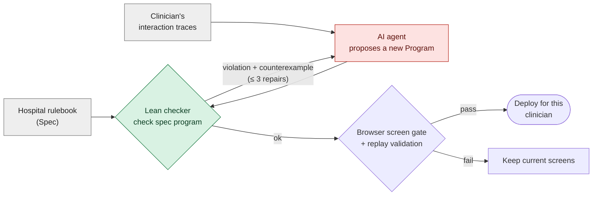
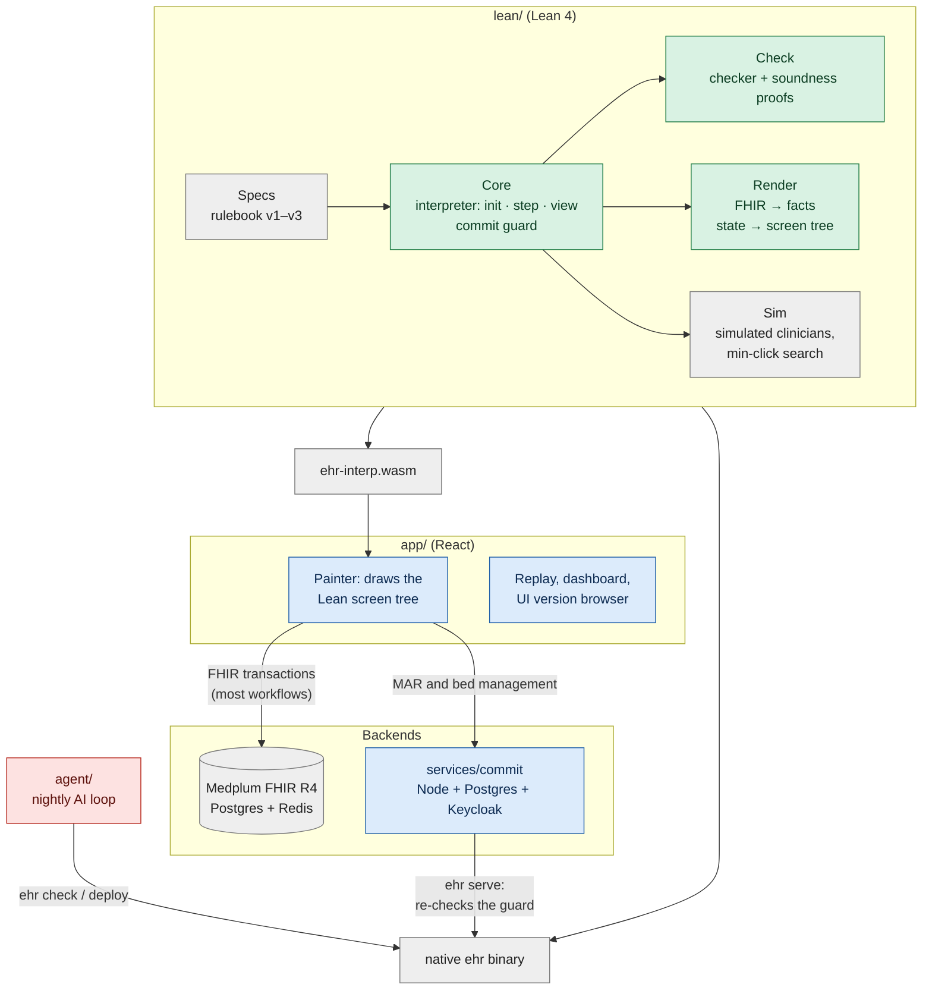
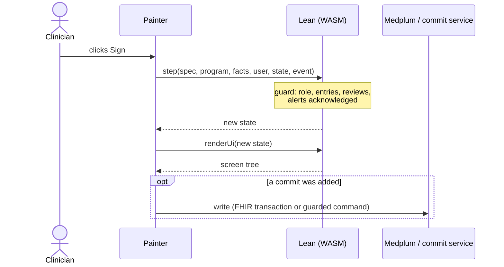

# VGI Health

A research system for clinical software that can safely change itself. It has
three parts:

1. **A realistic EHR simulator.** A hospital and clinic electronic health
   record (EHR) built on the conventions of the dominant commercial systems,
   Epic and Oracle Health (Cerner). It includes a patient banner and
   storyboard, in-basket, chart review, ED track board, MAR and flowsheets,
   order entry with preference lists, interruptive and passive alerts, and
   vendor releases that change the rules. It runs on synthetic FHIR patients.
   Simulated clinicians work through generated clinical days in it, so any
   change to the screens can be measured in clicks, scrolls and mouse travel.
2. **Lean proofs of what a clinician-facing interface must preserve.** The
   hospital's rules (law, regulators and hospital policy) are written in Lean,
   and a Lean interpreter runs every click. The theorems hold for every screen
   layout. Nothing is signed without its required entries, reviews and alert
   acknowledgments. The patient banner, required information and interruptive
   alerts stay on screen. Macros never act for a human.
3. **A way for an AI model to change the interface and stay within those
   proofs.** The model edits only the screens, never the rules. A Lean checker
   accepts or rejects each proposed layout and gives a counterexample when it
   rejects one. Only accepted layouts deploy, and the guarantees of part 2
   carry over to them.

Part 2 is what makes part 3 possible. Clinical software is normally locked
down because every change must be re-validated. Here the guarantees are proved
once for every accepted layout, so the screens can be reshaped for each
clinician without re-validating each version by hand. [What is
proved](#what-is-proved) lists what is covered and what is not. [Open
problems](#open-problems) describes the weakest parts: how users are simulated
and how the agent makes its changes.

The same Lean interpreter runs natively and in the browser as WebAssembly. The
project is not affiliated with Epic or Oracle.

| Primary care order entry | ED track board | Inpatient MAR |
|---|---|---|
|  |  |  |

## How the parts fit

Two things are kept apart:

- **The rulebook** (`Spec`, in Lean): what must be entered, reviewed and
  acknowledged before an action, and by whom. For example: "signing a
  medication order needs a dosing weight in kg entered by a human, the allergy
  list on screen, and every interruptive drug-allergy alert acknowledged".
- **The screens** (`Program`, JSON): one clinician's layout of screens,
  fields, tabs, buttons and macros.

The agent may only change the screens. Every proposed program goes through
`check`; only accepted programs are deployed. At run time every click goes
through `step`, which refuses a sign unless its guard holds, whatever the
layout.



## Architecture

One Lean code base is the single source of truth. It is compiled natively (the
`ehr` binary: checker, simulator, deploy, commit server) and, through
Lean → C → Emscripten, to WebAssembly that the browser runs. React only paints
the screen tree Lean returns; it holds no clinical logic.



Green: proved in Lean. Blue: tested. Grey: trusted. Red: untrusted by design.

**One click.** The painter sends an event to the WASM `step`. If the event is a
sign, the interpreter evaluates the commit guard first. The new state goes
through `renderUi`, which produces the screen tree (banner, required reviews,
enabled or disabled buttons with Lean's reason, modal or inline alerts). If a
commit happened, the app writes it: as one FHIR transaction to Medplum, or for
medication administration and bed management through the commit service, which
re-runs the guard on the server under row locks before a Postgres write.



| Directory | Contents |
|---|---|
| `lean/` | Rulebook, interpreter, checker, renderer, simulator and all proofs. |
| `app/` | React app: clinical painter, live and replay modes, dashboard. |
| `agent/` | Offline simulator-only tailoring sessions (`session*.ts`) and nightly loop: observe traces, prompt an LLM for JSON patches, check, gate, deploy. Also an offline harness (`proposal-quality`) that re-runs recorded nights to compare prompt variants; it never deploys. |
| `services/commit/` | Postgres commit authority for MAR and ADT, driven by the native Lean binary. |
| `wasm/` | Lean → C → Emscripten build. |
| `world/` | Generator of simulated clinical days (patients, tasks, schedules). |
| `conformance/` | 200 held-out rule scenarios run against every deployed revision. |
| `releases/` | Vendor releases v1–v3 (rulebook + reference screens). |
| `infra/` | Docker Compose for Medplum; setup and data loading. |
| `explore/` | Offline design-space research; never deploys. |

## What is proved

"Proved" means a Lean theorem checked by the kernel using only the standard
axioms (`propext`, `Classical.choice`, `Quot.sound`), with the statements
cross-checked by Lean's Comparator (`make verify`).

| Guarantee | Scope |
|---|---|
| No sign without its guard: required entries confirmed and human-entered where required, in the declared unit (lb never satisfies kg); reviews shown or covered by a valid receipt; interruptive alerts acknowledged; role allowed (`T0`, `T2`). | Every program, record and event sequence. |
| Macros and prefills never sign, acknowledge, create receipts or enter human-only values; a cosign names a second human (`T3`, `T6`). | Every program. |
| Alerts appear only when their condition holds; passive alerts never pop up (`A2`, `A4`). | Every program. |
| Checker acceptance implies 12 of 13 screen properties for every patient and reachable state (`accepted_*`). | Every accepted program. |
| Every required task stays completable (property 6). | Proved for restricted families only; open in general. |
| The screen tree keeps the patient banner, required review content, honest buttons and modal interruptive alerts (`D1`–`D6`). | Every program and record. |
| Bed assignments are exclusive; scheduled doses are given at most once; critical results are resolved or escalated by a deadline. | Lean reducers and multi-actor models. |

Not proved: that the rules are clinically complete; the React painter,
browser and FHIR mapping (tested); Medplum, Postgres and authentication
(integration-tested); the Lean compiler and Emscripten (trusted); the AI agent
(untrusted; only accepted programs deploy).

## What parts of a real EHR are replicated

The app models the clinician-facing workflows of a hospital and clinic EHR on
FHIR data. It is a research system on synthetic patients, not a deployable
product.

| Area | Replicated | Not replicated or simplified |
|---|---|---|
| **Workflows** | Seven end-to-end workflows: W1 adult clinic visit (rooming → history → exam → orders → sign → close), W2 results in-basket and patient messages, W3 emergency department (track board, triage, orders, disposition), W4 inpatient nursing (worklist, MAR, flowsheets, SBAR handoff), W5 pediatric visit (growth charts, vaccines), W6 surgery (consult, pre-op, operative note, post-op orders, OR schedule), W7 refill requests. | Pharmacy verification and dispensing, lab and radiology departments, scheduling engine, registration, billing and claims, patient portal. |
| **Roles** | Physician, nurse practitioner, RN, surgeon; charge nurse, bed manager and admitting clerk for bed management. Five personas: primary care, ED, inpatient RN, pediatric NP, surgeon. | Pharmacists, technicians, residents with supervision chains, schedulers. |
| **Chart** | Patient banner (name, DOB, MRN, allergies, code status, isolation, weight), storyboard sidebar, chart review tabs (encounters, notes, results, meds, problems, allergies, imaging), lab trends and flowsheets, WHO/CDC growth curves, chart search. | Imaging viewer (PACS), scanned media, outside-records exchange. |
| **Orders** | Medication order composer with preference lists, formulary dose units, kg dosing weight, route, frequency, PRN, dispense and refills, pharmacy, indication and diagnosis; lab, imaging and procedure orders; prior authorization (release v2); coded antibiotic indication (release v3). | Real e-prescribing transmission, pharmacy interventions. |
| **Safety checks** | Hard-stop sign guards; drug-allergy, interaction, duplicate-therapy, dose-range and high-alert alerts, interruptive (modal) or passive (inline); barcode patient and medication scan at administration; second-nurse cosign for high-alert drugs; patient-ID re-entry; review receipts that expire; critical-result escalation; California controlled-substance rules (CURES check, naloxone offer, Schedule II refills). | Real CURES/PDMP queries, barcode hardware, a full drug-knowledge base (a small formulary is built in). |
| **Documentation** | Visit and operative notes, nursing assessments, vaccine administration, consent, SBAR handoff, administration records. | Note templates, dictation. |
| **Bed management (ADT)** | Admit, assign, transfer, release, discharge and bed cleaning on a unit bed board, with exclusive beds and atomic transfers. | Enterprise patient flow, transport, multiple facilities. |
| **Regulatory updates** | Vendor releases v1 → v2 → v3 that add rules, migrated per clinician and re-certified. | Real vendor upgrade tooling. |
| **Data and storage** | FHIR R4 on Medplum: Patient, Encounter, Observation, Condition, AllergyIntolerance, MedicationRequest, MedicationAdministration, Immunization, DiagnosticReport, DocumentReference, ServiceRequest, Procedure, Consent, Appointment, Task, Communication, ChargeItem, Provenance. Postgres event streams with version checks and live updates for MAR and ADT. | HL7v2 interfaces, enterprise patient index, production audit logging, high availability. |
| **Identity** | Keycloak single sign-on (PKCE) for MAR and bed management; development password login elsewhere. | Production identity, break-the-glass access. |
| **Users** | Simulated clinicians with seeded behavior and interruptions, measured in clicks, scrolls and mouse travel. They plan the shortest path through the current screens. | Real clinicians; no user study. Visual search, learning, forgetting and relearning after a change (see [Open problems](#open-problems)). |

## Open problems

How users are simulated and how the agent changes the interface are the two
weakest parts.

- **Simulated clinicians already know the interface.** A simulated clinician
  takes its goals from the rulebook. It then plans the shortest path to them
  through the whole current layout, by breadth-first search over real
  interpreter steps (`lean/Ehr/Sim/Interaction.lean`). Seeded noise adds
  detours, backtracking, search, keyboard use and interruptions. Even so, the
  clinician never has to hunt for a control, never reaches for where a control
  used to be, and never makes the slips the rules exist to catch. A
  rearranged layout therefore costs nothing on its first day. Learning,
  relearning and discoverability are not measured. The stability budget (at
  most N components moved per version, checked in Lean) stands in for them.
- **The agent changes the interface on its own, in small greedy steps.** Each
  night it reads one clinician's traces and proposes 3–5 patches. It deploys
  the best passing patch, or a few that touch different components. It does
  not explore the wider design space: the quality-diversity search in
  `explore/` runs offline and never deploys. The clinician takes no part. They
  cannot ask for a change, try alternatives or turn one down in the clinical
  app, and a change arrives whenever the agent finds one. The separate
  simulator-only tailoring protocol below exercises an off-shift choice
  boundary; the nightly deployment loop does not yet call that boundary.

## Offline tailoring sessions (simulator only)

`agent/src/session.ts` prepares an off-shift, weekly or monthly review from a
`SessionArchive` of whole candidate bundles. It verifies the certificate's
program hash/spec, rechecks each candidate against the current program and
canonical reference (including the current stability budget), removes duplicate
layouts, and selects 2–3 options by farthest-first diversity over component
changes and locations. Fewer than two eligible, replay-complete options leaves
the current layout in place by failing preparation; no option is invented or
deployed. `phase: "offShift"` is required. Cadence is review metadata here;
the archive/release lane remains responsible for scheduling and release gates.

Evidence reuses `EhrClient.simulate` on the same clinician's supplied recent
schedules, world and paired seeds for current versus each option. Future days,
foreign schedules and incomplete/mismatched task replays are rejected. Totals
report clicks, keystrokes and scrolls saved, with negative savings retained.
`layoutChanges` expands composites and records additions, removals, edits and
old→new screen, parent, tab and list position. Relearning is an explicitly
unvalidated simulator heuristic: 0.5 minutes per moved component plus 0.25 per
other component change. It is not a measured learning or clinical time benefit.
These replays still use the existing simulator's knowledge of the whole layout.

`SessionChooser` accepts the prepared record and returns one option ID or
`null` (keep current), a reason and optional per-option reasons. The temporary
`seededSessionChooser` keeps seeded preference weights private in a closure,
compares savings against estimated relearning, and can reject every option.
It is the adapter boundary for the bounded-knowledge user-model lane, not a
human study. `answerSession` validates the choice and exports winner-versus-each
alternative comparisons, including current, program hashes and change features;
it infers no ranking among rejected options. `chosenSessionBundle` returns the
whole selected bundle for a later cadence gate. None of these functions deploys
or edits a program. The AI remains the author of every candidate.

`agent/src/session-schema.ts` reexports the shared review wire schema from
`app/src/browser/session-schema.ts` (inside the review-only hash boundary).
It defines optional typed friction entries alongside interaction
entries in `SessionTraceEntry`: `slowHere` or a bounded free-text `wish`, with
clinician, program hash, day, task, time, screen and optional component. They
are feedback metadata, not Lean interpreter events. `flagFriction` appends the
annotation without an interpreter call or clinical-state mutation;
`traceFriction` extracts it. `sessionGeneratorInput` scopes flags and recorded
pairwise comparisons to this clinician and past days, and marks wishes/reasons
as untrusted data. A generator passes this result as the optional
`NightlyContext.tailoring` prompt input. Existing nightly callers are unchanged.
There is no in-app flag control; a future control would enqueue this annotation
without interrupting work or changing screens during a shift.

`recordSession` writes one immutable JSON record to `runs/sessions/<id>.json`
(options, full programs/certificates, recent schedules and simulated traces,
evidence, choice/reasons and comparisons). These files are gitignored data.
The offline harness runs without an LLM or deployment:

```sh
TMPDIR=/home/saithat/Projects/run-tmp \
EHR_BIN=/home/saithat/Projects/VGI-Health/lean/.lake/build/bin/ehr \
pnpm --filter agent exec tsx src/session-cli.ts /absolute/path/to/session-input.json
```

The input shape is `inputSchema` in `agent/src/session-cli.ts`: current and
canonical programs, persona, nonempty recent schedules, world directory,
archive candidates with certificates, session metadata, seed and optional flags.
Use absolute input/world paths; output defaults to this repo's `runs/`. The
harness always uses the simulated chooser. Fake backend evidence is permitted
only in tests and certifies nothing.

Open `/browse?session=/runs/sessions/<id>.json` for the desktop review. Current
and candidate layouts appear side by side for the same selectable recent case,
with independently scrubbed recorded event sequences and highlighted targets
in a component layout map. This map shows recorded screen/order/target, not
clinical values or a full clinical painter replay. Savings, old→new locations,
heuristic relearning, flags, the choice and reasons are shown explicitly. The
page is read-only, simulator-only, and covered at 1440×900. App changes stay
inside `app/src/browser`; the certified clinical app hash is unchanged.

Validation for this module uses the fake backend and no LLM calls:

```sh
TMPDIR=/home/saithat/Projects/run-tmp pnpm --filter agent exec vitest run test/session.test.ts
TMPDIR=/home/saithat/Projects/run-tmp pnpm --filter app build
TMPDIR=/home/saithat/Projects/run-tmp pnpm --filter app exec playwright test --config src/browser/session-playwright.config.ts
```

## Data sources

- **Synthea** (Apache-2.0) synthetic patients. Walonoski J, et al. *Synthea.*
  JAMIA 2018;25(3):230–238.
- **Synthetic Hospital** (code MIT; data fully synthetic and redistributable)
  longitudinal records. Park, Chen, Dettmers, preprint 2026,
  https://arxiv.org/abs/2609.30027.
- **Medplum** (Apache-2.0) FHIR backend.
- CPT is a trademark of the AMA; only a few code identifiers with original
  short labels are included.
- Fonts: Noto Sans, Noto Sans Mono and Noto Sans Symbols 2 (SIL OFL 1.1).
