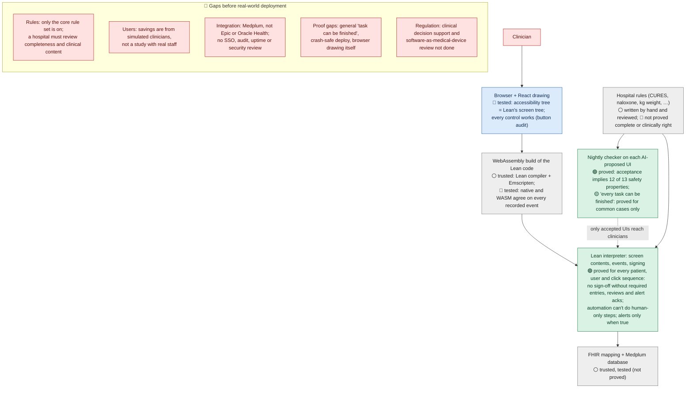
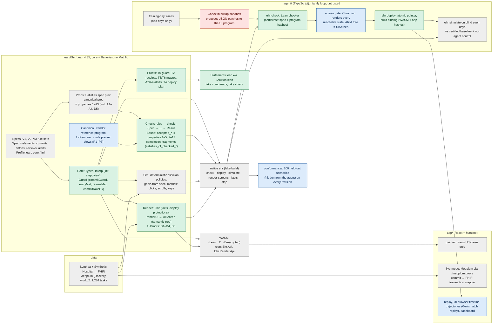

# VGI Health

An EHR whose screens adapt to each clinician's work. An overnight (whenever the user is logged in since people have night shifts :) ) AI agent
proposes UI changes; the Lean checker blocks changes that violate the hospital
rules. The same Lean interpreter runs natively and in the browser as WebAssembly.

## Read the Lean

Start with these files, in order:

1. [Statements.lean](lean/Statements.lean): the main theorem statements and trusted definitions.
2. [Props/Properties.lean](lean/Ehr/Props/Properties.lean): the thirteen UI requirements.
3. [Specs/V1.lean](lean/Ehr/Specs/V1.lean): hospital rules, with law and policy labels.
4. [Core/Interp.lean](lean/Ehr/Core/Interp.lean): the interpreter the app runs.
5. [Check/Sound.lean](lean/Ehr/Check/Sound.lean): what checker acceptance proves.
6. [Render/UiProofs.lean](lean/Ehr/Render/UiProofs.lean): how the EHR tree preserves controls and information.

## What the Lean code does

Lean is both the programming language and the proof language here. The code
implements the EHR, describes its rules, and proves selected guarantees about
its behavior.

As counted on 2026-11-01, the repository has **245 Lean source files and
42,927 lines**, including comments and blank lines. The default build imports
184 of those files, containing **693 named theorem declarations** and 59
additional unnamed proof examples. These counts exclude dependencies and build
outputs. The source is distributed approximately as follows:

| Part | Lines | What it does |
|---|---:|---|
| [Data projection and screen rendering](lean/Ehr/Render/) | 9,700 | Reads FHIR records, constructs chart rows and screen trees, and proves selected content-preservation guarantees. |
| [Hospital rule definitions](lean/Ehr/Specs/) | 7,700 | Defines required fields, reviews, permissions, alerts, units and regulatory/policy requirements. |
| [Interface checker and its proofs](lean/Ehr/Check/) | 7,100 | Examines proposed screen programs and connects acceptance to the specified properties. |
| [Reference interfaces](lean/Ehr/Canonical/) | 5,500 | Defines the starting visit, medication, results, pediatric and surgical workflows that the AI can adapt. |
| [Execution engine](lean/Ehr/Core/) | 4,100 | Handles entering values, navigating, reviewing, acknowledging alerts and signing; maintains the interaction state. |
| [Simulation and search](lean/Ehr/Sim/) | 3,200 | Runs simulated clinicians, measures interactions and computes certified minima within defined search spaces. |
| [Property definitions](lean/Ehr/Props/) and [central proofs](lean/Ehr/Proofs/) | 2,900 | Defines precisely what the guarantees mean and proves guard, receipt, automation and alert behavior. Other proofs also live in the sections above. |
| Supporting code | 2,700 | APIs, command-line tools, examples, exports and proof audits. |

For example, when **signing a medication order**, the rule definitions specify
the required entries, reviews and acknowledgments. The execution engine checks
those requirements when the user clicks Sign. Before deployment, the interface
checker examines whether an AI redesign retains the required structure and
protections. The proofs establish claims such as "a successful sign passed its
guard" and "a macro cannot supply a human-only action." The rendering code
constructs the fields, review panels and enabled or disabled button. Simulation
exercises the workflow and measures interaction costs.

The **693 named theorems include many supporting lemmas and concrete examples**.
A small theorem may establish that a value survives navigation, a lookup finds
the right requirement, a macro preserves acknowledgments, or a required row
appears in the output. Larger theorems assemble these results into guarantees
about complete actions or accepted programs. This is not a count of 693
independent clinical safety rules.

There are **13 main checker properties**. Checker acceptance generally implies
12; the remaining property, workflow completion, is proved for restricted
families, with the general case open. There are also separate rendering and
execution guarantees. These proofs concern the executable EHR engine; the
following sections explain their scope and the surrounding tested or trusted
code.

## What is proved, and what is not

**Proved** means a Lean theorem, kernel-checked, using only `propext`,
`Classical.choice` and `Quot.sound` (no `sorry`, no `native_decide`).
**Checked** means a test or a per-program check, not a theorem.

**Legend:** 🟢 proved in Lean · 🟡 proved for part of the cases · 🔵 checked by tests or a per-program check · ⚪ trusted (outside the proofs) · 🔴 not proved or not assumed.

| Claim | Status | Where |
|---|---|---|
| Nothing is signed unless the guard passes: required entries confirmed (human-entered where required, in the declared unit), reviews shown or validly receipted, interruptive alerts acknowledged, role allowed for this encounter | 🟢 **Proved**, for every program, record and event sequence | `Proofs/T0.lean`, `Proofs/T2.lean` (`T0_commit_needs_guard`, `commitGuard_iff`, `T0_entry_values`, `T2_receipts_sound`) |
| Macros and prefills can't sign, acknowledge, create receipts or enter human-only values; a high-alert cosign names a different human | 🟢 **Proved** | `Proofs/T3.lean`, `Proofs/T6.lean`, `T3_cosign_distinct` |
| Alerts: popups only for true conditions, never for passive alerts, acknowledgments persist | 🟢 **Proved** (A2, A4 for every run; A1, A3 via checker acceptance) | `Proofs/Alerts.lean`; `Check/AlertSound.lean`, `Check/SeveritySound.lean` |
| A program is deployed only if the checker accepts it, with a certificate naming that spec and program | 🟢 **Proved** (the plan; not crash-atomic file writes) | `Proofs/CheckDeploy.lean` (T4) |
| Checker acceptance implies properties 1–5 and 7–13 for every patient record and every reachable state | 🟢 **Proved** | `Check/*Sound.lean` (`accepted_*`) |
| Checker acceptance implies property 6, "every required task can be completed" | 🟡 **Proved for defined fragments only** (scalar fields, fixed order lines, receipts, many alerts, macros/prefills); general case **open** | `Check/Sound.lean`, `Check/ScalarCompletion.lean`, `Check/FixedLineCompletion.lean` |
| The screen tree keeps the patient banner, required reviews, honest buttons, modal vs inline alerts, labeled fields (D1–D4, D6) | 🟢 **Proved**, for the semantic screen tree | `Render/UiProofs.lean` |
| Navigation is sane (D5) | 🔵 **Checked** per program (overview, not the clickable tree) | `Check/NavigationSound.lean` |
| Known-bad UIs are rejected | 🟢 **Proved** for 3 small programs and the completion counterexample; 🔵 **checked** (native checker) for all 23 | `Check/TinyRejections.lean`, `Check/DoseCompletionObstruction.lean` |
| The browser's accessibility tree equals Lean's screen tree; every control works | 🔵 **Checked** (browser tests, button audit) | `app/e2e/` |
| Each rule is enforced in realistic workflows on every deployed revision | 🔵 **Checked** (200 held-out scenarios, hidden from the agent; 0 failures) | `conformance/` |
| The React drawing, FHIR mapping/Medplum writes, Lean compiler and Emscripten | ⚪ **Trusted**, not proved | — |
| The hospital rules are complete and clinically right | 🔴 **Not proved**: the rules are a reviewed spec (core profile; catalog rules switched off) | `Specs/` |
| The simulated clinicians and workload numbers reflect real people | 🔴 **Not proved**: deterministic Lean policies; clicks, scrolls and straight-line mouse travel at 1440×900 | `Sim/` |
| The AI agent is correct or honest | 🔴 **Not assumed**: it is untrusted; only checker-accepted programs deploy | `agent/` |

## Assurance by layer, and gaps to deployment

Each layer of the stack, from the clinician to the database, by the strongest
evidence that covers it. A theorem quantifies over all patients, users and
event sequences, but covers only the definitions in its statement; the layers
around the interpreter rest on tests or on trusted components.



Green: Lean theorem. Blue: tests or per-program checks, covering only what was
executed. Grey: trusted components (compilers, runtime, database). Red: not
covered. The agent sits outside the trusted base: deployment requires checker
acceptance, and the interpreter's guard applies regardless of the deployed UI.

## Architecture

One Lean code base is the single source of truth. It is compiled twice: to a
native `ehr` binary (checker, simulator, deploy) and, through Lean → C →
Emscripten, to WebAssembly that the browser runs. React only draws the
semantic screen tree Lean returns; it holds no clinical logic.



Colors match the table: green proved in Lean, blue checked, grey trusted, red untrusted.

**One event, end to end.** A click in the browser calls the WASM `step` (the
same `Interp.step` the proofs are about). If the event is a commit, the
interpreter first evaluates `commitGuard`; T0 proves no commit is added
without it. The new state goes through `renderUi`, whose D-theorems guarantee
the banner, required reviews, honest buttons and alert modality in the
`UiScreen` tree; the painter draws that tree, and a browser test checks the
accessibility tree equals it. In live mode, a committed state is mapped to one
FHIR transaction and sent to Medplum.

**One night, end to end.** The agent sees only training days and the rules
(generated capabilities manual), proposes patches, and merges compatible ones
into one candidate program. The native checker must accept it (properties
1–13; T4 ties deploy to acceptance), every reachable screen must pass the
browser gate, and validation must not lose task completion. Only then is the
candidate deployed for that clinician's next login; it is measured on blind
days against the certified baseline and a no-agent control.

[VERIFICATION.md](docs/VERIFICATION.md) records the proof scope, trusted code and
open gaps. Checker implications cover 12 of 13 properties; general completion
still requires a separate proof. Current releases use the **core** rule profile.
Browser drawing, record adapters and clinical rule completeness are outside
these proofs. Allowed proof axioms are propext, Quot.sound and Classical.choice.

## Run it

Install Node 22.18+, pnpm 11.8.0, [elan](https://github.com/leanprover/elan),
a C toolchain, and Docker with Compose and a running daemon.

```sh
git clone https://github.com/saithat/VGI-Health.git
cd VGI-Health
make install && make run
```

Open **http://localhost:5173/**. Installation starts Medplum, loads synthetic
patients, seeds worklists and creates a private `.env`. If another checkout
already uses the named Medplum stack, copy its `.env` locally first to preserve
the shared credentials. No AI API key is needed for local work or replay.

The **Demo / replay** link opens the offline catalog. In the dashboard,
**Trajectories** replays any recorded task on the real EHR in a fixed-size
player (fullscreen, moving cursor, click and scroll animation), and
**Compare** plays two runs of the same workflow side by side (for example the
baseline vs. the latest revision), with click, scroll and mouse-travel deltas
and the agent's changes linked to the moments they matter. Compare links are
bookmarkable, e.g. `/dashboard?view=compare&run=run1-P3&persona=P3&workflow=W4`.

For the offline catalog alone,
use `pnpm install && make run`. The dashboard includes the recorded `run1-P3`
trajectory; its archived replay preserves the recorded clinical events.
Use `make run APP_PORT=5187` if the default port is occupied.

See [DEMO](docs/DEMO.md). A clean-clone test (`scripts/clean-clone-test.sh`) clones
local HEAD, installs and serves it offline. `make wasm-check` checks the committed
WASM source binding; `make wasm` rebuilds it using the local toolchain.

The trusted system includes the reviewed hospital spec, Lean and Emscripten,
FHIR adapters, Node/React/browser, Docker/Medplum and the synthetic source data.
These software proofs do not establish clinical correctness.

## Data sources and credits

CPT: the mapper includes a small set of code identifiers and original short
labels, without a full catalog or AMA descriptors. CPT is an AMA trademark;
see the [AMA licensing requirements](https://www.ama-assn.org/practice-management/cpt/cpt-licensing-faqs).

- **Synthea**: synthetic patients, conditions, medications, labs and encounters
  (fixtures/synthea), loaded into Medplum. Synthea is Apache-2.0 licensed: Walonoski J,
  et al. *Synthea: An approach, method, and software mechanism for generating
  synthetic patients and the synthetic electronic health care record.* JAMIA 2018;
  25(3):230–238. https://github.com/synthetichealth/synthea
- **Synthetic Hospital** (Park, Chen, Dettmers): we import its released synthetic
  longitudinal records for chart realism. These are patient profiles with allergies,
  home medications, history and social history, plus encounters with full clinical
  notes. Code is MIT licensed; the released data is "fully synthetic and
  redistributable". Cite: Park, Chen, Dettmers. *Synthetic Hospital: An Open,
  Verifiable, Physician-Validated Longitudinal EHR Benchmark.* Preprint, 2026.
  https://arxiv.org/abs/2609.30027 · https://github.com/sparkcpark/synthetic_hospital
  Pinned source: `911f34c4ac65a508543c4b3b90c373a0cd16534d`.
  We converted and loaded **150 patients, 637 encounters/notes, 4,383 resources**
  into local Medplum; primary persona selections are 30 each for P1–P5,
  including 34 pediatric patients. The committed FHIR cohort is 6.68 MB,
  uncompressed, with source tags and per-patient Provenance. Opt in with
  `make seed SYNTHETIC_HOSPITAL=1` (also supported by `make install`), or run
  `make load-synthetic-hospital`. Mapping, checksums and limitations:
  [import guide](scripts/synthetic-hospital/README.md). The upstream CITATION.cff
  supplies citation details. Its Epic-style simulator informed chart organization;
  no code or screens were copied.
- **Medplum** (Apache-2.0): FHIR R4 backend. https://github.com/medplum/medplum
- EHR screen patterns follow public documentation and screenshots of real EHRs
  (sources in docs/design/ehr-ui-research.md). No proprietary vendor screens
  were copied.

## Malleable software

[Ink & Switch's Malleable Software](https://www.inkandswitch.com/essay/malleable-software/)
describes software people can shape to their needs. Each clinician has a role
view that the agent can revise within the hospital rules. Readable diffs and
version history expose the changes; certification gates deployment.
