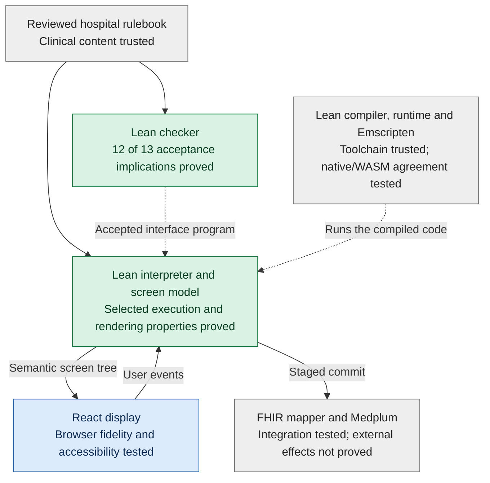
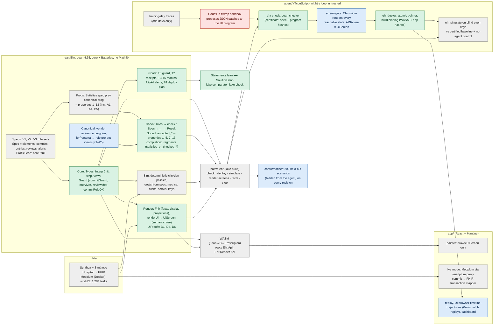
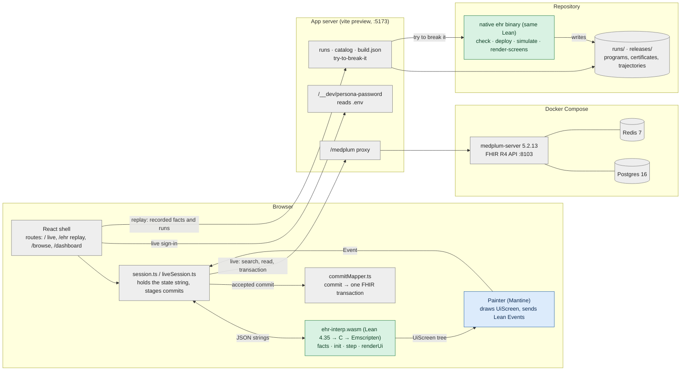
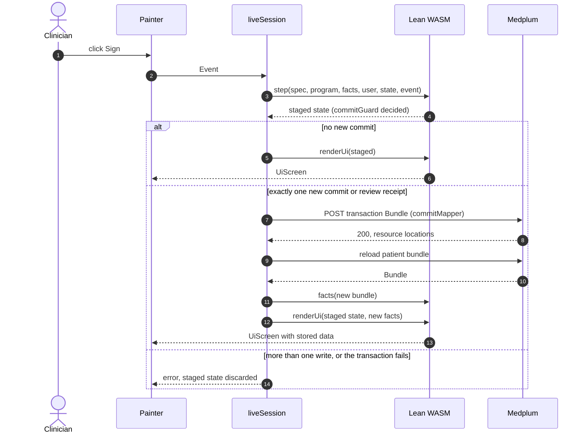

# VGI Health

An EHR whose screens adapt to each clinician's work. An overnight (whenever the user is logged in since people have night shifts :) ) AI agent
proposes UI changes; the Lean checker blocks changes that violate the hospital
rules. The same Lean interpreter runs natively and in the browser as WebAssembly.

## How it works

The hospital defines the clinical obligations. The AI proposes how to arrange
the interface around them: navigation, grouping, density and permitted
shortcuts. Every proposed interface goes through the same checker and runs
through the same interpreter.

### A proposed change must pass before deployment


The agent supplies proposals; the existing proofs justify specific guarantees
from checker acceptance. A new interface reuses those proofs. For example, a
shortcut may reduce navigation while retaining a required allergy review;
hiding that review at signing fails the check when the rule requires it shown.
Repair attempts are bounded; a failed proposal is not published.

### Every clinical commit is checked again during use


Interface approval leaves the runtime guard in force: a receipt can expire or
a required value can still be missing. In live mode, the app stages a permitted
commit and accepts the committed state only after its FHIR transaction succeeds.
The save, rollback and refresh paths are integration-tested; replay never writes
to Medplum. Preventing an invalid commit is separate from proving that a task
can always be completed. General completion remains open.

## Read the Lean

Start with these files, in order:

1. [Statements.lean](lean/Statements.lean): the main theorem statements and trusted definitions.
   Its `sorry` bodies are deliberate: it is the Comparator challenge file. `lake comparator` checks that
   [Solution.lean](lean/Solution.lean), which imports the proofs in `Ehr/Proofs/`, proves exactly these
   statements ([comparator.json](lean/comparator.json)) using only `propext`, `Quot.sound` and `Classical.choice`.
2. [Props/Properties.lean](lean/Ehr/Props/Properties.lean): the thirteen UI requirements.
3. [Specs/V1.lean](lean/Ehr/Specs/V1.lean): hospital rules, with law and policy labels.
4. [Core/Interp.lean](lean/Ehr/Core/Interp.lean): the interpreter the app runs.
5. [Check/Sound.lean](lean/Ehr/Check/Sound.lean): what checker acceptance proves.
6. [Render/UiProofs.lean](lean/Ehr/Render/UiProofs.lean): how the EHR tree preserves controls and information.

## What the Lean code does

Lean is both the programming language and the proof language here. The code
implements the EHR, describes its rules, and proves selected guarantees about
its behavior.

As counted on 2026-11-01, the repository has **245 Lean source files and
42,927 lines**, including comments and blank lines. The default build imports
184 of those files, containing **693 named theorem declarations** and 59
additional unnamed proof examples. These counts exclude dependencies and build
outputs. The source is distributed approximately as follows:

| Part | Lines | What it does |
|---|---:|---|
| [Data projection and screen rendering](lean/Ehr/Render/) | 9,700 | Reads FHIR records, constructs chart rows and screen trees, and proves selected content-preservation guarantees. |
| [Hospital rule definitions](lean/Ehr/Specs/) | 7,700 | Defines required fields, reviews, permissions, alerts, units and regulatory/policy requirements. |
| [Interface checker and its proofs](lean/Ehr/Check/) | 7,100 | Examines proposed screen programs and connects acceptance to the specified properties. |
| [Reference interfaces](lean/Ehr/Canonical/) | 5,500 | Defines the starting visit, medication, results, pediatric and surgical workflows that the AI can adapt. |
| [Execution engine](lean/Ehr/Core/) | 4,100 | Handles entering values, navigating, reviewing, acknowledging alerts and signing; maintains the interaction state. |
| [Simulation and search](lean/Ehr/Sim/) | 3,200 | Runs simulated clinicians, measures interactions and computes certified minima within defined search spaces. |
| [Property definitions](lean/Ehr/Props/) and [central proofs](lean/Ehr/Proofs/) | 2,900 | Defines precisely what the guarantees mean and proves guard, receipt, automation and alert behavior. Other proofs also live in the sections above. |
| Supporting code | 2,700 | APIs, command-line tools, examples, exports and proof audits. |

For example, when **signing a medication order**, the rule definitions specify
the required entries, reviews and acknowledgments. The execution engine checks
those requirements when the user clicks Sign. Before deployment, the interface
checker examines whether an AI redesign retains the required structure and
protections. The proofs establish claims such as "a successful sign passed its
guard" and "a macro cannot supply a human-only action." The rendering code
constructs the fields, review panels and enabled or disabled button. Simulation
exercises the workflow and measures interaction costs.

The **693 named theorems include many supporting lemmas and concrete examples**.
A small theorem may establish that a value survives navigation, a lookup finds
the right requirement, a macro preserves acknowledgments, or a required row
appears in the output. Larger theorems assemble these results into guarantees
about complete actions or accepted programs. This is not a count of 693
independent clinical safety rules.

There are **13 main checker properties**. Checker acceptance generally implies
12; the remaining property, workflow completion, is proved for restricted
families, with the general case open. There are also separate rendering and
execution guarantees. These proofs concern the executable EHR engine; the
following sections explain their scope and the surrounding tested or trusted
code.

## What is proved, and what is not

**Proved** means a Lean theorem, kernel-checked, using only `propext`,
`Classical.choice` and `Quot.sound` (no `sorry`, no `native_decide`).
**Checked** means a test or a per-program check, not a theorem.

**Legend:** 🟢 proved in Lean · 🟡 proved for part of the cases · 🔵 checked by tests or a per-program check · ⚪ trusted (outside the proofs) · 🔴 not proved or not assumed.

| Claim | Status | Where |
|---|---|---|
| Nothing is signed unless the guard passes: required entries confirmed (human-entered where required, in the declared unit), reviews shown or validly receipted, interruptive alerts acknowledged, role allowed for this encounter | 🟢 **Proved**, for every program, record and event sequence | `Proofs/T0.lean`, `Proofs/T2.lean` (`T0_commit_needs_guard`, `commitGuard_iff`, `T0_entry_values`, `T2_receipts_sound`) |
| Macros and prefills can't sign, acknowledge, create receipts or enter human-only values; a high-alert cosign names a different human | 🟢 **Proved** | `Proofs/T3.lean`, `Proofs/T6.lean`, `T3_cosign_distinct` |
| Alerts: popups only for true conditions, never for passive alerts, acknowledgments persist | 🟢 **Proved** (A2, A4 for every run; A1, A3 via checker acceptance) | `Proofs/Alerts.lean`; `Check/AlertSound.lean`, `Check/SeveritySound.lean` |
| A program is deployed only if the checker accepts it, with a certificate naming that spec and program | 🟢 **Proved** (the plan; not crash-atomic file writes) | `Proofs/CheckDeploy.lean` (T4) |
| Checker acceptance implies properties 1–5 and 7–13 for every patient record and every reachable state | 🟢 **Proved** | `Check/*Sound.lean` (`accepted_*`) |
| Checker acceptance implies property 6, "every required task can be completed" | 🟡 **Proved for defined fragments only** (scalar fields, fixed order lines, receipts, many alerts, macros/prefills); general case **open** | `Check/Sound.lean`, `Check/ScalarCompletion.lean`, `Check/FixedLineCompletion.lean` |
| The screen tree keeps the patient banner, required reviews, honest buttons, modal vs inline alerts, labeled fields (D1–D4, D6) | 🟢 **Proved**, for the semantic screen tree | `Render/UiProofs.lean` |
| Navigation is sane (D5) | 🔵 **Checked** per program (overview, not the clickable tree) | `Check/NavigationSound.lean` |
| Known-bad UIs are rejected | 🟢 **Proved** for 3 small programs and the completion counterexample; 🔵 **checked** (native checker) for all 23 | `Check/TinyRejections.lean`, `Check/DoseCompletionObstruction.lean` |
| The browser's accessibility tree equals Lean's screen tree; every control works | 🔵 **Checked** (browser tests, button audit) | `app/e2e/` |
| Each rule is enforced in realistic workflows on every deployed revision | 🔵 **Checked** (200 held-out scenarios, hidden from the agent; 0 failures) | `conformance/` |
| The React drawing, FHIR mapping/Medplum writes, Lean compiler and Emscripten | ⚪ **Trusted**, not proved | — |
| The hospital rules are complete and clinically right | 🔴 **Not proved**: the rules are a reviewed spec (core profile; catalog rules switched off) | `Specs/` |
| The simulated clinicians and workload numbers reflect real people | 🔴 **Not proved**: deterministic Lean policies; clicks, scrolls and straight-line mouse travel at 1440×900 | `Sim/` |
| The AI agent is correct or honest | 🔴 **Not assumed**: it is untrusted; only checker-accepted programs deploy | `agent/` |

## Assurance by layer, and gaps to deployment

Theorems cover the inputs and definitions in their statements. The diagram
separates proved properties of the Lean code from the surrounding tests and
trusted components; it does not mark any whole layer as completely verified.



Green identifies specified properties proved in Lean. Blue identifies tests
and per-program checks, covering what was executed. Grey identifies trusted
content or components, which may also have tests. The dashboard and UI browser
are React/TypeScript; their surrounding interface is tested, not proved in Lean.

The remaining deployment gaps include:

- Clinical review of the active core rule set; much of the full catalog is off.
- Evaluation with real clinical staff; reported savings use simulated clinicians.
- Production integration, authentication, audit, availability and security review.
- General task completion, crash-safe publication and end-to-end browser proofs.
- Review of applicable clinical decision support and medical software requirements.

## Architecture

One Lean code base is the single source of truth. It is compiled twice: to a
native `ehr` binary (checker, simulator, deploy) and, through Lean → C →
Emscripten, to WebAssembly that the browser runs. React only draws the
semantic screen tree Lean returns; it holds no clinical logic.

<details>
<summary>Detailed module architecture</summary>



Colors match the table: green proved in Lean, blue checked, grey trusted, red untrusted.

</details>

**One event, end to end.** A click in the browser calls the WASM `step` (the
same `Interp.step` the proofs are about). If the event is a commit, the
interpreter first evaluates `commitGuard`; T0 proves no commit is added
without it. The new state goes through `renderUi`, whose D-theorems guarantee
the banner, required reviews, honest buttons and alert modality in the
`UiScreen` tree; the painter draws that tree, and a browser test checks the
accessibility tree equals it. In live mode, a committed state is mapped to one
FHIR transaction and sent to Medplum.

**One night, end to end.** The agent sees only training days and the rules
(generated capabilities manual), proposes patches, and merges compatible ones
into one candidate program. The native checker must accept it (properties
1–13; T4 ties deploy to acceptance), every reachable screen must pass the
browser gate, and validation must not lose task completion. Only then is the
candidate deployed for that clinician's next login; it is measured on blind
days against the certified baseline and a no-agent control.

[VERIFICATION.md](docs/VERIFICATION.md) records the proof scope, trusted code and
open gaps. Checker implications cover 12 of 13 properties; general completion
still requires a separate proof. Current releases use the **core** rule profile.
Browser drawing, record adapters and clinical rule completeness are outside
these proofs. Allowed proof axioms are propext, Quot.sound and Classical.choice.

## Frontend and backend

The stack has no application server with business logic of its own. The
screen logic runs in the browser as the Lean interpreter compiled to
WebAssembly. Medplum is the only backend, and it stores FHIR resources. The
React app does two jobs: it moves JSON between the two, and it draws the tree
that Lean returns.



Colors as above: green is Lean that the proofs are about, blue is checked by the
browser screen gate, grey is trusted.

A save in live mode (the app at `/`, signed in against Medplum; replay mode never writes):



The `alt`/`else` box lists the three possible outcomes of one click: a screen-only change, exactly one
saved write, or a refused or failed write (nothing is saved and the screen keeps its prior state).

### Lean in the browser

- **Build.** `make wasm` runs `lake build <root>:c` for the API roots
  (`Ehr.Api`, `Ehr.Render.Api`). It compiles the emitted C, together with the
  pinned Lean 4.35 runtime, using Emscripten 6.0.13. It then patches the
  module initializers so that only the runtime half of `Init`/`Std` starts.
  The result is `app/public/ehr/ehr-interp.wasm` (~3 MB) plus a loader.
- **Exports.** `wasm/interp-bridge.cpp` exposes one entry point,
  `ehr_call_string(name, json) → json`. The names are the Lean `@[export]`
  functions `ehr_facts`, `ehr_init_envelope`, `ehr_step_envelope`,
  `ehr_view_envelope`, `ehr_render` and `ehr_render_ui`.
- **Stateless calls.** Every call takes the spec, program, facts and user as
  JSON, plus the state and event where needed. `app/src/core/session.ts`
  stores the state string between calls but never reads it.
- **Shared types.** The TypeScript types for these payloads are generated
  from the Lean types by `lake exe gents` (`lean/generated/ehr-types.ts`).
  Changing a Lean constructor therefore breaks the TypeScript build until the
  painter handles it.
- **Staleness check.** `manifest.json` stores a hash of every Lean source.
  `make wasm-check` fails when the WASM is older than the Lean;
  `make install` and `make run` both run it. The same hash goes into the
  loader URL (`interp-loader.mjs?v=<hash>`), so a browser cannot keep a
  stale interpreter from its cache.

### One screen, step by step

1. **Facts.** `ehr_facts` takes a FHIR Bundle and a context (user, role,
   clinical date). It returns the Lean `Facts` that the guards read and the
   display rows that the screens show (`Render/Fhir.lean`). The TypeScript
   code fetches and forwards FHIR; it does no clinical interpretation.
2. **Render.** `init` gives a state. `renderUi(spec, program, facts, user,
   state)` turns it into a `UiScreen`: a tree of semantic nodes such as the
   banner, alerts, result grids, order composers, worklists and navigators
   (13 presentation kinds). A disabled control carries the reason Lean gives
   for it.
3. **Paint.** `app/src/ehr/ui` draws the tree with Mantine, through an
   exhaustive switch over the generated node union. The painter holds no
   clinical state. Each input sends a Lean `Event` with a typed `Value`:
   text, code, flag, user, or a number with tenths and a unit.
4. **Step.** The event goes to `step`, then the new state goes back to
   `renderUi`.

The screen gate (below) checks that the painted accessibility tree equals
the `UiScreen`. That check is what connects step 3 to the D-theorems about
step 2.

### Live mode (`/`, against Medplum)

- **Transport.** All FHIR calls go to the same-origin path `/medplum`, which
  Vite proxies to the Medplum API on `:8103`.
- **Sign-in.** Each persona button signs in as a seeded Practitioner,
  using Medplum's password login from the browser (`data/medplum.ts`). The
  password comes from the same-origin `/__dev/persona-password` endpoint,
  which reads `.env`, so no credential is in the built assets. The
  practitioner id and role become Lean's `user`.
- **Landing lists.** The Schedule, In Basket, worklists and patient lookup
  are Medplum searches (Appointment, Encounter, Task, Communication,
  ServiceRequest) for the seeded clinical date (2026‑11‑02; `?date=`
  overrides it). They go through `ehr_facts` in directory mode.
- **Opening a chart.** Patients are selected inside the Lean screen. Opening
  a row sends a `workspace.open` event. The app then loads that patient's
  bundle (`loadPatientBundle`) and projects the facts again. It also checks
  that the projected patient is the selected one before it updates the state.
- **Writes: Lean decides, TypeScript stores.** Each event is first stepped
  into a *staged* state:
  - If the staged state adds no commit or review receipt, the app accepts it
    locally.
  - If it adds exactly one, `data/commitMapper.ts` maps the captured values
    to one FHIR `transaction` Bundle (MedicationRequest, Observation,
    DocumentReference, Condition, Immunization, MedicationAdministration,
    ChargeItem, Encounter updates, …). Medplum applies the bundle atomically,
    and the app accepts the staged state only after it succeeds. It then
    fetches the chart again and projects new facts, so the next screen
    reflects stored data.
  - If a step adds more than one write, the app rejects it, so nothing is
    partly saved.
  - If the transaction succeeds but the refetch fails, the app reports
    "Saved" and asks the user to reopen the chart. It never reports a
    retryable failure for data that was already stored.
- **Not proved.** The commit mapper is tested, not proved, so it is part of
  the trusted surface.
- **Client-side guard.** The commit guard runs in the client. Medplum
  accepts any write that the signed-in user's access policy allows. Running
  the same Lean guard on the server (as a proxy or Medplum Bot) is not done;
  see gap G3.

### Replay mode (`/ehr`, `/browse`, `/dashboard`)

Replay mode does not use Medplum. It loads the facts recorded for each task,
and Vite plugins in `app/scripts/` serve the artifacts:

| Plugin | Serves |
|---|---|
| `runs-plugin` | `/runs/index.json`, `/runs/default.json`, and run files, with ETags and compression |
| `catalog-plugin` | `/catalog.json`: releases, persona revisions, certificates |
| `build-binding-plugin` | `/build.json`: SHA-256 of everything that can change a certified screen (see below) |
| `try-break-plugin` | `/__dev/try-to-break-it`: runs the native `ehr check` on a pasted program |

- **Build binding.** Each published run records the `appSha256` and
  `wasmSha256` it was checked against. The app refuses to replay it on a
  different build, because a different painter or interpreter could draw
  something other than what was checked. After a rebuild, `make rebind
  RUN=<id>` re-validates the run and binds it again. It fails if any
  certification input has changed.
  `appSha256` covers everything that can change a certified screen, and nothing
  machine-specific: the source text of first-party modules outside the review
  tools (`src/dashboard`, `src/browser`), the emitted code of third-party
  rendering libraries (React, Mantine, …), and `pnpm-lock.yaml`,
  `vite.config.ts` and `index.html`. `.env` values and the clone path do not
  enter it. As a result, a fresh clone builds the exact app the recorded runs are
  bound to, and every recorded replay plays without re-certification. Editing the
  dashboard leaves certificates valid. Editing the painter, session, data
  adapters, styles or dependencies invalidates them. The interpreter is bound
  separately by `wasmSha256`.
- **Trajectories.** These are event sequences recorded by the native
  simulator. Playback runs them through the browser WASM.
  `scripts/trajectories/index.mjs` also replays every trajectory through the
  WASM build in Node and records the first divergent event, if any. This is
  the native-versus-WASM differential test.

### Backend and data

- **Services.** `infra/docker-compose.yml` runs Postgres 16, Redis 7,
  `medplum-server` 5.2.13 (API on `:8103`) and `medplum-app` 5.2.13 (admin
  UI). Medplum runs no custom code: there are no Bots or subscriptions.
- **`make install`** does the following, in order:
  1. builds the Lean;
  2. installs the pnpm workspace;
  3. checks the WASM;
  4. starts the stack;
  5. creates the project and practitioners (`setup`);
  6. loads the Synthea and Synthetic Hospital patients (`load`);
  7. seeds the world/2 clinical days (`seed`): appointments, tasks,
     messages and orders.
- **The `ehr` binary** (`lean/.lake/build/bin/ehr`) is the same Lean
  compiled natively. These offline tools use it:
  - the agent: `check`, `deploy`, `simulate`, `min-clicks`;
  - the screen gate: `render-screens` exports every reachable state, then
    Playwright loads each one in the built app and compares the
    accessibility tree with the `UiScreen`;
  - the held-out conformance suite;
  - trajectory recording.

<!-- results:start -->
## Results (`core-10day-live`)

The five-persona run (`runs/core-10day-live/`) completed all **10 of 10 days** and 9 nights. Day 1 runs every persona on v0. From day 2 on, each simulated clinician works on the latest certified revision of their fork, and a **no-agent control** (v0, which receives the same vendor releases) runs the same tasks. The v2 vendor release arrives on day 4 and v3 on day 7. Totals below count only tasks that both arms completed (11 task-days excluded).

| Persona | Revision now | Clicks, days 2–10: agent vs control | Scrolls | Mouse travel |
|---|---|---|---|---|
| P1 Primary care physician | v5 | 6264 vs 7099 (−12%) | 7412 vs 8466 (−12%) | −6% |
| P2 ED physician | v7 | 10234 vs 11160 (−8%) | 19359 vs 20996 (−8%) | −20% |
| P3 Inpatient RN | v4 | 5285 vs 5398 (−2%) | 5636 vs 6166 (−9%) | −2% |
| P4 Pediatric NP | v8 | 5122 vs 5134 (±0%) | 5694 vs 6626 (−14%) | −4% |
| P5 General surgeon | v4 | 4192 vs 4312 (−3%) | 7139 vs 7314 (−2%) | −1% |

- 28 of 45 persona-nights deployed a new revision; 17 kept the current one (9 because validation found the candidate made the replayed work worse).
- The Lean checker rejected 1 of 125 agent-written candidates. P2 night 8: "Show the signing-screen anticoagulant panel only for pre-op encounters." violated `reviewsBeforeCommit` (anticoagulantList is not shown on screen w3Sign when signOrders is clicked). The counterexample was a three-click path to signing without the list on screen.
- The nightly planted candidate (allergy list moved into a tab) landed on screens where no commit requires the allergy review, so the checker correctly accepted it (35 times, 0 rejected) and the other planted kinds never ran. Evidence that the checker rejects unsafe UIs comes from the known-bad suite and the proofs listed above, plus the rejection above.
- 1273 of 1284 simulated tasks completed. 4 failed in both arms (P1 v4, P5 v2), so the cause is in the task or the simulated user, not the revision. 7 failed only on the agent's revision (P1 v5). P1's v5 is the night-6 migration to the v3 release, which requires a coded antibiotic indication. On W1 visits from day 7, the simulated physician fills the free-text indication, reaches order signing and stops, because the coded per-line picker added by the migration is never filled. The control completes these tasks on the vendor's v3 screens. The migration's validation replayed day 5, before v3, so it did not exercise the new requirement. Completion is gated by validation, not proved (see the table above).
- Held-out rule conformance (200 scenarios the agent never sees; report-only): 3497 passed, 15 failed, 3088 not applicable, across 33 revisions. Failures: `v2.prior-auth.imaging` on P1 v3, P1 v4, P1 v5, P5 v2: the agent chose not to surface the optional v2 prior-auth controls, which left no reachable way to complete a prior-auth imaging order; `v2.prior-auth.procedure` on P1 v3, P1 v4, P1 v5, P5 v2: the same hidden prior-auth controls left no way to complete a prior-auth procedure order; `entry.signNote.claimDiagnosis` on P2 v1, P2 v2, P2 v3, P2 v4, P2 v5, P2 v6, P2 v7: night 1 moved diagnosis entry beside the provider note, and the claim diagnosis is no longer confirmed from the visit diagnosis (a billing rule the checker's properties do not express).
- Native vs. browser WASM: 72636 recorded events over 1284 trajectories replayed through both, with 0 mismatches.
- The run stopped once after day 7, when the agent process hit Node's default heap limit. Days 8–10 were resumed from the run-start commit, with every resume fingerprint matching (app, agent, gate, world, `ehr`).
- These are simulated clinicians with deterministic policies, not user studies (see gap G2).
<!-- results:end -->

## Run it

Install Node 22.18+, pnpm 11.8.0, [elan](https://github.com/leanprover/elan),
a C toolchain, and Docker with Compose and a running daemon.

```sh
git clone https://github.com/saithat/VGI-Health.git
cd VGI-Health
git archive hackathon-final runs fixtures programs verdicts.json | tar -x   # data, see Data
make install && make run
```

Open **http://localhost:5173/**. Installation starts Medplum, loads synthetic
patients, seeds worklists and creates a private `.env`. If another checkout
already uses the named Medplum stack, copy its `.env` locally first to preserve
the shared credentials. No AI API key is needed for local work or replay.

The **Demo / replay** link opens the offline catalog. In the dashboard,
**Trajectories** replays any recorded task on the real EHR in a fixed-size
player (fullscreen, moving cursor, click and scroll animation), and
**Compare** plays two runs of the same workflow side by side (for example the
baseline vs. the latest revision), with click, scroll and mouse-travel deltas
and the agent's changes linked to the moments they matter. Compare links are
bookmarkable, e.g.
`/dashboard?view=compare&run=core-10day-live&persona=P1&workflow=W1&left=d01-P1-W1-001&right=d03-P1-W1-001&comparison=cross-day`
(primary care clinic visit, baseline day 1 vs. revision 2 on day 3).

For the offline catalog alone,
use `pnpm install && make run`. The dashboard opens the newest complete run (`core-10day-live`); the earlier
single-persona `run1-P3` (inpatient RN, 10 days) is also included.
Use `make run APP_PORT=5187` if the default port is occupied.

A run writes into `runs/<id>/` as it goes. `pnpm publish-partial --run <id>
--into <id>-live [--watch]` publishes the completed days and nights to a
separate snapshot. That snapshot holds the replay, the trajectory index with its
native-vs-WASM check, and the complexity data. The publisher only reads the
running source. Once the writer has stopped, `--in-place` finalizes the run
itself. Both modes need `TMPDIR` on the same filesystem as `runs/`, because
publication is an atomic rename.

Runs are written to `runs/`, which is not tracked (see Data).

The [hackathon archive](docs/hackathon/) preserves the brief, [judge demo](docs/hackathon/DEMO.md), recordings,
implementation journals and one-off measurements. A clean-clone test (`scripts/clean-clone-test.sh`) clones
local HEAD, installs and serves it offline. `make wasm-check` checks the committed
WASM source binding; `make wasm` rebuilds it using the local toolchain.

The trusted system includes the reviewed hospital spec, Lean and Emscripten,
FHIR adapters, Node/React/browser, Docker/Medplum and the synthetic source data.
These software proofs do not establish clinical correctness.


## Development checks

Set `TMPDIR` to disk-backed scratch space and run only one Lean process in a
checkout at a time:

```sh
export LEAN_NUM_THREADS=4
(cd lean && lake build)
pnpm --filter app lint && pnpm --filter app exec tsc --noEmit
pnpm --filter agent lint && pnpm --filter agent typecheck
pnpm --filter world lint && pnpm --filter world typecheck
pnpm --filter app test --maxWorkers=4
pnpm --filter agent test --maxWorkers=4
pnpm --filter world test
EHR_BIN="$PWD/lean/.lake/build/bin/ehr" pnpm test:conformance
make wasm-check
```

Browser and live integration checks require Chromium (`pnpm --filter app exec
playwright install chromium`); live checks reuse Medplum and the existing `.env`:

```sh
pnpm --filter app build
pnpm --filter app exec playwright test --workers=4
pnpm --filter app test:live
pnpm --filter app audit:buttons
pnpm --filter app test:buttons
pnpm --filter app audit:performance
```

`app/scripts/screen-check.mjs` checks exactly the supplied native screen trees,
at desktop and narrow widths, for visibility, legibility, occlusion and component
fidelity. The agent enumerates the candidate states before calling this gate.
`docs/audits/` retains the control-regression and performance-report inputs consumed
by these commands; dated one-off audits are under `docs/hackathon/`.

Detailed contracts remain under `docs/design/`: core wire formats (also consumed
by the agent manual and CSS tests), rendering, patient selection, clinical
presentations, layout and source references. `docs/rules/` retains the regulatory
research catalog and encoding inputs; [regulations](docs/regulations.md) records
the dated source review, and [verification](docs/VERIFICATION.md) records detailed
proof obligations and gaps. `docs/agent/CAPABILITIES*` are generated by
`pnpm --filter agent manual`, which requires the archived decision examples.

The `historical-releases` adapter, replay exporter and `ReplayContext.lean`,
presentation fixture/matrix tools, documented realism fixture generators and
growth-reference generator remain in use. The frozen `app/public/verdicts.json`
is served by both the app and browser; `pnpm --filter app verdicts` regenerates it.


## Data

Data is not tracked in git after the `hackathon-final` tag. That covers:
- `runs/`: recorded runs and generated worlds;
- `fixtures/`: FHIR patient bundles;
- `programs/`: canonical, sample, benchmark and known-bad program exports;
- `verdicts.json`.

The tag contains all of it as submitted. To replay the completed run, either check
out `hackathon-final`, or extract the data into a `main` checkout without
tracking it:

```sh
git archive hackathon-final runs fixtures programs verdicts.json | tar -x
```

Without this data, `make install` loads no patients, and recorded dashboards and
run-specific conformance evaluation have nothing to read. Archive-dependent tests
skip with the missing paths and the extraction command in their reported reason;
with data present they run the same assertions. This includes agent tests whose
prompts use historical decisions, and the world generator's chart augmentation.
The small tracked unit fixtures still run without the archive. A partial or corrupt
present dataset remains a test failure. The world generator (`world/`), release
programs (`releases/`) and runtime code remain tracked.

## Data sources and credits

CPT: the mapper includes a small set of code identifiers and original short
labels, without a full catalog or AMA descriptors. CPT is an AMA trademark;
see the [AMA licensing requirements](https://www.ama-assn.org/practice-management/cpt/cpt-licensing-faqs).

- **Synthea**: synthetic patients, conditions, medications, labs and encounters
  (fixtures/synthea), loaded into Medplum. Synthea is Apache-2.0 licensed: Walonoski J,
  et al. *Synthea: An approach, method, and software mechanism for generating
  synthetic patients and the synthetic electronic health care record.* JAMIA 2018;
  25(3):230–238. https://github.com/synthetichealth/synthea
- **Synthetic Hospital** (Park, Chen, Dettmers): we import its released synthetic
  longitudinal records for chart realism. These are patient profiles with allergies,
  home medications, history and social history, plus encounters with full clinical
  notes. Code is MIT licensed; the released data is "fully synthetic and
  redistributable". Cite: Park, Chen, Dettmers. *Synthetic Hospital: An Open,
  Verifiable, Physician-Validated Longitudinal EHR Benchmark.* Preprint, 2026.
  https://arxiv.org/abs/2609.30027 · https://github.com/sparkcpark/synthetic_hospital
  Pinned source: `911f34c4ac65a508543c4b3b90c373a0cd16534d`.
  We converted and loaded **150 patients, 637 encounters/notes, 4,383 resources**
  into local Medplum; primary persona selections are 30 each for P1–P5,
  including 34 pediatric patients. The converted FHIR cohort is 6.68 MB,
  uncompressed, with source tags and per-patient Provenance. Opt in with
  `make seed SYNTHETIC_HOSPITAL=1` (also supported by `make install`), or run
  `make load-synthetic-hospital`. Mapping, checksums and limitations:
  [import guide](scripts/synthetic-hospital/README.md). The upstream CITATION.cff
  supplies citation details. Its Epic-style simulator informed chart organization;
  no code or screens were copied.
- **Medplum** (Apache-2.0): FHIR R4 backend. https://github.com/medplum/medplum
- EHR screen patterns follow public documentation and screenshots of real EHRs
  (sources in docs/design/ehr-ui-research.md). No proprietary vendor screens
  were copied.

## Malleable software

[Ink & Switch's Malleable Software](https://www.inkandswitch.com/essay/malleable-software/)
describes software people can shape to their needs. Each clinician has a role
view that the agent can revise within the hospital rules. Readable diffs and
version history expose the changes; certification gates deployment.
