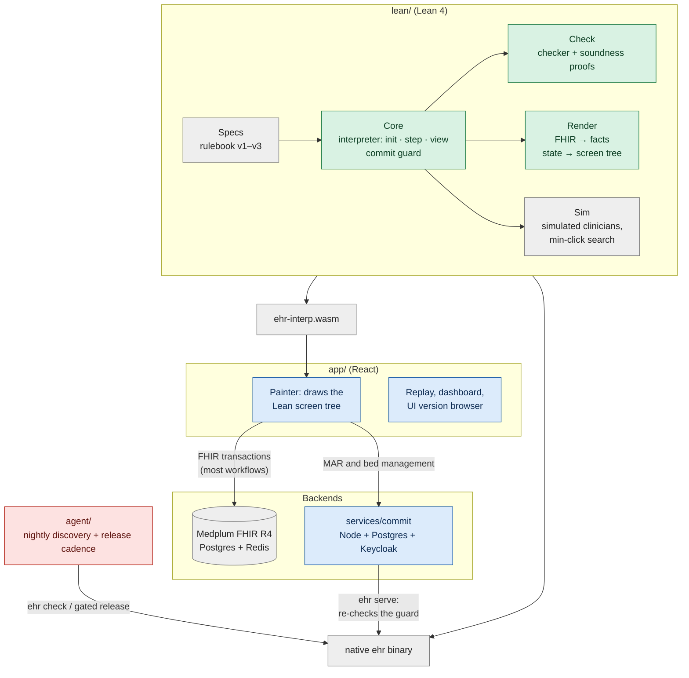
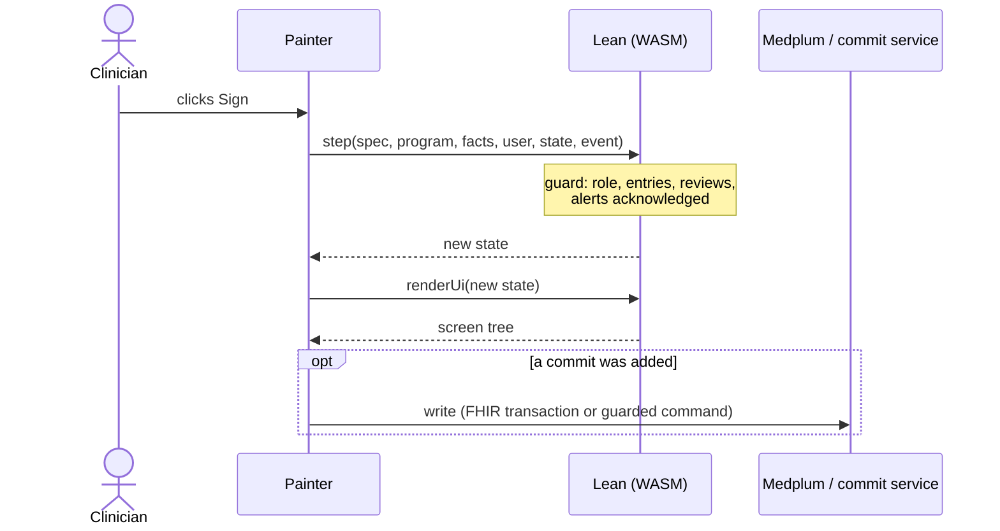

# VGI Health

A research system for clinical software that can safely change itself. It has
three parts:

1. **A realistic EHR simulator.** A hospital and clinic electronic health
   record (EHR) built on the conventions of real-world commercial EHR
   systems. It includes a patient banner and
   storyboard, in-basket, chart review, ED track board, MAR and flowsheets,
   order entry with preference lists, interruptive and passive alerts, and
   vendor releases that change the rules. It runs on synthetic FHIR patients.
   Simulated clinicians work through generated clinical days in it, so any
   change to the screens can be measured in clicks, scrolls and mouse travel.
2. **Lean proofs of what a clinician-facing interface must preserve.** The
   hospital's rules (law, regulators and hospital policy) are written in Lean,
   and a Lean interpreter runs every click. The theorems hold for every screen
   layout. Nothing is signed without its required entries, reviews and alert
   acknowledgments. The patient banner, required information and interruptive
   alerts stay on screen. Macros never act for a human.
3. **A way for an AI model to change the interface and stay within those
   proofs.** The model edits only the screens, never the rules. A Lean checker
   accepts or rejects each proposed layout and gives a counterexample when it
   rejects one. Only accepted layouts deploy, and the guarantees of part 2
   carry over to them.

Part 2 is what makes part 3 possible. Clinical software is normally locked
down because every change must be re-validated. Here the guarantees are proved
once for every accepted layout, so the screens can be reshaped for each
clinician without re-validating each version by hand. [What is
proved](#what-is-proved) lists what is covered and what is not. [Open
problems](#open-problems) describes the weakest parts: how users are simulated
and how the agent makes its changes.

The same Lean interpreter runs natively and in the browser as WebAssembly. The
project is not affiliated with any EHR vendor.

| Primary care order entry | ED track board | Inpatient MAR |
|---|---|---|
|  |  |  |

## How the parts fit

Two things are kept apart:

- **The rulebook** (`Spec`, in Lean): what must be entered, reviewed and
  acknowledged before an action, and by whom. For example: "signing a
  medication order needs a dosing weight in kg entered by a human, the allergy
  list on screen, and every interruptive drug-allergy alert acknowledged".
- **The screens** (`Program`, JSON): one clinician's layout of screens,
  fields, tabs, buttons and macros.

The agent may only change the screens. Every proposed program goes through
`check`; only accepted programs are deployed. At run time every click goes
through `step`, which refuses a sign unless its guard holds, whatever the
layout.


## Architecture

One Lean code base is the single source of truth. It is compiled natively (the
`ehr` binary: checker, simulator, deploy, commit server) and, through
Lean → C → Emscripten, to WebAssembly that the browser runs. React only paints
the screen tree Lean returns; it holds no clinical logic.



Green: proved in Lean. Blue: tested. Grey: trusted. Red: untrusted by design.

**One click.** The painter sends an event to the WASM `step`. If the event is a
sign, the interpreter evaluates the commit guard first. The new state goes
through `renderUi`, which produces the screen tree (banner, required reviews,
enabled or disabled buttons with Lean's reason, modal or inline alerts). If a
commit happened, the app writes it: as one FHIR transaction to Medplum, or for
medication administration and bed management through the commit service, which
re-runs the guard on the server under row locks before a Postgres write.



| Directory | Contents |
|---|---|
| `lean/` | Rulebook, interpreter, checker, renderer, simulator and all proofs. |
| `app/` | React app: clinical painter, live and replay modes, dashboard. |
| `agent/` | Nightly discovery, certified design archives, configurable release cadence and a typed review gate; simulator-only off-shift tailoring sessions (`session*.ts`). Historical nightly protocols remain available. The offline `proposal-quality` harness compares recorded prompt variants without deploying. |
| `services/commit/` | Postgres commit authority for MAR and ADT, driven by the native Lean binary. |
| `wasm/` | Lean → C → Emscripten build. |
| `world/` | Generator of simulated clinical days (patients, tasks, schedules). |
| `conformance/` | 200 held-out rule scenarios run against every deployed revision. |
| `releases/` | Vendor releases v1–v3 (rulebook + reference screens). |
| `infra/` | Docker Compose for Medplum; setup and data loading. |
| `explore/` | Quality-diversity archive, descriptors, admitted generators and search. The standalone research harness never deploys; `agent/` reuses these modules for cadence releases. |

Cadence runs use protocol `certified-cadence-archive-v1`. `run-days` accepts
`--protocol certified-cadence-archive-v1 --cadence nightly|weekly|N` (`N` is a
positive number of simulation days); `--cadence` alone selects that protocol.
Omitting both retains the historical `core-10day-live` nightly selection path.
The archive protocol defaults to nightly shipping. Weekly slots are nights
7, 14, …; every-N-day slots are N, 2N, …, anchored to the run calendar. A veto,
failed validation or empty archive waits until the next slot. No discretionary
release occurs after the final simulated day.

`agent/src/night.ts` keeps the train/holdout boundary. Discovery uses past odd
calibration days' train partitions only; archive scores are refreshed against
the deployed layout on the latest two train days. It retains every proposal,
including unchosen alternatives, failures and historical estimates, in atomic
`<run>/archives/clinicians/<scope-hash>/night-N.json` snapshots. Only designs
passing `ehr check`, the independent identity movement budget (screen, parent
and tab, including renamed tags or existing IDs claiming `copyOf`) and the existing
whole-version screen gate enter elite cells. The archive reuses `explore/`'s
niches, generators, operators' feedback envelope and search/archive machinery.
One deterministic admitted layout/density/input variant is explored per night
without an extra model call; generating a new layout removes inherited layout
tags from clinical groups so niche labels reflect the resulting layout. Disjoint pairs from the same deployed baseline
are also checked as complete bundles. Whole archived programs are rechecked
against the current version; old-spec candidates remain recorded but cannot
ship into a new vendor release. Rejected and non-improving train evidence is
fed back to the generator; validation/test measurements never enter that
feedback. Full-program patches are summarized by hash and paths in prompts.

Scopes include clinician, owner, department and role. `--departments` accepts a
JSON object such as `'{"P1":"primary-care","P2":"emergency"}'`; omitted mappings
use `unspecified`. Department × role views under `archives/departments/` index
clinician shards and their niche winners. Estimates remain clinician-specific;
there is no pooled department score or automatic cross-clinician deployment.
Archives persist across nights and `--resume` within a run, not across unrelated
runs. Retry reads only snapshots strictly earlier than the unfinished night.
Manifests bind cadence, department mappings, review/switch-cost identities and
exploration source fingerprints; resume refuses a changed policy. The native
`verify-resume` preflight checks exploration fingerprints for cadence runs too.
The single-night `night` command refuses cadence runs because it cannot restore
their archive and external review/cost hooks; use `run-days --resume`.

A complete bundle's score is daily train click-plus-scroll saving minus
`switchCost(prev, next, clinicianContext)`. Pixel improvements still pass the
existing no-regression validation gate; pixel-only improvements do not produce
a positive scalar release score. The default `usage-weighted-movement-v1` is a
**simulation assumption**: one extra click-equivalent per observed use/day of
a displaced control. Displacement includes screen, parent, tab, order, size,
layout tag and shortcut changes, including descendants of changed groups. This is not measured relearning, learning or
forgetting. `agent/src/cadence.ts` exports the replaceable `SwitchCost` interface
for the bounded-knowledge user-model lane.

Before release, `ReviewGate.review` receives 1–3 positive-scoring niche winners
(program bundles plus train estimates, switch costs, checker/screen evidence
and movement counts). It returns an offered bundle ID or `null`, with a reason;
`auto-approve-v1` chooses the highest score. `RunOptions.reviewGate` is the
integration hook for tailoring sessions; `RunOptions.switchCost` and
`switchCostModel` supply a replacement cost model. Both review and switch-cost hooks receive cloned inputs
and cannot mutate certified program bytes or the loop’s train context. Selection is followed by the
existing past-calibration validation, simulated user response, whole-version
screen check and atomic certified deployment. Mandatory vendor recertification
and migration retain their existing schedule and bypass discretionary cadence
and review; an old-spec layout cannot remain active after a rulebook update.
There is no clinician-facing review UI yet.

The self-contained fake path uses synthetic geometry and the fake checker,
certifies nothing, and makes no live model calls:

```sh
TMPDIR=/home/saithat/Projects/run-tmp pnpm --filter agent cadence-fake --out /home/saithat/Projects/run-tmp/cadence-demo
TMPDIR=/home/saithat/Projects/run-tmp pnpm --filter agent exec vitest run test/cadence.test.ts --maxWorkers=2
```

It exercises accumulation, weekly shipping, cross-night bundles, review vetoes,
switch-cost blocking, screen rejection, train-only feedback and resume. Missing
optional `runs/run1-P3` manual examples are omitted; formal rule context remains
required. The browser audit script accepts `EHR_BIN` for a prebuilt native
checker. Run the full template audit and then `--personas` sequentially, using
`TMPDIR` on disk; neither builds Lean:

```sh
TMPDIR=/home/saithat/Projects/run-tmp EHR_BIN=/home/saithat/Projects/VGI-Health/lean/.lake/build/bin/ehr node scripts/audit-alert-policy.mjs /home/saithat/Projects/run-tmp/cadence-audit-templates
TMPDIR=/home/saithat/Projects/run-tmp EHR_BIN=/home/saithat/Projects/VGI-Health/lean/.lake/build/bin/ehr node scripts/audit-alert-policy.mjs /home/saithat/Projects/run-tmp/cadence-audit-personas --personas
```

## What is proved

"Proved" means a Lean theorem checked by the kernel using only the standard
axioms (`propext`, `Classical.choice`, `Quot.sound`), with the statements
cross-checked by Lean's Comparator (`make verify`).

| Guarantee | Scope |
|---|---|
| No sign without its guard: required entries confirmed and human-entered where required, in the declared unit (lb never satisfies kg); reviews shown or covered by a valid receipt; interruptive alerts acknowledged; role allowed (`T0`, `T2`). | Every program, record and event sequence. |
| Macros and prefills never sign, acknowledge, create receipts or enter human-only values; a cosign names a second human (`T3`, `T6`). | Every program. |
| Alerts appear only when their condition holds; passive alerts never pop up (`A2`, `A4`). | Every program. |
| Checker acceptance implies 12 of 13 screen properties for every patient and reachable state (`accepted_*`). | Every accepted program. |
| Every required task stays completable (property 6). | Proved for restricted families only; open in general. |
| The screen tree keeps the patient banner, required review content, honest buttons and modal interruptive alerts (`D1`–`D6`). | Every program and record. |
| Bed assignments are exclusive; scheduled doses are given at most once; critical results are resolved or escalated by a deadline. | Lean reducers and multi-actor models. |

Not proved: that the rules are clinically complete; the React painter,
browser and FHIR mapping (tested); Medplum, Postgres and authentication
(integration-tested); the Lean compiler and Emscripten (trusted); the AI agent
(untrusted; only accepted programs deploy).

## What parts of a real EHR are replicated

The app models the clinician-facing workflows of a hospital and clinic EHR on
FHIR data. It is a research system on synthetic patients, not a deployable
product.

| Area | Replicated | Not replicated or simplified |
|---|---|---|
| **Workflows** | Seven end-to-end workflows: W1 adult clinic visit (rooming → history → exam → orders → sign → close), W2 results in-basket and patient messages, W3 emergency department (track board, triage, orders, disposition), W4 inpatient nursing (worklist, MAR, flowsheets, SBAR handoff), W5 pediatric visit (growth charts, vaccines), W6 surgery (consult, pre-op, operative note, post-op orders, OR schedule), W7 refill requests. | Pharmacy verification and dispensing, lab and radiology departments, scheduling engine, registration, billing and claims, patient portal. |
| **Roles** | Physician, nurse practitioner, RN, surgeon; charge nurse, bed manager and admitting clerk for bed management. Five personas: primary care, ED, inpatient RN, pediatric NP, surgeon. | Pharmacists, technicians, residents with supervision chains, schedulers. |
| **Chart** | Patient banner (name, DOB, MRN, allergies, code status, isolation, weight), storyboard sidebar, chart review tabs (encounters, notes, results, meds, problems, allergies, imaging), lab trends and flowsheets, WHO/CDC growth curves, chart search. | Imaging viewer (PACS), scanned media, outside-records exchange. |
| **Orders** | Medication order composer with preference lists, formulary dose units, kg dosing weight, route, frequency, PRN, dispense and refills, pharmacy, indication and diagnosis; lab, imaging and procedure orders; prior authorization (release v2); coded antibiotic indication (release v3). | Real e-prescribing transmission, pharmacy interventions. |
| **Safety checks** | Hard-stop sign guards; drug-allergy, interaction, duplicate-therapy, dose-range and high-alert alerts, interruptive (modal) or passive (inline); barcode patient and medication scan at administration; second-nurse cosign for high-alert drugs; patient-ID re-entry; review receipts that expire; critical-result escalation; California controlled-substance rules (CURES check, naloxone offer, Schedule II refills). | Real CURES/PDMP queries, barcode hardware, a full drug-knowledge base (a small formulary is built in). |
| **Documentation** | Visit and operative notes, nursing assessments, vaccine administration, consent, SBAR handoff, administration records. | Note templates, dictation. |
| **Bed management (ADT)** | Admit, assign, transfer, release, discharge and bed cleaning on a unit bed board, with exclusive beds and atomic transfers. | Enterprise patient flow, transport, multiple facilities. |
| **Regulatory updates** | Vendor releases v1 → v2 → v3 that add rules, migrated per clinician and re-certified. | Real vendor upgrade tooling. |
| **Data and storage** | FHIR R4 on Medplum: Patient, Encounter, Observation, Condition, AllergyIntolerance, MedicationRequest, MedicationAdministration, Immunization, DiagnosticReport, DocumentReference, ServiceRequest, Procedure, Consent, Appointment, Task, Communication, ChargeItem, Provenance. Postgres event streams with version checks and live updates for MAR and ADT. | HL7v2 interfaces, enterprise patient index, production audit logging, high availability. |
| **Identity** | Keycloak single sign-on (PKCE) for MAR and bed management; development password login elsewhere. | Production identity, break-the-glass access. |
| **Users** | Simulated clinicians with seeded behavior and interruptions, measured in clicks, scrolls and mouse travel. The default policy plans through the current screens; an optional bounded policy learns locations and searches visible controls. | Real clinicians; no user study. Search, practice, forgetting and hidden tastes use uncalibrated simulation assumptions. |

## Bounded clinician simulation

`Ehr.Sim.Policy.simulate` and its historical JSON output are unchanged. Select
`ehr simulate ... --policy bounded` (or `"policy":"bounded"` in the persona).
`expert` is the default; an explicit CLI policy overrides the persona. Pass
`--memory-in FILE --memory-out FILE` to carry one actor's layout knowledge
across days and program revisions. The result also contains `memory`; an actor
mismatch is rejected. Do not share memory between clinicians or counterfactual
arms. Empty memory represents an unfamiliar interface.

`lean/Ehr/Sim/Bounded.lean` owns the policy. Memory is keyed by stable component
`tag`, falling back to `id`; it records screen, parent, tab, ordinal position,
experienced navigation route, last-use day and exposure count. Strength is
`1000 * sqrt(exposures / (1 + ageDays))`, rounded down, with confidence at 1400.
Using a newly discovered location resets its practice count; deploying a program
never refreshes memory. Recall uses visible links to remembered screens and
experienced container/tab events, without retracing earlier goals. A stale location
causes a charged pointing/click attempt and then visual search. The attempted
location is recorded in an observation; a guaranteed-absent ID goes through the
interpreter and is ignored, rather than activating an unrelated clinical action.

Unknown controls incur a serial scan through the shown items preceding the
control (180 ms/item). Episode-local visual working memory retains labels
already scanned, so switching a tab or backtracking does not reread unchanged
chrome. Persistent placement confidence still strengthens only on use. Navigation
starts with lexical scent, then prefers unvisited screens/views when scent
stalls. The patience budget is logarithmic in screen count; a separate hard fuel
bound scales with component count and the number of clinical goals. These
mechanics and budgets are simulation assumptions.

A clinician who still cannot find a goal types its clinical rulebook label into
a shown search box, if available, and asks for help. Internal intent keys and
scent-expansion terms are not typed or charged as human query keystrokes. `Ehr.Sim.Discovery.Guide` is a pure assistance
boundary (`Context → State → Option (List Event)`). The default simulated help
desk knows the deployed layout and uses the existing BFS navigation solver to
return one route. The unassisted clinician never gets that layout map. Help
costs the actual search activation/typing, one `waitMs` (60 seconds), one
`mentalMs` for the reply, instruction-reading time, and every guided UI event.
The help wait is an uncalibrated simulation assumption. A failed provider reports
an obstruction; it cannot supply captures, interpreter state, commits, or a guard
exemption. Help answers are recorded separately from unassisted discoveries.

Tabs expose their declared indices. `Bounded.Scent := String → Component → Nat`
is the pure, replaceable scoring interface for a future decision model. Recall
uses logarithmic choice time and a diminishing square-root practice term. The
architecture follows Cockburn, Gutwin & Greenberg, CHI 2007,
[doi:10.1145/1240624.1240723](https://doi.org/10.1145/1240624.1240723);
the coefficients and memory law remain explicitly simulation assumptions.
[CogTool's KLM tutorial](https://www.cogtool.org/tutorial/) describes skilled
execution, not a general novice/expert multiplier. Cockburn's menu calibration
also does not establish a whole-EHR ratio. Cost reports separate search/help
contributions and retain all timing coefficients rather than tuning to a desired
ratio. Every clinical event, including failed attempts and guided actions, uses
the existing guarded interpreter. There are no new clinical rules or proof
assumptions.

Bounded results retain the original `tasks`, `trace`, `floor` and `complaints`.
`expert` contains an independent unchanged BFS-policy run on the same inputs and
seed: the expert comparison, not a newly proved minimum (persona noise can make
its cost exceed the bounded run). `floor` remains the ideal-interface clinical
floor. `effort` adds per-task misses, visual searches, scanned items, backtracks,
synthetic ordinal mouse travel, cognitive milliseconds and `helpRequests`.
`expertTravelUnits` reports the same ordinal proxy for the expert trace;
`learnability` contains signed per-task gaps in clicks, scrolls, keystrokes,
time and travel. `observations` links
search/recall/miss decisions to trace indices and old locations. `assistance`
records the task, request reason/query, hinted screen/control/caption, route, and
caption-only `labelMatch` against the actual target's clinical intent. Zero
lexical overlap is a named model finding, not proof of human undiscoverability.
Task time includes cognitive time as well as trace KLM operators; visual searches are not
search-box activations. Travel is an ordinal-layout proxy, not browser pixels.
Report completion alongside costs; an incomplete task's lower cost is not an
improvement. Signed bounded-minus-expert differences measure learnability cost.
`Bounded.relearningCost firstDays steadyDays : Int` computes summed first-k-day
cost minus k times mean steady cost; use matched workloads and report k and the
steady-state sampling protocol, retaining negative results.

Hidden persona preferences are optional `hiddenPreferences` with `placements`
(`tag`, `nearTag`, `weight`) and `changeSensitivity` (zero is neutral). The pure
boundary for the tailoring lane is
`Bounded.ratePrograms (prefs : HiddenPreferences) (before after : Program)
(recent : List RecentDay) : Rating`. Recent days contain `usedTags` and `costMs`;
the current assumption-based rating uses use frequency to weight disruption,
placement distances to score preferences, and reserves costMs for later fitting.
Positive score chooses after; ties keep before. `seededPreferences seed actor`
provides optional deterministic tastes. These preferences do not alter clinical
goals or the historical default policy.

World generation accepts `--policy bounded` and optional `--hidden-preferences`;
its taste seed matches Lean's `seededPreferences`. Without these options the
persona JSON stays unchanged. The agent adapter accepts optional `policy` and
`memory` on `SimulateInput` and preserves the bounded result fields. `run-days`
loads the prior committed day's memory, including on resume. Canonical baselines
and vendor-only controls retain independent actor memories. Train estimates
compare both programs from the same training-day memory snapshot and discard
counterfactual updates; validation without an explicit snapshot is a cold run.

For reproducible small comparisons, run
`TMPDIR=/home/saithat/Projects/run-tmp python3 scripts/user-model-compare.py
--out /home/saithat/Projects/run-tmp/user-model-comparison`. It samples the first
task of each represented workflow for every v1/v3 persona template, verifies
byte determinism/default equivalence, and compares three adjacent historical
P1 deployments. The template comparison fails on any task completed by the expert but missed by the
bounded actor and reports its task ID. `--all-tasks --templates-only` instead
checks entire day-1/v1 and day-7/v3 schedules for every persona, starting each
workday with empty actor memory. The per-deploy protocol uses k=2 matched dated
workloads, five before-program training blocks, and an independent eight-block after-program
warm reference. It reports incomplete tasks, the common completed task set,
expert and bounded effort, help and visual-search milliseconds, and signed
relearning milliseconds. Each report fingerprints the native binary and rejects
evidence mixed across a rebuild. The completion-accounting regression runs with
`python3 scripts/test-user-model-compare.py`. Scratch JSON is evidence output; no recorded runs, fixtures or certificates are rewritten.

## Open problems

How users are simulated and how the agent changes the interface are the two
weakest parts.

- **Simulated users are uncalibrated.** The default simulated clinician still
  knows the layout: it plans the shortest path through the whole current
  program by breadth-first search over real interpreter steps
  (`lean/Ehr/Sim/Interaction.lean`), so a rearranged layout costs it nothing.
  An opt-in bounded-knowledge clinician (`lean/Ehr/Sim/Bounded.lean`,
  `Discovery.lean`) remembers where controls were, misses after a move,
  searches by label and falls back to charged help; it measures discovery and
  relearning cost, and the BFS result is kept as the expert floor. Its search,
  memory, timing, help and preference parameters are simulation assumptions,
  not estimates from clinician observations. Completion parity with the expert
  is a regression requirement on the sampled and full persona workdays, not a
  theorem. Patient-directory selection still uses the shared fixed policy.
- **Clinician participation and design exploration are limited.** Historical
  nightly runs deploy a greedy patch or disjoint bundle. The opt-in cadence
  protocol keeps certified, screen-gated alternatives in a quality-diversity
  archive, preserves unchosen train estimates and known duds, and ships through
  a configurable schedule and review hook. Its switch cost is still a
  usage-weighted movement proxy; it does not yet use the bounded clinician's
  relearning cost. The default review hook auto-approves. A simulator-only
  tailoring-session protocol (below) lets a simulated clinician choose among
  2–3 certified options or keep the current layout, but it is not yet wired
  into the cadence review hook, its chooser is a seeded stand-in for the
  bounded clinician, and there is no in-app control. No live cadence
  experiment has validated these choices.

## Offline tailoring sessions (simulator only)

`agent/src/session.ts` prepares an off-shift, weekly or monthly review from a
`SessionArchive` of whole candidate bundles. It verifies the certificate's
program hash/spec, rechecks each candidate against the current program and
canonical reference (including the current stability budget), removes duplicate
expanded layouts (ignoring unused definitions and version numbers), and selects 2–3 options by farthest-first diversity over component
changes and locations. Fewer than two eligible, replay-complete options leaves
the current layout in place by failing preparation; no option is invented or
deployed. `phase: "offShift"` is required. Cadence is review metadata here;
the archive/release lane remains responsible for scheduling and release gates.

Evidence reuses `EhrClient.simulate` on the same clinician's supplied recent
schedules, world and paired seeds for current versus each option. Future days,
foreign schedules and incomplete/mismatched task replays are rejected. Totals
report clicks, keystrokes and scrolls saved, with negative savings retained.
`layoutChanges` expands composites and records additions, removals, edits and
old→new screen, parent, tab and list position. Relearning is an explicitly
unvalidated simulator heuristic: 0.5 minutes per moved component plus 0.25 per
other component change. It is not a measured learning or clinical time benefit.
These replays still use the existing simulator's knowledge of the whole layout.

`SessionChooser` accepts the prepared record and returns one option ID or
`null` (keep current), a reason and optional per-option reasons. The temporary
`seededSessionChooser` keeps seeded preference weights private in a closure,
compares savings against estimated relearning, and can reject every option.
It is the adapter boundary for the bounded-knowledge user-model lane, not a
human study. `answerSession` validates the choice and exports winner-versus-each
alternative comparisons, including current, program hashes and change features;
it infers no ranking among rejected options. `chosenSessionBundle` returns the
whole selected bundle for a later cadence gate. None of these functions deploys
or edits a program. The AI remains the author of every candidate.

`agent/src/session-schema.ts` reexports the shared review wire schema from
`app/src/browser/session-schema.ts` (inside the review-only hash boundary).
It defines optional typed friction entries alongside interaction
entries in `SessionTraceEntry`: `slowHere` or a bounded free-text `wish`, with
clinician, program hash, day, task, time, screen and optional component. They
are feedback metadata, not Lean interpreter events. `flagFriction` appends the
annotation without an interpreter call or clinical-state mutation;
`traceFriction` extracts it. `sessionGeneratorInput` scopes flags and recorded
pairwise comparisons to this clinician and past days, and marks wishes/reasons
as untrusted data. A generator passes this result as the optional
`NightlyContext.tailoring` prompt input. Existing nightly callers are unchanged.
There is no in-app flag control; a future control would enqueue this annotation
without interrupting work or changing screens during a shift.

`recordSession` writes one immutable JSON record to `runs/sessions/<id>.json`
(options, full programs/certificates, recent schedules and simulated traces,
evidence, choice/reasons and comparisons). These files are gitignored data.
The offline harness runs without an LLM or deployment:

```sh
TMPDIR=/home/saithat/Projects/run-tmp \
EHR_BIN=/home/saithat/Projects/VGI-Health/lean/.lake/build/bin/ehr \
pnpm --filter agent exec tsx src/session-cli.ts /absolute/path/to/session-input.json
```

The input shape is `inputSchema` in `agent/src/session-cli.ts`: current and
canonical programs, persona, nonempty recent schedules, world directory,
archive candidates with certificates, session metadata, seed and optional flags.
Use absolute input/world paths; output defaults to this repo's `runs/`. The
harness always uses the simulated chooser. Fake backend evidence is permitted
only in tests and certifies nothing.

Open `/browse?session=/runs/sessions/<id>.json` for the desktop review. Current
and candidate layouts appear side by side for the same selectable recent case,
with independently scrubbed recorded event sequences and highlighted targets
in a component layout map. This map shows recorded screen/order/target, not
clinical values or a full clinical painter replay. Savings, old→new locations,
heuristic relearning, flags, the choice and reasons are shown explicitly. The
page is read-only, simulator-only, and covered at 1440×900. App changes stay
inside `app/src/browser`; the certified clinical app hash is unchanged.

Validation for this module uses the fake backend and no LLM calls:

```sh
TMPDIR=/home/saithat/Projects/run-tmp pnpm --filter agent exec vitest run test/session.test.ts
TMPDIR=/home/saithat/Projects/run-tmp pnpm --filter app build
TMPDIR=/home/saithat/Projects/run-tmp pnpm --filter app exec playwright test --config src/browser/session-playwright.config.ts
```

## Data sources

- **Synthea** (Apache-2.0) synthetic patients. Walonoski J, et al. *Synthea.*
  JAMIA 2018;25(3):230–238.
- **Synthetic Hospital** (code MIT; data fully synthetic and redistributable)
  longitudinal records. Park, Chen, Dettmers, preprint 2026,
  https://arxiv.org/abs/2609.30027.
- **Medplum** (Apache-2.0) FHIR backend.
- CPT is a trademark of the AMA; only a few code identifiers with original
  short labels are included.
- Fonts: Noto Sans, Noto Sans Mono and Noto Sans Symbols 2 (SIL OFL 1.1).
