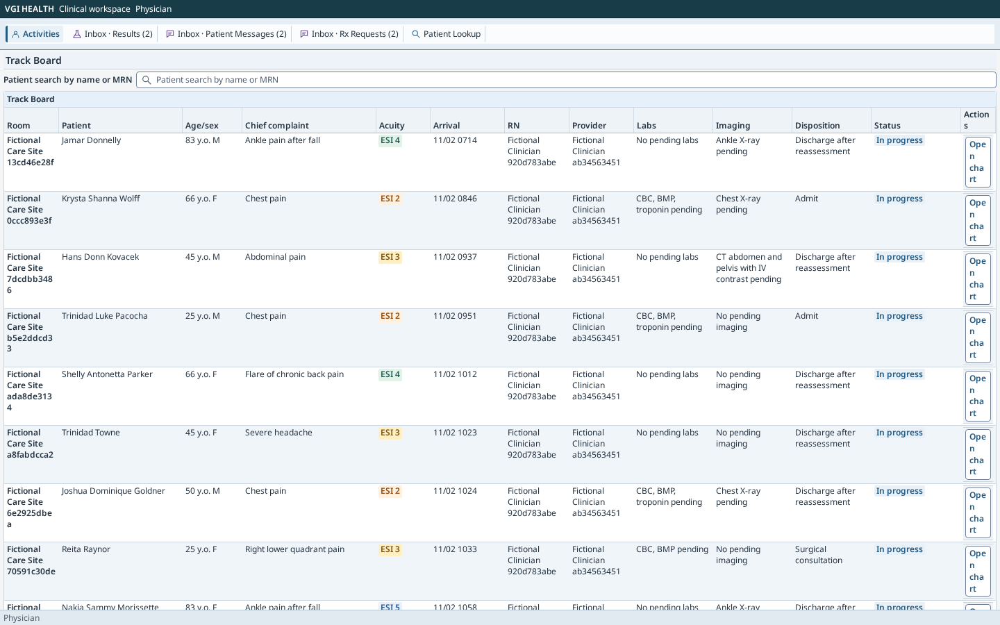
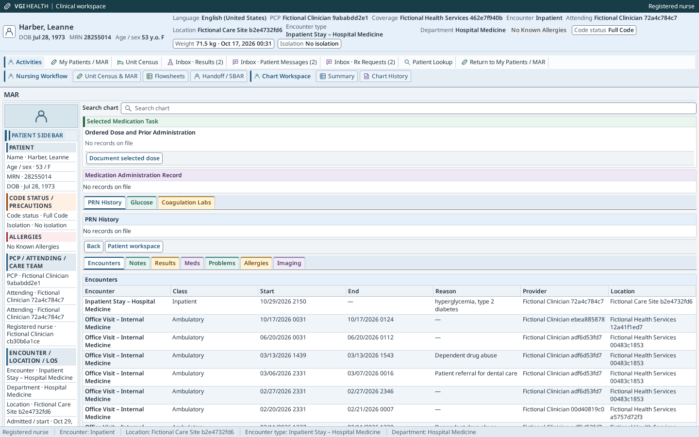
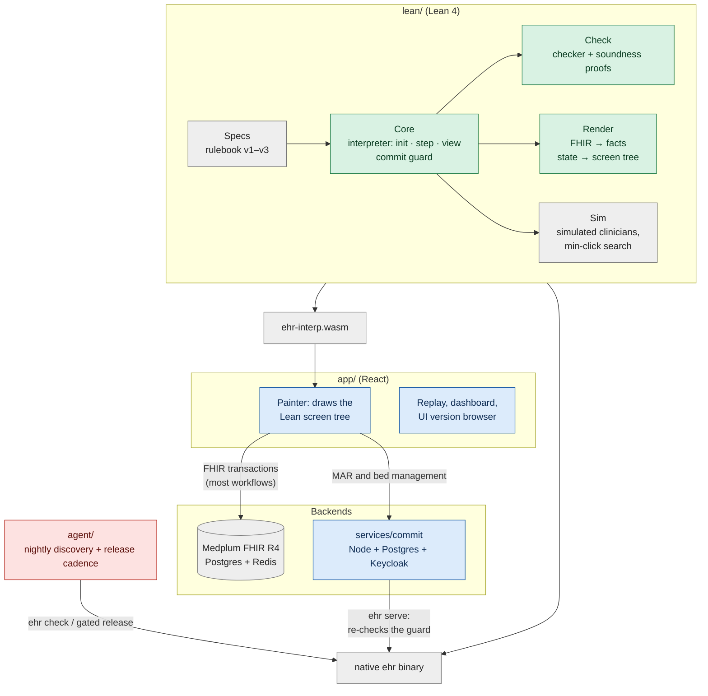
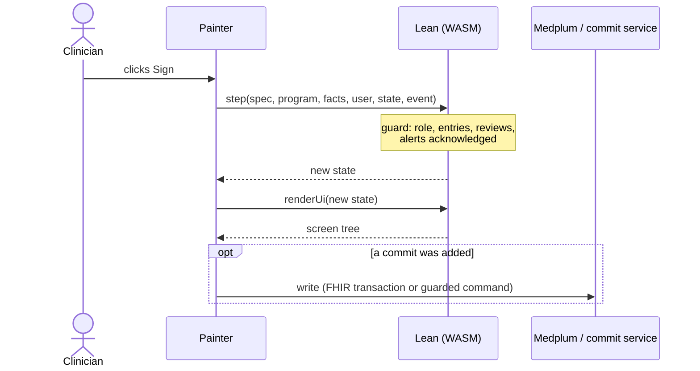

# VGI Health

A research system for clinical software that can safely change itself. It has
three parts:

1. **A realistic EHR simulator.** A hospital and clinic electronic health
   record (EHR) built on the conventions of the dominant commercial systems,
   Epic and Oracle Health (Cerner). It includes a patient banner and
   storyboard, in-basket, chart review, ED track board, MAR and flowsheets,
   order entry with preference lists, interruptive and passive alerts, and
   vendor releases that change the rules. It runs on synthetic FHIR patients.
   Simulated clinicians work through generated clinical days in it, so any
   change to the screens can be measured in clicks, scrolls and mouse travel.
2. **Lean proofs of what a clinician-facing interface must preserve.** The
   hospital's rules (law, regulators and hospital policy) are written in Lean,
   and a Lean interpreter runs every click. The theorems hold for every screen
   layout. Nothing is signed without its required entries, reviews and alert
   acknowledgments. The patient banner, required information and interruptive
   alerts stay on screen. Macros never act for a human.
3. **A way for an AI model to change the interface and stay within those
   proofs.** The model edits only the screens, never the rules. A Lean checker
   accepts or rejects each proposed layout and gives a counterexample when it
   rejects one. Only accepted layouts deploy, and the guarantees of part 2
   carry over to them.

Part 2 is what makes part 3 possible. Clinical software is normally locked
down because every change must be re-validated. Here the guarantees are proved
once for every accepted layout, so the screens can be reshaped for each
clinician without re-validating each version by hand. [What is
proved](#what-is-proved) lists what is covered and what is not. [Open
problems](#open-problems) describes the weakest parts: how users are simulated
and how the agent makes its changes.

The same Lean interpreter runs natively and in the browser as WebAssembly. The
project is not affiliated with Epic or Oracle.

| Primary care order entry | ED track board | Inpatient MAR |
|---|---|---|
|  |  |  |

## How the parts fit

Two things are kept apart:

- **The rulebook** (`Spec`, in Lean): what must be entered, reviewed and
  acknowledged before an action, and by whom. For example: "signing a
  medication order needs a dosing weight in kg entered by a human, the allergy
  list on screen, and every interruptive drug-allergy alert acknowledged".
- **The screens** (`Program`, JSON): one clinician's layout of screens,
  fields, tabs, buttons and macros.

The agent may only change the screens. Every proposed program goes through
`check`; only accepted programs are deployed. At run time every click goes
through `step`, which refuses a sign unless its guard holds, whatever the
layout.


## Architecture

One Lean code base is the single source of truth. It is compiled natively (the
`ehr` binary: checker, simulator, deploy, commit server) and, through
Lean → C → Emscripten, to WebAssembly that the browser runs. React only paints
the screen tree Lean returns; it holds no clinical logic.



Green: proved in Lean. Blue: tested. Grey: trusted. Red: untrusted by design.

**One click.** The painter sends an event to the WASM `step`. If the event is a
sign, the interpreter evaluates the commit guard first. The new state goes
through `renderUi`, which produces the screen tree (banner, required reviews,
enabled or disabled buttons with Lean's reason, modal or inline alerts). If a
commit happened, the app writes it: as one FHIR transaction to Medplum, or for
medication administration and bed management through the commit service, which
re-runs the guard on the server under row locks before a Postgres write.



| Directory | Contents |
|---|---|
| `lean/` | Rulebook, interpreter, checker, renderer, simulator and all proofs. |
| `app/` | React app: clinical painter, live and replay modes, dashboard. |
| `agent/` | Nightly discovery, certified design archives, configurable release cadence and a typed review gate. Historical nightly protocols remain available. The offline `proposal-quality` harness compares recorded prompt variants without deploying. |
| `services/commit/` | Postgres commit authority for MAR and ADT, driven by the native Lean binary. |
| `wasm/` | Lean → C → Emscripten build. |
| `world/` | Generator of simulated clinical days (patients, tasks, schedules). |
| `conformance/` | 200 held-out rule scenarios run against every deployed revision. |
| `releases/` | Vendor releases v1–v3 (rulebook + reference screens). |
| `infra/` | Docker Compose for Medplum; setup and data loading. |
| `explore/` | Quality-diversity archive, descriptors, admitted generators and search. The standalone research harness never deploys; `agent/` reuses these modules for cadence releases. |

Cadence runs use protocol `certified-cadence-archive-v1`. `run-days` accepts
`--protocol certified-cadence-archive-v1 --cadence nightly|weekly|N` (`N` is a
positive number of simulation days); `--cadence` alone selects that protocol.
Omitting both retains the historical `core-10day-live` nightly selection path.
The archive protocol defaults to nightly shipping. Weekly slots are nights
7, 14, …; every-N-day slots are N, 2N, …, anchored to the run calendar. A veto,
failed validation or empty archive waits until the next slot. No discretionary
release occurs after the final simulated day.

`agent/src/night.ts` keeps the train/holdout boundary. Discovery uses past odd
calibration days' train partitions only; archive scores are refreshed against
the deployed layout on the latest two train days. It retains every proposal,
including unchosen alternatives, failures and historical estimates, in atomic
`<run>/archives/clinicians/<scope-hash>/night-N.json` snapshots. Only designs
passing `ehr check`, the independent identity movement budget (screen, parent
and tab, including renamed tags or existing IDs claiming `copyOf`) and the existing
whole-version screen gate enter elite cells. The archive reuses `explore/`'s
niches, generators, operators' feedback envelope and search/archive machinery.
One deterministic admitted layout/density/input variant is explored per night
without an extra model call; generating a new layout removes inherited layout
tags from clinical groups so niche labels reflect the resulting layout. Disjoint pairs from the same deployed baseline
are also checked as complete bundles. Whole archived programs are rechecked
against the current version; old-spec candidates remain recorded but cannot
ship into a new vendor release. Rejected and non-improving train evidence is
fed back to the generator; validation/test measurements never enter that
feedback. Full-program patches are summarized by hash and paths in prompts.

Scopes include clinician, owner, department and role. `--departments` accepts a
JSON object such as `'{"P1":"primary-care","P2":"emergency"}'`; omitted mappings
use `unspecified`. Department × role views under `archives/departments/` index
clinician shards and their niche winners. Estimates remain clinician-specific;
there is no pooled department score or automatic cross-clinician deployment.
Archives persist across nights and `--resume` within a run, not across unrelated
runs. Retry reads only snapshots strictly earlier than the unfinished night.
Manifests bind cadence, department mappings, review/switch-cost identities and
exploration source fingerprints; resume refuses a changed policy. The native
`verify-resume` preflight checks exploration fingerprints for cadence runs too.
The single-night `night` command refuses cadence runs because it cannot restore
their archive and external review/cost hooks; use `run-days --resume`.

A complete bundle's score is daily train click-plus-scroll saving minus
`switchCost(prev, next, clinicianContext)`. Pixel improvements still pass the
existing no-regression validation gate; pixel-only improvements do not produce
a positive scalar release score. The default `usage-weighted-movement-v1` is a
**simulation assumption**: one extra click-equivalent per observed use/day of
a displaced control. Displacement includes screen, parent, tab, order, size,
layout tag and shortcut changes, including descendants of changed groups. This is not measured relearning, learning or
forgetting. `agent/src/cadence.ts` exports the replaceable `SwitchCost` interface
for the bounded-knowledge user-model lane.

Before release, `ReviewGate.review` receives 1–3 positive-scoring niche winners
(program bundles plus train estimates, switch costs, checker/screen evidence
and movement counts). It returns an offered bundle ID or `null`, with a reason;
`auto-approve-v1` chooses the highest score. `RunOptions.reviewGate` is the
integration hook for tailoring sessions; `RunOptions.switchCost` and
`switchCostModel` supply a replacement cost model. Hooks receive cloned data
and cannot mutate certified program bytes. Selection is followed by the
existing past-calibration validation, simulated user response, whole-version
screen check and atomic certified deployment. Mandatory vendor recertification
and migration retain their existing schedule and bypass discretionary cadence
and review; an old-spec layout cannot remain active after a rulebook update.
There is no clinician-facing review UI yet.

The self-contained fake path uses synthetic geometry and the fake checker,
certifies nothing, and makes no live model calls:

```sh
TMPDIR=/home/saithat/Projects/run-tmp pnpm --filter agent cadence-fake --out /home/saithat/Projects/run-tmp/cadence-demo
TMPDIR=/home/saithat/Projects/run-tmp pnpm --filter agent exec vitest run test/cadence.test.ts --maxWorkers=2
```

It exercises accumulation, weekly shipping, cross-night bundles, review vetoes,
switch-cost blocking, screen rejection, train-only feedback and resume. Missing
optional `runs/run1-P3` manual examples are omitted; formal rule context remains
required. The browser audit script accepts `EHR_BIN` for a prebuilt native
checker. Run the full template audit and then `--personas` sequentially, using
`TMPDIR` on disk; neither builds Lean:

```sh
TMPDIR=/home/saithat/Projects/run-tmp EHR_BIN=/home/saithat/Projects/VGI-Health/lean/.lake/build/bin/ehr node scripts/audit-alert-policy.mjs /home/saithat/Projects/run-tmp/cadence-audit-templates
TMPDIR=/home/saithat/Projects/run-tmp EHR_BIN=/home/saithat/Projects/VGI-Health/lean/.lake/build/bin/ehr node scripts/audit-alert-policy.mjs /home/saithat/Projects/run-tmp/cadence-audit-personas --personas
```

## What is proved

"Proved" means a Lean theorem checked by the kernel using only the standard
axioms (`propext`, `Classical.choice`, `Quot.sound`), with the statements
cross-checked by Lean's Comparator (`make verify`).

| Guarantee | Scope |
|---|---|
| No sign without its guard: required entries confirmed and human-entered where required, in the declared unit (lb never satisfies kg); reviews shown or covered by a valid receipt; interruptive alerts acknowledged; role allowed (`T0`, `T2`). | Every program, record and event sequence. |
| Macros and prefills never sign, acknowledge, create receipts or enter human-only values; a cosign names a second human (`T3`, `T6`). | Every program. |
| Alerts appear only when their condition holds; passive alerts never pop up (`A2`, `A4`). | Every program. |
| Checker acceptance implies 12 of 13 screen properties for every patient and reachable state (`accepted_*`). | Every accepted program. |
| Every required task stays completable (property 6). | Proved for restricted families only; open in general. |
| The screen tree keeps the patient banner, required review content, honest buttons and modal interruptive alerts (`D1`–`D6`). | Every program and record. |
| Bed assignments are exclusive; scheduled doses are given at most once; critical results are resolved or escalated by a deadline. | Lean reducers and multi-actor models. |

Not proved: that the rules are clinically complete; the React painter,
browser and FHIR mapping (tested); Medplum, Postgres and authentication
(integration-tested); the Lean compiler and Emscripten (trusted); the AI agent
(untrusted; only accepted programs deploy).

## What parts of a real EHR are replicated

The app models the clinician-facing workflows of a hospital and clinic EHR on
FHIR data. It is a research system on synthetic patients, not a deployable
product.

| Area | Replicated | Not replicated or simplified |
|---|---|---|
| **Workflows** | Seven end-to-end workflows: W1 adult clinic visit (rooming → history → exam → orders → sign → close), W2 results in-basket and patient messages, W3 emergency department (track board, triage, orders, disposition), W4 inpatient nursing (worklist, MAR, flowsheets, SBAR handoff), W5 pediatric visit (growth charts, vaccines), W6 surgery (consult, pre-op, operative note, post-op orders, OR schedule), W7 refill requests. | Pharmacy verification and dispensing, lab and radiology departments, scheduling engine, registration, billing and claims, patient portal. |
| **Roles** | Physician, nurse practitioner, RN, surgeon; charge nurse, bed manager and admitting clerk for bed management. Five personas: primary care, ED, inpatient RN, pediatric NP, surgeon. | Pharmacists, technicians, residents with supervision chains, schedulers. |
| **Chart** | Patient banner (name, DOB, MRN, allergies, code status, isolation, weight), storyboard sidebar, chart review tabs (encounters, notes, results, meds, problems, allergies, imaging), lab trends and flowsheets, WHO/CDC growth curves, chart search. | Imaging viewer (PACS), scanned media, outside-records exchange. |
| **Orders** | Medication order composer with preference lists, formulary dose units, kg dosing weight, route, frequency, PRN, dispense and refills, pharmacy, indication and diagnosis; lab, imaging and procedure orders; prior authorization (release v2); coded antibiotic indication (release v3). | Real e-prescribing transmission, pharmacy interventions. |
| **Safety checks** | Hard-stop sign guards; drug-allergy, interaction, duplicate-therapy, dose-range and high-alert alerts, interruptive (modal) or passive (inline); barcode patient and medication scan at administration; second-nurse cosign for high-alert drugs; patient-ID re-entry; review receipts that expire; critical-result escalation; California controlled-substance rules (CURES check, naloxone offer, Schedule II refills). | Real CURES/PDMP queries, barcode hardware, a full drug-knowledge base (a small formulary is built in). |
| **Documentation** | Visit and operative notes, nursing assessments, vaccine administration, consent, SBAR handoff, administration records. | Note templates, dictation. |
| **Bed management (ADT)** | Admit, assign, transfer, release, discharge and bed cleaning on a unit bed board, with exclusive beds and atomic transfers. | Enterprise patient flow, transport, multiple facilities. |
| **Regulatory updates** | Vendor releases v1 → v2 → v3 that add rules, migrated per clinician and re-certified. | Real vendor upgrade tooling. |
| **Data and storage** | FHIR R4 on Medplum: Patient, Encounter, Observation, Condition, AllergyIntolerance, MedicationRequest, MedicationAdministration, Immunization, DiagnosticReport, DocumentReference, ServiceRequest, Procedure, Consent, Appointment, Task, Communication, ChargeItem, Provenance. Postgres event streams with version checks and live updates for MAR and ADT. | HL7v2 interfaces, enterprise patient index, production audit logging, high availability. |
| **Identity** | Keycloak single sign-on (PKCE) for MAR and bed management; development password login elsewhere. | Production identity, break-the-glass access. |
| **Users** | Simulated clinicians with seeded behavior and interruptions, measured in clicks, scrolls and mouse travel. They plan the shortest path through the current screens. | Real clinicians; no user study. Visual search, learning, forgetting and relearning after a change (see [Open problems](#open-problems)). |

## Open problems

How users are simulated and how the agent changes the interface are the two
weakest parts.

- **Simulated clinicians already know the interface.** A simulated clinician
  takes its goals from the rulebook. It then plans the shortest path to them
  through the whole current layout, by breadth-first search over real
  interpreter steps (`lean/Ehr/Sim/Interaction.lean`). Seeded noise adds
  detours, backtracking, search, keyboard use and interruptions. Even so, the
  clinician never has to hunt for a control, never reaches for where a control
  used to be, and never makes the slips the rules exist to catch. A
  rearranged layout therefore costs nothing inside the native planner. Learning,
  relearning and discoverability are not measured. Cadence scoring adds an
  explicitly assumed usage-weighted movement cost, outside Lean; it is not a
  bounded-knowledge user model. The Lean stability budget still limits moves.
- **Clinician participation and design exploration remain limited.** Historical
  nightly runs still deploy a greedy patch or disjoint bundle. The opt-in
  cadence protocol now keeps certified, screen-gated niche alternatives,
  preserves unchosen train estimates and known duds, explores admitted
  layout/density/input variants, and ships through a configurable schedule and
  review hook with an assumed switch cost. The standalone `explore/` research
  search still never deploys directly. The default review hook auto-approves;
  clinicians cannot yet request changes or try/reject alternatives through a
  session UI. No live cadence experiment or user study has validated these
  choices, and unsupported interaction paradigms remain outside deployment.

## Data sources

- **Synthea** (Apache-2.0) synthetic patients. Walonoski J, et al. *Synthea.*
  JAMIA 2018;25(3):230–238.
- **Synthetic Hospital** (code MIT; data fully synthetic and redistributable)
  longitudinal records. Park, Chen, Dettmers, preprint 2026,
  https://arxiv.org/abs/2609.30027.
- **Medplum** (Apache-2.0) FHIR backend.
- CPT is a trademark of the AMA; only a few code identifiers with original
  short labels are included.
- Fonts: Noto Sans, Noto Sans Mono and Noto Sans Symbols 2 (SIL OFL 1.1).
