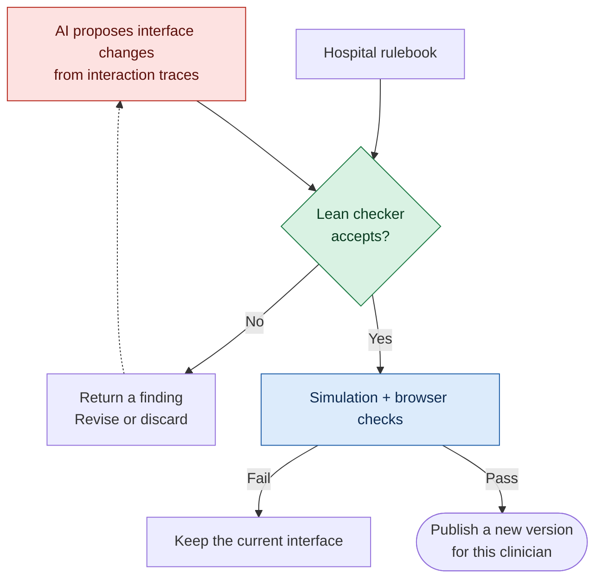
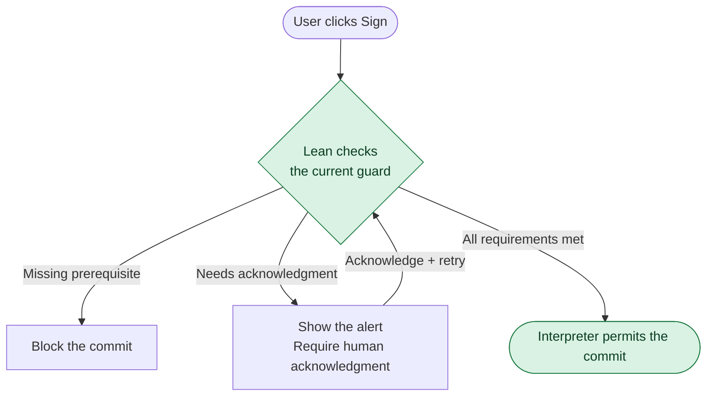
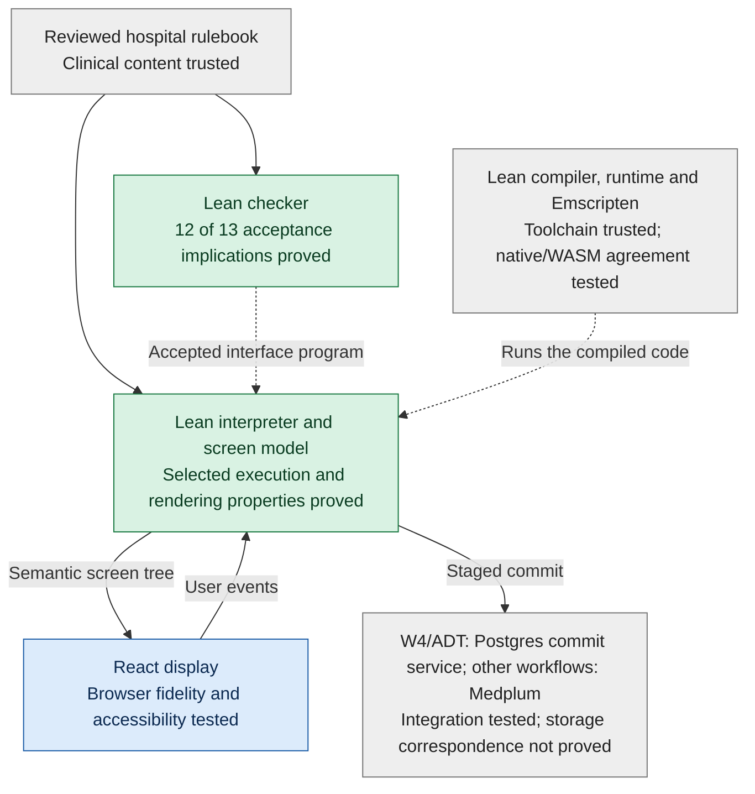
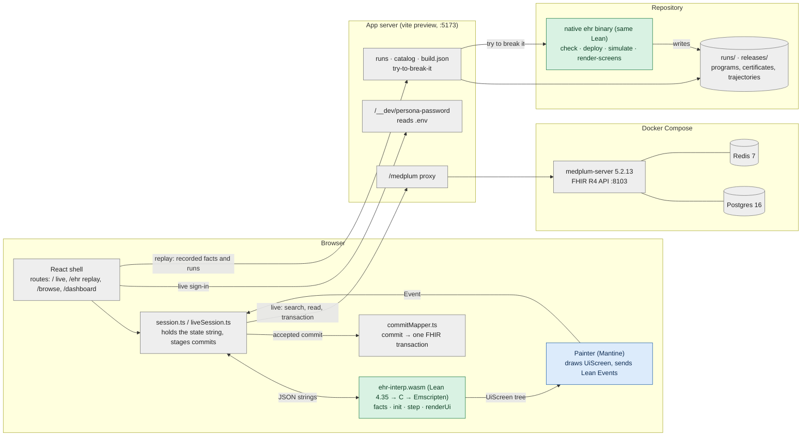
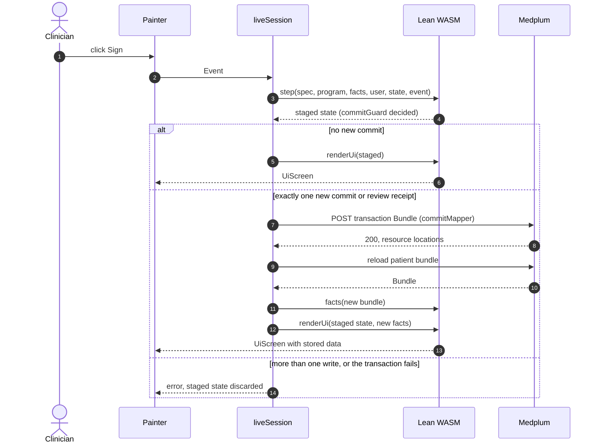

# VGI Health

An EHR whose screens adapt to each clinician's work. An overnight (whenever the user is logged in since people have night shifts :) ) AI agent
proposes UI changes; the Lean checker blocks changes that violate the hospital
rules. The same Lean interpreter runs natively and in the browser as WebAssembly.

## How it works

The hospital defines the clinical obligations. The AI proposes how to arrange
the interface around them: navigation, grouping, density and permitted
shortcuts. Every proposed interface goes through the same checker and runs
through the same interpreter.

### A proposed change must pass before deployment



The agent supplies proposals; the existing proofs justify specific guarantees
from checker acceptance. A new interface reuses those proofs. For example, a
shortcut may reduce navigation while retaining a required allergy review;
hiding that review at signing fails the check when the rule requires it shown.
Repair attempts are bounded; a failed proposal is not published.

### Every clinical commit is checked again during use



Interface approval leaves the runtime guard in force: a receipt can expire or
a required value can still be missing. In the W4 medication-administration path, the commit service reconstructs the
interaction, checks the current guard under patient/dose locks, and accepts only
a durable Postgres write. Administrative ADT checks its placement guard under
patient/bed locks and atomically publishes the changed streams. Other live workflows stage a permitted commit and
accept the committed state only after their Medplum FHIR transaction succeeds.
The save, rollback and refresh paths are integration-tested; replay never writes
to Medplum. Preventing an invalid commit is separate from proving that a task
can always be completed. General completion remains open.

## Read the Lean

Start with these files, in order:

1. [Statements.lean](lean/Statements.lean): the main theorem statements and trusted definitions.
   Its `sorry` bodies are deliberate: it is the Comparator challenge file. `lake comparator` checks that
   [Solution.lean](lean/Solution.lean), which imports the proofs in `Ehr/Proofs/`, proves exactly these
   statements ([comparator.json](lean/comparator.json)) using only `propext`, `Quot.sound` and `Classical.choice`.
2. [Props/Properties.lean](lean/Ehr/Props/Properties.lean): the thirteen UI requirements.
3. [Specs/V1.lean](lean/Ehr/Specs/V1.lean): hospital rules, with law and policy labels.
4. [Core/Interp.lean](lean/Ehr/Core/Interp.lean): the interpreter the app runs.
5. [Check/Sound.lean](lean/Ehr/Check/Sound.lean): what checker acceptance proves.
6. [Render/UiProofs.lean](lean/Ehr/Render/UiProofs.lean): how the EHR tree preserves controls and information.

## What the Lean code does

Lean is both the programming language and the proof language here. The code
implements the EHR, describes its rules, and proves selected guarantees about
its behavior.

As counted on 2026-11-01, the repository has **245 Lean source files and
42,927 lines**, including comments and blank lines. The default build imports
184 of those files, containing **693 named theorem declarations** and 59
additional unnamed proof examples. These counts exclude dependencies and build
outputs. The source is distributed approximately as follows:

| Part | Lines | What it does |
|---|---:|---|
| [Data projection and screen rendering](lean/Ehr/Render/) | 9,700 | Reads FHIR records, constructs chart rows and screen trees, and proves selected content-preservation guarantees. |
| [Hospital rule definitions](lean/Ehr/Specs/) | 7,700 | Defines required fields, reviews, permissions, alerts, units and regulatory/policy requirements. |
| [Interface checker and its proofs](lean/Ehr/Check/) | 7,100 | Examines proposed screen programs and connects acceptance to the specified properties. |
| [Reference interfaces](lean/Ehr/Canonical/) | 5,500 | Defines the starting visit, medication, results, pediatric and surgical workflows that the AI can adapt. |
| [Execution engine](lean/Ehr/Core/) | 4,100 | Handles entering values, navigating, reviewing, acknowledging alerts and signing; maintains the interaction state. |
| [Simulation and search](lean/Ehr/Sim/) | 3,200 | Runs simulated clinicians, measures interactions and computes certified minima within defined search spaces. |
| [Property definitions](lean/Ehr/Props/) and [central proofs](lean/Ehr/Proofs/) | 2,900 | Defines precisely what the guarantees mean and proves guard, receipt, automation and alert behavior. Other proofs also live in the sections above. |
| Supporting code | 2,700 | APIs, command-line tools, examples, exports and proof audits. |

For example, when **signing a medication order**, the rule definitions specify
the required entries, reviews and acknowledgments. The execution engine checks
those requirements when the user clicks Sign. Before deployment, the interface
checker examines whether an AI redesign retains the required structure and
protections. The proofs establish claims such as "a successful sign passed its
guard" and "a macro cannot supply a human-only action." The rendering code
constructs the fields, review panels and enabled or disabled button. Simulation
exercises the workflow and measures interaction costs.

The **693 named theorems include many supporting lemmas and concrete examples**.
A small theorem may establish that a value survives navigation, a lookup finds
the right requirement, a macro preserves acknowledgments, or a required row
appears in the output. Larger theorems assemble these results into guarantees
about complete actions or accepted programs. This is not a count of 693
independent clinical safety rules.

There are **13 main checker properties**. Checker acceptance generally implies
12; the remaining property, workflow completion, is proved for restricted
families, with the general case open. There are also separate rendering and
execution guarantees. These proofs concern the executable EHR engine; the
following sections explain their scope and the surrounding tested or trusted
code.

## What is proved, and what is not

**Proved** means a Lean theorem, kernel-checked, using only `propext`,
`Classical.choice` and `Quot.sound` (no `sorry`, no `native_decide`).
**Checked** means a test or a per-program check, not a theorem.

**Legend:** 🟢 proved in Lean · 🟡 proved for part of the cases · 🔵 checked by tests or a per-program check · ⚪ trusted (outside the proofs) · 🔴 not proved or not assumed.

| Claim | Status | Where |
|---|---|---|
| Nothing is signed unless the guard passes: required entries confirmed (human-entered where required, in the declared unit), reviews shown or validly receipted, interruptive alerts acknowledged, role allowed for this encounter | 🟢 **Proved**, for every program, record and event sequence | `Proofs/T0.lean`, `Proofs/T2.lean` (`T0_commit_needs_guard`, `commitGuard_iff`, `T0_entry_values`, `T2_receipts_sound`) |
| Native commit-check acceptance implies the guard holds on the supplied current FHIR projection | 🟢 **Proved** for the prototype; freshness, authenticated state and persistence remain trusted integration obligations | `Commit/Check.lean` (`accepted_current_guard`); [concurrency design](docs/design/concurrency.md) |
| W4 MAR reduction preserves dose-once safety and accepted administrations pass the guard at the written version | 🟢 **Proved** for the Lean reducer; 🔵 Postgres/JWKS/SSE correspondence checked in integration tests. Other live workflows retain G3 | `Commit/Mar.lean`, `services/commit/`; [storage contract](docs/design/concurrency.md) |
| ADT preserves bed exclusivity and one bed per patient; a transfer publishes one complete successor, and accepted commands pass their administrative guard on the checked version vector | 🟢 **Proved** for the native reducer using executable pre/post validation; 🔵 Postgres atomic publication/read correspondence tested | `Commit/Adt.lean`, `Commit/AdtTests.lean`, `services/commit/test/adt.integration.test.ts` |
| Shared scheduled doses are administered at most once; each bed holds at most one patient | 🟢 **Proved for the executable multi-actor model**, over all finite interleavings; Postgres correspondence is integration-tested, not proved | `Multi/Proofs.lean` (`reachable_invariant`, `run_invariant`); `Multi/Tests.lean` rejects a stale-read race |
| Macros and prefills can't sign, acknowledge, create receipts or enter human-only values; a high-alert cosign names a different human | 🟢 **Proved** | `Proofs/T3.lean`, `Proofs/T6.lean`, `T3_cosign_distinct` |
| Alerts: popups only for true conditions, never for passive alerts, acknowledgments persist | 🟢 **Proved** (A2, A4 for every run; A1, A3 via checker acceptance) | `Proofs/Alerts.lean`; `Check/AlertSound.lean`, `Check/SeveritySound.lean` |
| A program is deployed only if the checker accepts it, with a certificate naming that spec and program | 🟢 **Proved** (the plan; not crash-atomic file writes) | `Proofs/CheckDeploy.lean` (T4) |
| Checker acceptance implies properties 1–5 and 7–13 for every patient record and every reachable state | 🟢 **Proved** | `Check/*Sound.lean` (`accepted_*`) |
| Checker acceptance implies property 6, "every required task can be completed" | 🟡 **Proved for defined fragments only** (scalar fields, fixed order lines, receipts, many alerts, macros/prefills); general case **open** | `Check/Sound.lean`, `Check/ScalarCompletion.lean`, `Check/FixedLineCompletion.lean` |
| The screen tree keeps the patient banner, required reviews, honest buttons, modal vs inline alerts, labeled fields (D1–D4, D6) | 🟢 **Proved**, for the semantic screen tree | `Render/UiProofs.lean` |
| Layout-independent information/action semantics, with explicit perception and view-step bounds | 🟡 **Proved** D1–D4/D6 bridges at abstract exposed moments; actual exposure is an explicit hypothesis; positive and negative examples | `Sem/Screen.lean`, `Sem/Bridge.lean`, `Sem/Trace.lean`, `Sem/Examples.lean` |
| Active urgent alerts remain perceivable at every reachable view moment | 🟡 **Proved under explicit current-presentation/pinned-layout evidence** for renderUi modal and passive-inline kinds; full active-condition coverage and real browser geometry remain open; all 77 ID assignments **pending owner review** | `Specs/AlertUrgency.lean`, `Sem/Urgency.lean`; [policy and sources](docs/design/alert-urgency.md) |
| WCAG 2.2 AA physical policy (24×24 CSS px, 4.5:1 text, 3:1 non-text, resize/reflow) | 🔵 **Measured per exported state; canonical gate fails** at 768/1280/1440/1600/1920px plus reflow/resize probes; violations remain findings | `Specs/PhysicalBounds.lean`, `app/e2e/ui-check.spec.ts`; [audit](docs/design/alert-urgency-findings.md) |
| Ordered timeline extension preserves screen meaning and is admitted in a canonical program | 🟢 **Proved** semantic preservation and checker acceptance; 🔵 **checked** DOM order, complete detail and child events | `Sem/Timeline*.lean`, `app/src/ehr/ui/Timeline.tsx`, `app/e2e/ui-check.spec.ts` |
| Navigation is sane (D5) | 🔵 **Checked** per program (overview, not the clickable tree) | `Check/NavigationSound.lean` |
| Known-bad UIs are rejected | 🟢 **Proved** for 3 small programs and the completion counterexample; 🔵 **checked** (native checker) for all 23 | `Check/TinyRejections.lean`, `Check/DoseCompletionObstruction.lean` |
| The browser's accessibility tree equals Lean's screen tree; every control works | 🔵 **Checked** (browser tests, button audit) | `app/e2e/` |
| Each rule is enforced in realistic workflows on every deployed revision | 🔵 **Checked** (200 held-out scenarios, hidden from the agent; 0 failures) | `conformance/` |
| The React drawing, FHIR mapping/Medplum writes, Lean compiler and Emscripten | ⚪ **Trusted**, not proved | — |
| The hospital rules are complete and clinically right | 🔴 **Not proved**: the rules are a reviewed spec (core profile; catalog rules switched off) | `Specs/` |
| The simulated clinicians and workload numbers reflect real people | 🔴 **Not proved**: historical deterministic Lean policies and round-two seeded decision-model policies; no human validation; measured geometry at 1440×900 | `Sim/` |
| The AI agent is correct or honest | 🔴 **Not assumed**: it is untrusted; only checker-accepted programs deploy | `agent/` |

## Assurance by layer, and gaps to deployment

Theorems cover the inputs and definitions in their statements. The diagram
separates proved properties of the Lean code from the surrounding tests and
trusted components; it does not mark any whole layer as completely verified.



Green identifies specified properties proved in Lean. Blue identifies tests
and per-program checks, covering what was executed. Grey identifies trusted
content or components, which may also have tests. The dashboard and UI browser
are React/TypeScript; their surrounding interface is tested, not proved in Lean.

The remaining deployment gaps include:

- Clinical review of the active core rule set; much of the full catalog is off.
- Evaluation with real clinical staff; reported savings use simulated clinicians.
- Production integration, authentication, audit, availability and security review.
- General task completion, crash-safe publication and end-to-end browser proofs.
- Review of applicable clinical decision support and medical software requirements.

## Architecture

One Lean code base is the single source of truth. It is compiled twice: to a
native `ehr` binary (checker, simulator, deploy) and, through Lean → C →
Emscripten, to WebAssembly that the browser runs. React only draws the
semantic screen tree Lean returns; it holds no clinical logic.

<details>
<summary>Detailed module architecture</summary>


Colors match the table: green proved in Lean, blue checked, grey trusted, red untrusted.

</details>

**One event, end to end.** A click in the browser calls the WASM `step` (the
same `Interp.step` the proofs are about). If the event is a commit, the
interpreter first evaluates `commitGuard`; T0 proves no commit is added
without it. The new state goes through `renderUi`, whose D-theorems guarantee
the banner, required reviews, honest buttons and alert modality in the
`UiScreen` tree; the painter draws that tree, and a browser test checks the
accessibility tree equals it. For W4 MAR, the server checks and reduces the command against locked Postgres
streams and publishes SSE updates. Other live workflows map the committed state
to a FHIR transaction and send it to Medplum.

**One night, end to end.** The agent sees only training days and the rules
(generated capabilities manual), proposes patches, and merges compatible ones
into one candidate program. The native checker must accept it (properties
1–13; T4 ties deploy to acceptance), every exported clinical state must pass the
browser gate, and validation must not lose task completion. Only then is the
candidate deployed for that clinician's next login; it is measured on blind
days against the certified baseline and a no-agent control.

[VERIFICATION.md](docs/VERIFICATION.md) records the proof scope, trusted code and
open gaps. Checker implications cover 12 of 13 properties; general completion
still requires a separate proof. Current releases use the **core** rule profile.
Browser drawing, record adapters and clinical rule completeness are outside
these proofs. Allowed proof axioms are propext, Quot.sound and Classical.choice.

## Semantic properties and extensions (in progress)

[Semantic UI design](docs/design/semantic-ui.md) defines layout-independent
perception, bounded reachability and urgency alongside the unchanged hospital
properties. Tree presence alone does not prove viewport exposure or legibility.
New primitives require Lean meaning/preservation proofs, a DOM painter and an
independent screen-gate rule. [Ehr/Sem](lean/Ehr/Sem/) now contains the current-language bridge, including
D1–D4/D6 implications, structural converses for information and action honesty,
and concrete positive/rejected examples. `Sem/Trace.lean` preserves the clinical
review obligation and relates completion to finite interpreter event counts.
The admitted `layout.timeline` group tag emits an ordered full-detail timeline
through the existing native/WASM renderer. `Sem/Timeline.lean` proves semantic
preservation, and `Sem/TimelineProgram.lean` proves checker acceptance for a
canonical program. DOM fidelity remains checked; physical perception needs
exposure evidence, and general completion remains open.

[Alert urgency policy](docs/design/alert-urgency.md) classifies all 17 alert kinds
(77 exact IDs including full-catalog inherited variants), with sources and explicit
law/guidance/hospital-policy labels; the entire proposal is **pending owner review**.
`Sem/Urgency.lean` requires perception at every reachable moment while the clinical
condition is active. Current modal/passive-inline render proofs require pinned
viewport/legibility/occlusion evidence and presentation coverage in every state;
today's programs do not establish those assumptions generally. A kernel proof
also shows that the current single modal cannot expose a different alert, even
at an abstract fully exposed moment; simultaneous urgent conditions need new
presentation coverage. Acknowledgment alone does not resolve a condition. The gate checks the proposed urgent IDs before
scrolling and again after finite scroll/focus samples. `EHR_URGENT_ALERT_IDS` adds
operator IDs; it cannot remove the baseline. Browser samples do not prove the
all-moments invariant or recover active conditions omitted from exported trees.
Policy content enters the screen-cache key.

The owner-selected physical policy uses WCAG 2.2 AA SC 2.5.8 (24×24 CSS px),
1.4.3 (4.5:1 text), 1.4.11 (3:1 essential non-text), 1.4.4/1.4.10
(resize/reflow). Every supplied clinical state is measured at tablet 768px and
desktop 1280/1440/1600/1920px, with 320/640px reflow equivalents and text-only
200% resize probes. Reports name element IDs and measured violations; complex
paint effects require review. This is a bounded browser gate, not full WCAG
certification. [Canonical audit findings](docs/design/alert-urgency-findings.md)
record the unchanged painter's results: 8,418 exports (2,673 distinct trees),
32,094 matrix cases; both template and persona batches fail. Run
`node scripts/audit-alert-policy.mjs "$TMPDIR/policy-canonical"` after building
to reproduce the native release exports and gate; add `--personas` for the 15 role-specific candidates.
Set `EHR_PHYSICAL_REPORT` for durable per-state measurements when using
`app/scripts/screen-check.mjs --ui` directly. Exact duplicate trees share browser
measurements; the audit manifest maps every export to its checked tree.
The new policy/proof modules do not change WASM API dependencies. `make wasm`
refreshes the all-source manifest; executable WASM assets and `appSha256` are
unchanged. Gate/policy cache contexts change; existing run certificates are not
rebound by this audit.

Painter/interpreter
changes invalidate recorded build bindings: rebuild and rebind before replay.

## Frontend and backend

Postgres is the selected system of record for the new commit authority.
[`services/commit/`](services/commit/README.md) is a thin Node 22 HTTP service
with a long-running native Lean process, expected-version event streams,
atomic dose/bed controls, durable idempotency and SSE subscriptions. FHIR becomes
import/export; Medplum can be retired or retained as an optional projection.

**W4 medication administration now uses the service**, at `/?workflow=mar`.
P3/RN2 login buttons start Keycloak Authorization Code + S256 PKCE. The service
validates JWKS signatures, issuer, audience, expiry and client; Lean user/role
come from signed claims. It resolves a provisioned scheduled order, replays human
interaction, checks the guard, and atomically writes MAR events, a
MedicationAdministration and patient/shared versions. SSE refreshes other nurses'
charts and discards stale evidence. The legacy Medplum MAR save fails closed.
See the [fresh-clone setup and runnable W4 checks](services/commit/README.md#w4-mar-and-keycloak).

**Administrative bed management uses the service** at `/?workflow=adt`.
The native `Commit.Adt` reducer handles admit, assign, transfer, release,
discharge, start cleaning and mark ready. Patient placements and bed occupants
must agree in both directions; occupied/dirty/cleaning beds cannot accept a new
patient. Transfers produce one successor containing the patient and both beds.
The host locks the entire configured board in sorted key order, checks its exact
version vector, and atomically persists changed streams, audit events and the
request outcome. Board GET/SSE reads use one primary MVCC snapshot. This initial
closed-board implementation supports at most 64 patients and 64 beds per tenant;
unrelated board changes can cause a conflict. Bed-manager/charge-nurse roles
can perform all ADT commands; admitting clerks can admit and assign. All board
patients and units must be in the authenticated actor's operator-owned scope.
Routine patient histories redact other patients' ADT audit context.

**4 West is the first unit provisioned for service MAR.** The dev realm has a
`4-west-rn` group, `4west-rn1`/`4west-rn2`, `charge-4west`, `bed-manager` and
`admitting-clerk`. Administrator-managed signed unit claims intersect operator
scope. `units["4-west"].marOnService` gates the directory, session/evidence,
cosign and final write paths, including already-open sessions. Deployments with
unit configuration require an explicit unit on every MAR binding; earlier
isolated configurations without units retain their original behavior. Turning
the flag off blocks new writes without enabling a Medplum fallback.
[Rollout and rollback](docs/design/adt-rollout.md) include additive migration of
an existing Keycloak realm, actual subject-ID capture, initial stream provisioning,
operator controls and real browser verification. Synthetic clinical/configuration
files and credentials stay outside git. The administrative ADT snapshot is separate
from the imported clinical Encounter; these commands do not author physician
orders, discharge documents or mutate Medplum.

These new app screens change `appSha256`, invalidating recorded certificates.
Native Lean additions also stale the broad WASM source manifest. Existing WASM
execution semantics are reused; rebuilding assets and rebinding historical
certificates are not part of this lane.

**Other live workflows retain the existing client-side guard and Medplum writer.**
The diagram below describes that path. General clinical reducers, production
provenance/access review and writer cutover remain open; W4 does not close G3
for the rest of the EHR.



Colors as above: green is Lean that the proofs are about, blue is checked by the
browser screen gate, grey is trusted.

A save in the remaining Medplum live workflows (replay mode never writes):



The `alt`/`else` box lists the three possible outcomes of one click: a screen-only change, exactly one
saved write, or a refused or failed write (nothing is saved and the screen keeps its prior state).

### Postgres commit authority and shared workflows

[Concurrency design](docs/design/concurrency.md) specifies the storage contract:
linearizable per-stream order, exact expected-version checking, atomic
multi-stream commits and primary read-your-writes. The independent
[commit service](services/commit/README.md) implements READ COMMITTED transactions
with ordered patient/shared row locks. The same transaction appends events,
advances snapshots/versions and records the idempotency outcome. Two service
replicas are exercised against real Postgres; the seeded 32-actor test races
nurses on the same scheduled dose, admissions to one bed and stale writes.
Every accepted command is independently rechecked by Lean against its preceding
persisted chart version; shared histories are replayed through `Multi.step`.

`ehr serve` reads JSON lines `{id,op,input}` and returns `{id,result}` or
`{id,error}`, supporting `init`, `step`, `facts`, `commit-check`, `multi-step`,
`mar-context`, `mar-import-context`, `mar-commit` and `adt-commit`.
It flushes each response and survives malformed requests. The supervisor bounds
its queue, terminates failed/timed-out children and restarts on the next call.
The one-shot `ehr commit-check` interface remains available. Its existing
acceptance theorem proves the unmodified guard on the supplied current FHIR
projection; freshness, authenticated evidence, clinical reduction and storage
remain integration obligations. Existing theorem statements and hospital rules are unchanged. New MAR theorems
prove invariant preservation and guard acceptance at the written stream version.

The service binds sessions to operator-owned releases, users and patient scopes,
logs human events and reconstructs the before-state on the server. HTTP clients
submit intent and expected versions. It supports privileged **initial** FHIR
collection import and lossless export of the chart plus VGI Basic command
records. It does not yet map every accepted command to updated standard clinical
resources. The [migration plan](docs/design/concurrency.md#migration-to-the-live-app)
extends the W4 cutover to the remaining workflows after their reducers and
provenance are validated and direct writers are revoked. W4 changes certified
app sources and therefore the app hash; recorded certificates need revalidation
before reuse. The root dependency lock and existing Medplum database are untouched.

Build and verify the native boundary from the repository root:

```sh
export TMPDIR=/home/saithat/Projects/run-tmp LEAN_NUM_THREADS=2
(cd lean && lake build)
python3 scripts/test-commit-check.py
(cd lean && lake env lean --run ../services/commit/test/Fixture.lean) > "$TMPDIR/commit-service-fixture.json"
python3 scripts/test-ehr-serve.py "$TMPDIR/commit-service-fixture.json"
```

For the isolated database, service and unit/integration tests, use the
[service commands](services/commit/README.md#verification). That package has its
own npm lockfile. Native Lean additions change the broad Lean source fingerprint
used by WASM freshness checks. Existing WASM semantics are reused for browser
rendering; the native reducers are the W4/ADT authority. Recorded certificates have not
been rebound.

### Lean in the browser

- **Build.** `make wasm` runs `lake build <root>:c` for the API roots
  (`Ehr.Api`, `Ehr.Render.Api`). It compiles the emitted C, together with the
  pinned Lean 4.35 runtime, using Emscripten 6.0.13. It then patches the
  module initializers so that only the runtime half of `Init`/`Std` starts.
  The result is `app/public/ehr/ehr-interp.wasm` (~3 MB) plus a loader.
- **Exports.** `wasm/interp-bridge.cpp` exposes one entry point,
  `ehr_call_string(name, json) → json`. The names are the Lean `@[export]`
  functions `ehr_facts`, `ehr_init_envelope`, `ehr_step_envelope`,
  `ehr_view_envelope`, `ehr_render` and `ehr_render_ui`.
- **Stateless calls.** Every call takes the spec, program, facts and user as
  JSON, plus the state and event where needed. `app/src/core/session.ts`
  stores the state string between calls but never reads it.
- **Shared types.** The TypeScript types for these payloads are generated
  from the Lean types by `lake exe gents` (`lean/generated/ehr-types.ts`).
  Changing a Lean constructor therefore breaks the TypeScript build until the
  painter handles it.
- **Staleness check.** `manifest.json` stores a hash of every Lean source.
  `make wasm-check` fails when the WASM is older than the Lean;
  `make install` and `make run` both run it. The same hash goes into the
  loader URL (`interp-loader.mjs?v=<hash>`), so a browser cannot keep a
  stale interpreter from its cache.

### One screen, step by step

1. **Facts.** `ehr_facts` takes a FHIR Bundle and a context (user, role,
   clinical date). It returns the Lean `Facts` that the guards read and the
   display rows that the screens show (`Render/Fhir.lean`). The TypeScript
   code fetches and forwards FHIR; it does no clinical interpretation.
2. **Render.** `init` gives a state. `renderUi(spec, program, facts, user,
   state)` turns it into a `UiScreen`: a tree of semantic nodes such as the
   banner, alerts, result grids, order composers, worklists and navigators
   (13 presentation kinds plus the admitted timeline container). A disabled control carries the reason Lean gives
   for it.
3. **Paint.** `app/src/ehr/ui` draws the tree with Mantine, through an
   exhaustive switch over the generated node union. The painter holds no
   clinical state. Each input sends a Lean `Event` with a typed `Value`:
   text, code, flag, user, or a number with tenths and a unit.
4. **Step.** The event goes to `step`, then the new state goes back to
   `renderUi`.

The screen gate (below) checks that the painted accessibility tree equals
the `UiScreen`. That check is what connects step 3 to the D-theorems about
step 2.

### Remaining live workflows (`/`, against Medplum)

- **Transport.** All FHIR calls go to the same-origin path `/medplum`, which
  Vite proxies to the Medplum API on `:8103`.
- **Sign-in.** Non-nursing persona buttons sign in as a seeded Practitioner,
  using Medplum's password login from the browser (`data/medplum.ts`). The
  password comes from the same-origin `/__dev/persona-password` endpoint,
  which reads `.env`, so no credential is in the built assets. The
  practitioner id and role become Lean's `user`.
- **Landing lists.** The Schedule, In Basket, worklists and patient lookup
  are Medplum searches (Appointment, Encounter, Task, Communication,
  ServiceRequest) for the seeded clinical date (2026‑11‑02; `?date=`
  overrides it). They go through `ehr_facts` in directory mode.
- **Opening a chart.** Patients are selected inside the Lean screen. Opening
  a row sends a `workspace.open` event. The app then loads that patient's
  bundle (`loadPatientBundle`) and projects the facts again. It also checks
  that the projected patient is the selected one before it updates the state.
- **Writes: Lean decides, TypeScript stores.** Each event is first stepped
  into a *staged* state:
  - If the staged state adds no commit or review receipt, the app accepts it
    locally.
  - If it adds exactly one, `data/commitMapper.ts` maps the captured values
    to one FHIR `transaction` Bundle (MedicationRequest, Observation,
    DocumentReference, Condition, Immunization,
    ChargeItem, Encounter updates, …). Medplum applies the bundle atomically,
    and the app accepts the staged state only after it succeeds. It then
    fetches the chart again and projects new facts, so the next screen
    reflects stored data.
  - If a step adds more than one write, the app rejects it, so nothing is
    partly saved.
  - If the transaction succeeds but the refetch fails, the app reports
    "Saved" and asks the user to reopen the chart. It never reports a
    retryable failure for data that was already stored.
- **Not proved.** The commit mapper is tested, not proved, so it is part of
  the trusted surface.
- **Client-side guard.** The live commit guard runs in the client. Medplum
  accepts any write that the signed-in user's access policy allows. These workflows have not moved their guards into the server write
  path.
  The Postgres service mediates W4 MAR and administrative ADT; see G3 for the remaining writes.

### Replay mode (`/ehr`, `/browse`, `/dashboard`)

Replay mode does not use Medplum. It loads the facts recorded for each task,
and Vite plugins in `app/scripts/` serve the artifacts:

| Plugin | Serves |
|---|---|
| `runs-plugin` | `/runs/index.json`, `/runs/default.json`, and run files, with ETags and compression |
| `catalog-plugin` | `/catalog.json`: releases, persona revisions, certificates |
| `build-binding-plugin` | `/build.json`: SHA-256 of everything that can change a certified screen (see below) |
| `try-break-plugin` | `/__dev/try-to-break-it`: runs the native `ehr check` on a pasted program |

- **Build binding.** Each published run records the `appSha256` and
  `wasmSha256` it was checked against. The app refuses to replay it on a
  different build, because a different painter or interpreter could draw
  something other than what was checked. After a rebuild, `make rebind
  RUN=<id>` re-validates the run and binds it again. It fails if any
  certification input has changed.
  `appSha256` covers everything that can change a certified screen, and nothing
  machine-specific: the source text of first-party modules outside the review
  tools (`src/dashboard`, `src/browser`), the emitted code of third-party
  rendering libraries (React, Mantine, …), and `pnpm-lock.yaml`,
  `vite.config.ts` and `index.html`. `.env` values and the clone path do not
  enter it. As a result, a fresh clone builds the exact app the recorded runs are
  bound to, and every recorded replay plays without re-certification. Editing the
  dashboard leaves certificates valid. Editing the painter, session, data
  adapters, styles or dependencies invalidates them. The interpreter is bound
  separately by `wasmSha256`.
- **Trajectories.** These are event sequences recorded by the native
  simulator. Playback runs them through the browser WASM.
  `scripts/trajectories/index.mjs` also replays every trajectory through the
  WASM build in Node and records the first divergent event, if any. This is
  the native-versus-WASM differential test.

### Backend and data

- **Commit authority.** `services/commit/compose.yml` runs a separate Postgres
  16 database on loopback `:55432`, with an independent volume and a 256 MB limit.
  The Node service defaults to `127.0.0.1:8090`. Start/migrate it explicitly using
  its [README](services/commit/README.md); `make install` does not start it.
- **Existing live stack.** `infra/docker-compose.yml` runs Postgres 16, Redis 7,
  `medplum-server` 5.2.13 (API on `:8103`) and `medplum-app` 5.2.13 (admin
  UI). Medplum runs no custom code: there are no Bots or subscriptions.
- **`make install`** does the following, in order:
  1. builds the Lean;
  2. installs the pnpm workspace;
  3. checks the WASM;
  4. starts the stack;
  5. creates the project and practitioners (`setup`);
  6. loads the Synthea and Synthetic Hospital patients (`load`);
  7. seeds the world/2 clinical days (`seed`): appointments, tasks,
     messages and orders.
- **The `ehr` binary** (`lean/.lake/build/bin/ehr`) is the same Lean
  compiled natively. The commit service uses `serve`; these offline tools use it:
  - the agent: `check`, `deploy`, `simulate`, `min-clicks`;
  - the screen gate: `render-screens` exports representative view variants for each screen/context, then
    Playwright loads each one in the built app and compares the
    accessibility tree with the `UiScreen`;
  - the held-out conformance suite;
  - trajectory recording.

<!-- results:start -->
## Results (`core-10day-live`)

The five-persona run (`runs/core-10day-live/`) completed all **10 of 10 days** and 9 nights. Day 1 runs every persona on v0. From day 2 on, each simulated clinician works on the latest certified revision of their fork, and a **no-agent control** (v0, which receives the same vendor releases) runs the same tasks. The v2 vendor release arrives on day 4 and v3 on day 7. Totals below count only tasks that both arms completed (11 task-days excluded).

| Persona | Revision now | Clicks, days 2–10: agent vs control | Scrolls | Mouse travel |
|---|---|---|---|---|
| P1 Primary care physician | v5 | 6264 vs 7099 (−12%) | 7412 vs 8466 (−12%) | −6% |
| P2 ED physician | v7 | 10234 vs 11160 (−8%) | 19359 vs 20996 (−8%) | −20% |
| P3 Inpatient RN | v4 | 5285 vs 5398 (−2%) | 5636 vs 6166 (−9%) | −2% |
| P4 Pediatric NP | v8 | 5122 vs 5134 (±0%) | 5694 vs 6626 (−14%) | −4% |
| P5 General surgeon | v4 | 4192 vs 4312 (−3%) | 7139 vs 7314 (−2%) | −1% |

- 28 of 45 persona-nights deployed a new revision; 17 kept the current one (9 because validation found the candidate made the replayed work worse).
- The Lean checker rejected 1 of 125 agent-written candidates. P2 night 8: "Show the signing-screen anticoagulant panel only for pre-op encounters." violated `reviewsBeforeCommit` (anticoagulantList is not shown on screen w3Sign when signOrders is clicked). The counterexample was a three-click path to signing without the list on screen.
- The nightly planted candidate (allergy list moved into a tab) landed on screens where no commit requires the allergy review, so the checker correctly accepted it (35 times, 0 rejected) and the other planted kinds never ran. Evidence that the checker rejects unsafe UIs comes from the known-bad suite and the proofs listed above, plus the rejection above.
- 1273 of 1284 simulated tasks completed. 4 failed in both arms (P1 v4, P5 v2), so the cause is in the task or the simulated user, not the revision. 7 failed only on the agent's revision (P1 v5). P1's v5 is the night-6 migration to the v3 release, which requires a coded antibiotic indication. On W1 visits from day 7, the simulated physician fills the free-text indication, reaches order signing and stops, because the coded per-line picker added by the migration is never filled. The control completes these tasks on the vendor's v3 screens. The migration's validation replayed day 5, before v3, so it did not exercise the new requirement. Completion is gated by validation, not proved (see the table above).
- Held-out rule conformance (200 scenarios the agent never sees; report-only): 3497 passed, 15 failed, 3088 not applicable, across 33 revisions. Failures: `v2.prior-auth.imaging` on P1 v3, P1 v4, P1 v5, P5 v2: the agent chose not to surface the optional v2 prior-auth controls, which left no reachable way to complete a prior-auth imaging order; `v2.prior-auth.procedure` on P1 v3, P1 v4, P1 v5, P5 v2: the same hidden prior-auth controls left no way to complete a prior-auth procedure order; `entry.signNote.claimDiagnosis` on P2 v1, P2 v2, P2 v3, P2 v4, P2 v5, P2 v6, P2 v7: night 1 moved diagnosis entry beside the provider note, and the claim diagnosis is no longer confirmed from the visit diagnosis (a billing rule the checker's properties do not express).
- Native vs. browser WASM: 72636 recorded events over 1284 trajectories replayed through both, with 0 mismatches.
- The run stopped once after day 7, when the agent process hit Node's default heap limit. Days 8–10 were resumed from the run-start commit, with every resume fingerprint matching (app, agent, gate, world, `ehr`).
- These are simulated clinicians with deterministic policies, not user studies (see gap G2).
<!-- results:end -->

## Run it

Install Node 22.18+, pnpm 11.8.0, [elan](https://github.com/leanprover/elan),
a C toolchain, and Docker with Compose and a running daemon.

```sh
git clone https://github.com/saithat/VGI-Health.git
cd VGI-Health
git archive hackathon-final runs fixtures programs verdicts.json | tar -x   # data, see Data
make install && make run
```

Open **http://localhost:5173/**. Installation starts Medplum, loads synthetic
patients, seeds worklists and creates a private `.env`. If another checkout
already uses the named Medplum stack, copy its `.env` locally first to preserve
the shared credentials. W4 additionally requires the
[Keycloak and commit-service setup](services/commit/README.md#w4-mar-and-keycloak);
`make install` does not start that separate authority. No AI API key is needed
for local work or replay.

The **Demo / replay** link opens the offline catalog. In the dashboard,
**Trajectories** replays any recorded task on the real EHR in a fixed-size
player (fullscreen, moving cursor, click and scroll animation), and
**Compare** plays two runs of the same workflow side by side (for example the
baseline vs. the latest revision), with click, scroll and mouse-travel deltas
and the agent's changes linked to the moments they matter. Compare links are
bookmarkable, e.g.
`/dashboard?view=compare&run=core-10day-live&persona=P1&workflow=W1&left=d01-P1-W1-001&right=d03-P1-W1-001&comparison=cross-day`
(primary care clinic visit, baseline day 1 vs. revision 2 on day 3).

Trajectories uses the dashboard persona picker plus workflow, day, revision and
completion filters, task-id/workflow/patient search, and sorting by clicks,
scrolls or click savings against the same-task no-agent arm. Lists render at most
40 tasks per page. Filters and the selected task are bookmarkable; for example,
`/dashboard?view=Trajectories&run=core-10day-live&persona=P1&trajectoryDay=&trajectoryWorkflow=W1&completed=false&task=d07-P1-W1-004`.
Incomplete recordings remain inspectable and visibly marked (11 in
`core-10day-live`); Compare suggests only completed tasks within one workflow.
Both replay views show recorded-vs-no-agent outcomes matched by persona, day
and task id. Savings require both arms to complete. A metrics-only no-agent arm
does not acquire an invented replay context; side-by-side playback uses exported
trajectories where available.

Replay geometry is served as per-task slices, preserving state selection,
component aliases, scrollers and source hashes. Derived slices live under
`runs/<id>/.cache/geometry/`, invalidate when the atlas or task file changes, and
can be deleted to regenerate them. The run inventory excludes `.cache` and is
cached for five seconds. A shared 96-entry JSON cache coalesces requests for
30 seconds, and trajectory-index validation is reused across views. Installed
build evidence, certification/rejection pointers and presentation/source evidence
are fetched fresh for every verification; build-binding and geometry identity
checks remain in force. On-demand JSON uses Brotli quality 4 with ETag
revalidation. Trajectories and Compare remain lazy-loaded; visited players stay
mounted only for the current run/persona, pause when hidden, ignore hidden
keyboard input, and refresh their index on reactivation after cache expiry.

The rerunnable Playwright/CDP benchmark is
`node app/scripts/dashboard-benchmark.mjs http://127.0.0.1:5194 output.json`
after `make run APP_PORT=5194`. It records wall time, transferred/decoded bytes
and renderer main-thread time for each action. See the
[measurement report](app/scripts/dashboard-performance.md) for cold-load and
section-switch results, methodology, tradeoffs and validation commands.

For the offline catalog alone,
use `pnpm install && make run`. The dashboard opens the newest complete run (`core-10day-live`); the earlier
single-persona `run1-P3` (inpatient RN, 10 days) is also included.
Use `make run APP_PORT=5187` if the default port is occupied.

A run writes into `runs/<id>/` as it goes. `pnpm publish-partial --run <id>
--into <id>-live [--watch]` publishes the completed days and nights to a
separate snapshot. That snapshot holds the replay, the trajectory index with its
native-vs-WASM check, and the complexity data. The publisher only reads the
running source. Once the writer has stopped, `--in-place` finalizes the run
itself. Both modes need `TMPDIR` on the same filesystem as `runs/`, because
publication is an atomic rename.

Runs are written to `runs/`, which is not tracked (see Data).

The [hackathon archive](docs/hackathon/) preserves the brief, [judge demo](docs/hackathon/DEMO.md), recordings,
implementation journals and one-off measurements. A clean-clone test (`scripts/clean-clone-test.sh`) clones
local HEAD, restores ignored data from `hackathon-final` before installation,
then installs and serves it offline. It requires the shared Medplum stack on
port 8103 and its existing `.env` (or `CLEAN_CLONE_ENV_FILE=/path/to/.env`); it
never provisions a replacement stack. `node scripts/clean-clone-smoke.mjs
--extract-data` restores an empty checkout without installing dependencies and
leaves existing complete data alone; a partial dataset requires explicit repair.
`make wasm-check` checks the committed
WASM source binding; `make wasm` rebuilds it using the local toolchain.

The trusted system includes the reviewed hospital spec, Lean and Emscripten,
FHIR adapters, Node/React/browser, Docker/Postgres, the current Medplum live path
and the synthetic source data.
These software proofs do not establish clinical correctness.


## Exploration (early)

The [formal design space](docs/design/design-space.md) fixes W1–W7 task contracts
and separates task, abstract, concrete and final interfaces. New exploration
uses department × role workloads and a portfolio across navigation/layout
families; reviewed publication is on a slow cadence, independent of search.
Historical nightly per-persona runs above remain the original experiment.
Proved Lean layout, empirically checked renderers and simulation-only sandbox
candidates have separate assurance tiers. No exploration result is deployed.

`explore/design.ts` defines typed dimensions and one-hot descriptors;
`explore/tasks.ts` extracts unchanged release commit contracts; and
`explore/generator.ts` compiles design points plus workflow sets into ordinary
programs. Unsupported primitives yield explicit sandbox manifests. Generation
preserves clinical component kinds; a separate identity-based movement check
retains the stability budget even if an operator renames tags. The original
generator does not require Lean or certified application changes; round two adds
separate research primitives and API modules.

The [implementation notes](docs/design/exploration-tools.md) record the
OpenEvolve/ShinkaEvolve evaluation, MAP-Elites objective, model licenses,
external ML environment, CPU/GPU server commands and calibration protocol.
`explore/cli.ts` reuses the isolated Codex (`default` service tier) or Claude
backend, native Lean check, whole-version screen gate and world simulator.
`make decision-server` starts a local open-model scorer (`--device auto|cpu|cuda`; on a CUDA GPU it serves Decider 0.8B at about 0.5 s per decision); `make explore-test`
checks the harness. Decision models rank candidates and score recorded visible
actions; Lean remains the only certification gate. TabPFN is an optional local
screening adapter; Jev is an unconfigured stub that makes no calls.
The [first ED portfolio](docs/design/exploration-first-ed.md) contains four
checker-accepted layout families (stack, columns, timeline, document), all
completing 40/40 synthetic W3 tasks after screen checks. Five Codex calls and an
explicit budget repair produced the portfolio; both rejected proposals remain
in the untracked run report. Native effort estimates and tiny-model calibration
are early diagnostics, not human usability or deployment evidence.

The [second ED exploration](docs/design/exploration-round2.md) adds an isolated
laboratory at `/exotic-check.html?mode=command|spatial|board|dated` (Vite development
server). It exercises typed commands, pinned zones, independent patient sessions
and a source-dated UTC index with complete clinical content retained. Patient selection
remains enabled: native lookup/open/hydration precedes bound clinical work, and
the laboratory can return to that native picker without discarding other panes. New
`Ehr.Sem.Exotic` proofs cover offered click-command IDs/reasons, unique patient
routing/banner selection, complete zones and chronological axis admission.
These four richer views remain **sandbox**: typed ordinary-program constructors,
view-transition/exposure refinement and whole-version custom-renderer coverage
are still missing; board source/receipt/concurrency obligations remain explicit.
The existing `layout.timeline` stays the admitted ordered-child primitive.
The canonical dated demo has a proportional time axis. Sampled W3 display rows
omit timezone offsets, so the cohort index conservatively remains empty; retaining
machine-readable source dates is unfinished integration work.
The laboratory uses the real interpreter and has no clinical persistence path.
Launch it with `TAILSCALE_SERVE=0 pnpm --filter app dev`.

Round two uses 24 seeded simulated ED physicians (final seed 20261103), split before search into 12
search and 12 held-out members. Their legal goal-action choices use the supplied
local CUDA Decider model through `DecisionModel`; physical-device preferences,
visual search, choice lapses, detours and task learning are explicit simulator
parameters. Browser target rectangles and scroll distances supplement native
P2 estimates. Calibration labels are simulator-generated, not human. Eight
Codex proposals use service tier `default`; archive selection precedes held-out
choices. Outputs and screenshots stay in ignored `runs/explore-round2/`; the
tracked report retains the niche table, screenshot inventory, exclusions and
proof gaps. Descriptors name realized behavior: spatial/dated views retain list
navigation, and no compact-control density niche is claimed. The new WASM API root is `Ehr.Sem.ExoticApi`; rebuilding changes the
Lean/WASM bindings, invalidating historical certificates. The production app
fingerprint is unchanged in a same-worktree baseline build because the laboratory
is a separate development entry; its source hashes are recorded independently.
No historical certificate is rebound and no exploration design is deployed.
The report writer also consumes the run's captured `app-binding-comparison.json`;
that baseline comparison is evidence from a pre-change build, not reconstructed
from the final experiment's fingerprint.
The original board measurements were corrected by replaying saved events with
the scrollable patient-pane root included. The original frozen archive and
before/after geometry remain in the run; no choices or archive members changed.

```sh
export TMPDIR=/home/saithat/Projects/run-tmp LEAN_NUM_THREADS=4
(cd lean && lake build && lake build exotic-api)
JOBS=4 EM_CACHE="$TMPDIR/explore2-emcache" make wasm
pnpm --filter app build
# Proposal output must be a fresh run directory; the budget claim forbids reset.
EXPLORATION_RUN=runs/new-round2
mkdir -p "$EXPLORATION_RUN"
node --import ./agent/node_modules/tsx/dist/loader.mjs explore/round2-propose.ts "$EXPLORATION_RUN"
printf '%s\n' '{"op":"canonical"}' | lean/.lake/build/bin/exotic-api > "$EXPLORATION_RUN/canonical.json"
node app/scripts/exotic-gate.mjs "$EXPLORATION_RUN"
EHR_SCREEN_WORKERS=4 APP_TEST_PREVIEW=1 APP_TEST_PORT=4272 node --import ./agent/node_modules/tsx/dist/loader.mjs explore/round2.mjs "$EXPLORATION_RUN"
node --import ./agent/node_modules/tsx/dist/loader.mjs explore/round2-agreement.mjs "$EXPLORATION_RUN"
node --import ./agent/node_modules/tsx/dist/loader.mjs explore/full-binding-check.mjs "$EXPLORATION_RUN"
node --import ./agent/node_modules/tsx/dist/loader.mjs explore/calibration.mjs --out "$EXPLORATION_RUN/calibration" --endpoint http://127.0.0.1:8788/v1 --model Mapika/decider-0.8b --limit 24
node --import ./agent/node_modules/tsx/dist/loader.mjs explore/round2-descriptors.mjs "$EXPLORATION_RUN"
node --import ./agent/node_modules/tsx/dist/loader.mjs explore/round2-samples.mjs "$EXPLORATION_RUN"
node --import ./agent/node_modules/tsx/dist/loader.mjs explore/round2-report.mjs "$EXPLORATION_RUN"
```

The final cohort runs the unchanged patient-selection programs. The earlier
pre-bound-core diagnostic run is excluded under `prebound-v1/`; only its frozen
search-side model probabilities are reused, with no held-out scores or labels.
The cohort runner resumes complete members from saved event/geometry records and
exact-input frozen-model cache entries; unfinished members restart from their
seeds. Three actors use at most six browser pages: a native patient picker and bound
workspace per actor. The held-out stage does not select or replace archive entries. The additive gate
`app/scripts/exotic-gate.mjs` checks canonical views at 1440 and 390 px, source
cells, action honesty, hidden content, proportional dated order and real WASM
patient isolation. This is sample coverage, not admission of all view transitions.


```sh
TMPDIR=/home/saithat/Projects/run-tmp pnpm --filter agent exec tsc -p ../explore/tsconfig.json --noEmit
TMPDIR=/home/saithat/Projects/run-tmp node --import ./agent/node_modules/tsx/dist/loader.mjs --test explore/*.test.ts
```


## Development checks

Set `TMPDIR` to disk-backed scratch space and run only one Lake build/check
process in a checkout at a time:

```sh
export TMPDIR=/home/saithat/Projects/run-tmp LEAN_NUM_THREADS=2
(cd lean && lake build)
pnpm --filter app lint && pnpm --filter app exec tsc --noEmit
pnpm --filter agent lint && pnpm --filter agent typecheck
pnpm --filter world lint && pnpm --filter world typecheck
pnpm --filter app test --maxWorkers=4
pnpm --filter agent test --maxWorkers=4
pnpm --filter world test
EHR_BIN="$PWD/lean/.lake/build/bin/ehr" pnpm test:conformance
make wasm-check
```

Browser and live integration checks require Chromium (`pnpm --filter app exec
playwright install chromium`); live checks reuse Medplum and the existing `.env`:

```sh
pnpm --filter app build
pnpm --filter app exec playwright test --workers=4
pnpm --filter app test:live
pnpm --filter app audit:buttons
pnpm --filter app test:buttons
pnpm --filter app audit:performance
```

Browser tests build and serve production preview by default: development's
`development-unbound` fingerprint deliberately refuses recorded certificates.
`APP_TEST_PREVIEW=1` reuses a prebuilt preview (including in the screen gate);
`APP_TEST_PREVIEW=0` explicitly selects unbound development. Tests accept
`APP_TEST_PORT` for an isolated server and `--workers=4` for bounded parallel
execution. Native browser actions and revision checks use
`EHR_BIN` when supplied, otherwise `lean/.lake/build/bin/ehr`. Live checks load
the repo-root `.env`: browser login needs its `VITE_MEDPLUM_*` values and
`VGI_USER_PASSWORD`; `test:live` also needs `MEDPLUM_CLIENT_ID` and
`MEDPLUM_CLIENT_SECRET`. Missing credentials fail with a setup error when the
backend is available. An unavailable Medplum healthcheck skips live cases with
the backend URL and reason. Both canonical baseline and personalized login
paths are exercised. Personalized live journeys and recorded trajectory checks
require current build bindings; use `make rebind RUN=<id>` to revalidate stale
recordings after building the app. A rejected rebind remains a test failure.
Replay signing and surgical journeys select their original fixture MRNs and
assert the bound patient IDs; live search/review retains the named patients.

Structured presentation fidelity, contrast and wrapping checks, plus the five
canonical chart-review tab journeys, run in the default browser suite at both
project widths. `EHR_PRESENT_SHOTS=1` and `EPIC_DENSITY_SHOTS=after` additionally
capture review images. Other historical before/after capture suites remain
opt-in; their skips do not certify those review inputs.

The [browser suite repair report](docs/audits/e2e-repair-2026-11-02.md) records
failure triage, the remaining skip inventory, live prerequisites and repeat-run
verification.

`app/scripts/screen-check.mjs` checks exactly the supplied native screen trees,
at desktop and narrow widths, for visibility, legibility, occlusion and component
fidelity, and (when urgent alert IDs are configured) continuous perceivability of
urgent alerts. The WCAG 2.2 AA physical-policy matrix (target size, contrast,
reflow at the viewports above) is **opt-in and report-only** while the canonical
UI still has findings: `EHR_PHYSICAL_POLICY=1` runs it and reports findings;
`EHR_ENFORCE_PHYSICAL=1` additionally fails the gate on any finding. Enforcement
becomes the default once the canonical UI passes. The worker count is capped at
six; large export lists use file manifests and sequential 64-tree batches. The
agent enumerates the candidate states before calling this gate.
`docs/audits/` retains the control-regression and performance-report inputs consumed
by these commands; dated one-off audits are under `docs/hackathon/`.

Detailed contracts remain under `docs/design/`: core wire formats (also consumed
by the agent manual and CSS tests), rendering, patient selection, clinical
presentations, layout and source references. `docs/rules/` retains the regulatory
research catalog and encoding inputs; [regulations](docs/regulations.md) records
the dated source review, and [verification](docs/VERIFICATION.md) records detailed
proof obligations and gaps. `docs/agent/CAPABILITIES*` are generated by
`pnpm --filter agent manual`, which requires the archived decision examples.

The `historical-releases` adapter, replay exporter and `ReplayContext.lean`,
presentation fixture/matrix tools, documented realism fixture generators and
growth-reference generator remain in use. The frozen `app/public/verdicts.json`
is served by both the app and browser; `pnpm --filter app verdicts` regenerates it.


## Data

Data is not tracked in git after the `hackathon-final` tag. That covers:
- `runs/`: recorded runs and generated worlds;
- `fixtures/`: FHIR patient bundles;
- `programs/`: canonical, sample, benchmark and known-bad program exports;
- `verdicts.json`.

The tag contains all of it as submitted. To replay the completed run, either check
out `hackathon-final`, or extract the data into a `main` checkout without
tracking it:

```sh
git archive hackathon-final runs fixtures programs verdicts.json | tar -x
```

Without this data, `make install` loads no patients, and recorded dashboards and
run-specific conformance evaluation have nothing to read. Archive-dependent tests in the workspace packages and root suites (reporting,
seeding and conformance) skip with the missing paths and extraction command in
their reported reason;
with data present they run the same assertions. This includes agent tests whose
prompts use historical decisions, and the world generator's chart augmentation.
The small tracked unit fixtures still run without the archive. A partial or corrupt
present dataset remains a test failure. The world generator (`world/`), release
programs (`releases/`) and runtime code remain tracked.

## Data sources and credits

CPT: the mapper includes a small set of code identifiers and original short
labels, without a full catalog or AMA descriptors. CPT is an AMA trademark;
see the [AMA licensing requirements](https://www.ama-assn.org/practice-management/cpt/cpt-licensing-faqs).

- **Synthea**: synthetic patients, conditions, medications, labs and encounters
  (fixtures/synthea), loaded into Medplum. Synthea is Apache-2.0 licensed: Walonoski J,
  et al. *Synthea: An approach, method, and software mechanism for generating
  synthetic patients and the synthetic electronic health care record.* JAMIA 2018;
  25(3):230–238. https://github.com/synthetichealth/synthea
- **Synthetic Hospital** (Park, Chen, Dettmers): we import its released synthetic
  longitudinal records for chart realism. These are patient profiles with allergies,
  home medications, history and social history, plus encounters with full clinical
  notes. Code is MIT licensed; the released data is "fully synthetic and
  redistributable". Cite: Park, Chen, Dettmers. *Synthetic Hospital: An Open,
  Verifiable, Physician-Validated Longitudinal EHR Benchmark.* Preprint, 2026.
  https://arxiv.org/abs/2609.30027 · https://github.com/sparkcpark/synthetic_hospital
  Pinned source: `911f34c4ac65a508543c4b3b90c373a0cd16534d`.
  We converted and loaded **150 patients, 637 encounters/notes, 4,383 resources**
  into local Medplum; primary persona selections are 30 each for P1–P5,
  including 34 pediatric patients. The converted FHIR cohort is 6.68 MB,
  uncompressed, with source tags and per-patient Provenance. Opt in with
  `make seed SYNTHETIC_HOSPITAL=1` (also supported by `make install`), or run
  `make load-synthetic-hospital`. Mapping, checksums and limitations:
  [import guide](scripts/synthetic-hospital/README.md). The upstream CITATION.cff
  supplies citation details. Its Epic-style simulator informed chart organization;
  no code or screens were copied.
- **Medplum** (Apache-2.0): FHIR R4 backend. https://github.com/medplum/medplum
- EHR screen patterns follow public documentation and screenshots of real EHRs
  (sources in docs/design/ehr-ui-research.md). No proprietary vendor screens
  were copied.

## Malleable software

[Ink & Switch's Malleable Software](https://www.inkandswitch.com/essay/malleable-software/)
describes software people can shape to their needs. Each clinician has a role
view that the agent can revise within the hospital rules. Readable diffs and
version history expose the changes; certification gates deployment.
