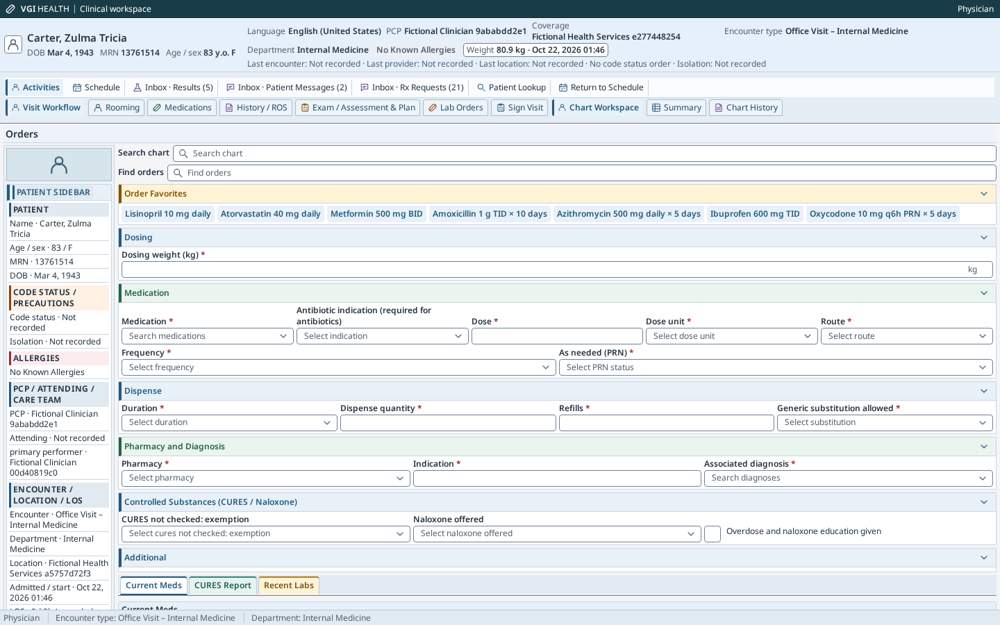
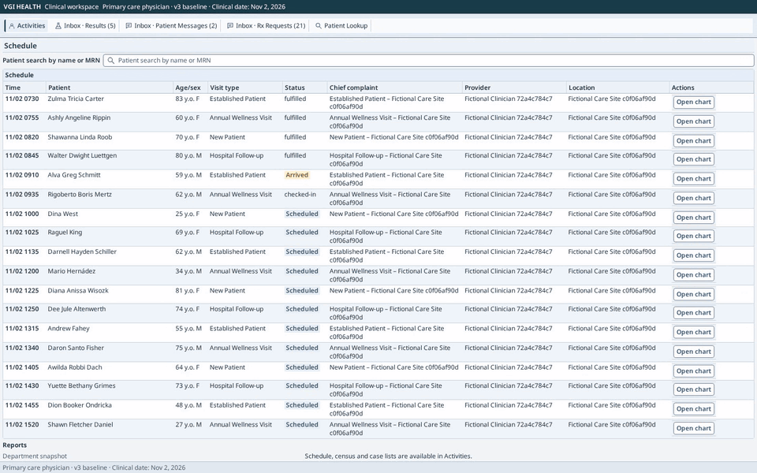
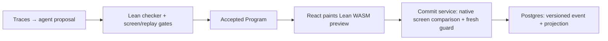

_README last reviewed against commit `30408ffc` (2026-11-13)._

# VGI Health

[](https://github.com/saithat/VGI-Health/actions/workflows/ci.yml)

A research system for clinical software that can safely change itself. It has
three parts:

1. **A realistic EHR simulator.** A hospital and clinic electronic health
   record (EHR) built on the conventions of real-world commercial EHR
   systems. It includes a patient banner and
   patient sidebar, inbox, chart history, ED track board, MAR and flowsheets,
   order entry with order favorites, interruptive and passive alerts, and
   vendor releases that change the rules. It runs on synthetic FHIR patients.
   Simulated clinicians work through generated clinical days in it, so any
   change to the screens can be measured in clicks, scrolls and mouse travel.
   A shared clock tracks queues, shift coverage and interrupting work; returning
   to a draft revalidates its evidence before the next guarded interaction.
2. **Lean proofs of what a clinician-facing interface must preserve.** The
   hospital's rules (law, regulators and hospital policy) are written in Lean,
   and a Lean interpreter runs every click. The theorems hold for every screen
   layout. Nothing is signed without its required entries, reviews and alert
   acknowledgments. The patient banner, required information and interruptive
   alerts stay on screen. Macros never act for a human.
3. **A way for an AI model to change the interface and stay within those
   proofs.** The model edits only the screens, never the rules. A Lean checker
   accepts or rejects each proposed layout and gives a counterexample when it
   rejects one. Only accepted layouts deploy, and the guarantees of part 2
   carry over to them.

Part 2 is what makes part 3 possible. Clinical software is normally locked
down because every change must be re-validated. Here the guarantees are proved
once for every accepted layout, so the screens can be reshaped for each
clinician without re-validating each version by hand. [What is
proved](#what-is-proved) lists what is covered and what is not. [Open
problems](#open-problems) describes the weakest parts: how users are simulated
and how the agent makes its changes.

The same Lean interpreter runs natively and in the browser as WebAssembly. The
project is not affiliated with any EHR vendor.

| Primary care order entry | ED track board | Inpatient MAR |
|---|---|---|
|  |  |  |

A primary-care visit, from the clinic schedule to order review: the clinician
opens the chart, enters the reason for visit and vitals, reviews allergies,
picks an order favorite, confirms each automated prefill and reviews the order
before signing ([full-resolution video](app/shots/video/p1-visit.mp4)).

[](app/shots/video/p1-visit.mp4)

## Architecture

The Lean `Spec` is the rulebook; a JSON `Program` describes screens, fields,
tabs, buttons and macros. The agent changes only `Program`. Native `check`,
browser screen checks and replay validation gate deployment; `step` guards each
interaction at runtime. A rejected proposal can receive a counterexample and up
to three repairs.

Seeded safety probes are diagnostic and cannot deploy. The allergy probe hides
every provider of the required allergy list on one commit screen; hiding only
one panel can be safe ([investigation](docs/audits/wave2-investigation-20261109.md)).



`lean/` owns the interpreter, checker, renderer, simulator and proofs; `wasm/`
builds the browser interpreter. `app/` paints and reviews its output. `agent/`
proposes and evaluates layouts, `explore/` supplies an archive and search, and
`world/` generates synthetic clinical days. `services/commit/` is the sole live
writer; `infra/` supplies Postgres and Keycloak identity.

Every clinical command binds its request ID, chart version, ordered interaction
journal and painted-screen hashes. Native Lean reconstructs the journal and
compares screens, then checks the current guard under patient/shared-resource
locks. Acceptance publishes events and projections atomically; retries recover
the original intent. There is no browser FHIR writer. React, SQL, authentication
and the host wrapper are tested; compiler and storage assumptions remain trusted.
[Architecture and one-click protocol](docs/architecture.md) gives the trust
boundaries, directory map and detailed sequence.

## Headline results

These are synthetic, local experiments, not observed clinician performance.
The retained recording was re-certified against the current build on
2026-11-13; its layouts, rule inputs and outcome scenarios are frozen.

| Evidence | Result and caveat |
|---|---|
| Retained recording verification (frozen inputs) | All 33 retained revision bindings re-certified; strict native/WASM replay checked 1,284 tasks and 72,636 events with zero mismatches. Re-certification preserves recorded layouts and source inputs; it adds no new outcome scenarios. [Build and screen evidence](docs/methods/screen-validation.md). |
| Matched workload experiment | Blind even days across five clinicians: both successor arms complete 660/662 tasks; mean queue delay is 1.19 minutes with fixed-cost interruptions and 1.73 with typed real work. Both have two overdue doses and zero active overtime. These are fixed-layout offline runs with uncalibrated rates; the archived cohort differs. [Cohorts, endpoints and screenshots](docs/methods/workload-and-interruptions.md#local-measurement-cohorts). |
| Simulator smoke test | Day 2: 158/158 tasks complete; mean queue 12.58 min versus 1.73 in the earlier cohort. On identical new tasks, length costs add 267.69 active min and 56 scrolls. Scenario assumptions, fixed layouts, different cohorts. Full template/persona browser audits: zero findings. [Verification and scope](docs/audits/wave3-sim-20261109.md). |
| Information lookup experiment | 30/30 tasks complete in both arms. Lookup effort varies by role and route; memory carry is a proxy, not a clinical capacity measure. This small seed-7 sample does not estimate population effects or achievable summary savings. [Measurements and assumptions](docs/methods/information-needs.md). |
| Layout optimization pilot | One frozen P1 context accepts B and refuses D after D adds three validation clicks; both selected designs have structural distance 0.004717 and zero native rejection rate. This does not establish improvement or broader exploration. [Discovery policy and pilot](docs/methods/discovery-and-cadence.md). |

The [EHR scope inventory](docs/methods/ehr-scope.md) lists seven workflows, five
personas and the simplified or absent departments, interfaces and production
capabilities. The system uses synthetic patients and is not a deployable product.

### Simulated hospital

- Separate UI, clinical, communication, waiting, queue and return clocks share one serial server. [Methods](docs/methods/wave3-simulation.md#separate-time-on-one-server).
- Consecutive hospital days include night/weekend ED arrivals, next-day provider queues, boarding and merged queues. [World clock](docs/methods/wave3-simulation.md#continuous-world-and-ed-stages).
- Accepted handover transfers responsibility to actors with private receipts and layout memory. [Ownership](docs/methods/wave3-simulation.md#ownership-and-acceptance).
- Role/activity interruption service and length-based note reading/scrolling retain explicit legacy opt-outs and historical native decoding; data comparisons expose the same controls. [Parameters](docs/methods/wave3-simulation.md#roleactivity-interruptions-and-opt-outs).
- Refills have claim/delegation, review, guarded approve/deny/change, pharmacy response and closure phases ([methods](docs/methods/workflow-phases.md)).
- Compound alert scenarios cover inspection, cancellation, alternative orders and documented override through existing guards ([methods](docs/methods/workflow-phases.md#compound-alerts)).
- MAR has CMS ±30/60/120-minute windows and separate administration/charting times; timing draws remain scenarios ([methods](docs/methods/workflow-phases.md#mar-timing)).
- Five inbox streams use N1 mean inputs, explicit ownership and delegated support review ([methods](docs/methods/workflow-phases.md#inbox-streams)).
- Release gates prove retention of reachable field capabilities for the declared workload even when optional features are declined ([contract](docs/methods/workflow-phases.md#release-capabilities)).
- Chart synthesis, note preparation and result follow-through have explicit scenario phases ([scope and remaining work](docs/methods/workflow-phases.md#scenario-scope); [verification](docs/audits/wave3-workflows-20261109.md)).
- Synthetic Hospital supplies synthetic-benchmark case mix, imaging priority and note-section text ([method](docs/methods/synthetic-hospital.md)).
- Dataset notes use section-level template/copy/free-text effort with verified older N18 origin shares and explicit scenario operator costs ([methods and matched comparison](docs/methods/note-authoring.md)).
- P5 inpatient rounds include scenario imaging orders with Synthetic Hospital priority ([methods](docs/methods/workflow-phases.md#inpatient-imaging)).
- Library generation defaults to realistic workflows; explicit legacy mode reproduces preserved library snapshots byte-for-byte ([methods](docs/methods/workflow-phases.md#library-default-and-frozen-worlds)).
- Separate role profiles remain experimental: the pre-declared fit failed every holdout gate ([methods](docs/methods/role-calibration.md), [diagnosis](docs/audits/fit-diagnosis-20261110.md)).

## How to run

Requires Node ≥22.18, pnpm 11.8, Docker Compose and pinned Lean 4.35
(`lean/lean-toolchain`). Run commands from the repository root with disk-backed
`TMPDIR`. Restore local gitignored fixtures, worlds and recordings before
archive-backed work. Run data and local run-store aliases remain untracked. Initial FHIR imports are immutable; a different baseline
requires a separate tenant/database.

```sh
export TMPDIR="${TMPDIR:?Set disk-backed TMPDIR}" CI=true LEAN_NUM_THREADS=6
CI=true pnpm install --offline
COMPOSE_PROJECT_NAME=vgi-local make install SYNTHETIC_HOSPITAL=1
make run APP_PORT=5173
```

`make install` builds native Lean, checks packaged WASM, provisions local identity
and imports the baseline before starting the commit service. `make run` builds
and serves the app. Default ports: app 5173, commit 18090, Postgres 55532,
Keycloak 18180. Local passwords are in untracked `.env`. Use a unique
`COMPOSE_PROJECT_NAME` for an isolated stack; `make infra-down` preserves its
volumes. [Live setup and validation](docs/methods/live-validation.md) covers
accounts, import bindings, alternate ports, MAR/ADT and integration commands.

For a self-contained cadence demo after installing dependencies:

```sh
pnpm --filter agent cadence-fake --out "$TMPDIR"/cadence-demo
```

It uses synthetic geometry and a fake checker, certifies nothing and makes no
live model calls. [Model backends](docs/methods/model-backends.md) documents real
and replay configuration, context requirements and frozen-night comparisons.
The [run-data contract](docs/methods/run-data.md) explains completed prefixes,
lazy review evidence and safe local renames.

`scripts/build-ehrheavy.py [--target MODULE]` builds the full-profile `EhrHeavy`
modules serially (about 8.3 GiB peak); the weekly `ehrheavy.yml` workflow audits
all 24 seeded-defect axioms.

CI builds Lean and audits axioms; lints/typechecks app, agent, world and commit;
runs unit tests, 201 canonical conformance scenarios, the 15-accepted/23-rejected
certification matrix, and Postgres integration/protocol tests. Archive-backed
tests skip without local data. CI checks packaged WASM evidence but does not
rebuild WASM. Full Comparator verification is `make verify`; browser audits,
WASM rebuilds and live e2e remain manual. [Reproduction and CI](docs/reproduction.md)
contains the exact commands, local prerequisites and browser-lock discipline.

## What is proved

“Proved” means kernel-checked Lean theorems using only `propext`,
`Classical.choice` and `Quot.sound`. Clinical statements are cross-checked by
Comparator (`make verify`); protocol and experimental UI-library statements are
not yet in Comparator.

The headline `Ehr.Proofs.*` and original `accepted_*` theorems below cover
`Ehr.step`/`init` and `Props.Reachable`. The deployed API calls
`Ehr.runStep`/`runInit`, which add a critical-result handler and patient
selection. [Runtime coverage](docs/methods/runtime-coverage.md) proves the commit
safeguards (T0, T2, T3), popup origin, popup severity and popup blocking for
`runStep`. Of the twelve accepted properties, three carry over to `runStep` for
every program; the other nine are proved for programs without patient selection
run with fixed facts (`accepted_ordinary`). With patient selection, all nine
are proved per bound patient episode (`accepted_episode`): from the hydration
of one patient's chart until the clinician leaves or switches it, with fixed
facts. Leaving a chart keeps that patient's unsigned entries and alert
acknowledgments as a draft for the signed-in session and reopening the chart
restores them; signed work is not restored. Across such navigation, properties
2, 5 and 11 are proved with each patient's work read from the open chart or
the draft (`selection_global`). The call that loads a chart refuses commits,
acknowledgments and order-reconciliation decisions, and no patient data is shown before a patient is selected
(`unselected_view`). Properties 1 and 9 keep their global counterexamples on
the landing view; the global form of the other four is not stated. The live
app keeps unsigned drafts across charts after long visits and changes to other
patients' records ([drafts and signing](docs/methods/live-drafts.md)). Observation
fields offer “Time taken”; entry, observation and signing times stay separate.
“Late entry” is informational, using a configurable 24-hour local policy default
([timing](docs/design/chart-timing.md)). A
"Deficiencies" work list shows each clinician's latest unsigned drafts and overdue
record obligations when enabled by the release, using patient-, encounter- and
version-bound record evidence ([mappings and limits](docs/design/chart-timing.md#trusted-temporal-record-mappings)). Unsigned orders reopened after a transfer cannot be signed
until the clinician keeps, changes or discontinues each line; after a discharge
they are not restored and are listed as discarded. Critical-result action text is a
draft outside `captured`, cleared on a successful resolve; the handler is
refused while an alert popup is open, and the checker reserves all `critical.`
component IDs; order reconciliation similarly reserves `reconcile.line|`, so runtime
controls cannot shadow a program control
(`Ehr.Check.accepted_critical_no_shadow`). Authorization is by
responsible/covering user ID, which is stricter than a role check.

| Headline theorem(s) | Guarantee and scope |
|---|---|
| `T0`, `T2` | Every program/record/event sequence: no sign without required confirmed entries, human provenance and declared units, valid reviews/receipts, interruptive-alert acknowledgments and an allowed role. |
| `T3`, `T6` | Macros/prefills cannot sign, acknowledge, create receipts or supply human-only values; cosigning names a second human. |
| `A2`, `A4`; `D1`–`D6` | Alert conditions/passivity and the rendered banner, required reviews, honest buttons and modal alerts are preserved. |
| `accepted_*` | Checker acceptance implies 12 of 13 screen properties for all patients and reachable states. Property 6 (completion) is proved only for restricted families. For the V1–V3 rule sets `Completable` is false as defined: it ranges over records with no trusted payload, where no program can commit (`v1_payload_domain_not_satisfies`, `EhrHeavy`). A [feasibility premise (`CompletableWhereFeasible`)](docs/design/property6-record-domain.md) excludes missing-payload records (`missing_payload_not_commitFeasible`) and carries over all restricted-family proofs (`completable_imp_completableWhereFeasible`), while static acceptance under V1–V3 still permits a reachable cross-field validation trap (`v1_v2_v3_not_acceptedCompletableWhereFeasible`). |
| Multi-actor safety | Bed exclusivity, at-most-once doses and critical-result resolution or escalation by deadline in the Lean reducers/models. |
| Protocol invariants | Unbounded request-effect uniqueness, durable retries, guarded expected-version replacement, refusal isolation and event-fold projections, under the storage/sole-writer contract. ADT uses the actual native reducer; host trace refinement is tested. |
| Research layout range | `renderer_range`, `checkProgram_sound`, `layoutAccepted_program`: the fixed semantic text-card compiler covers every renderer output and preserves G1–G9. This does not certify deployed widget fidelity or integrate DOM/APG dispatch. |

Not proved: clinical completeness or appropriateness of the rules; general
completion; TypeScript/SQL/FHIR refinement, imports and projections; actual
cached reconstruction or dynamic directory/time inputs; physical transport;
React, DOM pixels, CSS, browser behavior, perception or actions outside a command.
The compiler/native clang, Postgres contract and authentication remain trust or
test boundaries. SHA-256 collision resistance is assumed; serialization
injectivity and native/WASM/host agreement are tested. WASM/Emscripten are
untrusted for displayed-tree comparison: discrepancies refuse the next command.
The agent is untrusted and only accepted programs deploy.

[Assurance and trust limits](docs/assurance.md), [commit protocol](docs/methods/commit-protocol.md),
[ADT](docs/methods/adt.md), [completion checker](docs/methods/completion-checker.md)
and [UI-library methods](docs/methods/ui-library.md) state the precise assumptions,
quantifiers, bounded checks and outstanding proof work.
The generated [proof map](docs/proof-map.md) includes all headline dependency
charts; CI enforces freshness with `scripts/proof-map/build.sh --check-readme`.
Regenerate it with `scripts/proof-map/build.sh --readme` after building the
[additional proof modules](scripts/proof-map/extra-modules.txt). The same CI job
uploads self-contained declaration and module-import views, including private
declarations and named equation lemmas, with source links at the built commit, bidirectional expansion, guarantee breadcrumbs, full-type previews,
keyboard search with arrow navigation and per-theorem axioms/premises. Hover and keyboard previews preserve
access to their trigger nodes. The import view uses an isolated
Lean 4.35 `import-graph` package; its DOT edges drive the SVG view and are
cross-checked against the compiled environment. It adds no dependency to the
certified build.
An optional [Lean Atlas view](docs/proof-map.md#optional-lean-atlas-view) runs against the same compiled roots in isolation.
[MAR proof walkthrough](docs/proof-walkthrough.md) traces one guarantee through its definitions and key lemmas.

## Provisional policies

The MAR, ADT, workload and interruption rules are implemented, provisional
specifications. The checks establish their stated behavior; their clinical
appropriateness and the uncalibrated rates are not validated.

| Area | Implemented policy |
|---|---|
| MAR outcomes and timing | [Symmetric CMS windows and distinct clocks](docs/methods/workflow-phases.md#mar-timing). Criticality, holds, 20/45-minute re-offers, escalation and the legacy monitoring cutoff remain scenario policy. |
| MAR follow-up scope | Prescriber notification is nursing documentation only; live delivery and cross-shift dose ownership remain future work. |
| ADT cancellation eligibility | [Administrative rules](docs/methods/adt.md#administrative-adt-extension): patient's latest ADT event, of the matching kind; positive exact ordinal; active destination beds; transfer cancellation requires the original bed empty and ready after cleaning. |
| Clinical work after cancellation | Retain all documentation, orders and administrations with their original encounter links, including an encounter marked entered-in-error; append cancellation provenance. |
| Swap compatibility | Two distinct admitted patients owning distinct active occupied beds; complete signed board scope; no additional unit/service compatibility restriction. |
| ADT simulation and transport | Provisional movement/error rates and cleaning/transport delays; `adt.json` is an administrative stream, with physical transport represented separately and no change to bedside clinical effort. |
| Workload dispatch and coverage | One serial clinician/coverage chain; priority/deadline/arrival ordering; task-boundary dispatch with event-boundary communication preemption; 15-minute hospital overlap; finite successor coverage and clinic weekend closure. ESI queue deadlines are 10/30/60 minutes for ESI ≤2/3/≥4. |
| Workload scope and endpoints | Source worlds include night/weekend cases; horizon schedules merge subsequent arrivals. Successors have private memory and explicit simulated handover acceptance; live human acceptance remains outside the model. Completed tasks use documentation endpoints; abandoned MAR attempts use service finish, carried doses use the coverage horizon. Result response requires completion. Missing source timing uses planned readiness. |
| Draft ownership and authority | Frames bind clinician, source patient and task; any workspace must remain selected and bound to that patient to restore. Current receipt rules filter stale evidence; changed chart data requires reconfirmation. Incomplete unsent drafts are discarded with reasons. Responsibility transfers only after the named recipient accepts, without sign authority or another clinician's draft. |
| Interruption service and calibration | Role/activity minute-bin rates, channel service, fixed exposure, urgency/type mix, protected-popup triage and return costs are provisional; parameter provenance and opt-outs are in [simulation methods](docs/methods/wave3-simulation.md). Urgent work precedes queued return work; individual protocols and reorientation are atomic. Fixed-exposure closure waits count as wall time, excluding active effort and overtime. |
| Commit and ADT protocol assumptions | [Models and storage contract](docs/methods/commit-protocol.md): sole writer, consistent imports, locked current snapshots and atomic durable publication; host refinement remains tested. |
| Completion interaction rules | [Scenario checker](docs/methods/completion-checker.md): acknowledgment before commit and Back retention; general property 6 and patient-switch durability remain open. |
| Research layout predicates | [UI library](docs/methods/ui-library.md): G1–G9, safety-text preservation and the supported viewport/font/keyboard contracts; no deployed painter change is authorized. |
| Release and user-model choices | [Cadence](docs/methods/discovery-and-cadence.md) uses a provisional effect floor, movement proxy and auto-approval; [bounded learning and preferences](docs/methods/simulation.md) are uncalibrated. [Tool-driven arm E](docs/methods/agent-loop.md) stays opt-in: in the 35-decision B/E paired run B accepted 88.6% and E 0%, because every E sample hit its 120K cumulative token ceiling before submitting, a ceiling B did not have. [Arm R](docs/methods/rlm-night.md), an opt-in recursive-language-model agent with a confined REPL, submitted within budget on all 70 full-study samples but accepted 57/70 versus B’s 58/70, using 1.86× the input tokens and 1.43× the charged sample wall time. |

The [full 35-decision paired B/R study](docs/methods/rlm-night.md#full-paired-results) accepted 81.4% for R versus 82.9% for B; the [Luna-root pilot](docs/methods/rlm-night.md#cheaper-model-pilots) accepted 2/7. R remains opt-in.

## Open problems

How users are simulated and how the agent changes the interface are the two
weakest parts.

[Workflow calibration](docs/design/workflow-calibration.md) inventories current
assumptions and public usability/workload evidence, including 2020+ cohort
updates, explicit older-evidence retention, role-specific target settings and a
statistical holdout acceptance rule without clinician review. It is a research
plan; [role fitting](docs/methods/role-calibration.md) applies its frozen gate
and leaves every profile experimental. No clinically validated simulator is
claimed. The source register
retains supersession links and a reproducible citation/recency verifier
(`scripts/verify-workflow-sources.py --online`).

- **Simulated users are uncalibrated.** The default simulated clinician still
  knows the layout: it plans the shortest path through the whole current
  program by breadth-first search over real interpreter steps
  (`lean/Ehr/Sim/Interaction.lean`), so a rearranged layout costs it nothing.
  An opt-in bounded-knowledge clinician (`lean/Ehr/Sim/Bounded.lean`,
  `Discovery.lean`) remembers where controls were, misses after a move,
  searches by label and falls back to charged help; it measures discovery and
  relearning cost, and the BFS run is retained as an independent expert comparison. Its search,
  memory, timing, help and preference parameters are simulation assumptions,
  not estimates from clinician observations. Completion parity with the expert
  is a regression requirement on the sampled and full persona workdays, not a
  theorem. Patient-directory selection still uses the shared fixed policy.
- **Clinician participation and design exploration are limited.** Historical
  nightly runs deploy a greedy patch or disjoint bundle. The opt-in cadence
  protocol keeps certified, screen-gated alternatives in a quality-diversity
  archive, preserves unchosen train estimates and known duds, and ships through
  a configurable schedule and review hook. Optional bounded switch costs and
  tailoring sessions now connect that archive to the bounded clinician's
  relearning estimate and private choice function. Defaults retain the movement
  proxy and auto-approval. Sessions export train-only comparisons and friction
  to later nightly prompts. The admitted generator changes layout tags, density and shortcuts and can
  move review components or complete groups through the same certification gates.
  Its finite public placement enumeration still bounds which tastes can be recovered. There is
  no live in-app choice/flag control, human calibration or live cadence study.

## Documentation

Each topic owns its detailed claims, caveats, citations and reproduction commands.

| Topic | Reference |
|---|---|
| Architecture and trust boundaries | [Architecture](docs/architecture.md), [assurance](docs/assurance.md), [generated proof map](docs/proof-map.md) |
| Setup, tests and CI | [Live validation](docs/methods/live-validation.md), [reproduction](docs/reproduction.md), [CI workflow](.github/workflows/ci.yml) |
| Clinical scope and rules | [Workflow inventory](docs/methods/ehr-scope.md), [regulations](docs/regulations.md), [rule catalog](docs/rules/catalog.md) |
| Simulation and calibration | [Bounded clinician](docs/methods/simulation.md), [workload/interruptions](docs/methods/workload-and-interruptions.md), [simulation clocks](docs/methods/wave3-simulation.md), [workflow phases](docs/methods/workflow-phases.md), [public-evidence calibration plan](docs/design/workflow-calibration.md) |
| Clinical scenario policies | [Medication outcomes](docs/methods/medication-outcomes.md), [information needs](docs/methods/information-needs.md), [ADT](docs/methods/adt.md) |
| Commits and completion | [Commit protocol](docs/methods/commit-protocol.md), [completion checker](docs/methods/completion-checker.md) |
| Interface research | [UI library](docs/methods/ui-library.md), [tailoring sessions](docs/methods/tailoring-sessions.md), [screen certification](docs/methods/screen-validation.md) |
| Agent experiments | [Discovery/cadence](docs/methods/discovery-and-cadence.md), [model backends](docs/methods/model-backends.md), [tool-driven arm E](docs/methods/agent-loop.md), [RLM arm R](docs/methods/rlm-night.md), [harness-native arm H](docs/methods/harness-night.md) (Claude Code CLI in a confined workspace: 60/70 accepted vs B's 58/70 in the full study; B ran on Codex `gpt-6.1-sol` and H on Claude Opus 5.5, so the gap is not a harness-only effect; opt-in) |
| Local evidence and data | [Run data](docs/methods/run-data.md), [conformance](docs/methods/conformance.md), [Synthetic Hospital](docs/methods/synthetic-hospital.md), [organization names and regeneration](docs/methods/fictional-identities.md), [audit records](docs/audits/) |

## Data sources

- **Synthea** (Apache-2.0) synthetic patients. Walonoski J, et al. *Synthea.*
  JAMIA 2018;25(3):230–238.
- **Synthetic Hospital** (code MIT; data fully synthetic and redistributable)
  longitudinal records. Park, Chen, Dettmers, preprint 2026,
  https://arxiv.org/abs/2609.30027. All 1,268 patients are converted; the
  dataset also supplies synthetic-benchmark (not calibrated) case mix, imaging
  priority and note-section text ([method and checks](docs/methods/synthetic-hospital.md)).
- CPT is a trademark of the AMA; only a few code identifiers with original
  short labels are included.
- Fonts: Noto Sans, Noto Sans Mono, Noto Sans Symbols 2, Noto Sans CJK SC and Noto Sans Hebrew (SIL OFL 1.1).
