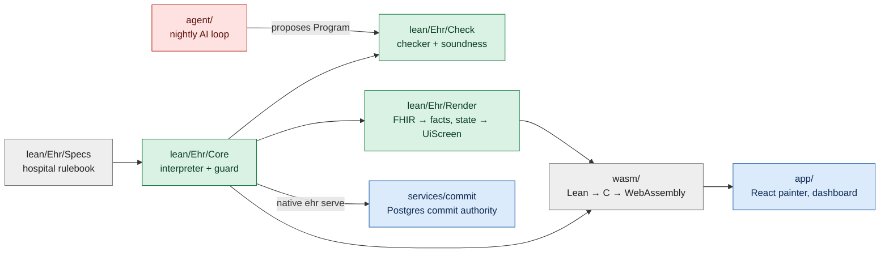
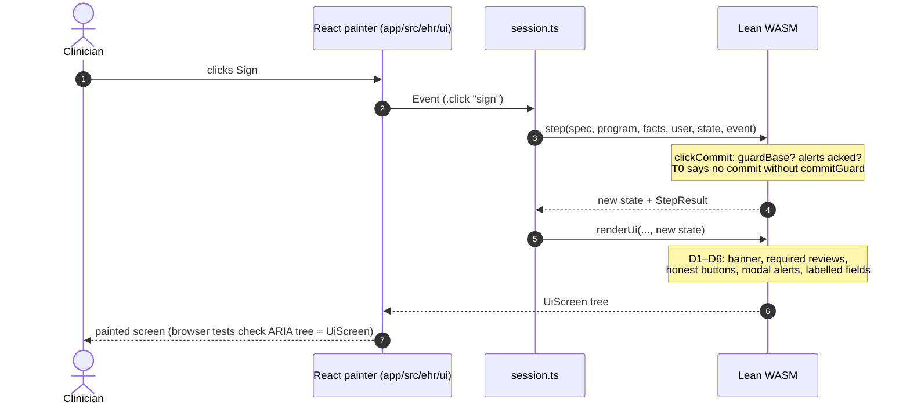
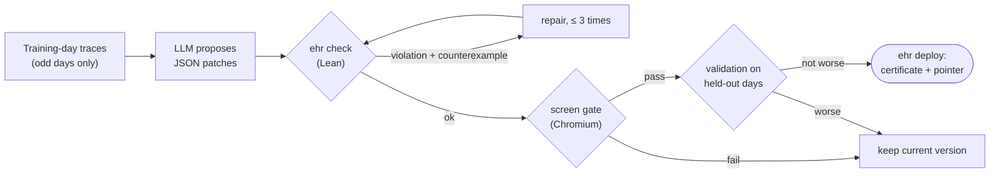
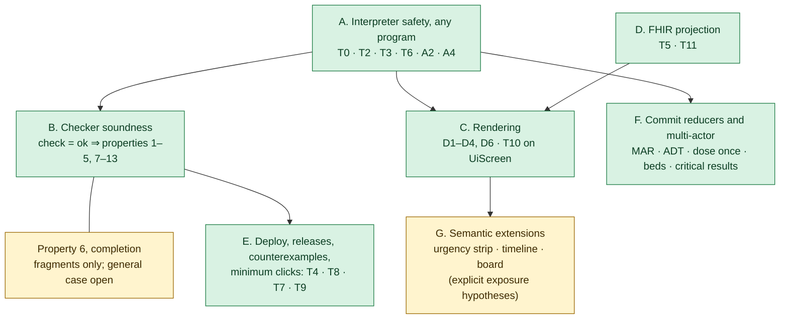

# VGI Health: a guided tour

This guide is the shortest path to understanding the whole project and its
proofs. It does not replace the [README](../README.md), which tracks status and
measurements, or [VERIFICATION.md](VERIFICATION.md), the reviewer's audit. Read
this guide first, then use those two as references.

It covers:

1. [The idea in one minute](#1-the-idea-in-one-minute)
2. [Five nouns and one function](#2-five-nouns-and-one-function)
3. [Map of the repository](#3-map-of-the-repository)
4. [Two journeys through the code](#4-two-journeys-through-the-code)
5. [The proofs, layer by layer](#5-the-proofs-layer-by-layer)
6. [How the proofs work](#6-how-the-proofs-work)
7. [What is not proved](#7-what-is-not-proved)
8. [Check it yourself](#8-check-it-yourself)
9. [Glossary of labels](#9-glossary-of-labels)
10. [Reading paths](#10-reading-paths)

Theorem names and file paths are given without line numbers on purpose, because
line numbers go stale. Search for the name, for example with
`git grep -n "theorem T0_commit_needs_guard" lean/`.

---

## 1. The idea in one minute

An electronic health record (EHR) has *rules*: an order cannot be signed until
allergies were reviewed, a dose must be entered in kg, a second nurse must
cosign a high-alert drug. It also has *screens*, which differ by clinician and
can be tuned to save clicks.

VGI Health keeps those two things apart:

- The **hospital rulebook** (a Lean value of type `Spec`) says what must be
  entered, reviewed, acknowledged, and by whom.
- A **UI program** (a JSON value of type `Program`) says how the screens are
  laid out for one clinician: screens, fields, buttons, tabs and macros.
- An AI agent proposes new UI programs overnight. It is **untrusted**.
- A **checker** written in Lean (`check`) must accept a program before it is
  deployed, and **theorems** say what acceptance guarantees.
- The **same Lean interpreter** (`step`) runs every click: natively for the
  checker and simulator, and as WebAssembly in the browser. React only draws
  the tree Lean returns.

So an AI may change the layout, but every proof about the interpreter still
applies to the new layout, and the checker's soundness theorems carry
guarantees from "accepted" to "safe in every reachable state".

---

## 2. Five nouns and one function

Everything in the Lean core is built from these types, all in
[`lean/Ehr/Core/Types.lean`](../lean/Ehr/Core/Types.lean):

| Type | What it is | Example |
|---|---|---|
| `Spec` | The rulebook: elements (data fields), infos (things to review), commits (sign actions), entry and review requirements, alert rules, design rules. | "Signing orders requires `weight` in kg, entered by a human; the allergy list must be shown." |
| `Program` | One clinician's UI: a flat list of `Screen`s, each a flat list of `Component`s, plus `Macro`s. Nesting uses `parent?`. | A sign screen with a weight field, an allergy panel and a Sign button. |
| `Facts` | One patient's record, already abstracted from FHIR. Fixed for the whole episode. | Weight today, active allergies, the drug to give. |
| `State` | The interaction state of one episode: current screen, captured values, receipts, acknowledged alerts, commits, open popup, clock. | "On screen `sign`, weight 70 kg captured and confirmed." |
| `Event` | One user or macro action: `click`, `enter`, `confirm`, `ack`, `selectTab`, `scroll`, `search`. | `.enter "weightField" (.qty 700 .kg)` |

Two more small types matter: `User` (an ID and a `Role`) and `Actor` (`human`
or `macro`, meaning who performed the event).

The one function is the interpreter step in
[`lean/Ehr/Core/Interp.lean`](../lean/Ehr/Core/Interp.lean):

```lean
step (sp : Spec) (prog : Program) (facts : Facts) (user : User)
     (actor : Actor) (s : State) (e : Event) : State × StepResult
```

`StepResult` is `ok`, `blocked reason` or `ignored`. Around `step` there are:

- `init`, the start state of an episode (start screen, prefilled);
- `runAll`, which folds `step` over a list of events;
- `view` ([`Core/View.lean`](../lean/Ehr/Core/View.lean)), what is shown, what
  is enabled and why things are blocked;
- `commitGuard` ([`Core/Guard.lean`](../lean/Ehr/Core/Guard.lean)), the Boolean
  test every sign must pass;
- `renderUi` ([`Render/Ui.lean`](../lean/Ehr/Render/Ui.lean)), which turns a
  state into the semantic screen tree (`UiScreen`) the browser paints;
- `check` ([`Check/Check.lean`](../lean/Ehr/Check/Check.lean)), the checker,
  which returns `.ok` or `.violation property message counterexamplePath`.

**The safety idea in code.** In `clickCommit`, a commit is appended only on
the branch where `guardBase` holds and every interruptive alert is
acknowledged. Macros cannot click commit, review or acknowledgment buttons:
`clickCore` returns `blocked "human only: …"` for `Actor.macro`. Every theorem
in layer A (below) is a precise statement of those few lines.

---

## 3. Map of the repository



### Lean (`lean/`)

| Directory | What lives there | Read when |
|---|---|---|
| `Statements.lean`, `Solution.lean`, `comparator.json` | The 18 headline interpreter theorems as a Comparator challenge, and the file that imports their proofs. | First. |
| `Ehr/Core/` | Types, the interpreter (`Interp`), the guard (`Guard`), alerts, views, JSON. **Trusted definitions**: the proofs are about these. | Second. |
| `Ehr/Props/` | Definitions of the 13 properties (`Properties.lean`), shared terms such as `Reachable`, `Always`, `EveryStep` (`Basics.lean`), and the T2/T6 helper definitions (`Defs.lean`). **Trusted definitions.** | With Core. |
| `Ehr/Proofs/` | Proofs of T0, T2, T3, T6, A2, A4 (layer A), T4 deploy, frame lemmas, concrete examples. | To see how layer A is proved. |
| `Ehr/Check/` | The checker (`Check.lean`, `Rules.lean`), soundness proofs (`*Sound.lean`), completion fragments, a second Comparator challenge, regression tests. | For layer B. |
| `Ehr/Render/` | FHIR → `Facts` and display rows (`Fhir.lean`); `renderUi` (`Ui.lean`) and its D-theorems (`UiProofs.lean`); a legacy HTML page renderer (`Page.lean`, T10 in `Proofs.lean`). | For layers C and D. |
| `Ehr/Specs/` | Rulebooks `V1`, `V2`, `V3`, legal rule catalogs (`Rules/`), alert-urgency policy, the `core`/`full` profile switch (`Profile.lean`). | To judge what the rules say. |
| `Ehr/Canonical/` | The vendor's reference UI program (workflows W1–W7), per-persona presets, seeded bad programs. | To see a realistic program. |
| `Ehr/Sim/` | Simulated clinicians, goals, metrics, exact minimum-click search with certificates. | For the workload numbers. |
| `Ehr/Commit/`, `Ehr/Multi/` | Server-side commit reducers (MAR, ADT, commit-check) and multi-actor models (dose once, bed exclusivity, critical results). | For layer F. |
| `Ehr/Sem/` | Layout-independent semantics: perception, urgency, timelines, multi-patient boards. Newer research with explicit hypotheses. | For layer G. |
| `Ehr/Cli/`, `Main.lean`, `Ehr/Api.lean`, `Ehr/Tools/` | Native CLI (`ehr check`, `deploy`, `simulate`, `serve`, …), WASM exports, TypeScript type generator. | When wiring things. |
| `EhrHeavy.lean` | Opt-in whole-program proofs that need the `full` profile. Some are known stale (see VERIFICATION.md §5). | Rarely. |
| `CompletionObligations.lean` | The exact open general-completion proposition, with no proof. | To see what is open. |
| `Audit/SpecSurface.lean` | Reviewer tool listing every definition a theorem statement depends on. | When auditing. |

### Everything else

| Directory | What lives there | Trust |
|---|---|---|
| `agent/` | TypeScript nightly loop: observe traces, ask an LLM for JSON patches, check, screen-gate, validate, deploy. Entry: `agent/src/night.ts` (`runNight`). | Untrusted by design. |
| `app/` | React + Mantine app. `src/ehr/ui/` paints `UiScreen`; `src/core/` holds the WASM session; `src/data/` talks to Medplum and the commit service; `src/dashboard/` and `src/browser/` are review tools; `e2e/` has Playwright tests, including the screen gate. | Tested. |
| `services/commit/` | Node HTTP service with Postgres. A long-running `ehr serve` process decides; Postgres stores. Used by W4 medication administration and ADT bed management. | Integration-tested. |
| `wasm/` | Build scripts: Lean → C → Emscripten → `app/public/ehr/ehr-interp.wasm`. | Trusted toolchain. |
| `world/` | Generator of simulated clinical days (tasks, patients). | Simulation input. |
| `conformance/` | 200 held-out rule scenarios run on every deployed revision; hidden from the agent. | Tested. |
| `releases/` | Exported vendor releases (spec + canonical program). | Data. |
| `explore/` | Offline research on design-space search; never deploys. | Research. |
| `infra/` | Docker Compose for Medplum, setup, data loading. | Trusted. |
| `scripts/` | Audits, exporters, data tools. | Mixed. |
| `docs/` | Design notes (`design/`), audits (`audits/`), the hackathon archive (`hackathon/`, including the original [BRIEF](hackathon/BRIEF.md) that defines T0–T11). | — |

---

## 4. Two journeys through the code

### A click, end to end



The TypeScript side keeps the state as an opaque JSON string and never reads
it. If the step added a commit, the app writes it: to Medplum as a FHIR
transaction for most workflows, or through `services/commit` (which re-runs
the Lean guard on the server) for W4 MAR and ADT.

### A night, end to end



Code: `agent/src/night.ts` (`runNight`, `checkPatch`, `deployVersion`),
`agent/src/ehr.ts` (calls the native `ehr` binary), `lean/Ehr/Cli/Check.lean`
(`ehr check`, `ehr deploy`), `lean/Ehr/Check/Deploy.lean` (`deployPlan`).

---

## 5. The proofs, layer by layer

"Proved" means a Lean theorem checked by the kernel, using only the axioms
`propext`, `Classical.choice` and `Quot.sound`. Each layer below says which
inputs the theorem quantifies over.



### Layer A: the interpreter is safe for every program

These hold for **every** spec, program, patient record, user, state and event,
with no checker involved. An AI-written program cannot break them. They form
the root Comparator challenge: statements in
[`Statements.lean`](../lean/Statements.lean), proofs in `Ehr/Proofs/`.

| Theorem | Plain meaning | Proof file |
|---|---|---|
| `T0_commit_needs_guard` | If a step adds commit `c`, `commitGuard` held for `c` just before. | `Proofs/T0.lean` |
| `commitGuard_iff` | The Boolean guard means: role allowed for this encounter ∧ entries met ∧ reviews met ∧ interruptive alerts acknowledged ∧ extra rules. | `Proofs/T0.lean` |
| `T0_entry_values` | At commit, each applicable entry has a confirmed value, human-entered if required, in the declared unit (lb never satisfies kg). | `Proofs/T0.lean` |
| `T3_cosign_distinct` | A required cosign names a human-entered user other than the signer. | `Proofs/T0.lean` |
| `T2_receipts_sound` | A review hidden at commit was covered by a valid receipt (same data version, inside the window, allowed role) or a human waiver. | `Proofs/T2.lean` |
| `T2_shownOnCommit_shown` | A review that forbids receipts was on screen at commit. | `Proofs/T2.lean` |
| `T3_macro_step`, `T3_macro_run`, `T3_prefill_never_human_only` | Macros and prefills never add commits, acknowledgments, receipts or human-only values. | `Proofs/T3.lean` |
| `T6_macro_is_fold`, `runMacro_ok_iff`, `T6_macro_run_safe` | A macro behaves exactly like running its steps one by one through `step`, stopping at the first failure. | `Proofs/T6.lean` |
| `A2_view_firing`, `A2_view_shown`, `A2_popup_holds` | Alerts are shown or pop up only when their condition is true. | `Proofs/Alerts.lean` |
| `A4_step`, `A4_run`, `A4_passive_never_popup` | A passive alert never becomes a popup. | `Proofs/Alerts.lean` |

### Layer B: checker acceptance implies the 13 properties

`Satisfies spec prev canonical prog` in
[`Props/Properties.lean`](../lean/Ehr/Props/Properties.lean) is the
conjunction of 13 properties. Each property has two kinds of clause:

- **static** clauses about the program text (for example `CatalogOnly`,
  `NoAutomationAttempts`), which the checker decides directly; and
- **semantic** clauses about every reachable state of every episode (for
  example `WritesAllowed ep`, `Always ep …`), which need an invariant proof.

| # | Property | Proved by |
|---|---|---|
| 1 | `WellFormed`: catalog components, unique IDs, references resolve, landmarks always shown, required fields within depth. | `accepted_wellFormed` (`Check/PartialSound.lean`) |
| 2 | `CapturesAllOnce`: commits capture what is required; confirmed captures survive non-entry events. | `accepted_capturesAllOnce` (`Check/EnterOnceSound.lean`) |
| 3 | `WritesOnly`: only spec elements, commits and infos the role may write. | `accepted_writesOnly` (`Check/WritesSound.lean`) |
| 4 | `ReviewsBeforeCommit`: reviews met at commit, and on any screen with a commit button. | `accepted_reviewsBeforeCommit` (`Check/PartialSound.lean`) |
| 5 | `HumanOnlyKept`: no automation of human-only steps; cosign by a second user. | `accepted_humanOnlyKept` (`Check/HumanEventsSound.lean`) |
| 6 | `Completable`: every required commit stays reachable. | **Open in general.** Proved for fragments: `satisfies_of_checked_scalar`, `…_fixed_lines`, `…_receipt_lines`, `…_many_alerts`, `…_automated_lines` (`Check/Sound.lean`). |
| 7 | `UnitsRight` | `accepted_units` (`Check/PartialSound.lean`) |
| 8 | `WithinBudgets`: no more popup requests than canonical; limited movement between versions. | `accepted_budgets` (`Check/BudgetSound.lean`) |
| 9–12 | A1–A4 alert properties. | `accepted_alertsFire`, `accepted_noFalseAlarms`, `accepted_noRepeatInterruptions`, `accepted_severityTiers` (`Check/PartialSound.lean`, `AlertSound.lean`, `SeveritySound.lean`) |
| 13 | `NavigationSane` (D5): the workflow overview is unique and bounded. Note that this is about the overview list, not the clickable navigation tree. | `accepted_navigation` (`Check/NavigationSound.lean`) |

The assembly theorem is

```lean
theorem satisfies_of_checked_completable (sp prev can p)
    (h : check sp prev can p = .ok) (hc : Completable sp can p) :
    Satisfies sp prev can p
```

so **acceptance gives everything except property 6, which must be supplied.**
These statements are a *second* Comparator challenge,
[`Ehr/Check/ComparatorStatements.lean`](../lean/Ehr/Check/ComparatorStatements.lean)
with [`Ehr/Check/comparator.json`](../lean/Ehr/Check/comparator.json) (21
theorems, including T7 and T8). A third challenge,
[`Ehr/Check/completion-comparator.json`](../lean/Ehr/Check/completion-comparator.json),
covers the completion fragments. The exact open statement is
`AcceptedCompletion` in
[`CompletionObligations.lean`](../lean/CompletionObligations.lean).

### Layer C: the screen tree shows what must be shown

About `renderUi` and the `UiScreen` tree, for every program and record, in
[`Render/UiProofs.lean`](../lean/Ehr/Render/UiProofs.lean):

| Theorem | Meaning |
|---|---|
| `D1_landmark` | The patient banner is always present. |
| `D2_workspace_required`, `D2_required_info`, `D2_commit_review` | Required review information appears in the main workspace, not only in a sidebar. |
| `D3_honest_actions`, `D3_all_buttons` | An enabled button is enabled in Lean; a disabled one carries Lean's reason. |
| `D4_interruptive_modal`, `D4_passive_no_modal`, `D4_passive_inline` | Interruptive alerts are modal; passive ones are inline, never modal. |
| `D6_clear_fields`, `D6_field_labels` | Fields carry their label, unit, provenance and pending-confirmation state. |
| `T10_ui_shown`, `T10_ui_only_shown`, `T10_ui_hidden` | Exactly the components the interpreter marks as shown are in the tree. |

The browser part (that the painted accessibility tree equals `UiScreen`) is
checked by Playwright tests, not proved. Two renderers exist: `renderUi` is the
one the clinician sees; the older HTML `page` renderer
([`Render/Page.lean`](../lean/Ehr/Render/Page.lean), T10 in
[`Render/Proofs.lean`](../lean/Ehr/Render/Proofs.lean)) is still exported for
the replay inspector.

### Layer D: FHIR becomes facts faithfully

[`Render/FhirProofs.lean`](../lean/Ehr/Render/FhirProofs.lean): `T5_weight`
(the "weight today in kg" fact needs a matching Observation),
`T5_allergyVersion`, `T11_allergy`, `T11_med`, `T11_note` (every relevant FHIR
record reaches its display row). `T11_ui_allergy_fhir` and `T11_ui_med_fhir`
in `UiProofs.lean` carry these rows into the screen tree.

### Layer E: deployment, releases, counterexamples, minimum clicks

- **T4** (`Proofs/CheckDeploy.lean`): `T4_publish_only_if_ok`,
  `T4_rejected_not_published`, `T4_published_certificate`. They concern the
  pure write *plan*; atomic file writes are not proved.
- **T7** (`Check/ReplaySound.lean`, `Check/RuleSound.lean`):
  `T7_counterexample_replays`, `T7_rejection`. A rejection's counterexample
  replays through the real interpreter.
- **T8** (`Check/Monotonicity.lean`): a program certified against a newer
  release still meets the older release's obligations (`T8_v1_to_v2`,
  `T8_v2_to_v3`).
- **T9 / C1–C2** (`Sim/Certificate.lean`): `exact_of_accept`, `search_sound`.
  A minimum-click result comes with a checkable shortest-path certificate.

### Layer F: server reducers and many actors

- `Commit/Check.lean`: `accepted_current_guard`. The native commit check
  accepts only when the guard holds on the supplied current projection.
- `Commit/Mar.lean`: `commit_invariant`, `accepted_guard_at_written_version`
  for W4 medication administration.
- `Commit/Adt.lean`: `bed_exclusivity`, `patient_one_bed`, `bed_one_patient`,
  `transfer_atomic`, `reachable_invariant`.
- `Multi/Proofs.lean`: `reachable_doses_unique`, `reachable_beds_exclusive`
  over all finite interleavings of actors.
- `Multi/Critical.lean`: `bounded_follow_through`,
  `acknowledgment_never_resolves`. Critical results are resolved or escalated
  by a deadline, under fair service.

Postgres, HTTP and authentication are tested, not proved.

### Layer G: semantic extensions

`Ehr/Sem/` separates *what* must be perceivable from *where* it is drawn.
Results such as `strip_continuous_perceivability` (urgent alerts stay visible)
take physical exposure (fits in the viewport, legible, not covered) as an
**explicit hypothesis**, which browser sampling supports but does not prove.
Read [semantic-ui.md](design/semantic-ui.md) before these files.

---

## 6. How the proofs work

Five patterns cover most of the proof code. Knowing them makes long proof
files readable.

**1. Boolean code, logical statement.** The interpreter uses `Bool` tests
(`commitGuard`, `entryMet`, …) so that it can be compiled and run.
Theorems such as `commitGuard_iff` unfold these into ordinary logic once, and
later proofs use the logical form.

**2. Frame lemmas.** [`Proofs/Frame.lean`](../lean/Ehr/Proofs/Frame.lean) and
the many small `private theorem …_captured` lemmas say what a helper leaves
unchanged ("`clickAlert` does not touch `captured`"). They are mostly proved by
`unfold` + `split`. T3 is a composition of such lemmas.

**3. Invariant + induction on `Reachable`.** Every semantic property has the
shape `Always ep P` or `EveryStep ep P`, where `Reachable ep` is generated by
`start`, `step` (any actor, any event) and `wait` (the clock advances). The
proof always looks like `writesAllowed` in `Check/WritesSound.lean`:

```lean
theorem writesAllowed (ep : Episode) (hd : DeclaredWritesInSpec ep.spec ep.prog) … :
    WritesAllowed ep := by
  intro s hs
  induction hs with
  | start => …               -- invariant holds after init/prefill
  | step actor e _ ih => …   -- preserved by stepCore and by runMacro (induction on steps)
  | wait d _ ih => exact ih  -- clock changes do not matter for this invariant
```

The static premise `hd` comes from the checker; the rest is about `step`.

**4. Acceptance unpacks into rule results.** `check_ok_iff`
(`Check/RuleSound.lean`) turns `check … = .ok` into "every rule in `rules`
passes". Many rules are literally `decide (P spec prog)` for the same `P` used
in `Satisfies`, so the static half of a property is immediate. (Proofs
currently select rules by position in that list; see the review notes.)

**5. Concrete witnesses by `decide`.** Files such as
`Proofs/HypothesisExamples.lean`, `Props/Examples.lean` and the
`*_satisfies` theorems in `Check/Sound.lean` evaluate small programs in the
kernel to show the theorems are not vacuous: there is a real program where the
premises hold and the commit really happens.

Executable tests use `#guard` (run at build time, no theorem produced).
`#print axioms` lines are scattered through proof files; their output appears
in the build log.

---

## 7. What is not proved

| Item | Status |
|---|---|
| Rule content is clinically right and complete | Trusted. Current releases use the `core` profile; the full regulation catalog is off. |
| General completion (property 6) | Open beyond the named fragments. |
| React painter, CSS, browser layout, accessibility tree | Tested (screen gate, Playwright), not proved. |
| FHIR mapping in TypeScript, Medplum writes, Postgres, HTTP, auth | Integration-tested, not proved. |
| Lean compiler, Emscripten, WASM runtime | Trusted. Native vs WASM agreement is tested by replaying recorded trajectories. |
| Simulated clinicians reflect real people | Not claimed. |
| The AI agent is correct or honest | Not assumed. It is untrusted; only accepted programs deploy. |

---

## 8. Check it yourself

From the repository root, with [elan](https://github.com/leanprover/elan) and
`bubblewrap` installed (Comparator runs the project inside a `bwrap` sandbox):

```sh
cd lean
lake build                     # default library + ehr binary; ~8 min on 4 cores
```

The build prints a `depends on axioms` line for each `#print axioms`. All of
them should list only `propext`, `Classical.choice` and `Quot.sound`.

```sh
export COMPARATOR_BWRAP="$PWD/../scripts/lean-bwrap.py"
lake comparator                                                    # 18 interpreter theorems (layer A)
lake comparator --config Ehr/Check/comparator.json                 # 21 checker theorems (layer B, T7, T8)
lake comparator --config Ehr/Check/completion-comparator.json      # completion fragments
```

Then, optionally, the dependency and axiom audit, which regenerates the
appendix of VERIFICATION.md: `scripts/audit-verification.sh`.

To play with the interpreter from the command line, build and use the native
binary `lean/.lake/build/bin/ehr` (`check`, `simulate`, `step`, …); see
[`lean/Main.lean`](../lean/Main.lean) for the commands.

**Editing any Lean file**, including a comment, changes the source hash that
`make wasm-check` compares and invalidates recorded run certificates; see the
README section "Lean in the browser".

---

## 9. Glossary of labels

The project uses short labels from the original
[hackathon brief](hackathon/BRIEF.md). This table collects them.

| Label | Meaning | Where |
|---|---|---|
| **T0** | Hard stop: no commit without its guard. | `Proofs/T0.lean` |
| **T1** | Checker soundness for all 13 properties. Complete except property 6. | `Check/Sound.lean` |
| **T2** | Receipts are sound. | `Proofs/T2.lean` |
| **T3** | Human-only steps are never automated; cosign by a second user. | `Proofs/T3.lean`, `T0.lean` |
| **T4** | Only accepted programs are published. | `Proofs/CheckDeploy.lean` |
| **T5** | FHIR abstraction facts (weight today, allergy version). | `Render/FhirProofs.lean` |
| **T6** | Macros equal their step-by-step expansion. | `Proofs/T6.lean` |
| **T7** | Counterexamples replay for real. | `Check/ReplaySound.lean`, `Check/RuleSound.lean` |
| **T8** | Newer releases keep the older release's obligations. | `Check/Monotonicity.lean` |
| **T9**, **C1/C2** | Minimum clicks are exact; shortest-path certificate checks. | `Sim/Certificate.lean`, `Sim/MinClicks.lean` |
| **T10** | The page/tree shows exactly what the interpreter shows. | `Render/Proofs.lean`, `Render/UiProofs.lean` |
| **T11** | Panels list every relevant FHIR record. | `Render/FhirProofs.lean`, `Render/UiProofs.lean` |
| **A1–A4** | Alert properties 9–12: fire when they should, no false alarms, no repeats, severity tiers. | `Props/Properties.lean`, `Proofs/Alerts.lean` |
| **D1–D6** | Screen-tree design rules: banner, required info in workspace, honest actions, modal alerts, sane navigation (D5 = property 13), clear fields. | `Render/UiProofs.lean`, [core-model.md](design/core-model.md) |
| **Properties 1–13** | The conjuncts of `Satisfies`. | `Props/Properties.lean` |
| **U / C** | In VERIFICATION.md: holds for every input (U) vs. holds for checker-accepted programs (C). | — |
| **W1–W7** | Workflows: outpatient visit, results, ED, MAR, pediatrics, surgery, refills. | `Canonical/W*.lean` |
| **P1–P5** | Personas: primary care physician, ED physician, inpatient RN, pediatric NP, general surgeon. | `world/src/personas.ts`; per-persona UI presets in `Canonical/Personas.lean` |
| **G1–G8** | Goals in the hackathon brief §4 (not gaps). Older notes may say "gap G3" for the client-side guard on Medplum writes. | [BRIEF](hackathon/BRIEF.md) |
| **core / full** | Rule profiles. `core` is used by current releases; `full` adds the regulation catalog. | `Specs/Profile.lean` |
| **Receipt** | A record that information was reviewed: data version, time, role, user. Lets a later screen skip re-showing it. | `Core/Types.lean`, `Props/Defs.lean` |
| **Prefill** | A value placed in a field on screen entry: from the record, a default, or linked from another field. Never confirmed, never by a human. | `Core/Interp.lean` |
| **Slot** | Order line index; per-order-line requirements apply to each slot. | `Core/Types.lean` |
| **Seeds 01–33** | Permanent bad-program mutations the checker must reject. | `Canonical/BadPrograms.lean` |

---

## 10. Reading paths

**30 minutes, to understand the claim.** This guide §1–§2 and §5 layer A;
then [`Statements.lean`](../lean/Statements.lean) (about 200 lines, plain
docstrings); then `clickCommit`, `clickCore` and `step` in
[`Core/Interp.lean`](../lean/Ehr/Core/Interp.lean).

**Half a day, to review the proofs.** Add
[`Core/Guard.lean`](../lean/Ehr/Core/Guard.lean),
[`Props/Basics.lean`](../lean/Ehr/Props/Basics.lean) (`Episode`,
`Reachable`, `Always`), [`Props/Properties.lean`](../lean/Ehr/Props/Properties.lean),
[`Check/Sound.lean`](../lean/Ehr/Check/Sound.lean), then one complete
invariant proof, [`Check/WritesSound.lean`](../lean/Ehr/Check/WritesSound.lean).
Finish with [VERIFICATION.md](VERIFICATION.md) §1–§6 and run §8 above.

**To work on the app.** [render.md](design/render.md),
[presentation-contract.md](design/presentation-contract.md),
`app/src/core/session.ts`, `app/src/ehr/ui/Screen.tsx`, and the README sections
"Lean in the browser" and "One screen, step by step".

**To work on the agent.** `agent/src/night.ts`, `agent/src/prompts.ts`,
`agent/src/ehr.ts`, [agent/DETERMINISM.md](../agent/DETERMINISM.md), and the
generated capabilities manual in `docs/agent/`.
