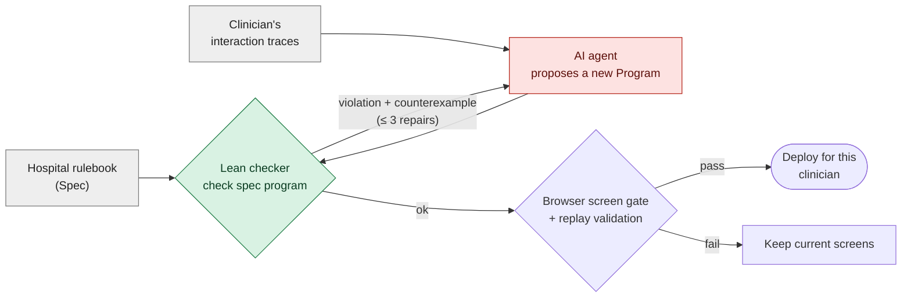
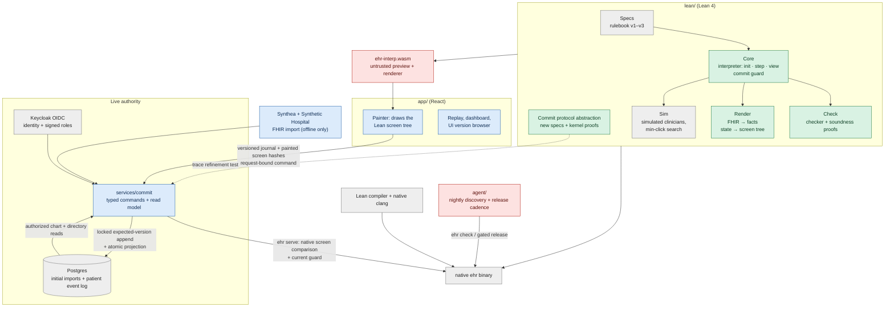
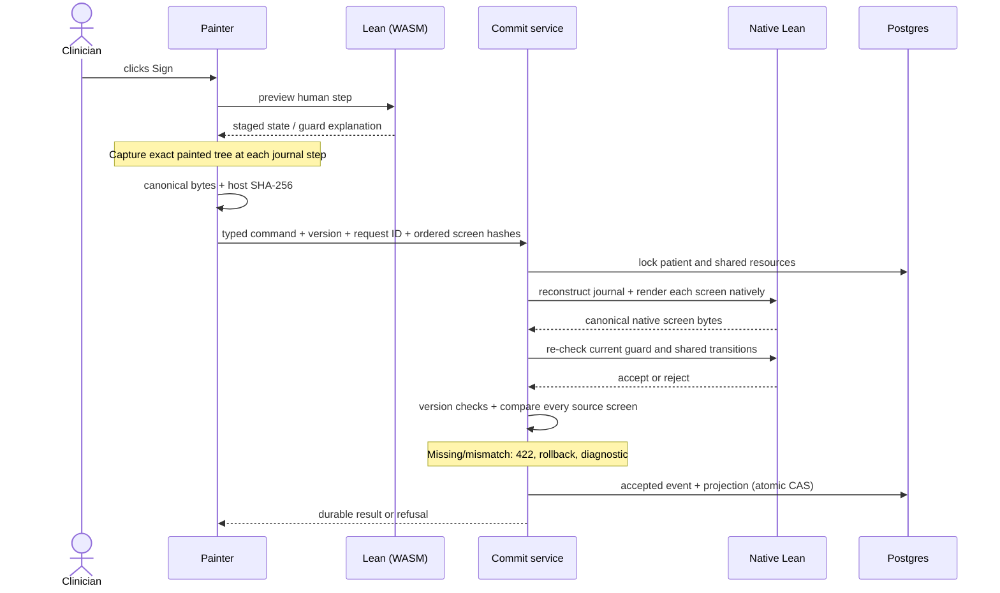

# Architecture

[Overview](../README.md) · [Methods and reproduction](../README.md#documentation)

## How the parts fit

Two things are kept apart:

- **The rulebook** (`Spec`, in Lean): what must be entered, reviewed and
  acknowledged before an action, and by whom. For example: "signing a
  medication order needs a dosing weight in kg entered by a human, the allergy
  list on screen, and every interruptive drug-allergy alert acknowledged".
- **The screens** (`Program`, JSON): one clinician's layout of screens,
  fields, tabs, buttons and macros.

The agent may only change the screens. Every proposed program goes through
`check`; only accepted programs are deployed. At run time every click goes
through `step`, which refuses a sign unless its guard holds, whatever the
layout.

## Runtime architecture

One Lean code base is the single source of truth. It is compiled natively (the
`ehr` binary: checker, simulator, deploy, commit server) and, through
Lean → C → Emscripten, to WebAssembly that the browser runs. React only paints
the screen tree Lean returns; it holds no clinical logic.

Green: proved in Lean. Blue: tested. Grey: trusted. Red: untrusted by design.

**One click.** WASM `step` previews the interaction and `renderUi` supplies the
screen tree. The painter records the exact object it receives, including the
banner, required reviews and interruptive alerts. The host checks Lean's
canonical serialization against an independent encoding of that painted object,
then hashes its UTF-8 bytes with SHA-256. In live mode every command binds the
ordered screen evidence to its request ID. The commit service reconstructs the
authenticated clinician's journal using its pinned release, renders each source
screen natively and compares its hash, including the command's source screen.
Missing, reordered or differing evidence returns retry-safe
`screen_fingerprint_mismatch` (422), rolls back the request reservation, and
appends no event or projection. Existing version-conflict refusals retain their
priority. Diagnostics contain the request ID, step, both
hashes and release name/hash. Corrected evidence may reuse the refused ID;
uncertain transport outcomes retain the exact original intent. WASM and
Emscripten are untrusted for this comparison; native Lean compilation and clang
remain trusted. Every clinical commit and review receipt
is a typed command with the version of the chart actually read. The service
locks the patient stream, checks the expected version and runs the native Lean
guard on current stored data. Only acceptance appends an event and materializes
its read projection in the same Postgres transaction. MAR also locks the exact
scheduled dose; clinical placement and administrative ADT commands use the same
bed streams and native ADT reducer. A rejected or stale command cannot publish
any of these effects. There is no browser FHIR writer.

Noncommitting interactions preview locally and are submitted as an ordered
human-event journal before the next command; every field edit retains its
position and displayed evidence. Each native ready screen since the previous
successful command is mandatory. Loading screens are compared when React
actually paints them; batched-away loading frames require no evidence. Returning
to the directory keeps unsigned patient drafts and acknowledgments in Lean's
navigation state. Before switching, the host flushes the outgoing journal; a
continuation binds its actor-scoped service session, revision and leave event.
The service checks the source version under lock, freshly replays that journal,
applies the leave event and stores the resulting directory state as the next
session's replay context. Only the selected patient's draft is restored into a
fresh chart, so another patient's evidence cannot authorize a command. The next
journal and painted-screen interval start at that server-derived directory
state ([draft protocol](methods/live-drafts.md)). Chart hydration and
post-command rendering use native projections, avoiding browser
recomputation of the authoritative display. Version-bound native caches remain available for interaction previews. Commands
bypass them for reconstruction; a stale cache cannot suppress comparison of a new step.
The final native guard and locked version checks remain authoritative. Request IDs bind exact
intent and allow recovery of an uncertain outcome without duplicating a write.
An unresolved save blocks new interactions, including patient switches, until
the original intent is reconciled.
MAR ignores delayed notifications for a chart version already adopted, preserving
the freshly reviewed session and its subsequent journal. Newer versions still
refresh the chart and discard stale evidence.
New clinical sessions recover the authenticated actor's current-day review receipts
only while every reviewed resource version still matches the stored chart.
The interaction endpoint checks the human event before hydrating a selected chart;
restoring stored receipts adds no patient event, while new reviews require a typed command.
Opening an encounter is a separate native role-guarded, versioned administrative
command; it creates no signed clinical content or bed placement.

| Directory | Contents |
|---|---|
| `lean/` | Rulebook, interpreter, checker, renderer, simulator and all proofs. |
| `app/` | React app: clinical painter, live and replay modes, dashboard. |
| `agent/` | Nightly discovery, certified design archives, configurable release cadence and a typed review gate; simulator-only off-shift tailoring sessions (`session*.ts`). Historical nightly protocols remain available. The offline `proposal-quality` harness compares recorded prompt variants without deploying. |
| `services/commit/` | Sole live store/writer: native guard, versioned patient event logs, chart/worklist projections, MAR and ADT; offline FHIR bootstrap. |
| `wasm/` | Lean → C → Emscripten build. |
| `world/` | Generator of simulated clinical days (patients, tasks, schedules). |
| `conformance/` | 201 held-out rule scenarios run against every deployed revision. |
| `releases/` | Vendor releases v1–v3 (rulebook + reference screens). |
| `infra/` | Isolated Postgres + Keycloak + commit Compose stack; initial-state import and identity provisioning. |
| `explore/` | Quality-diversity archive, descriptors, admitted generators and search. The standalone research harness never deploys; `agent/` reuses these modules for cadence releases. |
