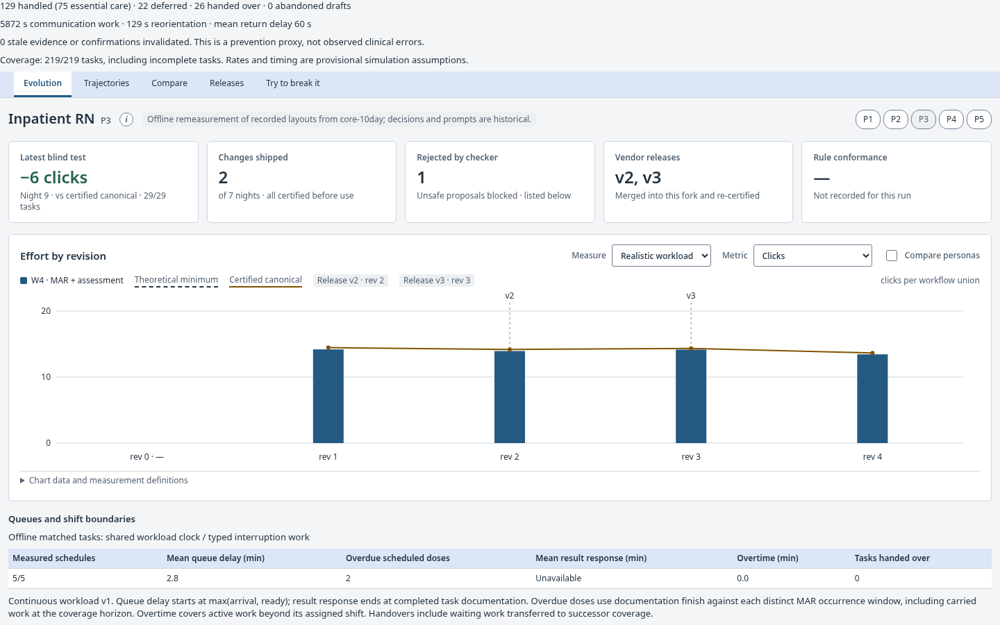
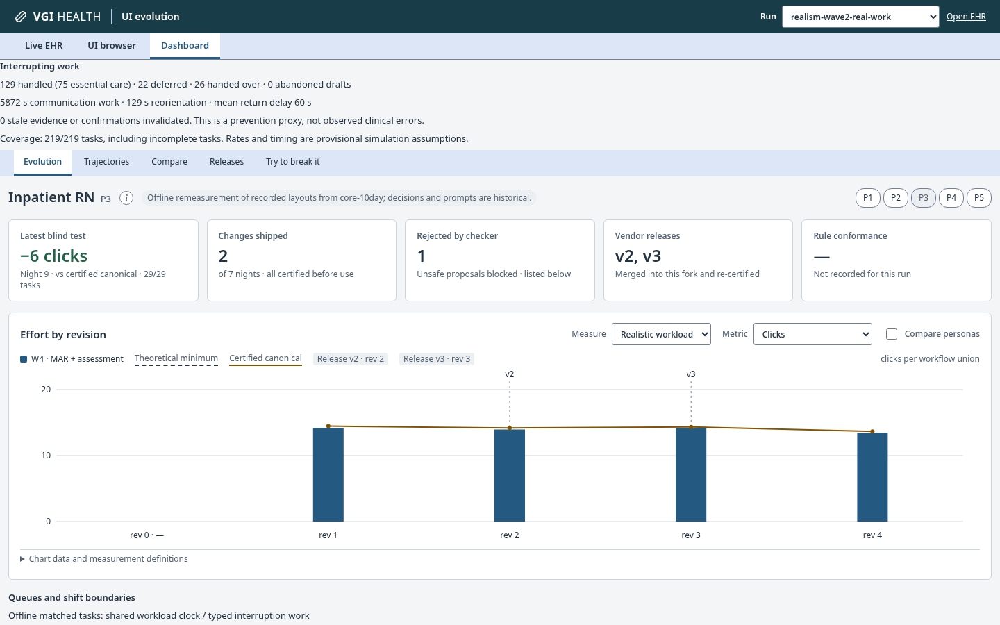

# Continuous workload clock

[Overview](../../README.md) · [Methods and reproduction](../../README.md#documentation)

The [wave-3 increment](wave3-simulation.md) supersedes the historical source-day,
flat-rate and unilateral-handover defaults below; the legacy switches retain
this wave-2 measurement model.

New native expert and bounded simulations default to `continuous-workload-v1`.
`lean/Ehr/Sim/Scheduling/` owns the shared queue and shift model; the policy hooks
retain the clinical interpreter and per-task random streams. `startMin` remains
the source task's planned ready time for archived schedules. Optional task
`timing` records arrival, ready, priority, deadline, result availability and MAR
occurrence/window pairs in milliseconds from the first shift's start. Without
that metadata, arrival and ready both equal `startMin`; no urgency is inferred.
The world CLI defaults to source-based timing metadata; `--clock-mode legacy`
selects task-local clocks in either the world CLI or `ehr simulate` and reproduces
the previous scheduling semantics. A schedule's `clockMode` can also select it.

The clock advances to max(previous finish, arrival, ready, shift start). Among
ready tasks it orders by ascending priority (urgent zero), deadline (finite before
absent), then arrival, retaining source order on ties. It reevaluates the queue
when an off-duty gap ends. Urgent work takes precedence at task boundaries;
clinical tasks finish before another clinical task dispatches; communication can preempt at an event boundary. The clock uses milliseconds;
clinical `Facts.now` plus the episode clock retain the subminute offset and trace
timestamps remain deciseconds. `workload.timings` records actual start/finish,
coverage ID, disposition and owned suspend/resume intervals from interruption service.

Shift intervals can be supplied as `shifts` in a schedule. The default uses the
existing persona tour lengths, 15-minute ED/ward overlaps and successor coverage;
clinic successors skip weekends. There is one serial server per persona even in
an overlap. Active work beyond its assigned shift counts as overtime; queued work
crossing a shift end is handed over to successor coverage. Each task is completed,
explicitly abandoned with a reason when its policy cannot complete the clinical
goals, or retained as carried work at the coverage horizon. Carried tasks also
receive incomplete effort rows so denominators retain every source task.
`ehr simulate --carry-out FILE` exports full unserved source tasks as a schedule;
recipient coverage must use the same time origin and replace the exhausted shifts.
This is simulator queue ownership, not the live clinical handoff acceptance protocol.

World timing projection (`world/src/timing/`) uses existing ED arrival clocks and
acuity, clinic slots, inbox resources/backlog and medication passes. Exogenous
source tasks and arrival metadata have no UI or policy input: comparison arms
receive the same world seed and schedule, while their actual starts and outcomes
can differ. Successor coverage continues through nights and weekends for hospital
work. The current world generates weekday daytime clinical cases. Independent night/weekend
cases and calibrated 24-hour demand remain outside its scope.
World clinical state remains exogenous rather than being altered by a faster arm.

`DayResult.workload` adds total queue delay (start minus max(arrival, ready)),
distinct overdue MAR occurrence count, completed-result response time (availability
to documentation finish, including source backlog age before the schedule origin),
active overtime and tasks handed over. Per-task timing
and pending source IDs are retained. Completed dose/result endpoints use the exact
final clinical-event completion, before unrelated closure communication; task service
finish and subsequent queue delay still include that communication. A completed
task's dose is overdue when documentation finishes after its existing MAR window.
Abandoned attempts use service finish; carried work uses the final coverage horizon.
This timing proxy includes held/refused
outcomes; it does not claim measured bedside administration time. Dashboard and
measurement reports expose these values separately from physical effort. Legacy
recordings without this envelope show timing as unavailable. Simulator type augmentation is generated in `lean/generated/sim-types.ts`;
the clinical enum/type module remains byte-stable. Simulator-only schemas
live under `app/src/dashboard/measurement-schema.ts` so source timing survives
agent load/store parsing without editing the clinical wire schema. Trajectory
extraction follows recorded dispatch order and seeds the actual subminute start.
Trajectory metadata distinguishes this clock/guard reconstruction from the physical
effort used in comparative UI scores; timing coefficients remain uncalibrated.

The [owner decision list](../../README.md#policies-awaiting-owner-review) collects the provisional
workload and interruption policies with the existing MAR and ADT decisions.

Kernel lemmas cover `start_bounds`, `clock_monotone`, `erase_conservation`,
`timing_accounted`, `exogenous_arm_independent`, queued-work start/duration bounds
and preservation of task start/finish when attaching interruption intervals. The full queue/coverage loop
and its output partition are executable bounded checks, not a general liveness or
fair-service proof. No clinical theorem statement or rule is changed. Headline
clinical claims and their proof map structure are unchanged.

Historical reruns select both `--clock-mode legacy --interruptions fixedCost`
on `ehr simulate` or `run-days`. New `run-days` manifests bind both modes, and
resume refuses a mode change.
`core-10day` is retained as that labeled control. Offline remeasurement uses
explicit `simulationModes` metadata, independent actual/canonical/no-agent actor
memories, and separate train/validation partitions. It preserves layout choices
and makes no model calls. `pnpm --filter agent exec tsx src/remeasure-cli.ts
--source runs/core-10day --out runs/<new-label> --world runs/world/<successor>`
creates a separately labeled real-work measurement. Use `--clock-mode continuous
--interruptions fixedCost` for a matched successor-clock control; select both
legacy flags for the archived task-clock protocol. The command refuses an existing output and a
world with a different seed, insufficient days or missing clinicians. It refreshes
world/runtime fingerprints, labels the serial execution `OFFLINE`, and records
the source recording digest. Copied decision/prompt evidence is explicitly
historical. Relative paths are repository-relative.
Calibration measurements are recomputed evidence;
recorded historical decision estimates remain historical inputs.
Copied decisions adopt the new review run ID and retain their source run ID;
their prompts, choices and historical estimates are preserved.
Copied day-completion markers are withheld until the new measurements are durable,
so an in-progress copy cannot expose source measurements as its own completed work.
Successor world schedules and real-work measurements belong in separately labeled local outputs;
frozen worlds 1/2 are never regenerated in place. Source-bound native/WASM assets
and certificate bindings must match before replay.
The [workload verification receipt](../audits/workload-clock-20261108.md) records
the bounded-check scope, source coverage limits and exact verification commands.

## Interrupting work and owned resumption

New native simulations default to `--interruptions realWork` for both expert and
bounded policies. `--interruptions fixedCost` selects the previous seeded
`Task.interruptions` count, goal-action positions and wait/think operators;
archived comparisons must select it explicitly. Real-work arrivals and service
ignore that historical count. Behavioral RNG initialization retains the archived
draw advancement for matched baseline noise; the offered-work hash stream is separate.
The clinical task trace contains only interpreter events; external
communication is measured separately in each task's optional `interruptions`
record (work, ordered steps, timestamps and closed frames). No synthetic clinical
click, receipt, prescription or result resolution is inferred from a call.

`lean/Ehr/Sim/Resumption/` defines patient-specific pages, urgent-result calls,
colleague questions, family requests and pharmacy clarifications. Each executes
patient identification, message reading, assessment, reply (or urgent escalation)
and documentation, with distinct per-step durations. Essential care is labeled
separately from routine requests. Urgent work preempts at the next event boundary;
time-sensitive work preempts nursing and inpatient-pharmacy work, while other
prescriber profiles queue it. Routine
work queues until task closure. A clinical popup must be acknowledged first;
if it remains unresolved at task closure, the clock waits for the remaining
offered arrivals and queued communication is explicitly handed to the on-call
service. Communication completion is distinct from clinical
follow-through under the existing critical-result rules: every completed urgent
notification records a separate handover of clinical follow-through to the
responsible clinical team; it never claims the result was resolved.

Draft/resumption specifications: frames belong jointly
to clinician ID, source patient ID and task ID. Foreign ownership, task or source
facts refuse restoration, with an explicit discard reason. An existing patient
workspace must still be selected and bound to that source; an unselected or
unbound frame is discarded too. Frames retain draft
values, screen/history, tabs, current slot and pending confirmations. Returning
advances the clock and pays `3000 + 700 × draft entries + 1000 × unconfirmed
entries` milliseconds. Current review rules filter receipts by clinician,
data version, time and allowed role. Any clinical fact change (excluding clock,
cached receipts and department directory) clears alert acknowledgments and makes
all draft entries unconfirmed; the clinician must reconfirm through normal events.
The next clinical event uses the existing guard. Named handover records transfer
work responsibility, never another clinician's sign authority. These are new
simulation policies, not additional clinical regulations or live UI behavior.

Arrivals use an independent seed/task/minute stream with at most one arrival per
minute, timestamp jitter, and fixed offered exposure: W1/W5 15 minutes, W3 12,
W4 6, W6 20, W2/W7 5. Neither layout, action count, nor behavioral RNG enters the
arrival draw. The same inputs/seed therefore offer identical work across arms.
At closure the simulator waits for unoffered arrivals in this fixed exposure and
services the queue; it does not erase arrivals when one UI finishes sooner.
The exposure windows, binomial arrival approximation, urgency/type mix, triage,
step durations, reorientation coefficients and closure policy are **provisional**.
They require calibration; these UI-task windows are not whole-shift workloads.

Default profiles are nursing/ward (5.5/hour), surgical physician (13/hour),
emergency physician (6.9/hour) and clinic prescriber (3/hour). The clinic rate is
an assumption. `--interruption-profile inpatientPharmacy` selects 10.6/hour;
other profile names are `wardNurse`, `surgicalPhysician`, `emergencyPhysician`
and `clinicPrescriber`. Profile selection does not grant a clinical role.
[Myers & Parikh](https://pubmed.ncbi.nlm.nih.gov/28871511/) observed 259
interruptions in 47.3 hours of trauma-center nursing, including beneficial work.
[Bellandi et al.](https://pubmed.ncbi.nlm.nih.gov/28697685/) observed approximately
13/hour among doctors and nurses in six surgical units.
[Chisholm et al.](https://pubmed.ncbi.nlm.nih.gov/11073472/) distinguished
30.9 brief interruptions from 20.7 task switches per three hours; the emergency
profile uses the latter denominator (6.9/hour).
[Inpatient pharmacy observations](https://pmc.ncbi.nlm.nih.gov/articles/PMC7153068/)
reported 10.6/hour across pharmacy employees. These populations, task definitions
and denominators differ: transferring any rate to the profiles above is provisional,
particularly nursing across settings and pharmacy employees to pharmacists.

Metrics separate handled/deferred work, work milliseconds, suspension-to-return
delay, reorientation, invalidated receipts/confirmations (`revalidationPrevented`,
a prevention proxy, not observed errors), and explicitly abandoned frames.
Communication and reorientation execute on the workload clock. A call arriving
during another call joins the service queue before return work; protocols and
reorientation are individually atomic. `reorientations` records each queued
return's release, start and finish. `workload.timings.suspensions` uses the same
owned frame's absolute suspend/return timestamps. Passive closure waits remain
wall time and are excluded from active KLM effort and overtime.

The native adapter accepts `SimulateInput.interruptions` and
`interruptionProfile`, retains the optional typed task measurements through schema
validation, and the dashboard displays them per selected clinician, including
incomplete tasks. Workload and interruption headline metrics use the same blind
even-day partition when the recording declares that measurement protocol. Historical absence is reported as unmeasured, rather than zero.

Incomplete clinical tasks explicitly discard their unsent drafts with the reason
`clinical task ended incomplete; unsent draft explicitly discarded`. Completion
is evaluated before this cleanup, and incomplete work remains incomplete.

Task metadata binds the model version, selected profile/rate, fixed exposure and
full offered-arrival list, even for zero arrivals. `closureWaitMs` separates
waiting for the offered exposure from active effort: wall time includes it,
KLM effort excludes it. Call/page content is synthetic communication input,
not an inferred FHIR finding. Empty patient/message inputs cannot complete
communication and are explicitly handed over.

Measurement validation is an extension in
`app/src/dashboard/interruption-schema.ts`, also used by the native adapter and
recording readers. The shared clinical wire schema remains unchanged, preserving
the certified painter source boundary. Revalidation tests include changed source
versions, expired reviews, foreign source/owner/task bindings, queued work,
unresolved-popup handover and both policy completion paths.

`InterruptionConfig.refreshFacts` is the scenario timeline hook at absolute
milliseconds. Both policies refresh at episode entry and on return from work;
planning and guarded events share that current snapshot. Foreign-patient
refreshes are refused, and the episode's receipt-clock origin is preserved.
The stock CLI supplies immutable task snapshots (identity refresh); concurrent
chart-version updates require the world/workload timeline to supply this hook.
Dispatch uses immutable source tasks to draw offered arrivals; queue delay does
not shift or redraw that stream. Checkpoints use actual workload-clock time,
including fractional-minute starts, communication and paid return work.

Service reconsiders urgency after each communication protocol; future arrivals
cannot cause idle waiting ahead of already-arrived routine work. Communication
protocols are atomic; nested interruption of their individual steps is not modeled.

[Interruption verification and scope](../audits/interruptions-20261108.md)
record theorem statements, exact commands, native matched-arm cases and scope limits.

### Local measurement cohorts

The retained `runs/core-10day` control uses frozen world 2 with `legacy` / `fixedCost`.
The successor world `runs/world/realism-wave2-seed-1` supplies both
`runs/realism-wave2-workload-control` (`continuous` / `fixedCost`) and
`runs/realism-wave2-real-work` (`continuous` / `realWork`). The latter is the newest
completed real run and the default review catalog selection unless `VGI_RUN` overrides it.
Seeds 1, 2 and 3 also have separately named successor worlds under
`runs/world/realism-wave2-seed-{1,2,3}`, each regenerated twice byte-identically.
Frozen worlds 1/2 remain unchanged. All data stays local and gitignored.

These are offline executions of recorded layout choices, with no new model calls
or optimization choices. Each run has 150 actual/canonical/no-agent day outputs
plus 25 train and 25 validation outputs, regenerated summaries/trajectories and
three same-task canonical controls. Historical prompts and decision estimates remain
historical. New raw calibration and blind measurements are distinguished explicitly.
Native execution is recomputed; matching current-build geometry captures may be reused
through the existing browser/font/source/tree/presentation cache fingerprints.

Headline actual-layout totals below use blind even days 2, 4, 6, 8 and 10 across
all five clinicians. Queue means include every started task; completion remains explicit.
The archived and successor cohorts differ. Only the two successor rows share identical
source tasks; their difference isolates the interruption model within this fixed-layout experiment.

| Recording | Completed/tasks | Mean queue (min) | Overdue doses | Active overtime (min) | Communication (min) | Reorientation (min) |
|---|---:|---:|---:|---:|---:|---:|
| Retained control | 626/630 | Unavailable | Unavailable | Unavailable | Not separately modeled | Not separately modeled |
| Successor fixed cost | 660/662 | 1.19 | 2 | 0.00 | Not separately modeled | Not separately modeled |
| Successor real work (default) | 660/662 | 1.73 | 2 | 0.00 | 510.75 | 15.22 |

Fixed-cost waits/thinks have no separate typed communication or return-cost measurement.
Missing workload/service metadata is unavailable, never a measured zero. Real-work passive
closure waiting advances the queue while remaining outside active effort and overtime.
Rates, exposure and closure behavior remain provisional; these are simulation results,
not observed clinician performance. The
[verification report](../audits/realism-wave2-verification-20261108.md)
records per-persona totals, completion, return delays, exact commands and timings.

