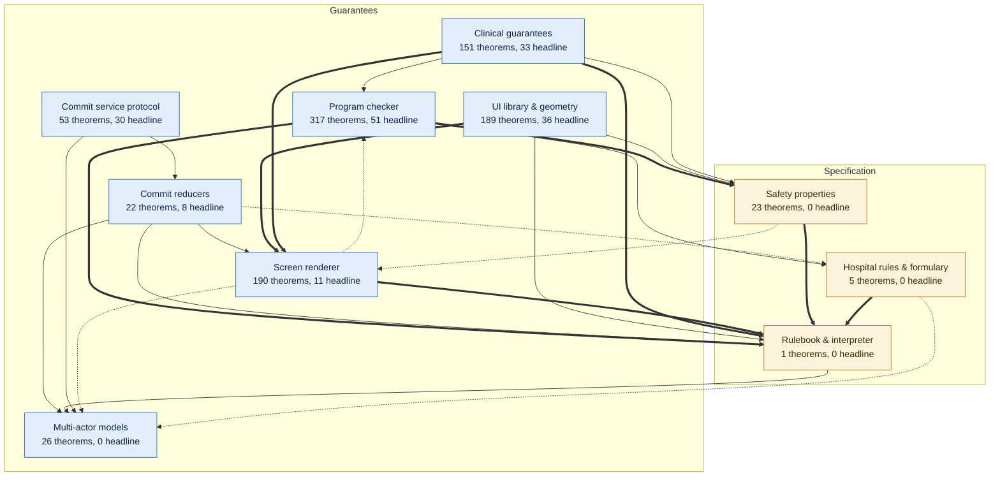
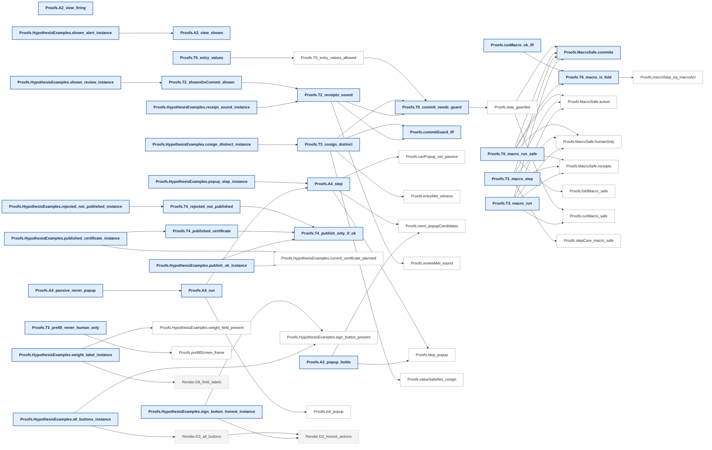
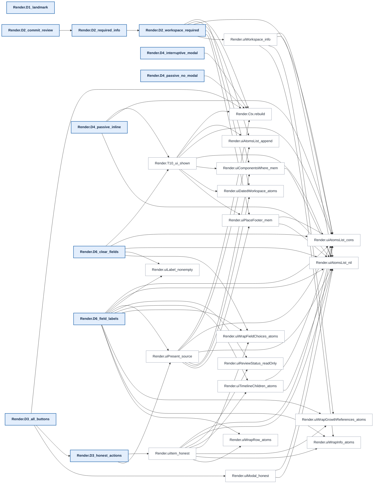
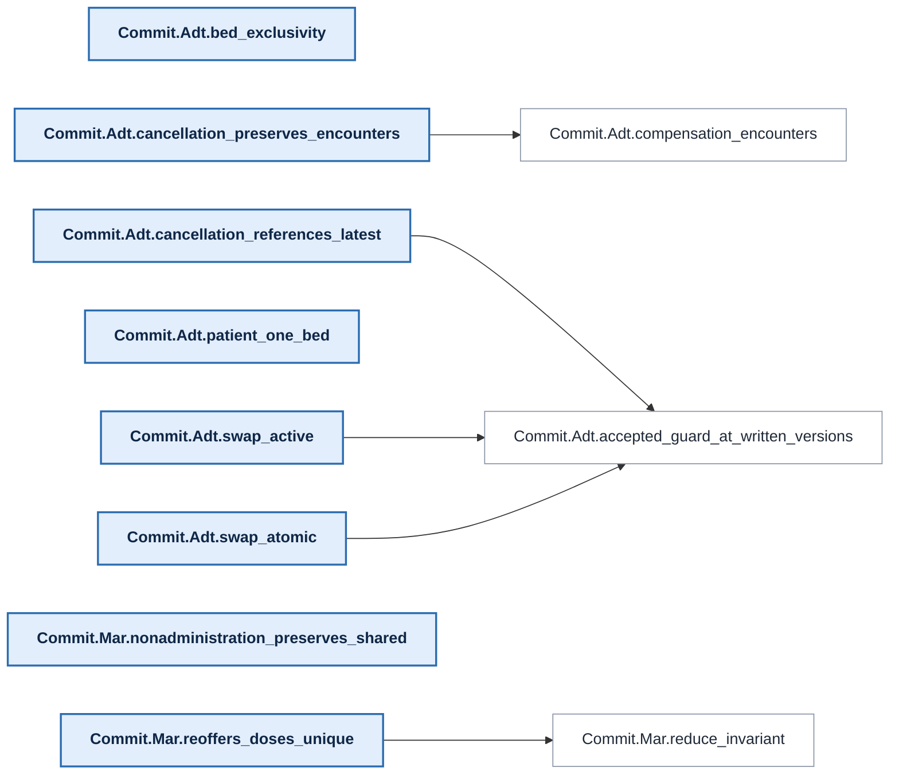
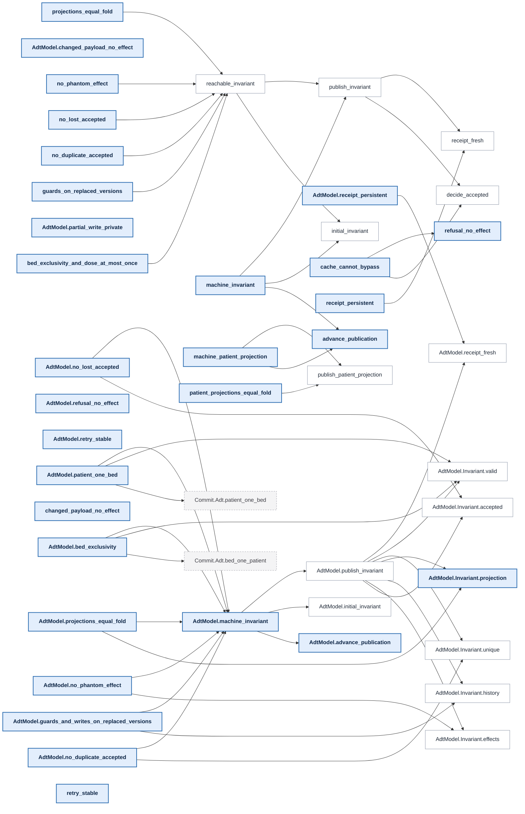
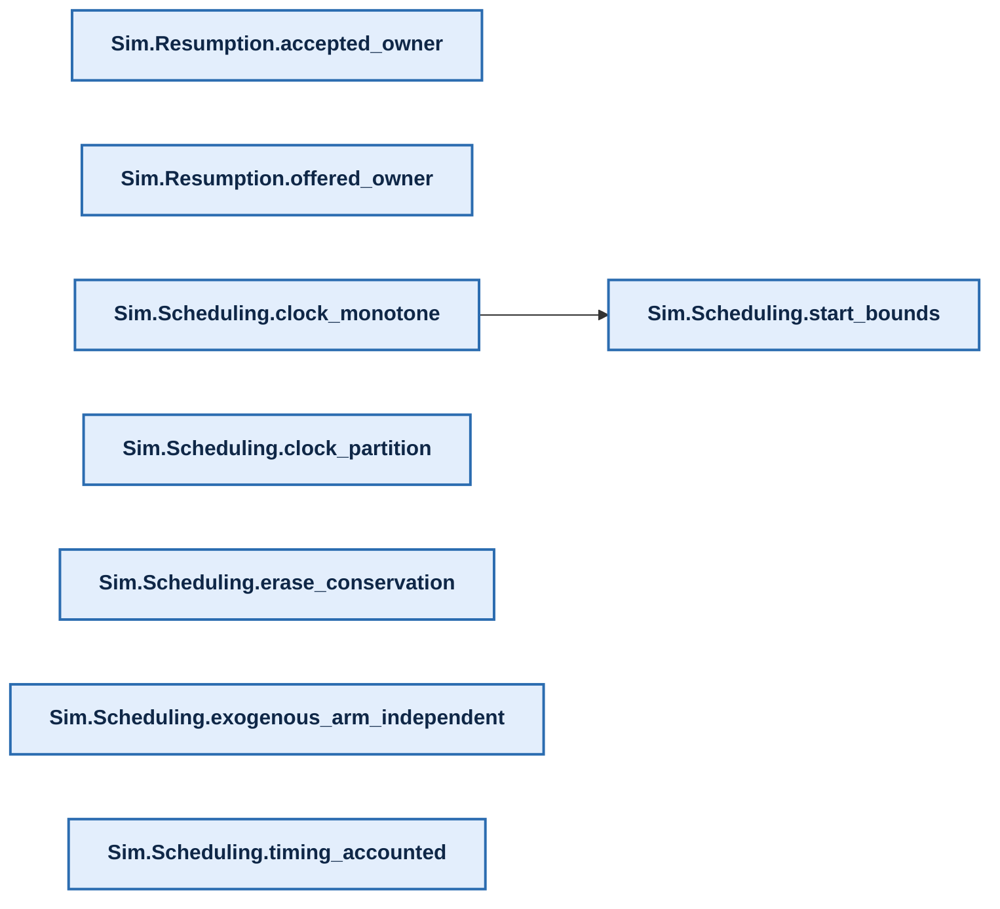
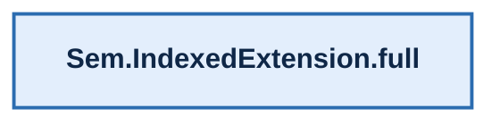

```mermaid
flowchart LR
  n0["Check.CompletionModel.accepted_completable"]:::head
  n1["Check.CompletionModel.accepted_edges"]:::head
  n2["Check.DoseCompletionObstruction.never_commits"]:::head
  n3["Check.DoseCompletionObstruction.not_completable"]:::head
  n4["Check.DoseCompletionObstruction.rejected"]:::head
  n5["Check.FixedLine.completable"]:::head
  n6["Check.FixedLine.completable_many_alerts"]:::head
  n7["Check.Scalar.completable"]:::head
  n8["Check.T7_counterexample_replays"]:::head
  n9["Check.T7_rejection"]:::head
  n10["Check.T8_checked_old_obligations"]:::head
  n11["Check.T8_old_obligations"]:::head
  n12["Check.T8_v1_to_v2"]:::head
  n13["Check.T8_v2_to_v3"]:::head
  n14["Check.accepted_alertsFire"]:::head
  n15["Check.accepted_budgets"]:::head
  n16["Check.accepted_capturesAllOnce"]:::head
  n17["Check.accepted_contracts"]:::head
  n18["Check.accepted_humanOnlyKept"]:::head
  n19["Check.accepted_navigation"]:::head
  n20["Check.accepted_noFalseAlarms"]:::head
  n21["Check.accepted_noRepeatInterruptions"]:::head
  n22["Check.accepted_reviewsBeforeCommit"]:::head
  n23["Check.accepted_severityTiers"]:::head
  n24["Check.accepted_units"]:::head
  n25["Check.accepted_wellFormed"]:::head
  n26["Check.accepted_writesOnly"]:::head
  n27["Check.alertsAcked_of_no_candidates"]:::head
  n28["Check.automated_lines_satisfies"]:::head
  n29["Check.cached_completion_eq"]:::head
  n30["Check.completion_dependency_rejected"]:::head
  n31["Check.fixed_lines_pending_nonempty"]:::head
  n32["Check.fixed_lines_satisfies"]:::head
  n33["Check.human_finish_ready"]:::head
  n34["Check.human_finish_ready_unique"]:::head
  n35["Check.many_alerts_satisfies"]:::head
  n36["Check.many_alerts_two_acknowledgments"]:::head
  n37["Check.prefill_macro_human_completion"]:::head
  n38["Check.reachable_drugSlots"]:::head
  n39["Check.receipt_lines_satisfies"]:::head
  n40["Check.receipt_review_transition"]:::head
  n41["Check.satisfies_of_checked_automated_lines"]:::head
  n42["Check.satisfies_of_checked_completable"]:::head
  n43["Check.satisfies_of_checked_fixed_lines"]:::head
  n44["Check.satisfies_of_checked_many_alerts"]:::head
  n45["Check.satisfies_of_checked_receipt_lines"]:::head
  n46["Check.satisfies_of_checked_scalar"]:::head
  n47["Check.scalar_identity_satisfies"]:::head
  n48["Check.tiny_bad_automation"]:::head
  n49["Check.tiny_bad_catalog"]:::head
  n50["Check.tiny_bad_role"]:::head
  n51["Check.CompletionModel.accepted_episode_complete"]:::lemma
  n52["Check.CompletionModel.run_closed"]:::lemma
  n53["Check.DoseCompletionObstruction.after_reachable"]:::lemma
  n54["Check.DoseCompletionObstruction.cannot_add"]:::lemma
  n55["Check.DoseCompletionObstruction.no_drug_fields"]:::lemma
  n56["Check.FixedLine.fixed_slots"]:::lemma
  n57["Check.FixedLine.on_screen"]:::lemma
  n58["Check.FixedLine.shown_assessment"]:::lemma
  n59["Check.FixedLine.shown_button"]:::lemma
  n60["Check.OkRun.append"]:::lemma
  n61["Check.Scalar.on_screen"]:::lemma
  n62["Check.Scalar.shown_button"]:::lemma
  n63["Check.Scalar.shown_field"]:::lemma
  n64["Check.accepted_depth"]:::lemma
  n65["Check.accepted_pins"]:::lemma
  n66["Check.accepted_structural"]:::lemma
  n67["Check.alertBudget_sound"]:::lemma
  n68["Check.alert_lookup_unique"]:::lemma
  n69["Check.alertsOnlyWhenTrue"]:::lemma
  n70["Check.check_ok_iff"]:::lemma
  n71["Check.commitCapturesAll"]:::lemma
  n72["Check.commitContracts"]:::lemma
  n73["Check.commitReviewsMet"]:::lemma
  n74["Check.commitUnitsRight"]:::lemma
  n75["Check.cosignIsSecondUser"]:::lemma
  n76["Check.declared_value_witness"]:::lemma
  n77["Check.enteredOnce"]:::lemma
  n78["Check.extends_contracts"]:::lemma
  n79["Check.extends_entries"]:::lemma
  n80["Check.extends_reviews"]:::lemma
  n81["Check.extends_static"]:::lemma
  n82["Check.firstFinding_some"]:::lemma
  n83["Check.followHops_sound"]:::lemma
  n84["Check.humanStepsByHuman"]:::lemma
  n85["Check.human_clear_popup"]:::lemma
  n86["Check.human_enter"]:::lemma
  n87["Check.interruptiveHandled"]:::lemma
  n88["Check.interruptsOnce"]:::lemma
  n89["Check.landmarksPinned_sound"]:::lemma
  n90["Check.onlyHumanCommitsAndAcks"]:::lemma
  n91["Check.orderLines_slots"]:::lemma
  n92["Check.passiveNeverPopsUp"]:::lemma
  n93["Check.passivePinned_sound"]:::lemma
  n94["Check.pinnedForReview_sound"]:::lemma
  n95["Check.prefillScreen_slots"]:::lemma
  n96["Check.replayOk_sound"]:::lemma
  n97["Check.reviewMet_iff"]:::lemma
  n98["Check.reviewsPinned_sound"]:::lemma
  n99["Check.step_drugSlots"]:::lemma
  n100["Check.tableReach_eq"]:::lemma
  n101["Check.writesAllowed"]:::lemma
  n102["Proofs.prefillScreen_frame"]:::other
  n103["Sim.Certificate.lookup_mem"]:::other
  n104["Specs.V2.specV2_extends_specV1"]:::other
  n105["Specs.V3.specV3_extends_specV2"]:::other
  n106["linkedDependents_not_self"]:::other
  n0 --> n51
  n1 --> n52
  n1 --> n103
  n2 --> n54
  n2 --> n55
  n2 --> n38
  n2 --> n102
  n3 --> n53
  n3 --> n2
  n5 --> n6
  n6 --> n56
  n6 --> n57
  n6 --> n58
  n6 --> n59
  n6 --> n76
  n6 --> n85
  n6 --> n86
  n6 --> n34
  n6 --> n91
  n6 --> n94
  n6 --> n38
  n6 --> n97
  n6 --> n99
  n6 --> n106
  n7 --> n61
  n7 --> n62
  n7 --> n63
  n7 --> n76
  n7 --> n85
  n7 --> n86
  n7 --> n33
  n8 --> n60
  n8 --> n83
  n8 --> n96
  n9 --> n8
  n9 --> n82
  n10 --> n14
  n10 --> n16
  n10 --> n18
  n10 --> n20
  n10 --> n21
  n10 --> n22
  n10 --> n23
  n10 --> n24
  n10 --> n78
  n10 --> n79
  n10 --> n80
  n10 --> n81
  n11 --> n78
  n11 --> n79
  n11 --> n80
  n11 --> n81
  n12 --> n10
  n12 --> n104
  n13 --> n10
  n13 --> n105
  n14 --> n65
  n14 --> n66
  n14 --> n87
  n14 --> n93
  n15 --> n67
  n15 --> n70
  n16 --> n66
  n16 --> n71
  n16 --> n77
  n17 --> n72
  n18 --> n66
  n18 --> n75
  n18 --> n84
  n18 --> n90
  n19 --> n70
  n20 --> n66
  n20 --> n69
  n21 --> n66
  n21 --> n88
  n22 --> n65
  n22 --> n66
  n22 --> n73
  n22 --> n98
  n23 --> n66
  n23 --> n92
  n24 --> n66
  n24 --> n74
  n25 --> n64
  n25 --> n65
  n25 --> n66
  n25 --> n89
  n26 --> n66
  n26 --> n101
  n27 --> n68
  n28 --> n41
  n29 --> n100
  n30 --> n4
  n32 --> n43
  n34 --> n27
  n34 --> n33
  n35 --> n44
  n38 --> n95
  n38 --> n99
  n39 --> n45
  n41 --> n6
  n41 --> n25
  n41 --> n42
  n42 --> n14
  n42 --> n15
  n42 --> n16
  n42 --> n18
  n42 --> n19
  n42 --> n20
  n42 --> n21
  n42 --> n22
  n42 --> n23
  n42 --> n24
  n42 --> n25
  n42 --> n26
  n43 --> n5
  n43 --> n42
  n44 --> n6
  n44 --> n25
  n44 --> n42
  n45 --> n5
  n45 --> n42
  n46 --> n7
  n46 --> n42
  n47 --> n46
  n64 --> n70
  n65 --> n70
  n66 --> n70
  n73 --> n97
  n78 --> n72
  n83 --> n60
  n83 --> n96
  n98 --> n94
  classDef head fill:#e3eefc,stroke:#2b6cb0,stroke-width:2px,color:#0f2747,font-weight:bold
  classDef lemma fill:#ffffff,stroke:#8a94a6,color:#1f2937
  classDef other fill:#f4f4f5,stroke:#a1a1aa,stroke-dasharray:4 3,color:#3f3f46
```

```mermaid
flowchart LR
  n0["Layout.Range.checkProgram_allStates"]:::head
  n1["Layout.Range.checkProgram_sound"]:::head
  n2["Layout.Range.layoutAccepted_program"]:::head
  n3["Layout.Range.renderer_range"]:::head
  n4["Layout.RenderCovered_finite_iff"]:::head
  n5["Layout.Shell.shell_rules"]:::head
  n6["Layout.Shell.targets"]:::head
  n7["Layout.Structural.targets"]:::head
  n8["Layout.advance_le_cell"]:::head
  n9["Layout.channel_certificates"]:::head
  n10["Layout.column_apart"]:::head
  n11["Layout.finiteFamily_missingShape"]:::head
  n12["Layout.geometry_independent"]:::head
  n13["Layout.greedy_complete"]:::head
  n14["Layout.greedy_width"]:::head
  n15["Layout.layoutAccepted_allPatients"]:::head
  n16["Layout.layoutAccepted_allPatients_finite"]:::head
  n17["Layout.layoutAccepted_allViewports"]:::head
  n18["Layout.layoutAccepted_bannerPixels"]:::head
  n19["Layout.layoutAccepted_reviewAllPayloads"]:::head
  n20["Layout.layoutAccepted_rules"]:::head
  n21["Layout.layoutAccepted_safety"]:::head
  n22["Layout.layoutAccepted_textComplete"]:::head
  n23["Layout.layoutAccepted_textPixels"]:::head
  n24["Layout.layout_satisfies"]:::head
  n25["Layout.modal_blocks"]:::head
  n26["Layout.paintText_supported"]:::head
  n27["Layout.portAccepted_rules"]:::head
  n28["Layout.realized_currentCommit_visible"]:::head
  n29["Layout.reviewFamily_accepted"]:::head
  n30["Layout.scroll_apart"]:::head
  n31["Layout.scroll_complete"]:::head
  n32["Layout.scroll_line_width"]:::head
  n33["Layout.textAtoms_preserve"]:::head
  n34["Layout.wrap_complete"]:::head
  n35["Layout.wrap_line_width"]:::head
  n36["Layout.Range.render_small"]:::lemma
  n37["Layout.Range.smallModal_fits"]:::lemma
  n38["Layout.Range.unchecked_sound"]:::lemma
  n39["Layout.RenderFamily.sound"]:::lemma
  n40["Layout.Shell.banner_rule"]:::lemma
  n41["Layout.Shell.base_footer"]:::lemma
  n42["Layout.Shell.base_no_modal"]:::lemma
  n43["Layout.Shell.base_rules"]:::lemma
  n44["Layout.Shell.base_target_inactive"]:::lemma
  n45["Layout.Shell.bounds"]:::lemma
  n46["Layout.Shell.commit_rule"]:::lemma
  n47["Layout.Shell.complete"]:::lemma
  n48["Layout.Shell.contrast"]:::lemma
  n49["Layout.Shell.footer_inactive"]:::lemma
  n50["Layout.Shell.horizontal"]:::lemma
  n51["Layout.Shell.modal_rule"]:::lemma
  n52["Layout.Shell.modals_separated"]:::lemma
  n53["Layout.Shell.reading_order"]:::lemma
  n54["Layout.Shell.shell_cases"]:::lemma
  n55["Layout.Shell.target_implies"]:::lemma
  n56["Layout.Shell.text_rule"]:::lemma
  n57["Layout.Shell.zip_order"]:::lemma
  n58["Layout.Structural.body_order"]:::lemma
  n59["Layout.Structural.bounds"]:::lemma
  n60["Layout.Structural.placement_cases"]:::lemma
  n61["Layout.candidate_length_le"]:::lemma
  n62["Layout.chunks_complete"]:::lemma
  n63["Layout.chunks_short"]:::lemma
  n64["Layout.codepointInk_supported"]:::lemma
  n65["Layout.column_floor"]:::lemma
  n66["Layout.constrain_satisfies"]:::lemma
  n67["Layout.layoutAccepted_allScreens"]:::lemma
  n68["Layout.layoutAccepted_geometry"]:::lemma
  n69["Layout.review_shape_payload_independent"]:::lemma
  n70["Layout.screenShape_flat_length"]:::lemma
  n71["Layout.screenShape_sources"]:::lemma
  n72["Layout.separated_pixels"]:::lemma
  n73["Layout.shape_path_unique"]:::lemma
  n74["Layout.shift_rect"]:::lemma
  n75["Layout.textAdvance_bound"]:::lemma
  n0 --> n3
  n0 --> n38
  n1 --> n3
  n2 --> n1
  n2 --> n15
  n3 --> n36
  n3 --> n37
  n5 --> n40
  n5 --> n46
  n5 --> n47
  n5 --> n48
  n5 --> n50
  n5 --> n51
  n5 --> n53
  n5 --> n6
  n5 --> n56
  n6 --> n41
  n6 --> n42
  n6 --> n43
  n6 --> n44
  n6 --> n45
  n6 --> n49
  n6 --> n52
  n6 --> n54
  n6 --> n55
  n6 --> n57
  n7 --> n58
  n7 --> n59
  n7 --> n60
  n10 --> n65
  n10 --> n74
  n11 --> n61
  n11 --> n70
  n15 --> n39
  n16 --> n15
  n17 --> n68
  n18 --> n20
  n18 --> n72
  n19 --> n67
  n19 --> n29
  n19 --> n69
  n21 --> n20
  n21 --> n26
  n21 --> n31
  n21 --> n32
  n21 --> n33
  n22 --> n20
  n22 --> n34
  n23 --> n20
  n23 --> n72
  n24 --> n66
  n26 --> n64
  n27 --> n20
  n28 --> n71
  n28 --> n73
  n31 --> n13
  n32 --> n8
  n32 --> n14
  n34 --> n62
  n35 --> n63
  n35 --> n75
  n40 --> n41
  n40 --> n43
  n40 --> n54
  n46 --> n54
  n48 --> n43
  n48 --> n54
  n50 --> n43
  n50 --> n45
  n50 --> n54
  n51 --> n54
  n53 --> n43
  n53 --> n57
  n56 --> n41
  n56 --> n42
  n56 --> n43
  n56 --> n49
  n56 --> n52
  n56 --> n54
  n65 --> n74
  n67 --> n20
  n67 --> n21
  n67 --> n71
  n68 --> n20
  n75 --> n8
  classDef head fill:#e3eefc,stroke:#2b6cb0,stroke-width:2px,color:#0f2747,font-weight:bold
  classDef lemma fill:#ffffff,stroke:#8a94a6,color:#1f2937
  classDef other fill:#f4f4f5,stroke:#a1a1aa,stroke-dasharray:4 3,color:#3f3f46
```

# Proof map

[Overview](../README.md) · [Methods and reproduction](../README.md#documentation)

<!-- PROOF-MAP:BEGIN (generated by scripts/proof-map/build.sh --readme; do not edit) -->

Generated from the compiled Lean environment. In the overview an arrow reads
"is stated in terms of" (thick: 100+ references, dotted: under 5). In each
layer's chart below an arrow reads "its proof cites": headline claims are
bold, lemmas they cite directly are white, lemmas from other layers are
dashed. The interactive version, with search, full
trees and each claim's trust surface, is the `proof-map` artifact of every CI
run.



<details><summary><b>Clinical guarantees</b>: 33 headline claims. Hard stop on signing, receipts, macros never act for a human, alert behaviour (T0–T6, A2, A4).</summary>



</details>

<details><summary><b>Program checker</b>: 51 headline claims. The checker that admits agent-written programs and its soundness: acceptance implies the screen properties (accepted_*), plus completability.</summary>



</details>

<details><summary><b>Screen renderer</b>: 11 headline claims. The screen tree the painter draws, and D1–D6: banner, required content, honest buttons, modal alerts.</summary>



</details>

<details><summary><b>UI library &amp; geometry</b>: 36 headline claims. Integer layout, layout rules G1–G9, structural certificates and the renderer-range theorem.</summary>



</details>

<details><summary><b>Commit reducers</b>: 8 headline claims. Medication administration and ADT reducers the commit service runs.</summary>



</details>

<details><summary><b>Commit service protocol</b>: 30 headline claims. Model of the live service: locking, retries, crashes, caches. Stated under Postgres assumptions.</summary>



</details>

<details><summary><b>Clinician simulation</b>: 8 headline claims. Simulated clinicians and effort measurement. Not a safety claim.</summary>



</details>

<details><summary><b>Research semantics</b>: 1 headline claim. Exploratory boards and timelines outside the clinical runtime.</summary>



</details>

<!-- PROOF-MAP:END -->

## Using the interactive artifact

Download the `proof-map` CI artifact and open `index.html` directly in a browser.
It embeds its data and needs no server, fonts or JavaScript CDN. Start with the
[MAR proof walkthrough](proof-walkthrough.md), or press `/` or Ctrl/Cmd K to
search all declarations. Enter jumps to the first result; arrow keys navigate
the result buttons. A nonempty search spans every declaration regardless of the
idle filter.

Click a dependency node to expand or collapse its direct proof/body citations;
“Statement references” follows types instead. “What uses it” expands reverse
references in either types or bodies. “Read” selects a declaration. The
breadcrumb follows a real path from a headline theorem; an independent search
finds the nearest reachable headline by reverse breadth-first search. A node
with no reachable headline says so. Repeated nodes are allowed on distinct
paths; a cycle marker ends recursion on the current path. Private source
declarations retain their raw identities so their citations remain connected.
Generated constructors, recursors and matcher helpers resolve to their source
declaration. Named lemmas such as `eq_withHistory` remain searchable declarations;
numbered helpers such as `eq_1` collapse to their source owner.

Hover or focus a node/name for its complete pretty-printed type and docstring.
The preview stays open during pointer movement within the node and can be
scrolled without covering its trigger. Dependency links expose their complete
declaration names to assistive technology.
Every declaration has a source link to its file and line at the built commit.
The trust panel reports the selected theorem's transitive logical axioms,
repeats its full type (including parameters and hypotheses), and lists the
statement's transitive definition surface. Definitions are semantic review
obligations, not extra logical axioms; clinical meaning and host/storage
assumptions still require review. Axiom extraction is reported for theorems.

`imports.html` provides a searchable SVG view of each project module’s direct
imports and reverse imports, with links at the same commit. `imports.dot` holds
the complete import graph, including external dependencies, generated by
[`leanprover-community/import-graph`](https://github.com/leanprover-community/import-graph/tree/v4.35.0)
(`lake exe graph --include-lean --show-transitive`). The upstream DOT uses
dependency → importer arrows; the HTML view labels arrows as importer → dependency.
The tool lives in a separate Lake package under `scripts/proof-map/import-graph`; its pinned dependency never enters
`lean/lakefile.toml` or the certified executable. The HTML view renders edges
from this DOT and cross-checks them against the compiled extractor's direct imports. Module membership includes modules with
no retained declarations. Import edges describe module loading, not proof citations.

Build after the default targets and `scripts/proof-map/extra-modules.txt`:

```sh
export TMPDIR=/home/saithat/Projects/run-tmp LEAN_NUM_THREADS=4
scripts/proof-map/build.sh --check-readme
node scripts/proof-map/lint.mjs
node scripts/proof-map/check.mjs
```

The separate import-graph package needs network access on first use; subsequent
builds use Lake's local dependency cache. The map remains scoped to the fixed
build roots rather than every experimental or challenge file in the checkout.

## Optional Lean Atlas view

[Lean Atlas (arXiv 2604.16347)](https://arxiv.org/abs/2604.16347) has
[public MIT-licensed code](https://github.com/NyxFoundation/lean-atlas).
Revision `3a81e194db0e6c41a2a8c5286f9e1b4962c3866a` builds unchanged on
Lean 4.35.0. `scripts/proof-map/atlas.sh` checks out that revision under
`lean/.lake/proof-map-tools/atlas` and uses its graph backend with the same
compiled roots as the ordinary map. The adapter preserves cross-namespace
edges, filters external constants, and marks the map's public headline theorems as
Atlas entry points in exported metadata. It changes no project attributes,
proofs, Lake dependencies or certified outputs. The adapter uses Lean’s
sharing-aware constant collector to detect direct placeholders, avoiding
upstream’s repeated traversal of shared expression subtrees, and reuses the
ordinary map’s axiom lists for headline metadata.

```sh
scripts/proof-map/atlas.sh          # export web/public/data/graph.json
scripts/proof-map/atlas.sh --serve  # upstream viewer at http://127.0.0.1:5326
```

The viewer installs its own pinned frontend dependencies on first use (network
required); `ATLAS_PORT` overrides the port. It reads a copied source snapshot,
so upstream review annotations affect only that snapshot. Run the script again
to refresh it. Atlas is optional and is not part of CI's static artifact.
Its generated/internal-node filtering differs from the ordinary map; counts
need not match. Upstream's default axiom presentation hides the standard three;
the ordinary map displays the selected theorem's complete extracted axiom list.
