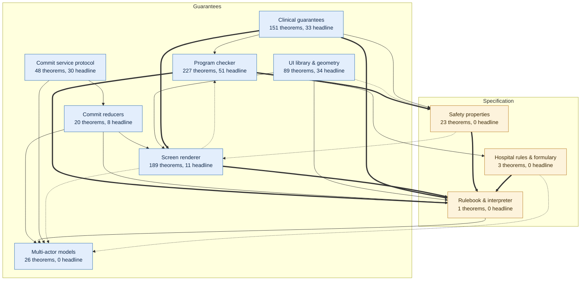
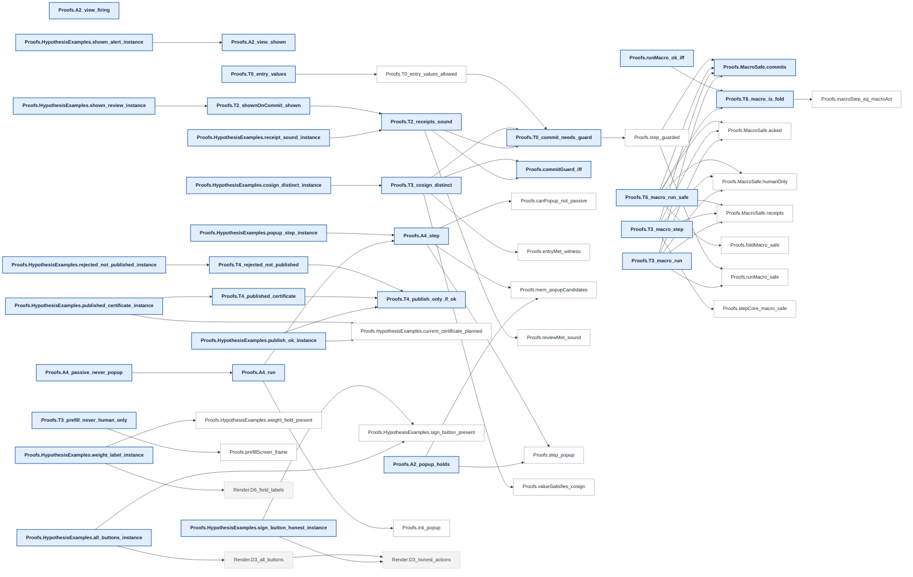
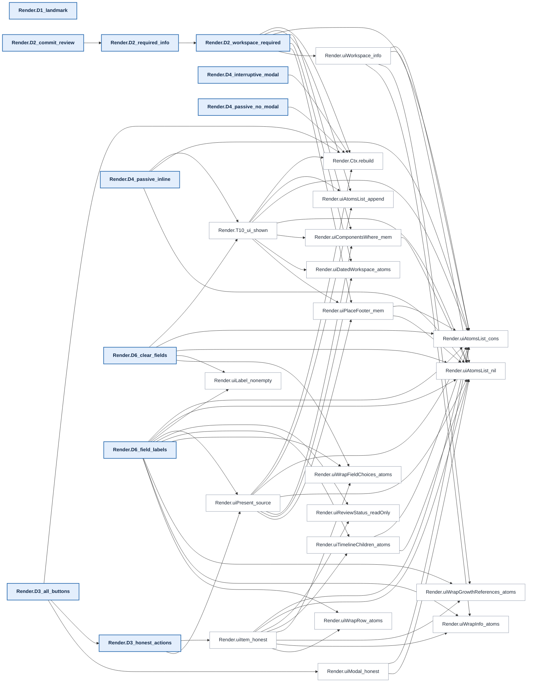
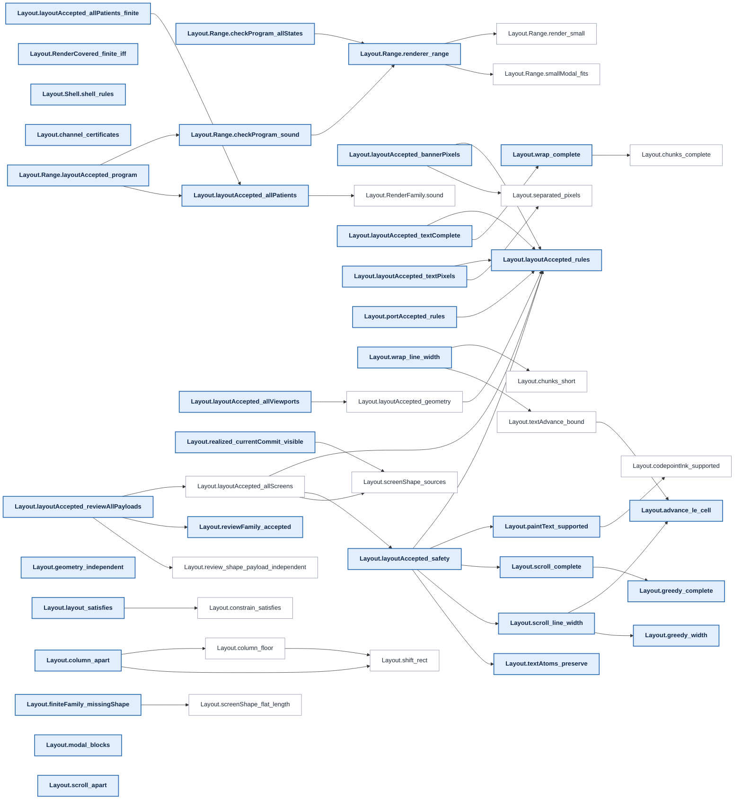
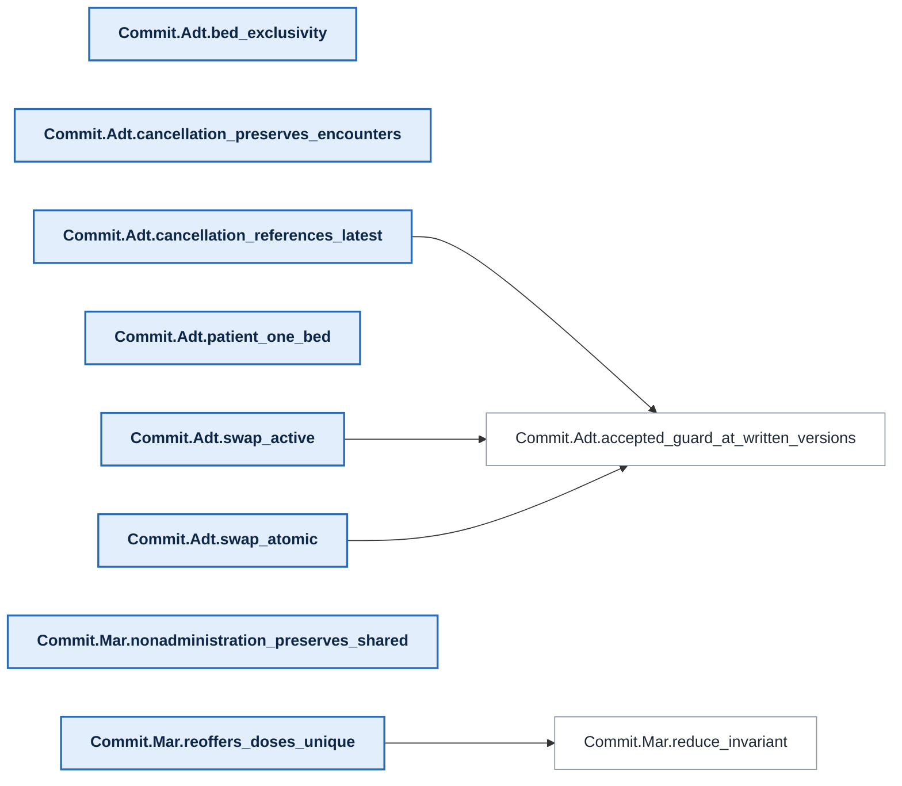
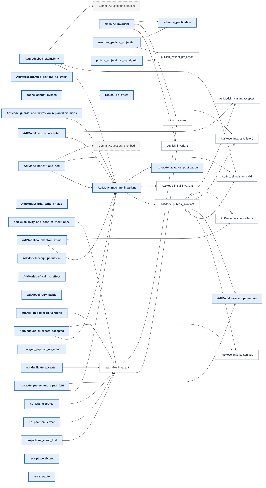
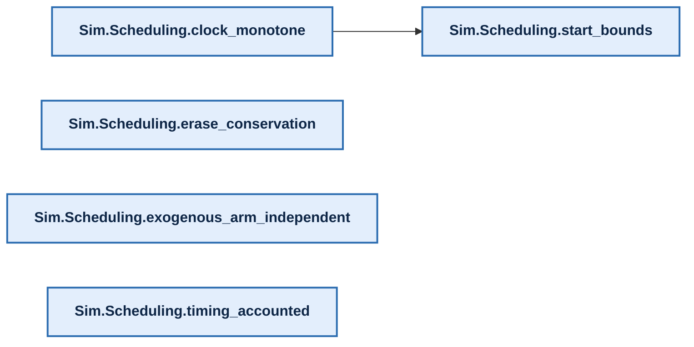

```mermaid
flowchart LR
  n0["Check.CompletionModel.accepted_completable"]:::head
  n1["Check.CompletionModel.accepted_edges"]:::head
  n2["Check.DoseCompletionObstruction.never_commits"]:::head
  n3["Check.DoseCompletionObstruction.not_completable"]:::head
  n4["Check.DoseCompletionObstruction.rejected"]:::head
  n5["Check.FixedLine.completable"]:::head
  n6["Check.FixedLine.completable_many_alerts"]:::head
  n7["Check.Scalar.completable"]:::head
  n8["Check.T7_counterexample_replays"]:::head
  n9["Check.T7_rejection"]:::head
  n10["Check.T8_checked_old_obligations"]:::head
  n11["Check.T8_old_obligations"]:::head
  n12["Check.T8_v1_to_v2"]:::head
  n13["Check.T8_v2_to_v3"]:::head
  n14["Check.accepted_alertsFire"]:::head
  n15["Check.accepted_budgets"]:::head
  n16["Check.accepted_capturesAllOnce"]:::head
  n17["Check.accepted_contracts"]:::head
  n18["Check.accepted_humanOnlyKept"]:::head
  n19["Check.accepted_navigation"]:::head
  n20["Check.accepted_noFalseAlarms"]:::head
  n21["Check.accepted_noRepeatInterruptions"]:::head
  n22["Check.accepted_reviewsBeforeCommit"]:::head
  n23["Check.accepted_severityTiers"]:::head
  n24["Check.accepted_units"]:::head
  n25["Check.accepted_wellFormed"]:::head
  n26["Check.accepted_writesOnly"]:::head
  n27["Check.alertsAcked_of_no_candidates"]:::head
  n28["Check.automated_lines_satisfies"]:::head
  n29["Check.cached_completion_eq"]:::head
  n30["Check.completion_dependency_rejected"]:::head
  n31["Check.fixed_lines_pending_nonempty"]:::head
  n32["Check.fixed_lines_satisfies"]:::head
  n33["Check.human_finish_ready"]:::head
  n34["Check.human_finish_ready_unique"]:::head
  n35["Check.many_alerts_satisfies"]:::head
  n36["Check.many_alerts_two_acknowledgments"]:::head
  n37["Check.prefill_macro_human_completion"]:::head
  n38["Check.reachable_drugSlots"]:::head
  n39["Check.receipt_lines_satisfies"]:::head
  n40["Check.receipt_review_transition"]:::head
  n41["Check.satisfies_of_checked_automated_lines"]:::head
  n42["Check.satisfies_of_checked_completable"]:::head
  n43["Check.satisfies_of_checked_fixed_lines"]:::head
  n44["Check.satisfies_of_checked_many_alerts"]:::head
  n45["Check.satisfies_of_checked_receipt_lines"]:::head
  n46["Check.satisfies_of_checked_scalar"]:::head
  n47["Check.scalar_identity_satisfies"]:::head
  n48["Check.tiny_bad_automation"]:::head
  n49["Check.tiny_bad_catalog"]:::head
  n50["Check.tiny_bad_role"]:::head
  n51["Check.CompletionModel.accepted_episode_complete"]:::lemma
  n52["Check.CompletionModel.run_closed"]:::lemma
  n53["Check.OkRun.append"]:::lemma
  n54["Check.accepted_structural"]:::lemma
  n55["Check.alertBudget_sound"]:::lemma
  n56["Check.alert_lookup_unique"]:::lemma
  n57["Check.alertsOnlyWhenTrue"]:::lemma
  n58["Check.check_ok_iff"]:::lemma
  n59["Check.commitCapturesAll"]:::lemma
  n60["Check.commitContracts"]:::lemma
  n61["Check.commitReviewsMet"]:::lemma
  n62["Check.commitUnitsRight"]:::lemma
  n63["Check.cosignIsSecondUser"]:::lemma
  n64["Check.declared_value_witness"]:::lemma
  n65["Check.enteredOnce"]:::lemma
  n66["Check.extends_contracts"]:::lemma
  n67["Check.extends_entries"]:::lemma
  n68["Check.extends_reviews"]:::lemma
  n69["Check.extends_static"]:::lemma
  n70["Check.firstFinding_some"]:::lemma
  n71["Check.followHops_sound"]:::lemma
  n72["Check.humanStepsByHuman"]:::lemma
  n73["Check.human_clear_popup"]:::lemma
  n74["Check.human_enter"]:::lemma
  n75["Check.interruptiveHandled"]:::lemma
  n76["Check.interruptsOnce"]:::lemma
  n77["Check.landmarksPinned_sound"]:::lemma
  n78["Check.onlyHumanCommitsAndAcks"]:::lemma
  n79["Check.orderLines_slots"]:::lemma
  n80["Check.passiveNeverPopsUp"]:::lemma
  n81["Check.passivePinned_sound"]:::lemma
  n82["Check.pinnedForReview_sound"]:::lemma
  n83["Check.replayOk_sound"]:::lemma
  n84["Check.reviewMet_iff"]:::lemma
  n85["Check.reviewsPinned_sound"]:::lemma
  n86["Check.step_drugSlots"]:::lemma
  n87["Check.tableReach_eq"]:::lemma
  n88["Check.writesAllowed"]:::lemma
  n89["Proofs.prefillScreen_frame"]:::other
  n90["Sim.Certificate.lookup_mem"]:::other
  n91["Specs.V2.specV2_extends_specV1"]:::other
  n92["Specs.V3.specV3_extends_specV2"]:::other
  n93["linkedDependents_not_self"]:::other
  n0 --> n51
  n1 --> n52
  n1 --> n90
  n2 --> n38
  n2 --> n89
  n3 --> n2
  n5 --> n6
  n6 --> n64
  n6 --> n73
  n6 --> n74
  n6 --> n34
  n6 --> n79
  n6 --> n82
  n6 --> n38
  n6 --> n84
  n6 --> n86
  n6 --> n93
  n7 --> n64
  n7 --> n73
  n7 --> n74
  n7 --> n33
  n8 --> n53
  n8 --> n71
  n8 --> n83
  n9 --> n8
  n9 --> n70
  n10 --> n14
  n10 --> n16
  n10 --> n18
  n10 --> n20
  n10 --> n21
  n10 --> n22
  n10 --> n23
  n10 --> n24
  n10 --> n66
  n10 --> n67
  n10 --> n68
  n10 --> n69
  n11 --> n66
  n11 --> n67
  n11 --> n68
  n11 --> n69
  n12 --> n10
  n12 --> n91
  n13 --> n10
  n13 --> n92
  n14 --> n54
  n14 --> n75
  n14 --> n81
  n15 --> n55
  n15 --> n58
  n16 --> n54
  n16 --> n59
  n16 --> n65
  n17 --> n60
  n18 --> n54
  n18 --> n63
  n18 --> n72
  n18 --> n78
  n19 --> n58
  n20 --> n54
  n20 --> n57
  n21 --> n54
  n21 --> n76
  n22 --> n54
  n22 --> n61
  n22 --> n85
  n23 --> n54
  n23 --> n80
  n24 --> n54
  n24 --> n62
  n25 --> n54
  n25 --> n77
  n26 --> n54
  n26 --> n88
  n27 --> n56
  n28 --> n41
  n29 --> n87
  n30 --> n4
  n32 --> n43
  n34 --> n27
  n34 --> n33
  n35 --> n44
  n38 --> n86
  n39 --> n45
  n41 --> n6
  n41 --> n25
  n41 --> n42
  n42 --> n14
  n42 --> n15
  n42 --> n16
  n42 --> n18
  n42 --> n19
  n42 --> n20
  n42 --> n21
  n42 --> n22
  n42 --> n23
  n42 --> n24
  n42 --> n25
  n42 --> n26
  n43 --> n5
  n43 --> n42
  n44 --> n6
  n44 --> n25
  n44 --> n42
  n45 --> n5
  n45 --> n42
  n46 --> n7
  n46 --> n42
  n47 --> n46
  n54 --> n58
  n61 --> n84
  n66 --> n60
  n71 --> n53
  n71 --> n83
  n85 --> n82
  classDef head fill:#e3eefc,stroke:#2b6cb0,stroke-width:2px,color:#0f2747,font-weight:bold
  classDef lemma fill:#ffffff,stroke:#8a94a6,color:#1f2937
  classDef other fill:#f4f4f5,stroke:#a1a1aa,stroke-dasharray:4 3,color:#3f3f46
```

# Proof map

[Overview](../README.md) · [Methods and reproduction](../README.md#documentation)

<!-- PROOF-MAP:BEGIN (generated by scripts/proof-map/build.sh --readme; do not edit) -->

Generated from the compiled Lean environment. In the overview an arrow reads
"is stated in terms of" (thick: 100+ references, dotted: under 5). In each
layer's chart below an arrow reads "its proof cites": headline claims are
bold, lemmas they cite directly are white, lemmas from other layers are
dashed. The interactive version, with search, full
trees and each claim's trust surface, is the `proof-map` artifact of every CI
run.

<b>Clinical guarantees</b>: 33 headline claims. Hard stop on signing, receipts, macros never act for a human, alert behaviour (T0–T6, A2, A4).

<b>Program checker</b>: 51 headline claims. The checker that admits agent-written programs and its soundness: acceptance implies the screen properties (accepted_*), plus completability.

<b>Screen renderer</b>: 11 headline claims. The screen tree the painter draws, and D1–D6: banner, required content, honest buttons, modal alerts.

<b>UI library &amp; geometry</b>: 34 headline claims. Integer layout, layout rules G1–G9, structural certificates and the renderer-range theorem.

<b>Commit reducers</b>: 8 headline claims. Medication administration and ADT reducers the commit service runs.

<b>Commit service protocol</b>: 30 headline claims. Model of the live service: locking, retries, crashes, caches. Stated under Postgres assumptions.

<b>Clinician simulation</b>: 5 headline claims. Simulated clinicians and effort measurement. Not a safety claim.

<b>Research semantics</b>: 1 headline claim. Exploratory boards and timelines outside the clinical runtime.

<!-- PROOF-MAP:END -->
