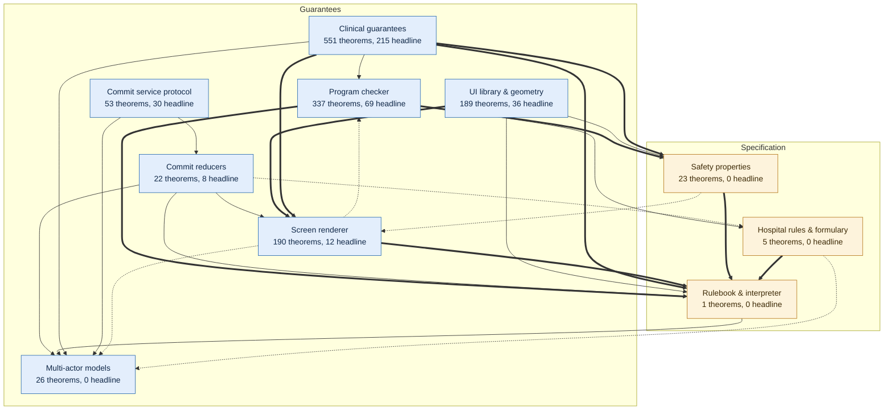
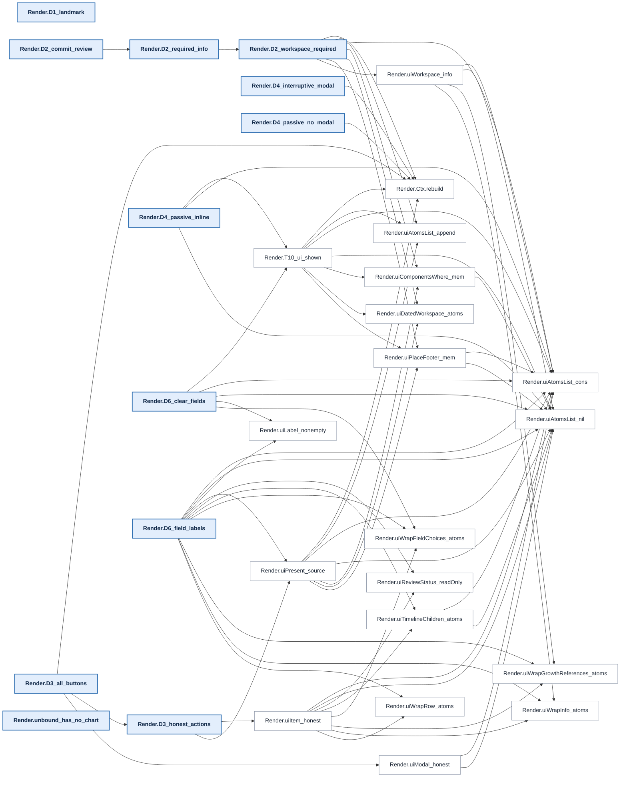
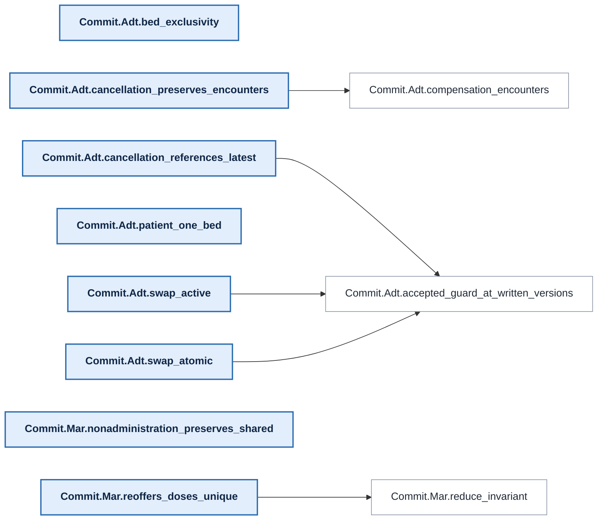
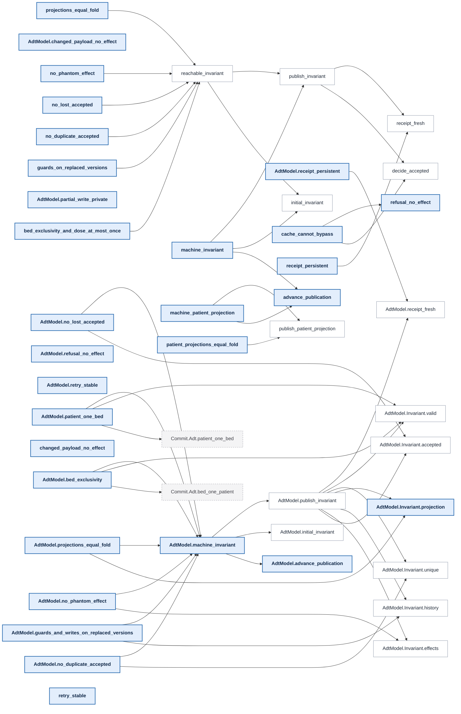
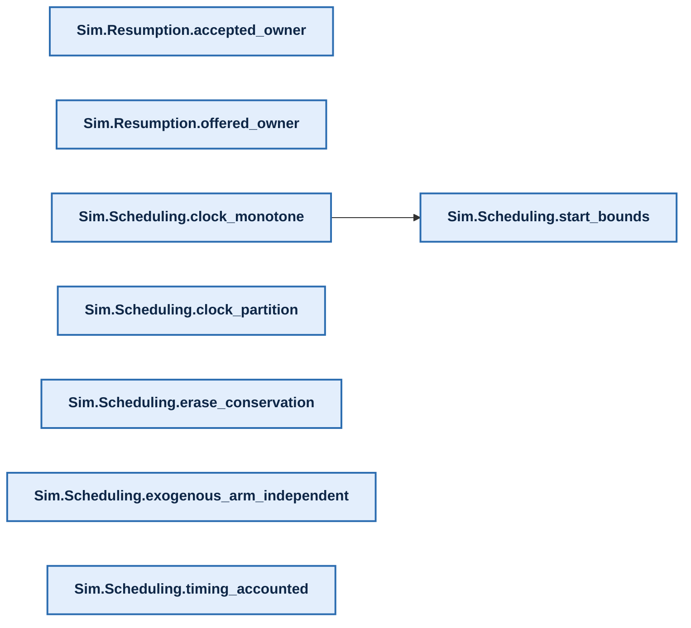

```mermaid
flowchart LR
  n0["Check.CompletionModel.accepted_completable"]:::head
  n1["Check.CompletionModel.accepted_edges"]:::head
  n2["Check.DoseCompletionObstruction.never_commits"]:::head
  n3["Check.DoseCompletionObstruction.not_completable"]:::head
  n4["Check.DoseCompletionObstruction.rejected"]:::head
  n5["Check.FixedLine.completable"]:::head
  n6["Check.FixedLine.completable_many_alerts"]:::head
  n7["Check.Scalar.completable"]:::head
  n8["Check.T7_counterexample_replays"]:::head
  n9["Check.T7_rejection"]:::head
  n10["Check.T8_checked_old_obligations"]:::head
  n11["Check.T8_old_obligations"]:::head
  n12["Check.T8_v1_to_v2"]:::head
  n13["Check.T8_v2_to_v3"]:::head
  n14["Check.accepted_alertsFire"]:::head
  n15["Check.accepted_budgets"]:::head
  n16["Check.accepted_capturesAllOnce"]:::head
  n17["Check.accepted_contracts"]:::head
  n18["Check.accepted_criticalIds"]:::head
  n19["Check.accepted_critical_no_shadow"]:::head
  n20["Check.accepted_humanOnlyKept"]:::head
  n21["Check.accepted_navigation"]:::head
  n22["Check.accepted_noFalseAlarms"]:::head
  n23["Check.accepted_noRepeatInterruptions"]:::head
  n24["Check.accepted_pinRules"]:::head
  n25["Check.accepted_reviewsBeforeCommit"]:::head
  n26["Check.accepted_severityTiers"]:::head
  n27["Check.accepted_units"]:::head
  n28["Check.accepted_wellFormed"]:::head
  n29["Check.accepted_writesOnly"]:::head
  n30["Check.alertKeys_of_captured"]:::head
  n31["Check.alertsAcked_of_no_candidates"]:::head
  n32["Check.automated_lines_satisfies"]:::head
  n33["Check.cached_completion_eq"]:::head
  n34["Check.completion_dependency_rejected"]:::head
  n35["Check.critical_handle_reserved"]:::head
  n36["Check.enteredOnce_at"]:::head
  n37["Check.fixed_lines_pending_nonempty"]:::head
  n38["Check.fixed_lines_satisfies"]:::head
  n39["Check.goTo_noNewHuman"]:::head
  n40["Check.goTo_writesState"]:::head
  n41["Check.human_finish_ready"]:::head
  n42["Check.human_finish_ready_unique"]:::head
  n43["Check.interruptsOnce_at"]:::head
  n44["Check.landmarksPinned_at"]:::head
  n45["Check.many_alerts_satisfies"]:::head
  n46["Check.many_alerts_two_acknowledgments"]:::head
  n47["Check.onlyHumanCommitsAndAcks_at"]:::head
  n48["Check.passivePinned_at"]:::head
  n49["Check.popupKeys_step"]:::head
  n50["Check.popupUnacked_step"]:::head
  n51["Check.prefill_macro_human_completion"]:::head
  n52["Check.reachable_drugSlots"]:::head
  n53["Check.receipt_lines_satisfies"]:::head
  n54["Check.receipt_review_transition"]:::head
  n55["Check.reviewsPinned_at"]:::head
  n56["Check.satisfies_of_checked_automated_lines"]:::head
  n57["Check.satisfies_of_checked_completable"]:::head
  n58["Check.satisfies_of_checked_fixed_lines"]:::head
  n59["Check.satisfies_of_checked_many_alerts"]:::head
  n60["Check.satisfies_of_checked_receipt_lines"]:::head
  n61["Check.satisfies_of_checked_scalar"]:::head
  n62["Check.scalar_identity_satisfies"]:::head
  n63["Check.step_humanCaptured"]:::head
  n64["Check.step_noNewHuman"]:::head
  n65["Check.step_writesState"]:::head
  n66["Check.tiny_bad_automation"]:::head
  n67["Check.tiny_bad_catalog"]:::head
  n68["Check.tiny_bad_role"]:::head
  n69["Check.CompletionModel.accepted_episode_complete"]:::lemma
  n70["Check.CompletionModel.run_closed"]:::lemma
  n71["Check.DoseCompletionObstruction.after_reachable"]:::lemma
  n72["Check.DoseCompletionObstruction.cannot_add"]:::lemma
  n73["Check.DoseCompletionObstruction.no_drug_fields"]:::lemma
  n74["Check.FixedLine.fixed_slots"]:::lemma
  n75["Check.FixedLine.on_screen"]:::lemma
  n76["Check.FixedLine.shown_assessment"]:::lemma
  n77["Check.FixedLine.shown_button"]:::lemma
  n78["Check.NoNewHuman.preserves"]:::lemma
  n79["Check.OkRun.append"]:::lemma
  n80["Check.Scalar.on_screen"]:::lemma
  n81["Check.Scalar.shown_button"]:::lemma
  n82["Check.Scalar.shown_field"]:::lemma
  n83["Check.accepted_depth"]:::lemma
  n84["Check.accepted_pins"]:::lemma
  n85["Check.accepted_structural"]:::lemma
  n86["Check.acked_monotone"]:::lemma
  n87["Check.alertBudget_sound"]:::lemma
  n88["Check.alertKeys_captured"]:::lemma
  n89["Check.alert_lookup_unique"]:::lemma
  n90["Check.alertsOnlyWhenTrue"]:::lemma
  n91["Check.check_ok_iff"]:::lemma
  n92["Check.commitCapturesAll"]:::lemma
  n93["Check.commitContracts"]:::lemma
  n94["Check.commitReviewsMet"]:::lemma
  n95["Check.commitUnitsRight"]:::lemma
  n96["Check.cosignIsSecondUser"]:::lemma
  n97["Check.currentScreen"]:::lemma
  n98["Check.declared_value_witness"]:::lemma
  n99["Check.enterCore_human_quality"]:::lemma
  n100["Check.enteredOnce"]:::lemma
  n101["Check.extends_contracts"]:::lemma
  n102["Check.extends_entries"]:::lemma
  n103["Check.extends_reviews"]:::lemma
  n104["Check.extends_static"]:::lemma
  n105["Check.firstFinding_some"]:::lemma
  n106["Check.fixedShown_sound"]:::lemma
  n107["Check.followHops_sound"]:::lemma
  n108["Check.goTo_noHuman"]:::lemma
  n109["Check.goTo_writes"]:::lemma
  n110["Check.humanStepsByHuman"]:::lemma
  n111["Check.human_clear_popup"]:::lemma
  n112["Check.human_enter"]:::lemma
  n113["Check.infoShown_iff"]:::lemma
  n114["Check.interruptiveHandled"]:::lemma
  n115["Check.interruptsOnce"]:::lemma
  n116["Check.landmarksPinned_sound"]:::lemma
  n117["Check.onlyHumanCommitsAndAcks"]:::lemma
  n118["Check.orderLines_slots"]:::lemma
  n119["Check.passiveNeverPopsUp"]:::lemma
  n120["Check.passivePinned_sound"]:::lemma
  n121["Check.pinnedForReview_sound"]:::lemma
  n122["Check.popup_acked"]:::lemma
  n123["Check.popup_captured"]:::lemma
  n124["Check.popup_continues"]:::lemma
  n125["Check.prefillScreen_slots"]:::lemma
  n126["Check.replayOk_sound"]:::lemma
  n127["Check.reserved_append"]:::lemma
  n128["Check.reviewMet_iff"]:::lemma
  n129["Check.reviewsPinned_sound"]:::lemma
  n130["Check.runMacro_writes"]:::lemma
  n131["Check.stepCore_ack_witness"]:::lemma
  n132["Check.stepCore_commit_witness"]:::lemma
  n133["Check.stepCore_keeps"]:::lemma
  n134["Check.stepCore_writes"]:::lemma
  n135["Check.step_drugSlots"]:::lemma
  n136["Check.step_eq_core"]:::lemma
  n137["Check.step_noHuman"]:::lemma
  n138["Check.tableReach_eq"]:::lemma
  n139["Check.writesAllowed"]:::lemma
  n140["Proofs.A2_popup_holds"]:::other
  n141["Proofs.MacroSafe.acked"]:::other
  n142["Proofs.MacroSafe.commits"]:::other
  n143["Proofs.T3_macro_step"]:::other
  n144["Proofs.prefillScreen_frame"]:::other
  n145["Proofs.runMacro_safe"]:::other
  n146["Sim.Certificate.lookup_mem"]:::other
  n147["Specs.V2.specV2_extends_specV1"]:::other
  n148["Specs.V3.specV3_extends_specV2"]:::other
  n149["linkedDependents_not_self"]:::other
  n0 --> n69
  n1 --> n70
  n1 --> n146
  n2 --> n72
  n2 --> n73
  n2 --> n52
  n2 --> n144
  n3 --> n71
  n3 --> n2
  n5 --> n6
  n6 --> n74
  n6 --> n75
  n6 --> n76
  n6 --> n77
  n6 --> n98
  n6 --> n111
  n6 --> n112
  n6 --> n42
  n6 --> n118
  n6 --> n121
  n6 --> n52
  n6 --> n128
  n6 --> n135
  n6 --> n149
  n7 --> n80
  n7 --> n81
  n7 --> n82
  n7 --> n98
  n7 --> n111
  n7 --> n112
  n7 --> n41
  n8 --> n79
  n8 --> n107
  n8 --> n126
  n9 --> n8
  n9 --> n105
  n10 --> n14
  n10 --> n16
  n10 --> n20
  n10 --> n22
  n10 --> n23
  n10 --> n25
  n10 --> n26
  n10 --> n27
  n10 --> n101
  n10 --> n102
  n10 --> n103
  n10 --> n104
  n11 --> n101
  n11 --> n102
  n11 --> n103
  n11 --> n104
  n12 --> n10
  n12 --> n147
  n13 --> n10
  n13 --> n148
  n14 --> n84
  n14 --> n85
  n14 --> n114
  n14 --> n120
  n15 --> n87
  n15 --> n91
  n16 --> n85
  n16 --> n92
  n16 --> n100
  n17 --> n93
  n18 --> n91
  n19 --> n18
  n19 --> n35
  n20 --> n85
  n20 --> n96
  n20 --> n110
  n20 --> n117
  n21 --> n91
  n22 --> n85
  n22 --> n90
  n23 --> n85
  n23 --> n115
  n24 --> n84
  n25 --> n84
  n25 --> n85
  n25 --> n94
  n25 --> n129
  n26 --> n85
  n26 --> n119
  n27 --> n85
  n27 --> n95
  n28 --> n83
  n28 --> n84
  n28 --> n85
  n28 --> n116
  n29 --> n85
  n29 --> n139
  n30 --> n88
  n31 --> n89
  n32 --> n56
  n33 --> n138
  n34 --> n4
  n35 --> n127
  n36 --> n133
  n36 --> n136
  n38 --> n58
  n39 --> n108
  n40 --> n109
  n42 --> n31
  n42 --> n41
  n43 --> n86
  n43 --> n124
  n44 --> n97
  n44 --> n106
  n44 --> n113
  n45 --> n59
  n47 --> n131
  n47 --> n132
  n47 --> n141
  n47 --> n142
  n47 --> n143
  n47 --> n145
  n48 --> n106
  n49 --> n88
  n49 --> n123
  n49 --> n140
  n50 --> n122
  n50 --> n140
  n52 --> n125
  n52 --> n135
  n53 --> n60
  n55 --> n97
  n55 --> n121
  n56 --> n6
  n56 --> n28
  n56 --> n57
  n57 --> n14
  n57 --> n15
  n57 --> n16
  n57 --> n20
  n57 --> n21
  n57 --> n22
  n57 --> n23
  n57 --> n25
  n57 --> n26
  n57 --> n27
  n57 --> n28
  n57 --> n29
  n58 --> n5
  n58 --> n57
  n59 --> n6
  n59 --> n28
  n59 --> n57
  n60 --> n5
  n60 --> n57
  n61 --> n7
  n61 --> n57
  n62 --> n61
  n63 --> n78
  n63 --> n99
  n63 --> n64
  n64 --> n137
  n65 --> n130
  n65 --> n134
  n83 --> n91
  n84 --> n91
  n85 --> n91
  n86 --> n47
  n90 --> n88
  n90 --> n49
  n94 --> n128
  n100 --> n36
  n101 --> n93
  n107 --> n79
  n107 --> n126
  n110 --> n137
  n115 --> n43
  n115 --> n50
  n116 --> n44
  n117 --> n47
  n120 --> n48
  n121 --> n113
  n122 --> n47
  n128 --> n113
  n129 --> n55
  n131 --> n141
  n132 --> n142
  n139 --> n65
  n143 --> n141
  n143 --> n142
  classDef head fill:#e3eefc,stroke:#2b6cb0,stroke-width:2px,color:#0f2747,font-weight:bold
  classDef lemma fill:#ffffff,stroke:#8a94a6,color:#1f2937
  classDef other fill:#f4f4f5,stroke:#a1a1aa,stroke-dasharray:4 3,color:#3f3f46
```

```mermaid
flowchart LR
  n0["Layout.Range.checkProgram_allStates"]:::head
  n1["Layout.Range.checkProgram_sound"]:::head
  n2["Layout.Range.layoutAccepted_program"]:::head
  n3["Layout.Range.renderer_range"]:::head
  n4["Layout.RenderCovered_finite_iff"]:::head
  n5["Layout.Shell.shell_rules"]:::head
  n6["Layout.Shell.targets"]:::head
  n7["Layout.Structural.targets"]:::head
  n8["Layout.advance_le_cell"]:::head
  n9["Layout.channel_certificates"]:::head
  n10["Layout.column_apart"]:::head
  n11["Layout.finiteFamily_missingShape"]:::head
  n12["Layout.geometry_independent"]:::head
  n13["Layout.greedy_complete"]:::head
  n14["Layout.greedy_width"]:::head
  n15["Layout.layoutAccepted_allPatients"]:::head
  n16["Layout.layoutAccepted_allPatients_finite"]:::head
  n17["Layout.layoutAccepted_allViewports"]:::head
  n18["Layout.layoutAccepted_bannerPixels"]:::head
  n19["Layout.layoutAccepted_reviewAllPayloads"]:::head
  n20["Layout.layoutAccepted_rules"]:::head
  n21["Layout.layoutAccepted_safety"]:::head
  n22["Layout.layoutAccepted_textComplete"]:::head
  n23["Layout.layoutAccepted_textPixels"]:::head
  n24["Layout.layout_satisfies"]:::head
  n25["Layout.modal_blocks"]:::head
  n26["Layout.paintText_supported"]:::head
  n27["Layout.portAccepted_rules"]:::head
  n28["Layout.realized_currentCommit_visible"]:::head
  n29["Layout.reviewFamily_accepted"]:::head
  n30["Layout.scroll_apart"]:::head
  n31["Layout.scroll_complete"]:::head
  n32["Layout.scroll_line_width"]:::head
  n33["Layout.textAtoms_preserve"]:::head
  n34["Layout.wrap_complete"]:::head
  n35["Layout.wrap_line_width"]:::head
  n36["Layout.Range.render_small"]:::lemma
  n37["Layout.Range.smallModal_fits"]:::lemma
  n38["Layout.Range.unchecked_sound"]:::lemma
  n39["Layout.RenderFamily.sound"]:::lemma
  n40["Layout.Shell.banner_rule"]:::lemma
  n41["Layout.Shell.base_footer"]:::lemma
  n42["Layout.Shell.base_no_modal"]:::lemma
  n43["Layout.Shell.base_rules"]:::lemma
  n44["Layout.Shell.base_target_inactive"]:::lemma
  n45["Layout.Shell.bounds"]:::lemma
  n46["Layout.Shell.commit_rule"]:::lemma
  n47["Layout.Shell.complete"]:::lemma
  n48["Layout.Shell.contrast"]:::lemma
  n49["Layout.Shell.footer_inactive"]:::lemma
  n50["Layout.Shell.horizontal"]:::lemma
  n51["Layout.Shell.modal_rule"]:::lemma
  n52["Layout.Shell.modals_separated"]:::lemma
  n53["Layout.Shell.reading_order"]:::lemma
  n54["Layout.Shell.shell_cases"]:::lemma
  n55["Layout.Shell.target_implies"]:::lemma
  n56["Layout.Shell.text_rule"]:::lemma
  n57["Layout.Shell.zip_order"]:::lemma
  n58["Layout.Structural.body_order"]:::lemma
  n59["Layout.Structural.bounds"]:::lemma
  n60["Layout.Structural.placement_cases"]:::lemma
  n61["Layout.candidate_length_le"]:::lemma
  n62["Layout.chunks_complete"]:::lemma
  n63["Layout.chunks_short"]:::lemma
  n64["Layout.codepointInk_supported"]:::lemma
  n65["Layout.column_floor"]:::lemma
  n66["Layout.constrain_satisfies"]:::lemma
  n67["Layout.layoutAccepted_allScreens"]:::lemma
  n68["Layout.layoutAccepted_geometry"]:::lemma
  n69["Layout.review_shape_payload_independent"]:::lemma
  n70["Layout.screenShape_flat_length"]:::lemma
  n71["Layout.screenShape_sources"]:::lemma
  n72["Layout.separated_pixels"]:::lemma
  n73["Layout.shape_path_unique"]:::lemma
  n74["Layout.shift_rect"]:::lemma
  n75["Layout.textAdvance_bound"]:::lemma
  n0 --> n3
  n0 --> n38
  n1 --> n3
  n2 --> n1
  n2 --> n15
  n3 --> n36
  n3 --> n37
  n5 --> n40
  n5 --> n46
  n5 --> n47
  n5 --> n48
  n5 --> n50
  n5 --> n51
  n5 --> n53
  n5 --> n6
  n5 --> n56
  n6 --> n41
  n6 --> n42
  n6 --> n43
  n6 --> n44
  n6 --> n45
  n6 --> n49
  n6 --> n52
  n6 --> n54
  n6 --> n55
  n6 --> n57
  n7 --> n58
  n7 --> n59
  n7 --> n60
  n10 --> n65
  n10 --> n74
  n11 --> n61
  n11 --> n70
  n15 --> n39
  n16 --> n15
  n17 --> n68
  n18 --> n20
  n18 --> n72
  n19 --> n67
  n19 --> n29
  n19 --> n69
  n21 --> n20
  n21 --> n26
  n21 --> n31
  n21 --> n32
  n21 --> n33
  n22 --> n20
  n22 --> n34
  n23 --> n20
  n23 --> n72
  n24 --> n66
  n26 --> n64
  n27 --> n20
  n28 --> n71
  n28 --> n73
  n31 --> n13
  n32 --> n8
  n32 --> n14
  n34 --> n62
  n35 --> n63
  n35 --> n75
  n40 --> n41
  n40 --> n43
  n40 --> n54
  n46 --> n54
  n48 --> n43
  n48 --> n54
  n50 --> n43
  n50 --> n45
  n50 --> n54
  n51 --> n54
  n53 --> n43
  n53 --> n57
  n56 --> n41
  n56 --> n42
  n56 --> n43
  n56 --> n49
  n56 --> n52
  n56 --> n54
  n65 --> n74
  n67 --> n20
  n67 --> n21
  n67 --> n71
  n68 --> n20
  n75 --> n8
  classDef head fill:#e3eefc,stroke:#2b6cb0,stroke-width:2px,color:#0f2747,font-weight:bold
  classDef lemma fill:#ffffff,stroke:#8a94a6,color:#1f2937
  classDef other fill:#f4f4f5,stroke:#a1a1aa,stroke-dasharray:4 3,color:#3f3f46
```

# Proof map

[Overview](../README.md) · [Methods and reproduction](../README.md#documentation)

<!-- PROOF-MAP:BEGIN (generated by scripts/proof-map/build.sh --readme; do not edit) -->

Generated from the compiled Lean environment. In the overview an arrow reads
"is stated in terms of" (thick: 100+ references, dotted: under 5). In each
layer's chart below an arrow reads "its proof cites": headline claims are
bold, lemmas they cite directly are white, lemmas from other layers are
dashed. The interactive version, with search, full
trees and each claim's trust surface, is the `proof-map` artifact of every CI
run.



<details><summary><b>Clinical guarantees</b>: 215 headline claims. Hard stop on signing, receipts, macros never act for a human, alert behaviour (T0–T6, A2, A4).</summary>

```mermaid
flowchart LR
  n0["Proofs.A2_popup_holds"]:::head
  n1["Proofs.A2_view_firing"]:::head
  n2["Proofs.A2_view_shown"]:::head
  n3["Proofs.A4_passive_never_popup"]:::head
  n4["Proofs.A4_run"]:::head
  n5["Proofs.A4_step"]:::head
  n6["Proofs.HypothesisExamples.all_buttons_instance"]:::head
  n7["Proofs.HypothesisExamples.cosign_distinct_instance"]:::head
  n8["Proofs.HypothesisExamples.popup_step_instance"]:::head
  n9["Proofs.HypothesisExamples.publish_ok_instance"]:::head
  n10["Proofs.HypothesisExamples.published_certificate_instance"]:::head
  n11["Proofs.HypothesisExamples.receipt_sound_instance"]:::head
  n12["Proofs.HypothesisExamples.rejected_not_published_instance"]:::head
  n13["Proofs.HypothesisExamples.shown_alert_instance"]:::head
  n14["Proofs.HypothesisExamples.shown_review_instance"]:::head
  n15["Proofs.HypothesisExamples.sign_button_honest_instance"]:::head
  n16["Proofs.HypothesisExamples.weight_label_instance"]:::head
  n17["Proofs.MacroSafe.acked"]:::head
  n18["Proofs.MacroSafe.commits"]:::head
  n19["Proofs.MacroSafe.receipts"]:::head
  n20["Proofs.T0_commit_needs_guard"]:::head
  n21["Proofs.T0_entry_values"]:::head
  n22["Proofs.T2_receipts_sound"]:::head
  n23["Proofs.T2_shownOnCommit_shown"]:::head
  n24["Proofs.T3_cosign_distinct"]:::head
  n25["Proofs.T3_macro_run"]:::head
  n26["Proofs.T3_macro_step"]:::head
  n27["Proofs.T3_prefill_never_human_only"]:::head
  n28["Proofs.T4_publish_only_if_ok"]:::head
  n29["Proofs.T4_published_certificate"]:::head
  n30["Proofs.T4_rejected_not_published"]:::head
  n31["Proofs.T6_macro_is_fold"]:::head
  n32["Proofs.T6_macro_run_safe"]:::head
  n33["Proofs.commitGuard_iff"]:::head
  n34["Proofs.runMacro_ok_iff"]:::head
  n35["Runtime.A2_popup_holds"]:::head
  n36["Runtime.A2_view_shown"]:::head
  n37["Runtime.A4_run"]:::head
  n38["Runtime.A4_step"]:::head
  n39["Runtime.ClinicalWitness.alerts_only_when_true"]:::head
  n40["Runtime.ClinicalWitness.blocked_under_popup"]:::head
  n41["Runtime.ClinicalWitness.clinical_unchanged"]:::head
  n42["Runtime.Hydrated.chart"]:::head
  n43["Runtime.Hydrated.pending"]:::head
  n44["Runtime.T0_commit_needs_guard"]:::head
  n45["Runtime.T0_entry_values"]:::head
  n46["Runtime.T2_receipts_sound"]:::head
  n47["Runtime.T2_shownOnCommit_shown"]:::head
  n48["Runtime.T3_cosign_distinct"]:::head
  n49["Runtime.Witness.acknowledged_inEpisode"]:::head
  n50["Runtime.Witness.acknowledged_keeps_acks"]:::head
  n51["Runtime.Witness.acknowledged_keeps_captures"]:::head
  n52["Runtime.Witness.acknowledged_landmark"]:::head
  n53["Runtime.Witness.acknowledged_reachable"]:::head
  n54["Runtime.Witness.action_is_draft"]:::head
  n55["Runtime.Witness.changed_fact_interrupts"]:::head
  n56["Runtime.Witness.episode_accepted"]:::head
  n57["Runtime.Witness.hydrating_call_refuses"]:::head
  n58["Runtime.Witness.landing_has_no_landmark"]:::head
  n59["Runtime.Witness.landing_not_inEpisode"]:::head
  n60["Runtime.Witness.landing_passive_not_shown"]:::head
  n61["Runtime.Witness.landing_workspaceOnly"]:::head
  n62["Runtime.Witness.passive_accepted"]:::head
  n63["Runtime.Witness.passive_landing_reachable"]:::head
  n64["Runtime.Witness.popup_blocks_action"]:::head
  n65["Runtime.Witness.reopen_does_not_interrupt"]:::head
  n66["Runtime.Witness.reopen_restores_entry"]:::head
  n67["Runtime.Witness.reopened_inEpisode"]:::head
  n68["Runtime.Witness.reopened_reachable"]:::head
  n69["Runtime.Witness.reopened_store"]:::head
  n70["Runtime.Witness.return_empties_acked"]:::head
  n71["Runtime.Witness.return_empties_captured"]:::head
  n72["Runtime.Witness.return_keeps_ack"]:::head
  n73["Runtime.Witness.return_keeps_capture"]:::head
  n74["Runtime.Witness.return_leaves"]:::head
  n75["Runtime.Witness.returned_not_inEpisode"]:::head
  n76["Runtime.Witness.role_not_checked"]:::head
  n77["Runtime.Witness.selected_not_inEpisode"]:::head
  n78["Runtime.Witness.start_history"]:::head
  n79["Runtime.Witness.start_history_not_core"]:::head
  n80["Runtime.Witness.witness_global"]:::head
  n81["Runtime.Witness.workspace_accepted"]:::head
  n82["Runtime.Witness.writes_allowed"]:::head
  n83["Runtime.WorkspaceOnly.controls"]:::head
  n84["Runtime.WorkspaceOnly.directoryOnly"]:::head
  n85["Runtime.WorkspaceOnly.noBlocked"]:::head
  n86["Runtime.WorkspaceOnly.noItems"]:::head
  n87["Runtime.accepted_episode"]:::head
  n88["Runtime.accepted_ordinary"]:::head
  n89["Runtime.accepted_severityTiers"]:::head
  n90["Runtime.accepted_static"]:::head
  n91["Runtime.ack_origin"]:::head
  n92["Runtime.alertKeys_critical"]:::head
  n93["Runtime.bind_cases"]:::head
  n94["Runtime.bind_evidence"]:::head
  n95["Runtime.bind_hydrates"]:::head
  n96["Runtime.bind_of_bound"]:::head
  n97["Runtime.call_shape"]:::head
  n98["Runtime.chart_humanCaptured"]:::head
  n99["Runtime.chart_names"]:::head
  n100["Runtime.chart_noHuman"]:::head
  n101["Runtime.chart_popup"]:::head
  n102["Runtime.chart_writes"]:::head
  n103["Runtime.commitGuard_critical"]:::head
  n104["Runtime.commit_byClick"]:::head
  n105["Runtime.commit_core"]:::head
  n106["Runtime.commit_entries"]:::head
  n107["Runtime.commit_input"]:::head
  n108["Runtime.commit_interruptive_handled"]:::head
  n109["Runtime.commit_reviews"]:::head
  n110["Runtime.commit_units"]:::head
  n111["Runtime.core_context"]:::head
  n112["Runtime.core_history"]:::head
  n113["Runtime.critical_evidence"]:::head
  n114["Runtime.critical_frame"]:::head
  n115["Runtime.critical_popup"]:::head
  n116["Runtime.draft_origin"]:::head
  n117["Runtime.episode_agrees"]:::head
  n118["Runtime.episode_alertsOnlyWhenTrue"]:::head
  n119["Runtime.episode_always"]:::head
  n120["Runtime.episode_bound"]:::head
  n121["Runtime.episode_commitCapturesAll"]:::head
  n122["Runtime.episode_commitReviewsMet"]:::head
  n123["Runtime.episode_commitScreenShowsReviews"]:::head
  n124["Runtime.episode_commitUnitsRight"]:::head
  n125["Runtime.episode_context"]:::head
  n126["Runtime.episode_cosignIsSecondUser"]:::head
  n127["Runtime.episode_enteredOnce"]:::head
  n128["Runtime.episode_everyStep"]:::head
  n129["Runtime.episode_humanStepsByHuman"]:::head
  n130["Runtime.episode_interruptiveHandled"]:::head
  n131["Runtime.episode_interruptsOnce"]:::head
  n132["Runtime.episode_landmarksShown"]:::head
  n133["Runtime.episode_not_core"]:::head
  n134["Runtime.episode_onlyHumanCommitsAndAcks"]:::head
  n135["Runtime.episode_passiveShownInline"]:::head
  n136["Runtime.episode_refines"]:::head
  n137["Runtime.episode_runView"]:::head
  n138["Runtime.episode_step"]:::head
  n139["Runtime.episode_writesAllowed"]:::head
  n140["Runtime.first_step"]:::head
  n141["Runtime.fixed_invariant"]:::head
  n142["Runtime.fixed_reachable"]:::head
  n143["Runtime.fixed_refines_core"]:::head
  n144["Runtime.hydrating_ack"]:::head
  n145["Runtime.hydrating_adds_nothing"]:::head
  n146["Runtime.hydrating_applies"]:::head
  n147["Runtime.hydrating_refuses"]:::head
  n148["Runtime.inputState_ordinary"]:::head
  n149["Runtime.input_acks"]:::head
  n150["Runtime.input_commits"]:::head
  n151["Runtime.input_receipts"]:::head
  n152["Runtime.interruptsOnce_from"]:::head
  n153["Runtime.landmarksShown_from"]:::head
  n154["Runtime.navigation_leaves"]:::head
  n155["Runtime.new_ack_core"]:::head
  n156["Runtime.new_commit_core"]:::head
  n157["Runtime.new_receipt_core"]:::head
  n158["Runtime.ordinary_agrees"]:::head
  n159["Runtime.ordinary_alertsOnlyWhenTrue"]:::head
  n160["Runtime.ordinary_always"]:::head
  n161["Runtime.ordinary_commitCapturesAll"]:::head
  n162["Runtime.ordinary_commitReviewsMet"]:::head
  n163["Runtime.ordinary_commitScreenShowsReviews"]:::head
  n164["Runtime.ordinary_commitUnitsRight"]:::head
  n165["Runtime.ordinary_cosignIsSecondUser"]:::head
  n166["Runtime.ordinary_enteredOnce"]:::head
  n167["Runtime.ordinary_everyStep"]:::head
  n168["Runtime.ordinary_humanStepsByHuman"]:::head
  n169["Runtime.ordinary_interruptiveHandled"]:::head
  n170["Runtime.ordinary_interruptsOnce"]:::head
  n171["Runtime.ordinary_landmarksShown"]:::head
  n172["Runtime.ordinary_onlyHumanCommitsAndAcks"]:::head
  n173["Runtime.ordinary_passiveShownInline"]:::head
  n174["Runtime.ordinary_refines"]:::head
  n175["Runtime.ordinary_step"]:::head
  n176["Runtime.ordinary_writesAllowed"]:::head
  n177["Runtime.others_ne"]:::head
  n178["Runtime.popup_blocks"]:::head
  n179["Runtime.popup_blocks_ordinary"]:::head
  n180["Runtime.popup_kept"]:::head
  n181["Runtime.reachableFrom_start"]:::head
  n182["Runtime.reachable_settled"]:::head
  n183["Runtime.receipt_origin"]:::head
  n184["Runtime.restore_human"]:::head
  n185["Runtime.restore_humanCaptured"]:::head
  n186["Runtime.restore_keeps"]:::head
  n187["Runtime.restore_mem"]:::head
  n188["Runtime.restore_writes"]:::head
  n189["Runtime.runInit_unselected"]:::head
  n190["Runtime.runView_ordinary"]:::head
  n191["Runtime.save_ne"]:::head
  n192["Runtime.save_self"]:::head
  n193["Runtime.selection_global"]:::head
  n194["Runtime.session_acks"]:::head
  n195["Runtime.session_bind"]:::head
  n196["Runtime.session_captures"]:::head
  n197["Runtime.session_humanEntries"]:::head
  n198["Runtime.start_acked"]:::head
  n199["Runtime.start_eq"]:::head
  n200["Runtime.start_fresh"]:::head
  n201["Runtime.start_lift"]:::head
  n202["Runtime.start_unacked"]:::head
  n203["Runtime.step_context"]:::head
  n204["Runtime.step_critical"]:::head
  n205["Runtime.step_drafts"]:::head
  n206["Runtime.step_shape"]:::head
  n207["Runtime.unbound_not_inEpisode"]:::head
  n208["Runtime.unbound_view"]:::head
  n209["Runtime.unselected_not_inEpisode"]:::head
  n210["Runtime.unselected_view"]:::head
  n211["Runtime.view_critical"]:::head
  n212["Runtime.workspace_core"]:::head
  n213["Runtime.workspace_popup_blocks"]:::head
  n214["Runtime.workspace_shape"]:::head
  n215["Check.NoNewHuman.humanCaptured"]:::other
  n216["Check.accepted_alertsFire"]:::other
  n217["Check.accepted_budgets"]:::other
  n218["Check.accepted_capturesAllOnce"]:::other
  n219["Check.accepted_humanOnlyKept"]:::other
  n220["Check.accepted_navigation"]:::other
  n221["Check.accepted_noFalseAlarms"]:::other
  n222["Check.accepted_noRepeatInterruptions"]:::other
  n223["Check.accepted_pinRules"]:::other
  n224["Check.accepted_reviewsBeforeCommit"]:::other
  n225["Check.accepted_severityTiers"]:::other
  n226["Check.accepted_units"]:::other
  n227["Check.accepted_wellFormed"]:::other
  n228["Check.accepted_writesOnly"]:::other
  n229["Check.check_ok_iff"]:::other
  n230["Check.enteredOnce_at"]:::other
  n231["Check.entryMet_iff"]:::other
  n232["Check.goTo_names"]:::other
  n233["Check.goTo_noNewHuman"]:::other
  n234["Check.goTo_writesState"]:::other
  n235["Check.humanStepsByHuman"]:::other
  n236["Check.interruptsOnce_at"]:::other
  n237["Check.landmarksPinned_at"]:::other
  n238["Check.onlyHumanCommitsAndAcks_at"]:::other
  n239["Check.popupUnacked_step"]:::other
  n240["Check.reachable_humanCaptured"]:::other
  n241["Check.reachable_screenNames"]:::other
  n242["Check.reviewMet_iff"]:::other
  n243["Check.step_noNewHuman"]:::other
  n244["Check.writesAllowed"]:::other
  n245["Proofs.HypothesisExamples.current_certificate_planned"]:::lemma
  n246["Proofs.HypothesisExamples.sign_button_present"]:::lemma
  n247["Proofs.HypothesisExamples.weight_field_present"]:::lemma
  n248["Proofs.MacroSafe.humanOnly"]:::lemma
  n249["Proofs.T0_entry_values_allowed"]:::lemma
  n250["Proofs.canPopup_not_passive"]:::lemma
  n251["Proofs.entryMet_witness"]:::lemma
  n252["Proofs.foldMacro_safe"]:::lemma
  n253["Proofs.goTo_popup"]:::lemma
  n254["Proofs.goTo_safe"]:::lemma
  n255["Proofs.init_popup"]:::lemma
  n256["Proofs.macroStep_eq_macroAct"]:::lemma
  n257["Proofs.mem_popupCandidates"]:::lemma
  n258["Proofs.prefillScreen_frame"]:::lemma
  n259["Proofs.prefillScreen_popup"]:::lemma
  n260["Proofs.prefillScreen_safe"]:::lemma
  n261["Proofs.reviewMet_sound"]:::lemma
  n262["Proofs.runMacro_safe"]:::lemma
  n263["Proofs.stepCore_macro_safe"]:::lemma
  n264["Proofs.step_guarded"]:::lemma
  n265["Proofs.step_popup"]:::lemma
  n266["Proofs.valueSatisfies_cosign"]:::lemma
  n267["Render.D3_all_buttons"]:::other
  n268["Render.D3_honest_actions"]:::other
  n269["Render.D6_field_labels"]:::other
  n270["Runtime.BoundEpisode.Hydrates.bound"]:::lemma
  n271["Runtime.BoundEpisode.Hydrates.enabled"]:::lemma
  n272["Runtime.BoundEpisode.Hydrates.unbound"]:::lemma
  n273["Runtime.ClinicalWitness.accepted"]:::lemma
  n274["Runtime.ClinicalWitness.user_role"]:::lemma
  n275["Runtime.EpisodeAccepted.enteredOnce"]:::lemma
  n276["Runtime.EpisodeAccepted.interruptsOnce"]:::lemma
  n277["Runtime.EpisodeAccepted.landmarksShown"]:::lemma
  n278["Runtime.EpisodeAccepted.onlyHumanCommitsAndAcks"]:::lemma
  n279["Runtime.FixedAccepted.alertsOnlyWhenTrue"]:::lemma
  n280["Runtime.FixedAccepted.writesAllowed"]:::lemma
  n281["Runtime.Hydrated.bound"]:::lemma
  n282["Runtime.Hydrated.eq"]:::lemma
  n283["Runtime.Hydrated.hydrates"]:::lemma
  n284["Runtime.Hydrated.patient"]:::lemma
  n285["Runtime.Hydrated.selected"]:::lemma
  n286["Runtime.Hydrated.unheld"]:::lemma
  n287["Runtime.InEpisode.hydrates"]:::lemma
  n288["Runtime.Settled.human"]:::lemma
  n289["Runtime.Settled.idle"]:::lemma
  n290["Runtime.Settled.unacked"]:::lemma
  n291["Runtime.Witness.accepted"]:::lemma
  n292["Runtime.Witness.chart_hydrates"]:::lemma
  n293["Runtime.Witness.reopen_hydrates"]:::lemma
  n294["Runtime.Witness.workspace_noNavigation"]:::lemma
  n295["Runtime.actionStatus_critical"]:::lemma
  n296["Runtime.alertHolds_critical"]:::lemma
  n297["Runtime.alertShownInline_critical"]:::lemma
  n298["Runtime.alertsAcked_critical"]:::lemma
  n299["Runtime.alertsOnlyWhenTrue_from"]:::lemma
  n300["Runtime.applies_critical"]:::lemma
  n301["Runtime.bound_of_context"]:::lemma
  n302["Runtime.bound_patient"]:::lemma
  n303["Runtime.chart_commits"]:::lemma
  n304["Runtime.clickedMacro_critical"]:::lemma
  n305["Runtime.clinicalEval_critical"]:::lemma
  n306["Runtime.commitButtonShown_critical"]:::lemma
  n307["Runtime.commitCapturesAll_from"]:::lemma
  n308["Runtime.commitReviewsMet_from"]:::lemma
  n309["Runtime.commitScreenShowsReviews_from"]:::lemma
  n310["Runtime.commitUnitsRight_from"]:::lemma
  n311["Runtime.compShown_critical"]:::lemma
  n312["Runtime.cosignIsSecondUser_from"]:::lemma
  n313["Runtime.draft_bind"]:::lemma
  n314["Runtime.draft_call"]:::lemma
  n315["Runtime.draft_lookup"]:::lemma
  n316["Runtime.enteredOnce_from"]:::lemma
  n317["Runtime.entryMetIn_critical"]:::lemma
  n318["Runtime.find_filter_ne"]:::lemma
  n319["Runtime.guardBase_critical"]:::lemma
  n320["Runtime.handled_or_core"]:::lemma
  n321["Runtime.humanEntries_from"]:::lemma
  n322["Runtime.hydrates_hydrated"]:::lemma
  n323["Runtime.infoShownIn_critical"]:::lemma
  n324["Runtime.init_context"]:::lemma
  n325["Runtime.init_critical"]:::lemma
  n326["Runtime.input_notPassive"]:::lemma
  n327["Runtime.input_popup"]:::lemma
  n328["Runtime.interruptiveHandled_from"]:::lemma
  n329["Runtime.itemView_critical"]:::lemma
  n330["Runtime.lookup_filter_ne"]:::lemma
  n331["Runtime.lookup_filter_self"]:::lemma
  n332["Runtime.obligationViews_critical"]:::lemma
  n333["Runtime.onlyHumanCommitsAndAcks_from"]:::lemma
  n334["Runtime.others_getD"]:::lemma
  n335["Runtime.passiveShownInline_from"]:::lemma
  n336["Runtime.prefillScreen_keepsHistory"]:::lemma
  n337["Runtime.restorable_spec"]:::lemma
  n338["Runtime.reviewMetIn_critical"]:::lemma
  n339["Runtime.runMacro_context"]:::lemma
  n340["Runtime.runMacro_critical"]:::lemma
  n341["Runtime.runMacro_drafts"]:::lemma
  n342["Runtime.screenNames_from"]:::lemma
  n343["Runtime.session_closed"]:::lemma
  n344["Runtime.session_core"]:::lemma
  n345["Runtime.session_handled"]:::lemma
  n346["Runtime.session_leave"]:::lemma
  n347["Runtime.session_open"]:::lemma
  n348["Runtime.session_query"]:::lemma
  n349["Runtime.settled_bind"]:::lemma
  n350["Runtime.settled_step"]:::lemma
  n351["Runtime.start_critical"]:::lemma
  n352["Runtime.stepCore_context"]:::lemma
  n353["Runtime.stepCore_critical"]:::lemma
  n354["Runtime.stepCore_drafts"]:::lemma
  n355["Runtime.step_keepsHistory"]:::lemma
  n356["Runtime.step_popup_blocks"]:::lemma
  n357["Runtime.unselected_unbound"]:::lemma
  n358["Runtime.workspace_cases"]:::lemma
  n359["Runtime.workspace_first"]:::lemma
  n360["Runtime.writesAllowed_from"]:::lemma
  n0 --> n257
  n0 --> n265
  n3 --> n4
  n4 --> n5
  n4 --> n255
  n5 --> n250
  n5 --> n257
  n5 --> n265
  n6 --> n246
  n6 --> n267
  n7 --> n24
  n8 --> n5
  n9 --> n245
  n9 --> n28
  n10 --> n245
  n10 --> n29
  n11 --> n22
  n12 --> n30
  n13 --> n2
  n14 --> n23
  n15 --> n246
  n15 --> n268
  n16 --> n247
  n16 --> n269
  n20 --> n264
  n21 --> n249
  n22 --> n20
  n22 --> n33
  n22 --> n261
  n23 --> n22
  n24 --> n20
  n24 --> n33
  n24 --> n251
  n24 --> n266
  n25 --> n17
  n25 --> n18
  n25 --> n248
  n25 --> n19
  n25 --> n262
  n26 --> n17
  n26 --> n18
  n26 --> n248
  n26 --> n19
  n26 --> n263
  n27 --> n258
  n29 --> n28
  n30 --> n28
  n31 --> n256
  n32 --> n17
  n32 --> n18
  n32 --> n248
  n32 --> n19
  n32 --> n31
  n32 --> n252
  n34 --> n31
  n35 --> n0
  n35 --> n327
  n35 --> n206
  n36 --> n2
  n37 --> n255
  n37 --> n38
  n38 --> n5
  n38 --> n326
  n38 --> n206
  n39 --> n273
  n39 --> n274
  n39 --> n279
  n39 --> n88
  n40 --> n179
  n42 --> n281
  n42 --> n282
  n42 --> n284
  n43 --> n285
  n44 --> n20
  n44 --> n105
  n45 --> n249
  n45 --> n105
  n46 --> n22
  n46 --> n105
  n47 --> n23
  n47 --> n105
  n48 --> n24
  n48 --> n105
  n49 --> n292
  n50 --> n276
  n50 --> n278
  n50 --> n49
  n50 --> n56
  n51 --> n275
  n51 --> n49
  n51 --> n56
  n52 --> n277
  n52 --> n49
  n52 --> n56
  n52 --> n137
  n56 --> n81
  n56 --> n87
  n59 --> n209
  n61 --> n210
  n62 --> n229
  n67 --> n293
  n67 --> n81
  n67 --> n87
  n68 --> n53
  n75 --> n209
  n77 --> n207
  n79 --> n78
  n79 --> n294
  n79 --> n112
  n80 --> n193
  n81 --> n229
  n82 --> n280
  n82 --> n291
  n82 --> n88
  n87 --> n223
  n87 --> n227
  n87 --> n228
  n87 --> n299
  n87 --> n98
  n87 --> n99
  n87 --> n100
  n87 --> n101
  n87 --> n102
  n87 --> n307
  n87 --> n308
  n87 --> n309
  n87 --> n310
  n87 --> n312
  n87 --> n316
  n87 --> n118
  n87 --> n121
  n87 --> n122
  n87 --> n123
  n87 --> n124
  n87 --> n126
  n87 --> n127
  n87 --> n129
  n87 --> n130
  n87 --> n131
  n87 --> n132
  n87 --> n134
  n87 --> n135
  n87 --> n139
  n87 --> n321
  n87 --> n328
  n87 --> n152
  n87 --> n153
  n87 --> n333
  n87 --> n335
  n87 --> n184
  n87 --> n185
  n87 --> n188
  n87 --> n201
  n87 --> n360
  n88 --> n216
  n88 --> n218
  n88 --> n219
  n88 --> n221
  n88 --> n222
  n88 --> n224
  n88 --> n226
  n88 --> n227
  n88 --> n228
  n88 --> n159
  n88 --> n161
  n88 --> n162
  n88 --> n163
  n88 --> n164
  n88 --> n165
  n88 --> n166
  n88 --> n168
  n88 --> n169
  n88 --> n170
  n88 --> n171
  n88 --> n172
  n88 --> n173
  n88 --> n176
  n89 --> n225
  n89 --> n37
  n90 --> n216
  n90 --> n217
  n90 --> n218
  n90 --> n219
  n90 --> n220
  n90 --> n221
  n90 --> n222
  n90 --> n225
  n90 --> n226
  n90 --> n227
  n90 --> n228
  n91 --> n149
  n91 --> n155
  n92 --> n305
  n94 --> n18
  n94 --> n19
  n94 --> n253
  n94 --> n254
  n94 --> n259
  n94 --> n260
  n97 --> n96
  n97 --> n114
  n97 --> n358
  n98 --> n215
  n98 --> n233
  n98 --> n240
  n99 --> n232
  n99 --> n241
  n100 --> n233
  n100 --> n235
  n101 --> n253
  n101 --> n255
  n102 --> n234
  n102 --> n244
  n103 --> n298
  n103 --> n319
  n104 --> n238
  n104 --> n105
  n104 --> n107
  n105 --> n150
  n105 --> n156
  n106 --> n231
  n106 --> n33
  n106 --> n44
  n107 --> n283
  n107 --> n95
  n107 --> n145
  n108 --> n33
  n108 --> n44
  n109 --> n242
  n109 --> n33
  n109 --> n44
  n110 --> n45
  n111 --> n324
  n111 --> n203
  n112 --> n336
  n112 --> n355
  n113 --> n114
  n116 --> n313
  n116 --> n314
  n117 --> n136
  n118 --> n296
  n118 --> n92
  n118 --> n297
  n118 --> n119
  n119 --> n287
  n119 --> n136
  n120 --> n270
  n120 --> n287
  n120 --> n301
  n120 --> n125
  n121 --> n317
  n121 --> n128
  n122 --> n128
  n122 --> n338
  n123 --> n306
  n123 --> n119
  n123 --> n338
  n124 --> n300
  n124 --> n128
  n125 --> n270
  n125 --> n271
  n125 --> n287
  n125 --> n301
  n125 --> n138
  n125 --> n140
  n125 --> n203
  n126 --> n300
  n126 --> n128
  n127 --> n304
  n127 --> n128
  n128 --> n271
  n128 --> n287
  n128 --> n120
  n128 --> n136
  n128 --> n138
  n128 --> n140
  n129 --> n128
  n130 --> n92
  n130 --> n128
  n131 --> n119
  n131 --> n128
  n132 --> n119
  n132 --> n323
  n133 --> n111
  n133 --> n120
  n134 --> n128
  n135 --> n296
  n135 --> n297
  n135 --> n119
  n136 --> n271
  n136 --> n287
  n136 --> n120
  n136 --> n138
  n136 --> n140
  n136 --> n351
  n136 --> n204
  n137 --> n120
  n138 --> n320
  n138 --> n212
  n139 --> n119
  n140 --> n270
  n140 --> n271
  n140 --> n272
  n140 --> n359
  n141 --> n143
  n144 --> n147
  n145 --> n238
  n145 --> n282
  n145 --> n43
  n145 --> n97
  n145 --> n303
  n145 --> n322
  n146 --> n359
  n147 --> n359
  n149 --> n94
  n150 --> n94
  n151 --> n94
  n152 --> n236
  n152 --> n239
  n153 --> n237
  n153 --> n342
  n155 --> n206
  n156 --> n206
  n157 --> n206
  n158 --> n174
  n159 --> n296
  n159 --> n92
  n159 --> n297
  n159 --> n160
  n160 --> n174
  n161 --> n317
  n161 --> n167
  n162 --> n167
  n162 --> n338
  n163 --> n306
  n163 --> n160
  n163 --> n338
  n164 --> n300
  n164 --> n167
  n165 --> n300
  n165 --> n167
  n166 --> n304
  n166 --> n167
  n167 --> n174
  n167 --> n175
  n168 --> n167
  n169 --> n92
  n169 --> n167
  n170 --> n160
  n170 --> n167
  n171 --> n323
  n171 --> n160
  n172 --> n167
  n173 --> n296
  n173 --> n297
  n173 --> n160
  n174 --> n325
  n174 --> n175
  n175 --> n114
  n175 --> n204
  n176 --> n160
  n177 --> n315
  n177 --> n330
  n177 --> n334
  n178 --> n96
  n178 --> n115
  n178 --> n148
  n178 --> n179
  n178 --> n213
  n179 --> n115
  n179 --> n356
  n180 --> n236
  n180 --> n286
  n180 --> n289
  n180 --> n95
  n180 --> n97
  n182 --> n288
  n182 --> n289
  n182 --> n290
  n182 --> n350
  n183 --> n151
  n183 --> n157
  n184 --> n337
  n184 --> n187
  n185 --> n337
  n185 --> n187
  n188 --> n337
  n188 --> n187
  n191 --> n318
  n191 --> n334
  n191 --> n177
  n192 --> n331
  n192 --> n334
  n193 --> n290
  n193 --> n48
  n193 --> n104
  n193 --> n106
  n193 --> n107
  n193 --> n142
  n193 --> n180
  n193 --> n182
  n193 --> n194
  n193 --> n196
  n193 --> n197
  n194 --> n236
  n194 --> n238
  n194 --> n97
  n194 --> n195
  n194 --> n343
  n194 --> n344
  n194 --> n345
  n194 --> n346
  n194 --> n347
  n194 --> n348
  n195 --> n42
  n195 --> n282
  n195 --> n286
  n195 --> n95
  n195 --> n177
  n195 --> n186
  n195 --> n187
  n195 --> n343
  n195 --> n347
  n196 --> n230
  n196 --> n97
  n196 --> n195
  n196 --> n343
  n196 --> n344
  n196 --> n345
  n196 --> n346
  n196 --> n347
  n196 --> n348
  n197 --> n243
  n197 --> n288
  n197 --> n97
  n197 --> n100
  n197 --> n195
  n197 --> n343
  n197 --> n344
  n197 --> n345
  n197 --> n346
  n197 --> n347
  n197 --> n348
  n197 --> n349
  n198 --> n199
  n199 --> n270
  n199 --> n272
  n199 --> n93
  n200 --> n303
  n200 --> n101
  n200 --> n199
  n201 --> n199
  n202 --> n198
  n203 --> n339
  n203 --> n352
  n204 --> n304
  n204 --> n340
  n204 --> n353
  n205 --> n341
  n205 --> n354
  n206 --> n96
  n206 --> n113
  n206 --> n214
  n207 --> n120
  n209 --> n302
  n209 --> n120
  n210 --> n208
  n210 --> n357
  n211 --> n295
  n211 --> n311
  n211 --> n329
  n211 --> n332
  n212 --> n96
  n212 --> n302
  n213 --> n356
  n217 --> n229
  n219 --> n235
  n220 --> n229
  n228 --> n244
  n235 --> n240
  n238 --> n17
  n238 --> n18
  n238 --> n26
  n238 --> n262
  n239 --> n0
  n249 --> n20
  n253 --> n259
  n255 --> n259
  n259 --> n258
  n260 --> n258
  n264 --> n18
  n264 --> n262
  n267 --> n268
  n295 --> n319
  n296 --> n92
  n298 --> n92
  n303 --> n18
  n303 --> n254
  n303 --> n260
  n307 --> n231
  n307 --> n20
  n307 --> n33
  n308 --> n242
  n308 --> n20
  n308 --> n33
  n309 --> n342
  n310 --> n21
  n311 --> n296
  n312 --> n24
  n313 --> n282
  n313 --> n95
  n313 --> n331
  n313 --> n334
  n313 --> n177
  n314 --> n97
  n314 --> n191
  n314 --> n192
  n314 --> n344
  n316 --> n230
  n317 --> n300
  n320 --> n114
  n320 --> n204
  n321 --> n243
  n322 --> n95
  n326 --> n94
  n327 --> n94
  n328 --> n20
  n328 --> n33
  n329 --> n296
  n329 --> n311
  n330 --> n318
  n333 --> n238
  n338 --> n300
  n338 --> n323
  n344 --> n203
  n344 --> n205
  n346 --> n191
  n346 --> n192
  n346 --> n343
  n346 --> n347
  n348 --> n343
  n349 --> n42
  n349 --> n282
  n349 --> n95
  n349 --> n98
  n349 --> n101
  n349 --> n185
  n350 --> n239
  n350 --> n288
  n350 --> n289
  n350 --> n290
  n350 --> n97
  n350 --> n349
  n350 --> n203
  n351 --> n199
  n353 --> n311
  n359 --> n302
  classDef head fill:#e3eefc,stroke:#2b6cb0,stroke-width:2px,color:#0f2747,font-weight:bold
  classDef lemma fill:#ffffff,stroke:#8a94a6,color:#1f2937
  classDef other fill:#f4f4f5,stroke:#a1a1aa,stroke-dasharray:4 3,color:#3f3f46
```

</details>

<details><summary><b>Program checker</b>: 69 headline claims. The checker that admits agent-written programs and its soundness: acceptance implies the screen properties (accepted_*), plus completability.</summary>



</details>

<details><summary><b>Screen renderer</b>: 12 headline claims. The screen tree the painter draws, and D1–D6: banner, required content, honest buttons, modal alerts.</summary>



</details>

<details><summary><b>UI library &amp; geometry</b>: 36 headline claims. Integer layout, layout rules G1–G9, structural certificates and the renderer-range theorem.</summary>



</details>

<details><summary><b>Commit reducers</b>: 8 headline claims. Medication administration and ADT reducers the commit service runs.</summary>



</details>

<details><summary><b>Commit service protocol</b>: 30 headline claims. Model of the live service: locking, retries, crashes, caches. Stated under Postgres assumptions.</summary>



</details>

<details><summary><b>Clinician simulation</b>: 8 headline claims. Simulated clinicians and effort measurement. Not a safety claim.</summary>



</details>

<details><summary><b>Research semantics</b>: 1 headline claim. Exploratory boards and timelines outside the clinical runtime.</summary>


</details>

<!-- PROOF-MAP:END -->

## Using the interactive artifact

Download the `proof-map` CI artifact and open `index.html` directly in a browser.
It embeds its data and needs no server, fonts or JavaScript CDN. Start with the
[MAR proof walkthrough](proof-walkthrough.md), or press `/` or Ctrl/Cmd K to
search all declarations. Enter jumps to the first result; arrow keys navigate
the result buttons. A nonempty search spans every declaration regardless of the
idle filter.

Click a dependency node to expand or collapse its direct proof/body citations;
“Statement references” follows types instead. “What uses it” expands reverse
references in either types or bodies. “Read” selects a declaration. The
breadcrumb follows a real path from a headline theorem; an independent search
finds the nearest reachable headline by reverse breadth-first search. A node
with no reachable headline says so. Repeated nodes are allowed on distinct
paths; a cycle marker ends recursion on the current path. Private source
declarations retain their raw identities so their citations remain connected.
Generated constructors, recursors and matcher helpers resolve to their source
declaration. Named lemmas such as `eq_withHistory` remain searchable declarations;
numbered helpers such as `eq_1` collapse to their source owner.

Hover or focus a node/name for its complete pretty-printed type and docstring.
The preview stays open during pointer movement within the node and can be
scrolled without covering its trigger. Dependency links expose their complete
declaration names to assistive technology.
Every declaration has a source link to its file and line at the built commit.
The trust panel reports the selected theorem's transitive logical axioms,
repeats its full type (including parameters and hypotheses), and lists the
statement's transitive definition surface. Definitions are semantic review
obligations, not extra logical axioms; clinical meaning and host/storage
assumptions still require review. Axiom extraction is reported for theorems.

`imports.html` provides a searchable SVG view of each project module’s direct
imports and reverse imports, with links at the same commit. `imports.dot` holds
the complete import graph, including external dependencies, generated by
[`leanprover-community/import-graph`](https://github.com/leanprover-community/import-graph/tree/v4.35.0)
(`lake exe graph --include-lean --show-transitive`). The upstream DOT uses
dependency → importer arrows; the HTML view labels arrows as importer → dependency.
The tool lives in a separate Lake package under `scripts/proof-map/import-graph`; its pinned dependency never enters
`lean/lakefile.toml` or the certified executable. The HTML view renders edges
from this DOT and cross-checks them against the compiled extractor's direct imports. Module membership includes modules with
no retained declarations. Import edges describe module loading, not proof citations.

Build after the default targets and `scripts/proof-map/extra-modules.txt`:

```sh
export TMPDIR=/home/saithat/Projects/run-tmp LEAN_NUM_THREADS=4
scripts/proof-map/build.sh --check-readme
node scripts/proof-map/lint.mjs
node scripts/proof-map/check.mjs
```

The separate import-graph package needs network access on first use; subsequent
builds use Lake's local dependency cache. The map remains scoped to the fixed
build roots rather than every experimental or challenge file in the checkout.

## Optional Lean Atlas view

[Lean Atlas (arXiv 2604.16347)](https://arxiv.org/abs/2604.16347) has
[public MIT-licensed code](https://github.com/NyxFoundation/lean-atlas).
Revision `3a81e194db0e6c41a2a8c5286f9e1b4962c3866a` builds unchanged on
Lean 4.35.0. `scripts/proof-map/atlas.sh` checks out that revision under
`lean/.lake/proof-map-tools/atlas` and uses its graph backend with the same
compiled roots as the ordinary map. The adapter preserves cross-namespace
edges, filters external constants, and marks the map's public headline theorems as
Atlas entry points in exported metadata. It changes no project attributes,
proofs, Lake dependencies or certified outputs. The adapter uses Lean’s
sharing-aware constant collector to detect direct placeholders, avoiding
upstream’s repeated traversal of shared expression subtrees, and reuses the
ordinary map’s axiom lists for headline metadata.

```sh
scripts/proof-map/atlas.sh          # export web/public/data/graph.json
scripts/proof-map/atlas.sh --serve  # upstream viewer at http://127.0.0.1:5326
```

The viewer installs its own pinned frontend dependencies on first use (network
required); `ATLAS_PORT` overrides the port. It reads a copied source snapshot,
so upstream review annotations affect only that snapshot. Run the script again
to refresh it. Atlas is optional and is not part of CI's static artifact.
Its generated/internal-node filtering differs from the ordinary map; counts
need not match. Upstream's default axiom presentation hides the standard three;
the ordinary map displays the selected theorem's complete extracted axiom list.
