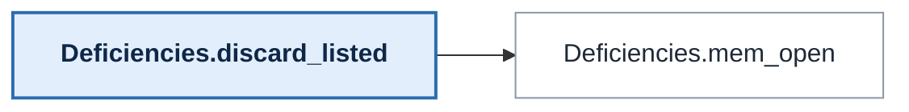
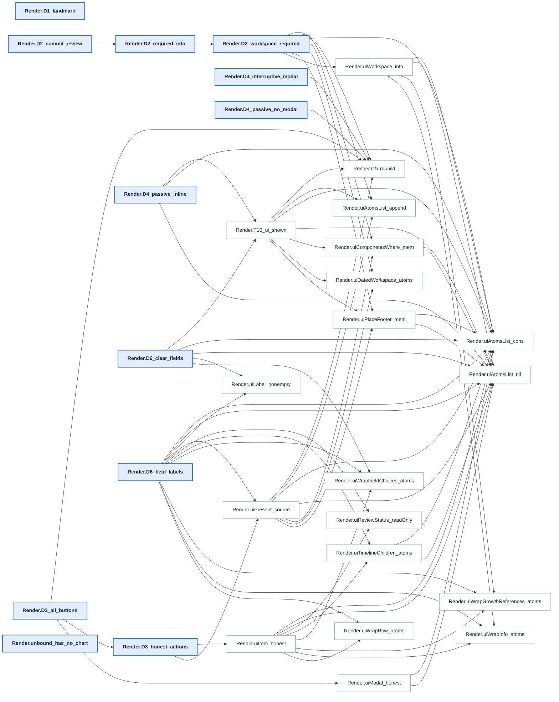
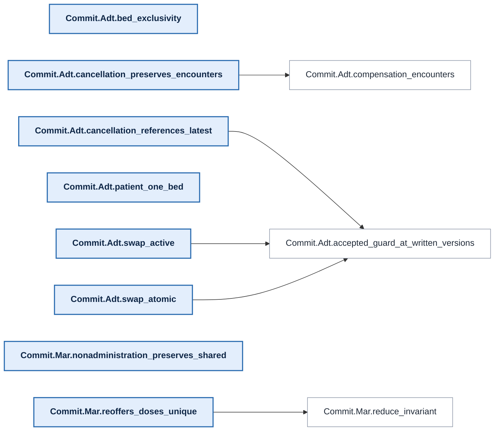
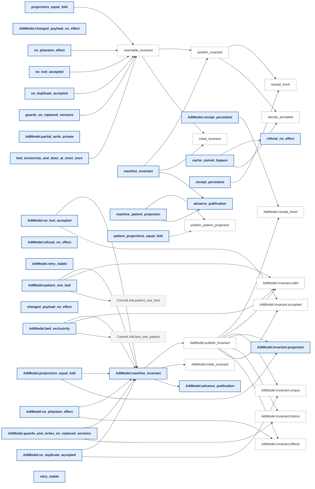
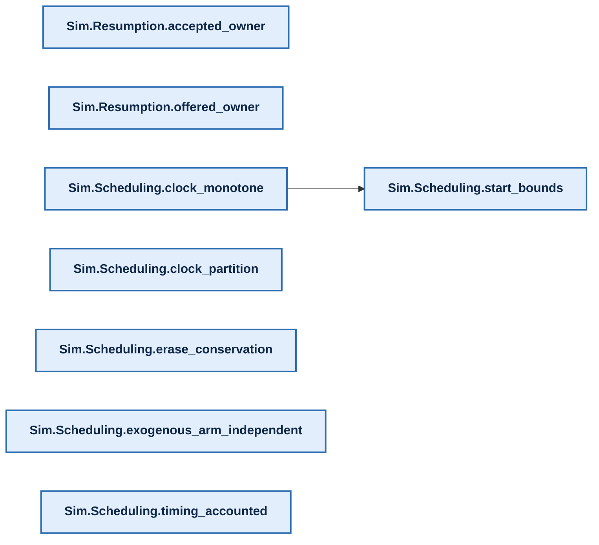
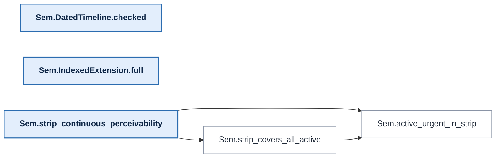

```mermaid
flowchart LR
  n0["Check.CompletionModel.accepted_completable"]:::head
  n1["Check.CompletionModel.accepted_edges"]:::head
  n2["Check.DoseCompletionObstruction.never_commits"]:::head
  n3["Check.DoseCompletionObstruction.not_completable"]:::head
  n4["Check.DoseCompletionObstruction.rejected"]:::head
  n5["Check.EntryWitness.accepted_actionableEntries"]:::head
  n6["Check.EntryWitness.accepted_entryTraces"]:::head
  n7["Check.EntryWitness.accepted_humanProbe"]:::head
  n8["Check.EntryWitness.accepted_medicationCases"]:::head
  n9["Check.EntryWitness.diagnose_sound"]:::head
  n10["Check.EntryWitness.inject_present"]:::head
  n11["Check.FixedLine.completable"]:::head
  n12["Check.FixedLine.completable_many_alerts"]:::head
  n13["Check.ReviewTrace.accepted_clinicalScenarios"]:::head
  n14["Check.ReviewTrace.tour_includes_destination"]:::head
  n15["Check.Scalar.completable"]:::head
  n16["Check.T7_counterexample_replays"]:::head
  n17["Check.T7_rejection"]:::head
  n18["Check.T8_checked_old_obligations"]:::head
  n19["Check.T8_old_obligations"]:::head
  n20["Check.T8_v1_to_v2"]:::head
  n21["Check.T8_v2_to_v3"]:::head
  n22["Check.accepted_D5"]:::head
  n23["Check.accepted_alertsFire"]:::head
  n24["Check.accepted_capturesAllOnce"]:::head
  n25["Check.accepted_contextRetained"]:::head
  n26["Check.accepted_contracts"]:::head
  n27["Check.accepted_criticalIds"]:::head
  n28["Check.accepted_critical_no_shadow"]:::head
  n29["Check.accepted_humanOnlyKept"]:::head
  n30["Check.accepted_navigation"]:::head
  n31["Check.accepted_navigationLabels"]:::head
  n32["Check.accepted_noFalseAlarms"]:::head
  n33["Check.accepted_pinRules"]:::head
  n34["Check.accepted_reviewsBeforeCommit"]:::head
  n35["Check.accepted_servicePriorAuth"]:::head
  n36["Check.accepted_severityTiers"]:::head
  n37["Check.accepted_units"]:::head
  n38["Check.accepted_wellFormed"]:::head
  n39["Check.accepted_writesOnly"]:::head
  n40["Check.alertKeys_of_captured"]:::head
  n41["Check.alertsAcked_of_no_candidates"]:::head
  n42["Check.automated_lines_satisfies"]:::head
  n43["Check.cached_completion_eq"]:::head
  n44["Check.completable_imp_completableWhereFeasible"]:::head
  n45["Check.completion_dependency_rejected"]:::head
  n46["Check.contextDestinations_sound"]:::head
  n47["Check.contextProvider_sound"]:::head
  n48["Check.contextRetained_sound"]:::head
  n49["Check.contextShownAux_sound"]:::head
  n50["Check.critical_handle_reserved"]:::head
  n51["Check.enteredOnce_at"]:::head
  n52["Check.fixed_lines_pending_nonempty"]:::head
  n53["Check.fixed_lines_satisfies"]:::head
  n54["Check.goTo_noNewHuman"]:::head
  n55["Check.goTo_writesState"]:::head
  n56["Check.human_finish_ready"]:::head
  n57["Check.human_finish_ready_unique"]:::head
  n58["Check.interruptsOnce_at"]:::head
  n59["Check.landmarksPinned_at"]:::head
  n60["Check.many_alerts_satisfies"]:::head
  n61["Check.many_alerts_two_acknowledgments"]:::head
  n62["Check.missing_payload_not_commitFeasible"]:::head
  n63["Check.onlyHumanCommitsAndAcks_at"]:::head
  n64["Check.passivePinned_at"]:::head
  n65["Check.popupKeys_step"]:::head
  n66["Check.popupUnacked_step"]:::head
  n67["Check.prefill_macro_human_completion"]:::head
  n68["Check.reachable_drugSlots"]:::head
  n69["Check.receipt_lines_satisfies"]:::head
  n70["Check.receipt_review_transition"]:::head
  n71["Check.reviewsPinned_at"]:::head
  n72["Check.satisfies_of_checked_automated_lines"]:::head
  n73["Check.satisfies_of_checked_completable"]:::head
  n74["Check.satisfies_of_checked_fixed_lines"]:::head
  n75["Check.satisfies_of_checked_many_alerts"]:::head
  n76["Check.satisfies_of_checked_receipt_lines"]:::head
  n77["Check.satisfies_of_checked_scalar"]:::head
  n78["Check.scalar_identity_satisfies"]:::head
  n79["Check.step_humanCaptured"]:::head
  n80["Check.step_noNewHuman"]:::head
  n81["Check.step_writesState"]:::head
  n82["Check.tiny_bad_automation"]:::head
  n83["Check.tiny_bad_catalog"]:::head
  n84["Check.tiny_bad_role"]:::head
  n85["Check.v1_v2_v3_not_acceptedCompletableWhereFeasible"]:::head
  n86["Check.CompletionModel.accepted_episode_complete"]:::lemma
  n87["Check.CompletionModel.run_closed"]:::lemma
  n88["Check.DoseCompletionObstruction.after_reachable"]:::lemma
  n89["Check.DoseCompletionObstruction.cannot_add"]:::lemma
  n90["Check.DoseCompletionObstruction.no_drug_fields"]:::lemma
  n91["Check.FixedLine.fixed_slots"]:::lemma
  n92["Check.FixedLine.on_screen"]:::lemma
  n93["Check.FixedLine.shown_assessment"]:::lemma
  n94["Check.FixedLine.shown_button"]:::lemma
  n95["Check.NoNewHuman.preserves"]:::lemma
  n96["Check.OkRun.append"]:::lemma
  n97["Check.Scalar.on_screen"]:::lemma
  n98["Check.Scalar.shown_button"]:::lemma
  n99["Check.Scalar.shown_field"]:::lemma
  n100["Check.accepted_pins"]:::lemma
  n101["Check.accepted_structural"]:::lemma
  n102["Check.acked_monotone"]:::lemma
  n103["Check.alertKeys_captured"]:::lemma
  n104["Check.alert_lookup_unique"]:::lemma
  n105["Check.alertsOnlyWhenTrue"]:::lemma
  n106["Check.check_ok_iff"]:::lemma
  n107["Check.commitCapturesAll"]:::lemma
  n108["Check.commitContracts"]:::lemma
  n109["Check.commitReviewsMet"]:::lemma
  n110["Check.commitUnitsRight"]:::lemma
  n111["Check.completableWhereFeasible_imp_completableWhereAcceptedFeasible"]:::lemma
  n112["Check.cosignIsSecondUser"]:::lemma
  n113["Check.currentScreen"]:::lemma
  n114["Check.declared_value_witness"]:::lemma
  n115["Check.enterCore_human_quality"]:::lemma
  n116["Check.enteredOnce"]:::lemma
  n117["Check.extends_contracts"]:::lemma
  n118["Check.extends_entries"]:::lemma
  n119["Check.extends_reviews"]:::lemma
  n120["Check.extends_static"]:::lemma
  n121["Check.firstFinding_some"]:::lemma
  n122["Check.fixedShown_sound"]:::lemma
  n123["Check.followHops_sound"]:::lemma
  n124["Check.goTo_noHuman"]:::lemma
  n125["Check.goTo_writes"]:::lemma
  n126["Check.humanStepsByHuman"]:::lemma
  n127["Check.human_clear_popup"]:::lemma
  n128["Check.human_enter"]:::lemma
  n129["Check.infoShown_iff"]:::lemma
  n130["Check.init_clock"]:::lemma
  n131["Check.interruptiveHandled"]:::lemma
  n132["Check.interruptsOnce"]:::lemma
  n133["Check.isGotoPath_sound"]:::lemma
  n134["Check.landmarksPinned_sound"]:::lemma
  n135["Check.missing_payload_blocks_commit"]:::lemma
  n136["Check.newCommit_witness"]:::lemma
  n137["Check.onlyHumanCommitsAndAcks"]:::lemma
  n138["Check.orderLines_slots"]:::lemma
  n139["Check.passiveNeverPopsUp"]:::lemma
  n140["Check.passivePinned_sound"]:::lemma
  n141["Check.pinnedForReview_sound"]:::lemma
  n142["Check.popup_acked"]:::lemma
  n143["Check.popup_captured"]:::lemma
  n144["Check.popup_continues"]:::lemma
  n145["Check.prefillScreen_slots"]:::lemma
  n146["Check.reach_request_control"]:::lemma
  n147["Check.replayOk_sound"]:::lemma
  n148["Check.reserved_append"]:::lemma
  n149["Check.reviewMet_iff"]:::lemma
  n150["Check.reviewsPinned_sound"]:::lemma
  n151["Check.runMacro_writes"]:::lemma
  n152["Check.stepCore_ack_witness"]:::lemma
  n153["Check.stepCore_commit_witness"]:::lemma
  n154["Check.stepCore_keeps"]:::lemma
  n155["Check.stepCore_writes"]:::lemma
  n156["Check.step_drugSlots"]:::lemma
  n157["Check.step_eq_core"]:::lemma
  n158["Check.step_noHuman"]:::lemma
  n159["Check.tableReach_eq"]:::lemma
  n160["Check.v1TrapProg_not_completableWhereAcceptedFeasible"]:::lemma
  n161["Check.v1_accepted_not_completableWhereAcceptedFeasible"]:::lemma
  n162["Check.writesAllowed"]:::lemma
  n163["Proofs.A2_popup_holds"]:::other
  n164["Proofs.MacroSafe.acked"]:::other
  n165["Proofs.MacroSafe.commits"]:::other
  n166["Proofs.T3_macro_step"]:::other
  n167["Proofs.prefillScreen_frame"]:::other
  n168["Proofs.runMacro_safe"]:::other
  n169["Sim.Certificate.lookup_mem"]:::other
  n170["Specs.V2.specV2_extends_specV1"]:::other
  n171["Specs.V3.specV3_extends_specV2"]:::other
  n172["linkedDependents_not_self"]:::other
  n173["reconcileCore_captured"]:::other
  n0 --> n86
  n1 --> n87
  n1 --> n169
  n2 --> n89
  n2 --> n90
  n2 --> n68
  n2 --> n167
  n3 --> n88
  n3 --> n2
  n5 --> n6
  n6 --> n9
  n6 --> n106
  n7 --> n6
  n7 --> n10
  n8 --> n6
  n11 --> n12
  n12 --> n91
  n12 --> n92
  n12 --> n93
  n12 --> n94
  n12 --> n114
  n12 --> n127
  n12 --> n128
  n12 --> n57
  n12 --> n138
  n12 --> n141
  n12 --> n68
  n12 --> n149
  n12 --> n156
  n12 --> n172
  n13 --> n106
  n15 --> n97
  n15 --> n98
  n15 --> n99
  n15 --> n114
  n15 --> n127
  n15 --> n128
  n15 --> n56
  n16 --> n96
  n16 --> n123
  n16 --> n147
  n17 --> n16
  n17 --> n121
  n18 --> n23
  n18 --> n24
  n18 --> n29
  n18 --> n32
  n18 --> n34
  n18 --> n36
  n18 --> n37
  n18 --> n117
  n18 --> n118
  n18 --> n119
  n18 --> n120
  n18 --> n132
  n19 --> n117
  n19 --> n118
  n19 --> n119
  n19 --> n120
  n20 --> n18
  n20 --> n170
  n21 --> n18
  n21 --> n171
  n22 --> n30
  n22 --> n31
  n23 --> n100
  n23 --> n101
  n23 --> n131
  n23 --> n140
  n24 --> n101
  n24 --> n107
  n24 --> n116
  n25 --> n106
  n25 --> n48
  n26 --> n108
  n27 --> n106
  n28 --> n27
  n28 --> n50
  n29 --> n101
  n29 --> n112
  n29 --> n126
  n29 --> n137
  n30 --> n106
  n31 --> n106
  n32 --> n101
  n32 --> n105
  n33 --> n100
  n34 --> n100
  n34 --> n101
  n34 --> n109
  n34 --> n150
  n35 --> n101
  n35 --> n106
  n35 --> n146
  n36 --> n101
  n36 --> n139
  n37 --> n101
  n37 --> n110
  n38 --> n100
  n38 --> n101
  n38 --> n134
  n39 --> n101
  n39 --> n162
  n40 --> n103
  n41 --> n104
  n42 --> n72
  n43 --> n159
  n45 --> n4
  n46 --> n133
  n47 --> n49
  n47 --> n129
  n48 --> n46
  n48 --> n47
  n50 --> n148
  n51 --> n154
  n51 --> n157
  n53 --> n74
  n54 --> n124
  n55 --> n125
  n57 --> n41
  n57 --> n56
  n58 --> n102
  n58 --> n144
  n59 --> n113
  n59 --> n122
  n59 --> n129
  n60 --> n75
  n62 --> n130
  n62 --> n135
  n62 --> n136
  n62 --> n167
  n63 --> n152
  n63 --> n153
  n63 --> n164
  n63 --> n165
  n63 --> n166
  n63 --> n168
  n64 --> n122
  n65 --> n103
  n65 --> n143
  n65 --> n163
  n66 --> n142
  n66 --> n163
  n68 --> n145
  n68 --> n156
  n69 --> n76
  n71 --> n113
  n71 --> n141
  n72 --> n12
  n72 --> n38
  n72 --> n73
  n73 --> n23
  n73 --> n24
  n73 --> n29
  n73 --> n30
  n73 --> n32
  n73 --> n34
  n73 --> n36
  n73 --> n37
  n73 --> n38
  n73 --> n39
  n73 --> n132
  n74 --> n11
  n74 --> n73
  n75 --> n12
  n75 --> n38
  n75 --> n73
  n76 --> n11
  n76 --> n73
  n77 --> n15
  n77 --> n73
  n78 --> n77
  n79 --> n95
  n79 --> n115
  n79 --> n80
  n79 --> n173
  n80 --> n158
  n81 --> n151
  n81 --> n155
  n85 --> n111
  n85 --> n160
  n85 --> n161
  n100 --> n106
  n101 --> n106
  n102 --> n63
  n105 --> n103
  n105 --> n65
  n109 --> n149
  n116 --> n51
  n117 --> n108
  n123 --> n96
  n123 --> n147
  n126 --> n158
  n132 --> n58
  n132 --> n66
  n134 --> n59
  n135 --> n108
  n137 --> n63
  n140 --> n64
  n141 --> n129
  n142 --> n63
  n149 --> n129
  n150 --> n71
  n152 --> n164
  n153 --> n165
  n155 --> n173
  n161 --> n111
  n161 --> n160
  n162 --> n81
  n166 --> n164
  n166 --> n165
  classDef head fill:#e3eefc,stroke:#2b6cb0,stroke-width:2px,color:#0f2747,font-weight:bold
  classDef lemma fill:#ffffff,stroke:#8a94a6,color:#1f2937
  classDef other fill:#f4f4f5,stroke:#a1a1aa,stroke-dasharray:4 3,color:#3f3f46
```

```mermaid
flowchart LR
  n0["Layout.Density.checkProgramDensity_sound"]:::head
  n1["Layout.Density.layoutAccepted_familyDensity"]:::head
  n2["Layout.Density.render_density"]:::head
  n3["Layout.Density.shell_density"]:::head
  n4["Layout.G10_fixed"]:::head
  n5["Layout.G10_window"]:::head
  n6["Layout.G11_fixed"]:::head
  n7["Layout.G11_pixels"]:::head
  n8["Layout.G3_hoisted"]:::head
  n9["Layout.G4_hoisted"]:::head
  n10["Layout.Keyboard.alertDialog_agrees"]:::head
  n11["Layout.Keyboard.alertDialog_escape_ignored"]:::head
  n12["Layout.Keyboard.alertDialog_never_closes"]:::head
  n13["Layout.Keyboard.alertDialog_stays_open"]:::head
  n14["Layout.Keyboard.alertDialog_traps"]:::head
  n15["Layout.Keyboard.dialog_escape_restores"]:::head
  n16["Layout.Keyboard.interruptive_stays_open"]:::head
  n17["Layout.Range.checkProgram_allStates"]:::head
  n18["Layout.Range.checkProgram_sound"]:::head
  n19["Layout.Range.layoutAccepted_program"]:::head
  n20["Layout.Range.leaf_plain"]:::head
  n21["Layout.Range.renderer_range"]:::head
  n22["Layout.RenderCovered_finite_iff"]:::head
  n23["Layout.Shell.certifiedClass_urgent"]:::head
  n24["Layout.Shell.class_urgent"]:::head
  n25["Layout.Shell.shell_rules"]:::head
  n26["Layout.Shell.shell_urgent"]:::head
  n27["Layout.Shell.targets"]:::head
  n28["Layout.Structural.targets"]:::head
  n29["Layout.Window.flaggedOff_pos"]:::head
  n30["Layout.Window.nextFlagged_found"]:::head
  n31["Layout.Window.nextFlagged_none"]:::head
  n32["Layout.Window.next_target"]:::head
  n33["Layout.Window.page_unique"]:::head
  n34["Layout.Window.pages_cover"]:::head
  n35["Layout.Window.record_off_page"]:::head
  n36["Layout.Window.selector_offers"]:::head
  n37["Layout.Window.windowNode_info"]:::head
  n38["Layout.advance_le_cell"]:::head
  n39["Layout.alertSquare_inside"]:::head
  n40["Layout.alertSquare_side"]:::head
  n41["Layout.alert_complete"]:::head
  n42["Layout.alert_one_part"]:::head
  n43["Layout.banner_complete"]:::head
  n44["Layout.button_complete"]:::head
  n45["Layout.channel_certificates"]:::head
  n46["Layout.column_apart"]:::head
  n47["Layout.contrast_thresholds_exact"]:::head
  n48["Layout.control_shows_choice"]:::head
  n49["Layout.field_complete"]:::head
  n50["Layout.finiteFamily_missingShape"]:::head
  n51["Layout.geometry_independent"]:::head
  n52["Layout.greedy_complete"]:::head
  n53["Layout.greedy_width"]:::head
  n54["Layout.info_complete"]:::head
  n55["Layout.info_empty"]:::head
  n56["Layout.layoutAccepted_all"]:::head
  n57["Layout.layoutAccepted_allPatients"]:::head
  n58["Layout.layoutAccepted_allPatients_finite"]:::head
  n59["Layout.layoutAccepted_allScreens"]:::head
  n60["Layout.layoutAccepted_allViewports"]:::head
  n61["Layout.layoutAccepted_bannerPixels"]:::head
  n62["Layout.layoutAccepted_density"]:::head
  n63["Layout.layoutAccepted_familyUrgent"]:::head
  n64["Layout.layoutAccepted_minFont"]:::head
  n65["Layout.layoutAccepted_nonTextContrast"]:::head
  n66["Layout.layoutAccepted_reviewAllPayloads"]:::head
  n67["Layout.layoutAccepted_rules"]:::head
  n68["Layout.layoutAccepted_safety"]:::head
  n69["Layout.layoutAccepted_textComplete"]:::head
  n70["Layout.layoutAccepted_textContrast"]:::head
  n71["Layout.layoutAccepted_textPixels"]:::head
  n72["Layout.layout_satisfies"]:::head
  n73["Layout.lists_complete"]:::head
  n74["Layout.modal_blocks"]:::head
  n75["Layout.paintText_supported"]:::head
  n76["Layout.portAccepted_rules"]:::head
  n77["Layout.reviewFamily_accepted"]:::head
  n78["Layout.scroll_apart"]:::head
  n79["Layout.scroll_complete"]:::head
  n80["Layout.scroll_line_width"]:::head
  n81["Layout.scroll_line_width_inset"]:::head
  n82["Layout.section_complete"]:::head
  n83["Layout.stepper_complete"]:::head
  n84["Layout.strip_dispatches"]:::head
  n85["Layout.strip_modal_blocks"]:::head
  n86["Layout.tabs_complete"]:::head
  n87["Layout.textAtoms_preserve"]:::head
  n88["Layout.widgetBox_rect"]:::head
  n89["Layout.widgetBoxes_rects"]:::head
  n90["Layout.wrap_complete"]:::head
  n91["Layout.wrap_line_width"]:::head
  n92["Layout.Density.class_density"]:::lemma
  n93["Layout.Density.count_split"]:::lemma
  n94["Layout.Density.filter_nil_of"]:::lemma
  n95["Layout.Density.inactive_ordinary"]:::lemma
  n96["Layout.Density.modal_present"]:::lemma
  n97["Layout.Density.rows_window"]:::lemma
  n98["Layout.Density.strip_targets"]:::lemma
  n99["Layout.G10_mono"]:::lemma
  n100["Layout.Keyboard.next_inside"]:::lemma
  n101["Layout.Keyboard.prev_inside"]:::lemma
  n102["Layout.Range.atom_plain"]:::lemma
  n103["Layout.Range.checkProgram_accepts"]:::lemma
  n104["Layout.Range.field_plain"]:::lemma
  n105["Layout.Range.info_plain"]:::lemma
  n106["Layout.Range.plain_append"]:::lemma
  n107["Layout.Range.plain_map"]:::lemma
  n108["Layout.Range.plain_nil"]:::lemma
  n109["Layout.Range.plain_option"]:::lemma
  n110["Layout.Range.plain_single"]:::lemma
  n111["Layout.Range.plain_some"]:::lemma
  n112["Layout.Range.render_small"]:::lemma
  n113["Layout.Range.smallModal_fits"]:::lemma
  n114["Layout.Range.unchecked_sound"]:::lemma
  n115["Layout.Range.window_plain"]:::lemma
  n116["Layout.RenderFamily.sound"]:::lemma
  n117["Layout.Shell.banner_rule"]:::lemma
  n118["Layout.Shell.base_footer"]:::lemma
  n119["Layout.Shell.base_no_modal"]:::lemma
  n120["Layout.Shell.base_not_urgent"]:::lemma
  n121["Layout.Shell.base_rules"]:::lemma
  n122["Layout.Shell.base_strip"]:::lemma
  n123["Layout.Shell.base_target_inactive"]:::lemma
  n124["Layout.Shell.bounds"]:::lemma
  n125["Layout.Shell.certifiedClass_allScreens"]:::lemma
  n126["Layout.Shell.complete"]:::lemma
  n127["Layout.Shell.contrast"]:::lemma
  n128["Layout.Shell.footer_inactive"]:::lemma
  n129["Layout.Shell.footer_strip"]:::lemma
  n130["Layout.Shell.horizontal"]:::lemma
  n131["Layout.Shell.modal_cases"]:::lemma
  n132["Layout.Shell.modal_rule"]:::lemma
  n133["Layout.Shell.modal_strip"]:::lemma
  n134["Layout.Shell.modals_separated"]:::lemma
  n135["Layout.Shell.parts_inventory"]:::lemma
  n136["Layout.Shell.pinnedSlot_true"]:::lemma
  n137["Layout.Shell.separated_symm"]:::lemma
  n138["Layout.Shell.shell_cases"]:::lemma
  n139["Layout.Shell.strip_cases"]:::lemma
  n140["Layout.Shell.strip_index"]:::lemma
  n141["Layout.Shell.strip_length"]:::lemma
  n142["Layout.Shell.strip_visible"]:::lemma
  n143["Layout.Shell.strips_separated"]:::lemma
  n144["Layout.Shell.target_implies"]:::lemma
  n145["Layout.Shell.text_rule"]:::lemma
  n146["Layout.Shell.zip_order"]:::lemma
  n147["Layout.Structural.body_order"]:::lemma
  n148["Layout.Structural.bounds"]:::lemma
  n149["Layout.Structural.placement_cases"]:::lemma
  n150["Layout.Window.cyclic_mem"]:::lemma
  n151["Layout.Window.pageRows_length"]:::lemma
  n152["Layout.Window.pages_prefix"]:::lemma
  n153["Layout.accepted_candidate"]:::lemma
  n154["Layout.bannerRunRole_cases"]:::lemma
  n155["Layout.bindSemantic_box"]:::lemma
  n156["Layout.bindSemantic_original"]:::lemma
  n157["Layout.candidate_length_le"]:::lemma
  n158["Layout.chunks_complete"]:::lemma
  n159["Layout.chunks_short"]:::lemma
  n160["Layout.codepointInk_supported"]:::lemma
  n161["Layout.column_floor"]:::lemma
  n162["Layout.constrain_satisfies"]:::lemma
  n163["Layout.filter_length_mono"]:::lemma
  n164["Layout.fixed_pixels"]:::lemma
  n165["Layout.layoutAccepted_geometry"]:::lemma
  n166["Layout.lowest_bottom"]:::lemma
  n167["Layout.mem_joinRuns"]:::lemma
  n168["Layout.review_shape_payload_independent"]:::lemma
  n169["Layout.screenShape_flat_length"]:::lemma
  n170["Layout.screenShape_sources"]:::lemma
  n171["Layout.select_covered"]:::lemma
  n172["Layout.separated_pixels"]:::lemma
  n173["Layout.shift_rect"]:::lemma
  n174["Layout.textAdvance_bound"]:::lemma
  n175["Layout.zipIdx_at"]:::lemma
  n0 --> n2
  n0 --> n99
  n0 --> n103
  n0 --> n17
  n1 --> n155
  n1 --> n59
  n1 --> n171
  n2 --> n92
  n2 --> n21
  n2 --> n155
  n3 --> n93
  n3 --> n94
  n3 --> n95
  n3 --> n96
  n3 --> n97
  n3 --> n98
  n5 --> n163
  n5 --> n166
  n6 --> n164
  n7 --> n172
  n12 --> n13
  n14 --> n100
  n14 --> n101
  n16 --> n13
  n17 --> n21
  n17 --> n114
  n18 --> n21
  n19 --> n18
  n19 --> n57
  n20 --> n102
  n20 --> n104
  n20 --> n105
  n20 --> n106
  n20 --> n107
  n20 --> n108
  n20 --> n109
  n20 --> n110
  n20 --> n111
  n20 --> n115
  n21 --> n112
  n21 --> n113
  n23 --> n125
  n23 --> n24
  n23 --> n155
  n24 --> n135
  n24 --> n136
  n24 --> n26
  n24 --> n141
  n25 --> n117
  n25 --> n126
  n25 --> n127
  n25 --> n130
  n25 --> n132
  n25 --> n27
  n25 --> n145
  n26 --> n120
  n26 --> n121
  n26 --> n122
  n26 --> n129
  n26 --> n133
  n26 --> n137
  n26 --> n138
  n26 --> n140
  n26 --> n142
  n26 --> n143
  n27 --> n118
  n27 --> n119
  n27 --> n121
  n27 --> n122
  n27 --> n123
  n27 --> n124
  n27 --> n128
  n27 --> n129
  n27 --> n131
  n27 --> n133
  n27 --> n134
  n27 --> n138
  n27 --> n139
  n27 --> n140
  n27 --> n143
  n27 --> n144
  n27 --> n146
  n28 --> n147
  n28 --> n148
  n28 --> n149
  n30 --> n150
  n31 --> n30
  n34 --> n152
  n35 --> n151
  n35 --> n33
  n37 --> n151
  n43 --> n154
  n43 --> n167
  n46 --> n161
  n46 --> n173
  n50 --> n157
  n50 --> n169
  n54 --> n175
  n56 --> n62
  n57 --> n116
  n58 --> n57
  n59 --> n153
  n59 --> n155
  n59 --> n156
  n59 --> n67
  n59 --> n68
  n59 --> n170
  n59 --> n171
  n60 --> n165
  n61 --> n67
  n61 --> n172
  n62 --> n67
  n63 --> n155
  n63 --> n59
  n63 --> n171
  n64 --> n67
  n65 --> n67
  n66 --> n59
  n66 --> n77
  n66 --> n168
  n68 --> n67
  n68 --> n75
  n68 --> n79
  n68 --> n80
  n68 --> n87
  n69 --> n67
  n69 --> n90
  n70 --> n67
  n71 --> n67
  n71 --> n172
  n72 --> n162
  n75 --> n160
  n76 --> n67
  n79 --> n52
  n80 --> n81
  n81 --> n38
  n81 --> n53
  n83 --> n175
  n86 --> n175
  n89 --> n88
  n90 --> n158
  n91 --> n159
  n91 --> n174
  n92 --> n3
  n104 --> n106
  n104 --> n108
  n104 --> n109
  n104 --> n110
  n104 --> n111
  n105 --> n106
  n105 --> n107
  n105 --> n109
  n105 --> n110
  n109 --> n108
  n111 --> n108
  n111 --> n110
  n114 --> n125
  n115 --> n108
  n117 --> n118
  n117 --> n121
  n117 --> n122
  n117 --> n138
  n117 --> n140
  n123 --> n120
  n125 --> n155
  n125 --> n156
  n125 --> n68
  n125 --> n170
  n127 --> n121
  n127 --> n138
  n130 --> n121
  n130 --> n124
  n130 --> n138
  n132 --> n138
  n138 --> n131
  n138 --> n139
  n141 --> n136
  n142 --> n124
  n145 --> n118
  n145 --> n119
  n145 --> n121
  n145 --> n122
  n145 --> n128
  n145 --> n129
  n145 --> n133
  n145 --> n134
  n145 --> n137
  n145 --> n138
  n145 --> n140
  n145 --> n142
  n145 --> n143
  n161 --> n173
  n165 --> n67
  n174 --> n38
  classDef head fill:#e3eefc,stroke:#2b6cb0,stroke-width:2px,color:#0f2747,font-weight:bold
  classDef lemma fill:#ffffff,stroke:#8a94a6,color:#1f2937
  classDef other fill:#f4f4f5,stroke:#a1a1aa,stroke-dasharray:4 3,color:#3f3f46
```

# Proof map

[Overview](../README.md) · [Methods and reproduction](../README.md#documentation)

<!-- PROOF-MAP:BEGIN (generated by scripts/proof-map/build.sh --readme; do not edit) -->

Generated from the compiled Lean environment. In the overview an arrow reads
"is stated in terms of" (thick: 100+ references, dotted: under 5). In each
layer's chart below an arrow reads "its proof cites": headline claims are
bold, lemmas they cite directly are white, lemmas from other layers are
dashed. The interactive version, with search, full
trees and each claim's trust surface, is the `proof-map` artifact of every CI
run.


<details><summary><b>Rulebook &amp; interpreter</b>: 1 headline claim. The rulebook language, guards, alerts, navigation and the step interpreter. Every safety claim is stated in these terms.</summary>



</details>

<details><summary><b>Clinical guarantees</b>: 224 headline claims. Hard stop on signing, receipts, macros never act for a human, alert behaviour (T0–T6, A2, A4).</summary>

```mermaid
flowchart LR
  n0["Proofs.A2_popup_holds"]:::head
  n1["Proofs.A2_view_firing"]:::head
  n2["Proofs.A2_view_shown"]:::head
  n3["Proofs.A4_passive_never_popup"]:::head
  n4["Proofs.A4_run"]:::head
  n5["Proofs.A4_step"]:::head
  n6["Proofs.HypothesisExamples.all_buttons_instance"]:::head
  n7["Proofs.HypothesisExamples.cosign_distinct_instance"]:::head
  n8["Proofs.HypothesisExamples.popup_step_instance"]:::head
  n9["Proofs.HypothesisExamples.publish_ok_instance"]:::head
  n10["Proofs.HypothesisExamples.published_certificate_instance"]:::head
  n11["Proofs.HypothesisExamples.receipt_sound_instance"]:::head
  n12["Proofs.HypothesisExamples.rejected_not_published_instance"]:::head
  n13["Proofs.HypothesisExamples.shown_alert_instance"]:::head
  n14["Proofs.HypothesisExamples.shown_review_instance"]:::head
  n15["Proofs.HypothesisExamples.sign_button_honest_instance"]:::head
  n16["Proofs.HypothesisExamples.weight_label_instance"]:::head
  n17["Proofs.MacroSafe.acked"]:::head
  n18["Proofs.MacroSafe.commits"]:::head
  n19["Proofs.MacroSafe.receipts"]:::head
  n20["Proofs.T0_commit_needs_guard"]:::head
  n21["Proofs.T0_entry_values"]:::head
  n22["Proofs.T2_receipts_sound"]:::head
  n23["Proofs.T2_shownOnCommit_shown"]:::head
  n24["Proofs.T3_cosign_distinct"]:::head
  n25["Proofs.T3_macro_run"]:::head
  n26["Proofs.T3_macro_step"]:::head
  n27["Proofs.T3_prefill_never_human_only"]:::head
  n28["Proofs.T4_publish_only_if_ok"]:::head
  n29["Proofs.T4_published_certificate"]:::head
  n30["Proofs.T4_rejected_not_published"]:::head
  n31["Proofs.T6_macro_is_fold"]:::head
  n32["Proofs.T6_macro_run_safe"]:::head
  n33["Proofs.commitGuard_iff"]:::head
  n34["Proofs.runMacro_ok_iff"]:::head
  n35["Proofs.selectTabCore_safe"]:::head
  n36["Runtime.A2_popup_holds"]:::head
  n37["Runtime.A2_view_shown"]:::head
  n38["Runtime.A4_run"]:::head
  n39["Runtime.A4_step"]:::head
  n40["Runtime.BoundEpisode.Hydrates.enabled"]:::head
  n41["Runtime.ClinicalWitness.alerts_only_when_true"]:::head
  n42["Runtime.ClinicalWitness.blocked_under_popup"]:::head
  n43["Runtime.ClinicalWitness.clinical_unchanged"]:::head
  n44["Runtime.Hydrated.chart"]:::head
  n45["Runtime.Hydrated.pending"]:::head
  n46["Runtime.Hydrated.selected"]:::head
  n47["Runtime.Settled.human"]:::head
  n48["Runtime.T0_commit_needs_guard"]:::head
  n49["Runtime.T0_entry_values"]:::head
  n50["Runtime.T2_receipts_sound"]:::head
  n51["Runtime.T2_shownOnCommit_shown"]:::head
  n52["Runtime.T3_cosign_distinct"]:::head
  n53["Runtime.Witness.acknowledged_inEpisode"]:::head
  n54["Runtime.Witness.acknowledged_keeps_acks"]:::head
  n55["Runtime.Witness.acknowledged_keeps_captures"]:::head
  n56["Runtime.Witness.acknowledged_landmark"]:::head
  n57["Runtime.Witness.acknowledged_reachable"]:::head
  n58["Runtime.Witness.action_is_draft"]:::head
  n59["Runtime.Witness.changed_fact_interrupts"]:::head
  n60["Runtime.Witness.episode_accepted"]:::head
  n61["Runtime.Witness.hydrating_call_refuses"]:::head
  n62["Runtime.Witness.landing_has_no_landmark"]:::head
  n63["Runtime.Witness.landing_not_inEpisode"]:::head
  n64["Runtime.Witness.landing_passive_not_shown"]:::head
  n65["Runtime.Witness.landing_workspaceOnly"]:::head
  n66["Runtime.Witness.passive_accepted"]:::head
  n67["Runtime.Witness.passive_landing_reachable"]:::head
  n68["Runtime.Witness.popup_blocks_action"]:::head
  n69["Runtime.Witness.reopen_does_not_interrupt"]:::head
  n70["Runtime.Witness.reopen_restores_entry"]:::head
  n71["Runtime.Witness.reopened_inEpisode"]:::head
  n72["Runtime.Witness.reopened_reachable"]:::head
  n73["Runtime.Witness.reopened_store"]:::head
  n74["Runtime.Witness.return_empties_acked"]:::head
  n75["Runtime.Witness.return_empties_captured"]:::head
  n76["Runtime.Witness.return_keeps_ack"]:::head
  n77["Runtime.Witness.return_keeps_capture"]:::head
  n78["Runtime.Witness.return_leaves"]:::head
  n79["Runtime.Witness.returned_not_inEpisode"]:::head
  n80["Runtime.Witness.role_not_checked"]:::head
  n81["Runtime.Witness.selected_not_inEpisode"]:::head
  n82["Runtime.Witness.signed_not_restored"]:::head
  n83["Runtime.Witness.start_history"]:::head
  n84["Runtime.Witness.start_history_not_core"]:::head
  n85["Runtime.Witness.witness_global"]:::head
  n86["Runtime.Witness.workspace_accepted"]:::head
  n87["Runtime.Witness.writes_allowed"]:::head
  n88["Runtime.WorkspaceOnly.controls"]:::head
  n89["Runtime.WorkspaceOnly.directoryOnly"]:::head
  n90["Runtime.WorkspaceOnly.noBlocked"]:::head
  n91["Runtime.WorkspaceOnly.noItems"]:::head
  n92["Runtime.accepted_episode"]:::head
  n93["Runtime.accepted_ordinary"]:::head
  n94["Runtime.accepted_severityTiers"]:::head
  n95["Runtime.accepted_static"]:::head
  n96["Runtime.ack_origin"]:::head
  n97["Runtime.alertKeys_critical"]:::head
  n98["Runtime.bind_cases"]:::head
  n99["Runtime.bind_evidence"]:::head
  n100["Runtime.bind_hydrates"]:::head
  n101["Runtime.bind_of_bound"]:::head
  n102["Runtime.call_shape"]:::head
  n103["Runtime.chart_humanCaptured"]:::head
  n104["Runtime.chart_names"]:::head
  n105["Runtime.chart_noHuman"]:::head
  n106["Runtime.chart_popup"]:::head
  n107["Runtime.chart_writes"]:::head
  n108["Runtime.commitGuard_critical"]:::head
  n109["Runtime.commit_byClick"]:::head
  n110["Runtime.commit_core"]:::head
  n111["Runtime.commit_entries"]:::head
  n112["Runtime.commit_input"]:::head
  n113["Runtime.commit_interruptive_handled"]:::head
  n114["Runtime.commit_reviews"]:::head
  n115["Runtime.commit_units"]:::head
  n116["Runtime.core_context"]:::head
  n117["Runtime.core_history"]:::head
  n118["Runtime.critical_evidence"]:::head
  n119["Runtime.critical_frame"]:::head
  n120["Runtime.critical_popup"]:::head
  n121["Runtime.draft_call"]:::head
  n122["Runtime.draft_origin"]:::head
  n123["Runtime.episode_agrees"]:::head
  n124["Runtime.episode_alertsOnlyWhenTrue"]:::head
  n125["Runtime.episode_always"]:::head
  n126["Runtime.episode_bound"]:::head
  n127["Runtime.episode_commitCapturesAll"]:::head
  n128["Runtime.episode_commitReviewsMet"]:::head
  n129["Runtime.episode_commitScreenShowsReviews"]:::head
  n130["Runtime.episode_commitUnitsRight"]:::head
  n131["Runtime.episode_context"]:::head
  n132["Runtime.episode_cosignIsSecondUser"]:::head
  n133["Runtime.episode_enteredOnce"]:::head
  n134["Runtime.episode_everyStep"]:::head
  n135["Runtime.episode_humanStepsByHuman"]:::head
  n136["Runtime.episode_interruptiveHandled"]:::head
  n137["Runtime.episode_interruptsOnce"]:::head
  n138["Runtime.episode_landmarksShown"]:::head
  n139["Runtime.episode_not_core"]:::head
  n140["Runtime.episode_onlyHumanCommitsAndAcks"]:::head
  n141["Runtime.episode_passiveShownInline"]:::head
  n142["Runtime.episode_refines"]:::head
  n143["Runtime.episode_runView"]:::head
  n144["Runtime.episode_step"]:::head
  n145["Runtime.episode_writesAllowed"]:::head
  n146["Runtime.first_step"]:::head
  n147["Runtime.fixed_invariant"]:::head
  n148["Runtime.fixed_reachable"]:::head
  n149["Runtime.fixed_refines_core"]:::head
  n150["Runtime.hydrating_ack"]:::head
  n151["Runtime.hydrating_adds_nothing"]:::head
  n152["Runtime.hydrating_applies"]:::head
  n153["Runtime.hydrating_reconcile"]:::head
  n154["Runtime.hydrating_refuses"]:::head
  n155["Runtime.inputState_ordinary"]:::head
  n156["Runtime.input_acks"]:::head
  n157["Runtime.input_commits"]:::head
  n158["Runtime.input_receipts"]:::head
  n159["Runtime.interruptsOnce_from"]:::head
  n160["Runtime.landmarksShown_from"]:::head
  n161["Runtime.navigation_leaves"]:::head
  n162["Runtime.new_ack_core"]:::head
  n163["Runtime.new_commit_core"]:::head
  n164["Runtime.new_receipt_core"]:::head
  n165["Runtime.ordinary_agrees"]:::head
  n166["Runtime.ordinary_alertsOnlyWhenTrue"]:::head
  n167["Runtime.ordinary_always"]:::head
  n168["Runtime.ordinary_commitCapturesAll"]:::head
  n169["Runtime.ordinary_commitReviewsMet"]:::head
  n170["Runtime.ordinary_commitScreenShowsReviews"]:::head
  n171["Runtime.ordinary_commitUnitsRight"]:::head
  n172["Runtime.ordinary_cosignIsSecondUser"]:::head
  n173["Runtime.ordinary_enteredOnce"]:::head
  n174["Runtime.ordinary_everyStep"]:::head
  n175["Runtime.ordinary_humanStepsByHuman"]:::head
  n176["Runtime.ordinary_interruptiveHandled"]:::head
  n177["Runtime.ordinary_interruptsOnce"]:::head
  n178["Runtime.ordinary_landmarksShown"]:::head
  n179["Runtime.ordinary_onlyHumanCommitsAndAcks"]:::head
  n180["Runtime.ordinary_passiveShownInline"]:::head
  n181["Runtime.ordinary_refines"]:::head
  n182["Runtime.ordinary_step"]:::head
  n183["Runtime.ordinary_writesAllowed"]:::head
  n184["Runtime.others_ne"]:::head
  n185["Runtime.popup_blocks"]:::head
  n186["Runtime.popup_blocks_ordinary"]:::head
  n187["Runtime.popup_kept"]:::head
  n188["Runtime.reachableFrom_start"]:::head
  n189["Runtime.reachable_settled"]:::head
  n190["Runtime.receipt_origin"]:::head
  n191["Runtime.restore_human"]:::head
  n192["Runtime.restore_humanCaptured"]:::head
  n193["Runtime.restore_keeps"]:::head
  n194["Runtime.restore_mem"]:::head
  n195["Runtime.restore_writes"]:::head
  n196["Runtime.runInit_unselected"]:::head
  n197["Runtime.runView_ordinary"]:::head
  n198["Runtime.save_ne"]:::head
  n199["Runtime.save_self"]:::head
  n200["Runtime.selection_global"]:::head
  n201["Runtime.session_acks"]:::head
  n202["Runtime.session_bind"]:::head
  n203["Runtime.session_captures"]:::head
  n204["Runtime.session_humanEntries"]:::head
  n205["Runtime.session_leave"]:::head
  n206["Runtime.signed_leave_reopen"]:::head
  n207["Runtime.start_acked"]:::head
  n208["Runtime.start_eq"]:::head
  n209["Runtime.start_fresh"]:::head
  n210["Runtime.start_lift"]:::head
  n211["Runtime.start_unacked"]:::head
  n212["Runtime.step_context"]:::head
  n213["Runtime.step_critical"]:::head
  n214["Runtime.step_drafts"]:::head
  n215["Runtime.step_shape"]:::head
  n216["Runtime.unbound_not_inEpisode"]:::head
  n217["Runtime.unbound_view"]:::head
  n218["Runtime.unselected_not_inEpisode"]:::head
  n219["Runtime.unselected_view"]:::head
  n220["Runtime.view_critical"]:::head
  n221["Runtime.workspace_core"]:::head
  n222["Runtime.workspace_popup_blocks"]:::head
  n223["Runtime.workspace_shape"]:::head
  n224["Check.NoNewHuman.humanCaptured"]:::other
  n225["Check.accepted_alertsFire"]:::other
  n226["Check.accepted_capturesAllOnce"]:::other
  n227["Check.accepted_humanOnlyKept"]:::other
  n228["Check.accepted_navigation"]:::other
  n229["Check.accepted_noFalseAlarms"]:::other
  n230["Check.accepted_pinRules"]:::other
  n231["Check.accepted_reviewsBeforeCommit"]:::other
  n232["Check.accepted_severityTiers"]:::other
  n233["Check.accepted_units"]:::other
  n234["Check.accepted_wellFormed"]:::other
  n235["Check.accepted_writesOnly"]:::other
  n236["Check.check_ok_iff"]:::other
  n237["Check.enteredOnce_at"]:::other
  n238["Check.entryMet_iff"]:::other
  n239["Check.goTo_names"]:::other
  n240["Check.goTo_noNewHuman"]:::other
  n241["Check.goTo_writesState"]:::other
  n242["Check.humanStepsByHuman"]:::other
  n243["Check.interruptsOnce"]:::other
  n244["Check.interruptsOnce_at"]:::other
  n245["Check.landmarksPinned_at"]:::other
  n246["Check.onlyHumanCommitsAndAcks_at"]:::other
  n247["Check.popupUnacked_step"]:::other
  n248["Check.reachable_humanCaptured"]:::other
  n249["Check.reachable_screenNames"]:::other
  n250["Check.reviewMet_iff"]:::other
  n251["Check.step_noNewHuman"]:::other
  n252["Check.writesAllowed"]:::other
  n253["Proofs.HypothesisExamples.current_certificate_planned"]:::lemma
  n254["Proofs.HypothesisExamples.sign_button_present"]:::lemma
  n255["Proofs.HypothesisExamples.weight_field_present"]:::lemma
  n256["Proofs.MacroSafe.humanOnly"]:::lemma
  n257["Proofs.MacroSafe.of_eq"]:::lemma
  n258["Proofs.MacroSafe.refl"]:::lemma
  n259["Proofs.T0_entry_values_allowed"]:::lemma
  n260["Proofs.canPopup_not_passive"]:::lemma
  n261["Proofs.entryMet_witness"]:::lemma
  n262["Proofs.foldMacro_safe"]:::lemma
  n263["Proofs.goTo_popup"]:::lemma
  n264["Proofs.goTo_safe"]:::lemma
  n265["Proofs.init_popup"]:::lemma
  n266["Proofs.macroStep_eq_macroAct"]:::lemma
  n267["Proofs.mem_popupCandidates"]:::lemma
  n268["Proofs.prefillScreen_frame"]:::lemma
  n269["Proofs.prefillScreen_popup"]:::lemma
  n270["Proofs.prefillScreen_safe"]:::lemma
  n271["Proofs.reviewMet_sound"]:::lemma
  n272["Proofs.runMacro_safe"]:::lemma
  n273["Proofs.stepCore_macro_safe"]:::lemma
  n274["Proofs.step_guarded"]:::lemma
  n275["Proofs.step_popup"]:::lemma
  n276["Proofs.valueSatisfies_cosign"]:::lemma
  n277["Render.D3_all_buttons"]:::other
  n278["Render.D3_honest_actions"]:::other
  n279["Render.D6_field_labels"]:::other
  n280["Runtime.BoundEpisode.Hydrates.bound"]:::lemma
  n281["Runtime.BoundEpisode.Hydrates.unbound"]:::lemma
  n282["Runtime.ClinicalWitness.accepted"]:::lemma
  n283["Runtime.ClinicalWitness.user_role"]:::lemma
  n284["Runtime.EpisodeAccepted.enteredOnce"]:::lemma
  n285["Runtime.EpisodeAccepted.interruptsOnce"]:::lemma
  n286["Runtime.EpisodeAccepted.landmarksShown"]:::lemma
  n287["Runtime.EpisodeAccepted.onlyHumanCommitsAndAcks"]:::lemma
  n288["Runtime.FixedAccepted.alertsOnlyWhenTrue"]:::lemma
  n289["Runtime.FixedAccepted.writesAllowed"]:::lemma
  n290["Runtime.Hydrated.bound"]:::lemma
  n291["Runtime.Hydrated.eq"]:::lemma
  n292["Runtime.Hydrated.hydrates"]:::lemma
  n293["Runtime.Hydrated.patient"]:::lemma
  n294["Runtime.Hydrated.unheld"]:::lemma
  n295["Runtime.InEpisode.hydrates"]:::lemma
  n296["Runtime.Settled.idle"]:::lemma
  n297["Runtime.Settled.unacked"]:::lemma
  n298["Runtime.Witness.accepted"]:::lemma
  n299["Runtime.Witness.chart_hydrates"]:::lemma
  n300["Runtime.Witness.reopen_hydrates"]:::lemma
  n301["Runtime.Witness.workspace_noNavigation"]:::lemma
  n302["Runtime.actionStatus_critical"]:::lemma
  n303["Runtime.alertHolds_critical"]:::lemma
  n304["Runtime.alertShownInline_critical"]:::lemma
  n305["Runtime.alertsAcked_critical"]:::lemma
  n306["Runtime.alertsOnlyWhenTrue_from"]:::lemma
  n307["Runtime.applies_critical"]:::lemma
  n308["Runtime.bound_of_context"]:::lemma
  n309["Runtime.bound_patient"]:::lemma
  n310["Runtime.chart_commits"]:::lemma
  n311["Runtime.chart_unbound"]:::lemma
  n312["Runtime.clickedMacro_critical"]:::lemma
  n313["Runtime.clinicalEval_critical"]:::lemma
  n314["Runtime.commitButtonShown_critical"]:::lemma
  n315["Runtime.commitCapturesAll_from"]:::lemma
  n316["Runtime.commitReviewsMet_from"]:::lemma
  n317["Runtime.commitScreenShowsReviews_from"]:::lemma
  n318["Runtime.commitUnitsRight_from"]:::lemma
  n319["Runtime.compShown_critical"]:::lemma
  n320["Runtime.cosignIsSecondUser_from"]:::lemma
  n321["Runtime.draft_bind"]:::lemma
  n322["Runtime.draft_lookup"]:::lemma
  n323["Runtime.enteredOnce_from"]:::lemma
  n324["Runtime.entryMetIn_critical"]:::lemma
  n325["Runtime.find_filter_ne"]:::lemma
  n326["Runtime.guardBase_critical"]:::lemma
  n327["Runtime.handled_or_core"]:::lemma
  n328["Runtime.humanEntries_from"]:::lemma
  n329["Runtime.hydrates_hydrated"]:::lemma
  n330["Runtime.infoShownIn_critical"]:::lemma
  n331["Runtime.init_context"]:::lemma
  n332["Runtime.init_critical"]:::lemma
  n333["Runtime.input_notPassive"]:::lemma
  n334["Runtime.input_popup"]:::lemma
  n335["Runtime.interruptiveHandled_from"]:::lemma
  n336["Runtime.itemView_critical"]:::lemma
  n337["Runtime.lookup_filter_ne"]:::lemma
  n338["Runtime.lookup_filter_self"]:::lemma
  n339["Runtime.obligationViews_critical"]:::lemma
  n340["Runtime.onlyHumanCommitsAndAcks_from"]:::lemma
  n341["Runtime.others_getD"]:::lemma
  n342["Runtime.passiveShownInline_from"]:::lemma
  n343["Runtime.prefillScreen_keepsHistory"]:::lemma
  n344["Runtime.restorable_spec"]:::lemma
  n345["Runtime.reviewMetIn_critical"]:::lemma
  n346["Runtime.runMacro_context"]:::lemma
  n347["Runtime.runMacro_critical"]:::lemma
  n348["Runtime.runMacro_drafts"]:::lemma
  n349["Runtime.screenNames_from"]:::lemma
  n350["Runtime.session_closed"]:::lemma
  n351["Runtime.session_core"]:::lemma
  n352["Runtime.session_handled"]:::lemma
  n353["Runtime.session_open"]:::lemma
  n354["Runtime.session_query"]:::lemma
  n355["Runtime.settled_bind"]:::lemma
  n356["Runtime.settled_step"]:::lemma
  n357["Runtime.start_critical"]:::lemma
  n358["Runtime.stepCore_context"]:::lemma
  n359["Runtime.stepCore_critical"]:::lemma
  n360["Runtime.stepCore_drafts"]:::lemma
  n361["Runtime.step_keepsHistory"]:::lemma
  n362["Runtime.step_popup_blocks"]:::lemma
  n363["Runtime.unselected_unbound"]:::lemma
  n364["Runtime.workspace_cases"]:::lemma
  n365["Runtime.workspace_first"]:::lemma
  n366["Runtime.writesAllowed_from"]:::lemma
  n0 --> n267
  n0 --> n275
  n3 --> n4
  n4 --> n5
  n4 --> n265
  n5 --> n260
  n5 --> n267
  n5 --> n275
  n6 --> n254
  n6 --> n277
  n7 --> n24
  n8 --> n5
  n9 --> n253
  n9 --> n28
  n10 --> n253
  n10 --> n29
  n11 --> n22
  n12 --> n30
  n13 --> n2
  n14 --> n23
  n15 --> n254
  n15 --> n278
  n16 --> n255
  n16 --> n279
  n20 --> n274
  n21 --> n259
  n22 --> n20
  n22 --> n33
  n22 --> n271
  n23 --> n22
  n24 --> n20
  n24 --> n33
  n24 --> n261
  n24 --> n276
  n25 --> n17
  n25 --> n18
  n25 --> n256
  n25 --> n19
  n25 --> n272
  n26 --> n17
  n26 --> n18
  n26 --> n256
  n26 --> n19
  n26 --> n273
  n27 --> n268
  n29 --> n28
  n30 --> n28
  n31 --> n266
  n32 --> n17
  n32 --> n18
  n32 --> n256
  n32 --> n19
  n32 --> n31
  n32 --> n262
  n34 --> n31
  n35 --> n257
  n35 --> n258
  n36 --> n0
  n36 --> n334
  n36 --> n215
  n37 --> n2
  n38 --> n265
  n38 --> n39
  n39 --> n5
  n39 --> n333
  n39 --> n215
  n41 --> n282
  n41 --> n283
  n41 --> n288
  n41 --> n93
  n42 --> n186
  n44 --> n290
  n44 --> n291
  n44 --> n293
  n45 --> n46
  n48 --> n20
  n48 --> n110
  n49 --> n259
  n49 --> n110
  n50 --> n22
  n50 --> n110
  n51 --> n23
  n51 --> n110
  n52 --> n24
  n52 --> n110
  n53 --> n299
  n54 --> n285
  n54 --> n287
  n54 --> n53
  n54 --> n60
  n55 --> n284
  n55 --> n53
  n55 --> n60
  n56 --> n286
  n56 --> n53
  n56 --> n60
  n56 --> n143
  n60 --> n86
  n60 --> n92
  n63 --> n218
  n65 --> n219
  n66 --> n236
  n71 --> n300
  n71 --> n86
  n71 --> n92
  n72 --> n57
  n79 --> n218
  n81 --> n216
  n84 --> n83
  n84 --> n301
  n84 --> n117
  n85 --> n200
  n86 --> n236
  n87 --> n289
  n87 --> n298
  n87 --> n93
  n92 --> n230
  n92 --> n234
  n92 --> n235
  n92 --> n306
  n92 --> n103
  n92 --> n104
  n92 --> n105
  n92 --> n106
  n92 --> n107
  n92 --> n315
  n92 --> n316
  n92 --> n317
  n92 --> n318
  n92 --> n320
  n92 --> n323
  n92 --> n124
  n92 --> n127
  n92 --> n128
  n92 --> n129
  n92 --> n130
  n92 --> n132
  n92 --> n133
  n92 --> n135
  n92 --> n136
  n92 --> n137
  n92 --> n138
  n92 --> n140
  n92 --> n141
  n92 --> n145
  n92 --> n328
  n92 --> n335
  n92 --> n159
  n92 --> n160
  n92 --> n340
  n92 --> n342
  n92 --> n191
  n92 --> n192
  n92 --> n195
  n92 --> n210
  n92 --> n366
  n93 --> n225
  n93 --> n226
  n93 --> n227
  n93 --> n229
  n93 --> n231
  n93 --> n233
  n93 --> n234
  n93 --> n235
  n93 --> n243
  n93 --> n166
  n93 --> n168
  n93 --> n169
  n93 --> n170
  n93 --> n171
  n93 --> n172
  n93 --> n173
  n93 --> n175
  n93 --> n176
  n93 --> n177
  n93 --> n178
  n93 --> n179
  n93 --> n180
  n93 --> n183
  n94 --> n232
  n94 --> n38
  n95 --> n225
  n95 --> n226
  n95 --> n227
  n95 --> n228
  n95 --> n229
  n95 --> n232
  n95 --> n233
  n95 --> n234
  n95 --> n235
  n96 --> n156
  n96 --> n162
  n97 --> n313
  n99 --> n18
  n99 --> n19
  n99 --> n263
  n99 --> n264
  n99 --> n269
  n99 --> n270
  n102 --> n101
  n102 --> n119
  n102 --> n364
  n103 --> n224
  n103 --> n240
  n103 --> n248
  n104 --> n239
  n104 --> n249
  n105 --> n240
  n105 --> n242
  n106 --> n263
  n106 --> n265
  n107 --> n241
  n107 --> n252
  n108 --> n305
  n108 --> n326
  n109 --> n246
  n109 --> n110
  n109 --> n112
  n110 --> n157
  n110 --> n163
  n111 --> n238
  n111 --> n33
  n111 --> n48
  n112 --> n292
  n112 --> n100
  n112 --> n151
  n113 --> n33
  n113 --> n48
  n114 --> n250
  n114 --> n33
  n114 --> n48
  n115 --> n49
  n116 --> n331
  n116 --> n212
  n117 --> n343
  n117 --> n361
  n118 --> n119
  n121 --> n102
  n121 --> n198
  n121 --> n199
  n121 --> n351
  n122 --> n321
  n122 --> n121
  n123 --> n142
  n124 --> n303
  n124 --> n97
  n124 --> n304
  n124 --> n125
  n125 --> n295
  n125 --> n142
  n126 --> n280
  n126 --> n295
  n126 --> n308
  n126 --> n131
  n127 --> n324
  n127 --> n134
  n128 --> n134
  n128 --> n345
  n129 --> n314
  n129 --> n125
  n129 --> n345
  n130 --> n307
  n130 --> n134
  n131 --> n280
  n131 --> n40
  n131 --> n295
  n131 --> n308
  n131 --> n144
  n131 --> n146
  n131 --> n212
  n132 --> n307
  n132 --> n134
  n133 --> n312
  n133 --> n134
  n134 --> n40
  n134 --> n295
  n134 --> n126
  n134 --> n142
  n134 --> n144
  n134 --> n146
  n135 --> n134
  n136 --> n97
  n136 --> n134
  n137 --> n125
  n137 --> n134
  n138 --> n125
  n138 --> n330
  n139 --> n116
  n139 --> n126
  n140 --> n134
  n141 --> n303
  n141 --> n304
  n141 --> n125
  n142 --> n40
  n142 --> n295
  n142 --> n126
  n142 --> n144
  n142 --> n146
  n142 --> n357
  n142 --> n213
  n143 --> n126
  n144 --> n327
  n144 --> n221
  n145 --> n125
  n146 --> n280
  n146 --> n40
  n146 --> n281
  n146 --> n365
  n147 --> n149
  n150 --> n154
  n151 --> n246
  n151 --> n291
  n151 --> n45
  n151 --> n102
  n151 --> n310
  n151 --> n329
  n152 --> n365
  n153 --> n154
  n154 --> n365
  n156 --> n99
  n157 --> n99
  n158 --> n99
  n159 --> n244
  n159 --> n247
  n160 --> n245
  n160 --> n349
  n162 --> n215
  n163 --> n215
  n164 --> n215
  n165 --> n181
  n166 --> n303
  n166 --> n97
  n166 --> n304
  n166 --> n167
  n167 --> n181
  n168 --> n324
  n168 --> n174
  n169 --> n174
  n169 --> n345
  n170 --> n314
  n170 --> n167
  n170 --> n345
  n171 --> n307
  n171 --> n174
  n172 --> n307
  n172 --> n174
  n173 --> n312
  n173 --> n174
  n174 --> n181
  n174 --> n182
  n175 --> n174
  n176 --> n97
  n176 --> n174
  n177 --> n167
  n177 --> n174
  n178 --> n330
  n178 --> n167
  n179 --> n174
  n180 --> n303
  n180 --> n304
  n180 --> n167
  n181 --> n332
  n181 --> n182
  n182 --> n119
  n182 --> n213
  n183 --> n167
  n184 --> n322
  n184 --> n337
  n184 --> n341
  n185 --> n101
  n185 --> n120
  n185 --> n155
  n185 --> n186
  n185 --> n222
  n186 --> n120
  n186 --> n362
  n187 --> n244
  n187 --> n294
  n187 --> n296
  n187 --> n100
  n187 --> n102
  n189 --> n47
  n189 --> n296
  n189 --> n297
  n189 --> n356
  n190 --> n158
  n190 --> n164
  n191 --> n344
  n191 --> n194
  n192 --> n344
  n192 --> n194
  n195 --> n344
  n195 --> n194
  n198 --> n325
  n198 --> n341
  n198 --> n184
  n199 --> n338
  n199 --> n341
  n200 --> n297
  n200 --> n52
  n200 --> n109
  n200 --> n111
  n200 --> n112
  n200 --> n148
  n200 --> n187
  n200 --> n189
  n200 --> n201
  n200 --> n203
  n200 --> n204
  n201 --> n244
  n201 --> n246
  n201 --> n102
  n201 --> n202
  n201 --> n350
  n201 --> n351
  n201 --> n352
  n201 --> n205
  n201 --> n353
  n201 --> n354
  n202 --> n44
  n202 --> n291
  n202 --> n294
  n202 --> n100
  n202 --> n184
  n202 --> n193
  n202 --> n194
  n202 --> n350
  n202 --> n353
  n203 --> n237
  n203 --> n102
  n203 --> n202
  n203 --> n350
  n203 --> n351
  n203 --> n352
  n203 --> n205
  n203 --> n353
  n203 --> n354
  n204 --> n251
  n204 --> n47
  n204 --> n102
  n204 --> n105
  n204 --> n202
  n204 --> n350
  n204 --> n351
  n204 --> n352
  n204 --> n205
  n204 --> n353
  n204 --> n354
  n204 --> n355
  n205 --> n311
  n205 --> n198
  n205 --> n199
  n205 --> n350
  n205 --> n353
  n206 --> n199
  n207 --> n208
  n208 --> n280
  n208 --> n281
  n208 --> n98
  n209 --> n310
  n209 --> n106
  n209 --> n208
  n210 --> n208
  n211 --> n207
  n212 --> n346
  n212 --> n358
  n213 --> n312
  n213 --> n347
  n213 --> n359
  n214 --> n348
  n214 --> n360
  n215 --> n101
  n215 --> n118
  n215 --> n223
  n216 --> n126
  n218 --> n309
  n218 --> n126
  n219 --> n217
  n219 --> n363
  n220 --> n302
  n220 --> n319
  n220 --> n336
  n220 --> n339
  n221 --> n101
  n221 --> n309
  n222 --> n362
  n227 --> n242
  n228 --> n236
  n235 --> n252
  n242 --> n248
  n243 --> n244
  n243 --> n247
  n243 --> n265
  n246 --> n17
  n246 --> n18
  n246 --> n26
  n246 --> n272
  n247 --> n0
  n259 --> n20
  n262 --> n258
  n263 --> n269
  n264 --> n257
  n264 --> n258
  n265 --> n269
  n269 --> n268
  n270 --> n268
  n272 --> n258
  n273 --> n258
  n273 --> n35
  n274 --> n18
  n274 --> n272
  n277 --> n278
  n302 --> n326
  n303 --> n97
  n305 --> n97
  n310 --> n18
  n310 --> n264
  n310 --> n270
  n315 --> n238
  n315 --> n20
  n315 --> n33
  n316 --> n250
  n316 --> n20
  n316 --> n33
  n317 --> n349
  n318 --> n21
  n319 --> n303
  n320 --> n24
  n321 --> n291
  n321 --> n100
  n321 --> n338
  n321 --> n341
  n321 --> n184
  n323 --> n237
  n324 --> n307
  n327 --> n119
  n327 --> n213
  n328 --> n251
  n329 --> n100
  n333 --> n99
  n334 --> n99
  n335 --> n20
  n335 --> n33
  n336 --> n303
  n336 --> n319
  n337 --> n325
  n340 --> n246
  n345 --> n307
  n345 --> n330
  n351 --> n212
  n351 --> n214
  n354 --> n350
  n355 --> n44
  n355 --> n291
  n355 --> n100
  n355 --> n103
  n355 --> n106
  n355 --> n192
  n356 --> n247
  n356 --> n47
  n356 --> n296
  n356 --> n297
  n356 --> n102
  n356 --> n355
  n356 --> n212
  n357 --> n208
  n359 --> n319
  n365 --> n309
  classDef head fill:#e3eefc,stroke:#2b6cb0,stroke-width:2px,color:#0f2747,font-weight:bold
  classDef lemma fill:#ffffff,stroke:#8a94a6,color:#1f2937
  classDef other fill:#f4f4f5,stroke:#a1a1aa,stroke-dasharray:4 3,color:#3f3f46
```

</details>

<details><summary><b>Program checker</b>: 86 headline claims. The checker that admits agent-written programs and its soundness: acceptance implies the screen properties (accepted_*), plus completability.</summary>



</details>

<details><summary><b>Screen renderer</b>: 12 headline claims. The screen tree the painter draws, and D1–D6: banner, required content, honest buttons, modal alerts.</summary>



</details>

<details><summary><b>UI library &amp; geometry</b>: 92 headline claims. Integer layout, layout rules G1–G10, structural certificates and the renderer-range theorem.</summary>



</details>

<details><summary><b>Commit reducers</b>: 8 headline claims. Medication administration and ADT reducers the commit service runs.</summary>



</details>

<details><summary><b>Commit service protocol</b>: 30 headline claims. Model of the live service: locking, retries, crashes, caches. Stated under Postgres assumptions.</summary>



</details>

<details><summary><b>Clinician simulation</b>: 8 headline claims. Simulated clinicians and effort measurement. Not a safety claim.</summary>



</details>

<details><summary><b>Research semantics</b>: 3 headline claims. Exploratory boards and timelines outside the clinical runtime.</summary>



</details>

<!-- PROOF-MAP:END -->

## Using the interactive artifact

Download the `proof-map` CI artifact and open `index.html` directly in a browser.
It embeds its data and needs no server, fonts or JavaScript CDN. Start with the
[MAR proof walkthrough](proof-walkthrough.md), or press `/` or Ctrl/Cmd K to
search all declarations. Enter jumps to the first result; arrow keys navigate
the result buttons. A nonempty search spans every declaration regardless of the
idle filter.

Click a dependency node to expand or collapse its direct proof/body citations;
“Statement references” follows types instead. “What uses it” expands reverse
references in either types or bodies. “Read” selects a declaration. The
breadcrumb follows a real path from a headline theorem; an independent search
finds the nearest reachable headline by reverse breadth-first search. A node
with no reachable headline says so. Repeated nodes are allowed on distinct
paths; a cycle marker ends recursion on the current path. Private source
declarations retain their raw identities so their citations remain connected.
Generated constructors, recursors and matcher helpers resolve to their source
declaration. Named lemmas such as `eq_withHistory` remain searchable declarations;
numbered helpers such as `eq_1` collapse to their source owner.

Hover or focus a node/name for its complete pretty-printed type and docstring.
The preview stays open during pointer movement within the node and can be
scrolled without covering its trigger. Dependency links expose their complete
declaration names to assistive technology.
Every declaration has a source link to its file and line at the built commit.
The trust panel reports the selected theorem's transitive logical axioms,
repeats its full type (including parameters and hypotheses), and lists the
statement's transitive definition surface. Definitions are semantic review
obligations, not extra logical axioms; clinical meaning and host/storage
assumptions still require review. Axiom extraction is reported for theorems.

`imports.html` provides a searchable SVG view of each project module’s direct
imports and reverse imports, with links at the same commit. `imports.dot` holds
the complete import graph, including external dependencies, generated by
[`leanprover-community/import-graph`](https://github.com/leanprover-community/import-graph/tree/v4.35.0)
(`lake exe graph --include-lean --show-transitive`). The upstream DOT uses
dependency → importer arrows; the HTML view labels arrows as importer → dependency.
The tool lives in a separate Lake package under `scripts/proof-map/import-graph`; its pinned dependency never enters
`lean/lakefile.toml` or the certified executable. The HTML view renders edges
from this DOT and cross-checks them against the compiled extractor's direct imports. Module membership includes modules with
no retained declarations. Import edges describe module loading, not proof citations.

Build after the default targets and `scripts/proof-map/extra-modules.txt`:

```sh
export TMPDIR=/home/saithat/Projects/run-tmp LEAN_NUM_THREADS=4
scripts/proof-map/build.sh --check-readme
node scripts/proof-map/lint.mjs
node scripts/proof-map/check.mjs
```

The separate import-graph package needs network access on first use; subsequent
builds use Lake's local dependency cache. The map remains scoped to the fixed
build roots rather than every experimental or challenge file in the checkout.

## Optional Lean Atlas view

[Lean Atlas (arXiv 2604.16347)](https://arxiv.org/abs/2604.16347) has
[public MIT-licensed code](https://github.com/NyxFoundation/lean-atlas).
Revision `3a81e194db0e6c41a2a8c5286f9e1b4962c3866a` builds unchanged on
Lean 4.35.0. `scripts/proof-map/atlas.sh` checks out that revision under
`lean/.lake/proof-map-tools/atlas` and uses its graph backend with the same
compiled roots as the ordinary map. The adapter preserves cross-namespace
edges, filters external constants, and marks the map's public headline theorems as
Atlas entry points in exported metadata. It changes no project attributes,
proofs, Lake dependencies or certified outputs. The adapter uses Lean’s
sharing-aware constant collector to detect direct placeholders, avoiding
upstream’s repeated traversal of shared expression subtrees, and reuses the
ordinary map’s axiom lists for headline metadata.

```sh
scripts/proof-map/atlas.sh          # export web/public/data/graph.json
scripts/proof-map/atlas.sh --serve  # upstream viewer at http://127.0.0.1:5326
```

The viewer installs its own pinned frontend dependencies on first use (network
required); `ATLAS_PORT` overrides the port. It reads a copied source snapshot,
so upstream review annotations affect only that snapshot. Run the script again
to refresh it. Atlas is optional and is not part of CI's static artifact.
Its generated/internal-node filtering differs from the ordinary map; counts
need not match. Upstream's default axiom presentation hides the standard three;
the ordinary map displays the selected theorem's complete extracted axiom list.
