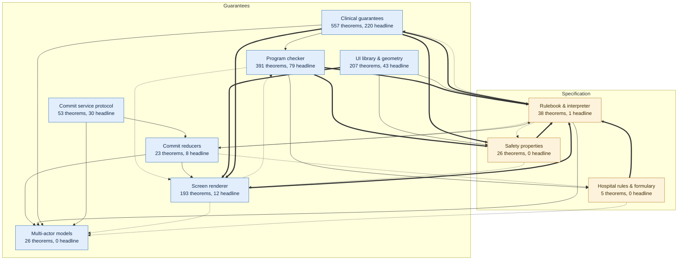
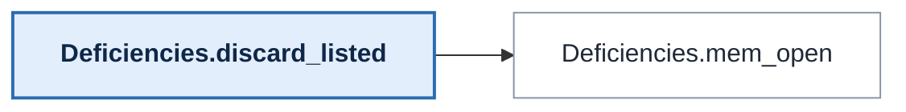
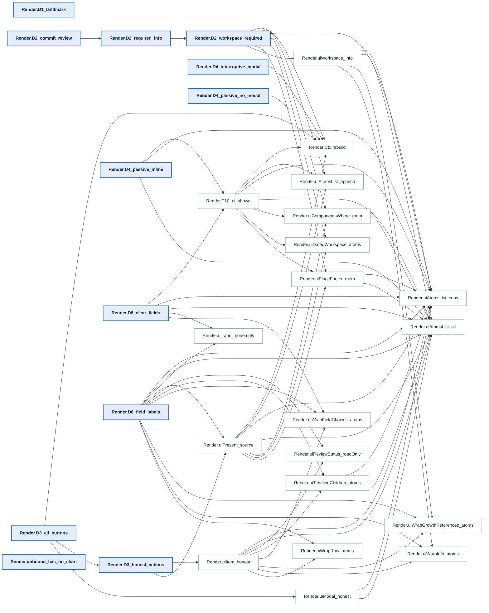
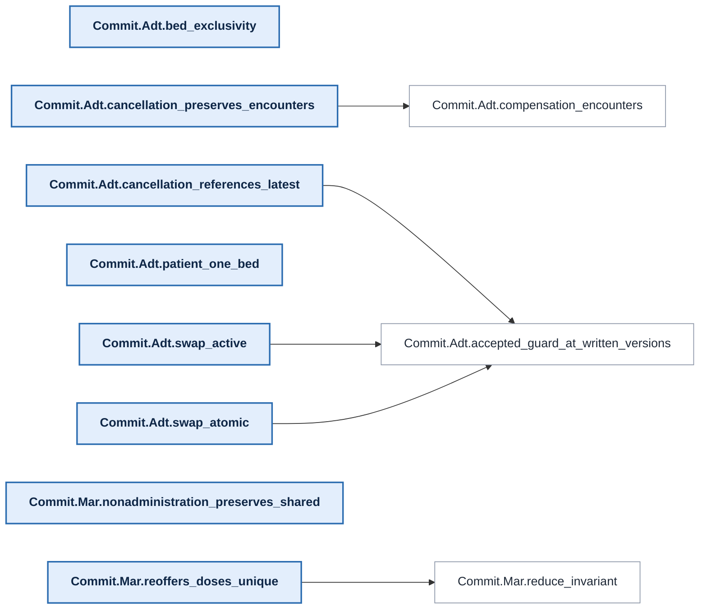
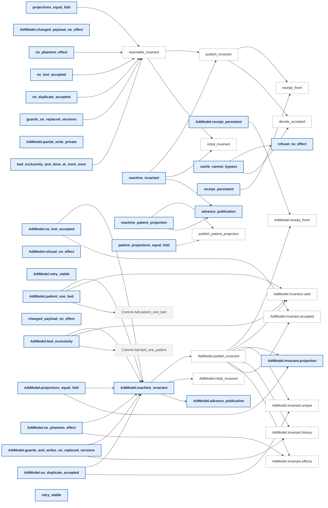
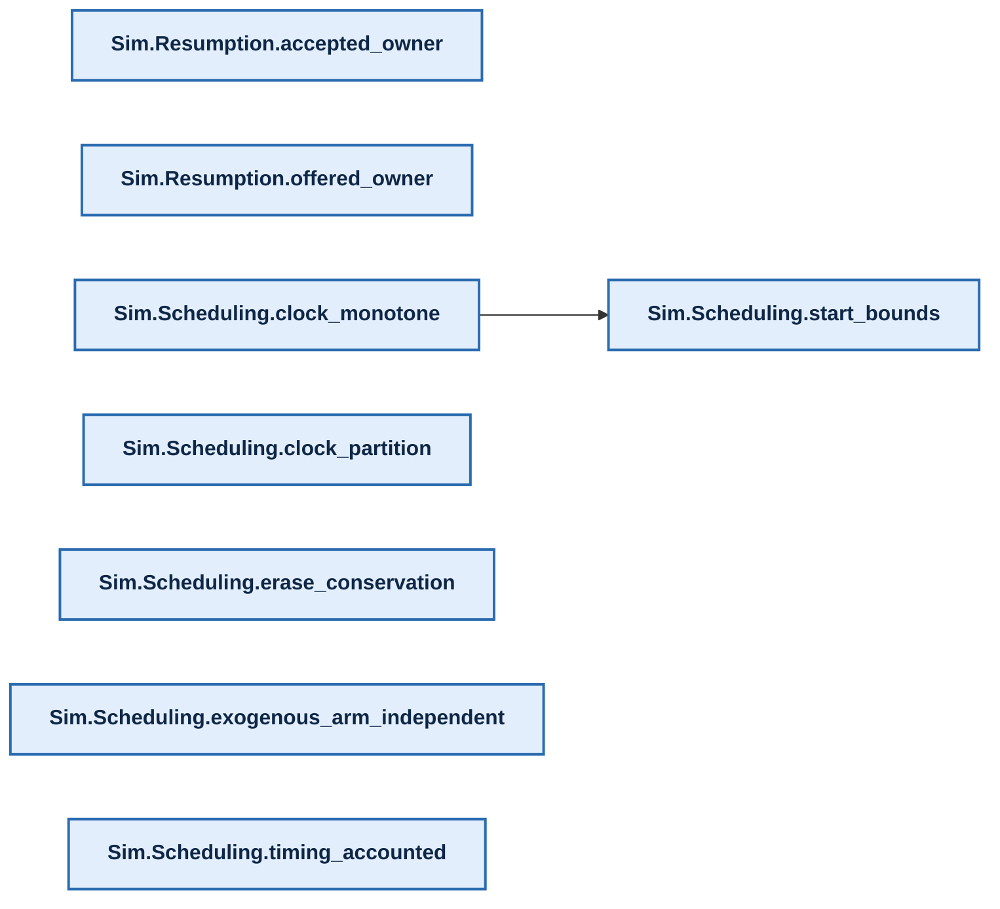

```mermaid
flowchart LR
  n0["Check.CompletionModel.accepted_completable"]:::head
  n1["Check.CompletionModel.accepted_edges"]:::head
  n2["Check.DoseCompletionObstruction.never_commits"]:::head
  n3["Check.DoseCompletionObstruction.not_completable"]:::head
  n4["Check.DoseCompletionObstruction.rejected"]:::head
  n5["Check.FixedLine.completable"]:::head
  n6["Check.FixedLine.completable_many_alerts"]:::head
  n7["Check.Scalar.completable"]:::head
  n8["Check.T7_counterexample_replays"]:::head
  n9["Check.T7_rejection"]:::head
  n10["Check.T8_checked_old_obligations"]:::head
  n11["Check.T8_old_obligations"]:::head
  n12["Check.T8_v1_to_v2"]:::head
  n13["Check.T8_v2_to_v3"]:::head
  n14["Check.accepted_D5"]:::head
  n15["Check.accepted_alertsFire"]:::head
  n16["Check.accepted_budgets"]:::head
  n17["Check.accepted_capturesAllOnce"]:::head
  n18["Check.accepted_contextRetained"]:::head
  n19["Check.accepted_contracts"]:::head
  n20["Check.accepted_criticalIds"]:::head
  n21["Check.accepted_critical_no_shadow"]:::head
  n22["Check.accepted_humanOnlyKept"]:::head
  n23["Check.accepted_navigation"]:::head
  n24["Check.accepted_navigationLabels"]:::head
  n25["Check.accepted_noFalseAlarms"]:::head
  n26["Check.accepted_noRepeatInterruptions"]:::head
  n27["Check.accepted_pinRules"]:::head
  n28["Check.accepted_reviewsBeforeCommit"]:::head
  n29["Check.accepted_severityTiers"]:::head
  n30["Check.accepted_units"]:::head
  n31["Check.accepted_wellFormed"]:::head
  n32["Check.accepted_writesOnly"]:::head
  n33["Check.alertKeys_of_captured"]:::head
  n34["Check.alertsAcked_of_no_candidates"]:::head
  n35["Check.automated_lines_satisfies"]:::head
  n36["Check.cached_completion_eq"]:::head
  n37["Check.completable_imp_completableWhereFeasible"]:::head
  n38["Check.completion_dependency_rejected"]:::head
  n39["Check.contextDestinations_sound"]:::head
  n40["Check.contextProvider_sound"]:::head
  n41["Check.contextRetained_sound"]:::head
  n42["Check.contextShownAux_sound"]:::head
  n43["Check.critical_handle_reserved"]:::head
  n44["Check.enteredOnce_at"]:::head
  n45["Check.fixed_lines_pending_nonempty"]:::head
  n46["Check.fixed_lines_satisfies"]:::head
  n47["Check.goTo_noNewHuman"]:::head
  n48["Check.goTo_writesState"]:::head
  n49["Check.human_finish_ready"]:::head
  n50["Check.human_finish_ready_unique"]:::head
  n51["Check.interruptsOnce_at"]:::head
  n52["Check.landmarksPinned_at"]:::head
  n53["Check.many_alerts_satisfies"]:::head
  n54["Check.many_alerts_two_acknowledgments"]:::head
  n55["Check.missing_payload_not_commitFeasible"]:::head
  n56["Check.onlyHumanCommitsAndAcks_at"]:::head
  n57["Check.passivePinned_at"]:::head
  n58["Check.popupKeys_step"]:::head
  n59["Check.popupUnacked_step"]:::head
  n60["Check.prefill_macro_human_completion"]:::head
  n61["Check.reachable_drugSlots"]:::head
  n62["Check.receipt_lines_satisfies"]:::head
  n63["Check.receipt_review_transition"]:::head
  n64["Check.reviewsPinned_at"]:::head
  n65["Check.satisfies_of_checked_automated_lines"]:::head
  n66["Check.satisfies_of_checked_completable"]:::head
  n67["Check.satisfies_of_checked_fixed_lines"]:::head
  n68["Check.satisfies_of_checked_many_alerts"]:::head
  n69["Check.satisfies_of_checked_receipt_lines"]:::head
  n70["Check.satisfies_of_checked_scalar"]:::head
  n71["Check.scalar_identity_satisfies"]:::head
  n72["Check.step_humanCaptured"]:::head
  n73["Check.step_noNewHuman"]:::head
  n74["Check.step_writesState"]:::head
  n75["Check.tiny_bad_automation"]:::head
  n76["Check.tiny_bad_catalog"]:::head
  n77["Check.tiny_bad_role"]:::head
  n78["Check.v1_v2_v3_not_acceptedCompletableWhereFeasible"]:::head
  n79["Check.CompletionModel.accepted_episode_complete"]:::lemma
  n80["Check.CompletionModel.run_closed"]:::lemma
  n81["Check.DoseCompletionObstruction.after_reachable"]:::lemma
  n82["Check.DoseCompletionObstruction.cannot_add"]:::lemma
  n83["Check.DoseCompletionObstruction.no_drug_fields"]:::lemma
  n84["Check.FixedLine.fixed_slots"]:::lemma
  n85["Check.FixedLine.on_screen"]:::lemma
  n86["Check.FixedLine.shown_assessment"]:::lemma
  n87["Check.FixedLine.shown_button"]:::lemma
  n88["Check.NoNewHuman.preserves"]:::lemma
  n89["Check.OkRun.append"]:::lemma
  n90["Check.Scalar.on_screen"]:::lemma
  n91["Check.Scalar.shown_button"]:::lemma
  n92["Check.Scalar.shown_field"]:::lemma
  n93["Check.accepted_depth"]:::lemma
  n94["Check.accepted_pins"]:::lemma
  n95["Check.accepted_structural"]:::lemma
  n96["Check.acked_monotone"]:::lemma
  n97["Check.alertBudget_sound"]:::lemma
  n98["Check.alertKeys_captured"]:::lemma
  n99["Check.alert_lookup_unique"]:::lemma
  n100["Check.alertsOnlyWhenTrue"]:::lemma
  n101["Check.check_ok_iff"]:::lemma
  n102["Check.commitCapturesAll"]:::lemma
  n103["Check.commitContracts"]:::lemma
  n104["Check.commitReviewsMet"]:::lemma
  n105["Check.commitUnitsRight"]:::lemma
  n106["Check.completableWhereFeasible_imp_completableWhereAcceptedFeasible"]:::lemma
  n107["Check.cosignIsSecondUser"]:::lemma
  n108["Check.currentScreen"]:::lemma
  n109["Check.declared_value_witness"]:::lemma
  n110["Check.enterCore_human_quality"]:::lemma
  n111["Check.enteredOnce"]:::lemma
  n112["Check.extends_contracts"]:::lemma
  n113["Check.extends_entries"]:::lemma
  n114["Check.extends_reviews"]:::lemma
  n115["Check.extends_static"]:::lemma
  n116["Check.firstFinding_some"]:::lemma
  n117["Check.fixedShown_sound"]:::lemma
  n118["Check.followHops_sound"]:::lemma
  n119["Check.goTo_noHuman"]:::lemma
  n120["Check.goTo_writes"]:::lemma
  n121["Check.humanStepsByHuman"]:::lemma
  n122["Check.human_clear_popup"]:::lemma
  n123["Check.human_enter"]:::lemma
  n124["Check.infoShown_iff"]:::lemma
  n125["Check.init_clock"]:::lemma
  n126["Check.interruptiveHandled"]:::lemma
  n127["Check.interruptsOnce"]:::lemma
  n128["Check.isGotoPath_sound"]:::lemma
  n129["Check.landmarksPinned_sound"]:::lemma
  n130["Check.missing_payload_blocks_commit"]:::lemma
  n131["Check.newCommit_witness"]:::lemma
  n132["Check.onlyHumanCommitsAndAcks"]:::lemma
  n133["Check.orderLines_slots"]:::lemma
  n134["Check.passiveNeverPopsUp"]:::lemma
  n135["Check.passivePinned_sound"]:::lemma
  n136["Check.pinnedForReview_sound"]:::lemma
  n137["Check.popup_acked"]:::lemma
  n138["Check.popup_captured"]:::lemma
  n139["Check.popup_continues"]:::lemma
  n140["Check.prefillScreen_slots"]:::lemma
  n141["Check.replayOk_sound"]:::lemma
  n142["Check.reserved_append"]:::lemma
  n143["Check.reviewMet_iff"]:::lemma
  n144["Check.reviewsPinned_sound"]:::lemma
  n145["Check.runMacro_writes"]:::lemma
  n146["Check.stepCore_ack_witness"]:::lemma
  n147["Check.stepCore_commit_witness"]:::lemma
  n148["Check.stepCore_keeps"]:::lemma
  n149["Check.stepCore_writes"]:::lemma
  n150["Check.step_drugSlots"]:::lemma
  n151["Check.step_eq_core"]:::lemma
  n152["Check.step_noHuman"]:::lemma
  n153["Check.tableReach_eq"]:::lemma
  n154["Check.v1TrapProg_not_completableWhereAcceptedFeasible"]:::lemma
  n155["Check.v1_accepted_not_completableWhereAcceptedFeasible"]:::lemma
  n156["Check.writesAllowed"]:::lemma
  n157["Proofs.A2_popup_holds"]:::other
  n158["Proofs.MacroSafe.acked"]:::other
  n159["Proofs.MacroSafe.commits"]:::other
  n160["Proofs.T3_macro_step"]:::other
  n161["Proofs.prefillScreen_frame"]:::other
  n162["Proofs.runMacro_safe"]:::other
  n163["Sim.Certificate.lookup_mem"]:::other
  n164["Specs.V2.specV2_extends_specV1"]:::other
  n165["Specs.V3.specV3_extends_specV2"]:::other
  n166["linkedDependents_not_self"]:::other
  n167["reconcileCore_captured"]:::other
  n0 --> n79
  n1 --> n80
  n1 --> n163
  n2 --> n82
  n2 --> n83
  n2 --> n61
  n2 --> n161
  n3 --> n81
  n3 --> n2
  n5 --> n6
  n6 --> n84
  n6 --> n85
  n6 --> n86
  n6 --> n87
  n6 --> n109
  n6 --> n122
  n6 --> n123
  n6 --> n50
  n6 --> n133
  n6 --> n136
  n6 --> n61
  n6 --> n143
  n6 --> n150
  n6 --> n166
  n7 --> n90
  n7 --> n91
  n7 --> n92
  n7 --> n109
  n7 --> n122
  n7 --> n123
  n7 --> n49
  n8 --> n89
  n8 --> n118
  n8 --> n141
  n9 --> n8
  n9 --> n116
  n10 --> n15
  n10 --> n17
  n10 --> n22
  n10 --> n25
  n10 --> n26
  n10 --> n28
  n10 --> n29
  n10 --> n30
  n10 --> n112
  n10 --> n113
  n10 --> n114
  n10 --> n115
  n11 --> n112
  n11 --> n113
  n11 --> n114
  n11 --> n115
  n12 --> n10
  n12 --> n164
  n13 --> n10
  n13 --> n165
  n14 --> n23
  n14 --> n24
  n15 --> n94
  n15 --> n95
  n15 --> n126
  n15 --> n135
  n16 --> n97
  n16 --> n101
  n17 --> n95
  n17 --> n102
  n17 --> n111
  n18 --> n101
  n18 --> n41
  n19 --> n103
  n20 --> n101
  n21 --> n20
  n21 --> n43
  n22 --> n95
  n22 --> n107
  n22 --> n121
  n22 --> n132
  n23 --> n101
  n24 --> n101
  n25 --> n95
  n25 --> n100
  n26 --> n95
  n26 --> n127
  n27 --> n94
  n28 --> n94
  n28 --> n95
  n28 --> n104
  n28 --> n144
  n29 --> n95
  n29 --> n134
  n30 --> n95
  n30 --> n105
  n31 --> n93
  n31 --> n94
  n31 --> n95
  n31 --> n129
  n32 --> n95
  n32 --> n156
  n33 --> n98
  n34 --> n99
  n35 --> n65
  n36 --> n153
  n38 --> n4
  n39 --> n128
  n40 --> n42
  n40 --> n124
  n41 --> n39
  n41 --> n40
  n43 --> n142
  n44 --> n148
  n44 --> n151
  n46 --> n67
  n47 --> n119
  n48 --> n120
  n50 --> n34
  n50 --> n49
  n51 --> n96
  n51 --> n139
  n52 --> n108
  n52 --> n117
  n52 --> n124
  n53 --> n68
  n55 --> n125
  n55 --> n130
  n55 --> n131
  n55 --> n161
  n56 --> n146
  n56 --> n147
  n56 --> n158
  n56 --> n159
  n56 --> n160
  n56 --> n162
  n57 --> n117
  n58 --> n98
  n58 --> n138
  n58 --> n157
  n59 --> n137
  n59 --> n157
  n61 --> n140
  n61 --> n150
  n62 --> n69
  n64 --> n108
  n64 --> n136
  n65 --> n6
  n65 --> n31
  n65 --> n66
  n66 --> n15
  n66 --> n16
  n66 --> n17
  n66 --> n22
  n66 --> n23
  n66 --> n25
  n66 --> n26
  n66 --> n28
  n66 --> n29
  n66 --> n30
  n66 --> n31
  n66 --> n32
  n67 --> n5
  n67 --> n66
  n68 --> n6
  n68 --> n31
  n68 --> n66
  n69 --> n5
  n69 --> n66
  n70 --> n7
  n70 --> n66
  n71 --> n70
  n72 --> n88
  n72 --> n110
  n72 --> n73
  n72 --> n167
  n73 --> n152
  n74 --> n145
  n74 --> n149
  n78 --> n106
  n78 --> n154
  n78 --> n155
  n93 --> n101
  n94 --> n101
  n95 --> n101
  n96 --> n56
  n100 --> n98
  n100 --> n58
  n104 --> n143
  n111 --> n44
  n112 --> n103
  n118 --> n89
  n118 --> n141
  n121 --> n152
  n127 --> n51
  n127 --> n59
  n129 --> n52
  n130 --> n103
  n132 --> n56
  n135 --> n57
  n136 --> n124
  n137 --> n56
  n143 --> n124
  n144 --> n64
  n146 --> n158
  n147 --> n159
  n149 --> n167
  n155 --> n106
  n155 --> n154
  n156 --> n74
  n160 --> n158
  n160 --> n159
  classDef head fill:#e3eefc,stroke:#2b6cb0,stroke-width:2px,color:#0f2747,font-weight:bold
  classDef lemma fill:#ffffff,stroke:#8a94a6,color:#1f2937
  classDef other fill:#f4f4f5,stroke:#a1a1aa,stroke-dasharray:4 3,color:#3f3f46
```

```mermaid
flowchart LR
  n0["Layout.Density.checkProgramDensity_sound"]:::head
  n1["Layout.Density.layoutAccepted_familyDensity"]:::head
  n2["Layout.Density.render_density"]:::head
  n3["Layout.Density.shell_density"]:::head
  n4["Layout.G10_window"]:::head
  n5["Layout.Range.checkProgram_allStates"]:::head
  n6["Layout.Range.checkProgram_sound"]:::head
  n7["Layout.Range.layoutAccepted_program"]:::head
  n8["Layout.Range.renderer_range"]:::head
  n9["Layout.RenderCovered_finite_iff"]:::head
  n10["Layout.Shell.shell_rules"]:::head
  n11["Layout.Shell.targets"]:::head
  n12["Layout.Structural.targets"]:::head
  n13["Layout.advance_le_cell"]:::head
  n14["Layout.channel_certificates"]:::head
  n15["Layout.column_apart"]:::head
  n16["Layout.finiteFamily_missingShape"]:::head
  n17["Layout.geometry_independent"]:::head
  n18["Layout.greedy_complete"]:::head
  n19["Layout.greedy_width"]:::head
  n20["Layout.layoutAccepted_allPatients"]:::head
  n21["Layout.layoutAccepted_allPatients_finite"]:::head
  n22["Layout.layoutAccepted_allScreens"]:::head
  n23["Layout.layoutAccepted_allViewports"]:::head
  n24["Layout.layoutAccepted_bannerPixels"]:::head
  n25["Layout.layoutAccepted_density"]:::head
  n26["Layout.layoutAccepted_reviewAllPayloads"]:::head
  n27["Layout.layoutAccepted_rules"]:::head
  n28["Layout.layoutAccepted_safety"]:::head
  n29["Layout.layoutAccepted_textComplete"]:::head
  n30["Layout.layoutAccepted_textPixels"]:::head
  n31["Layout.layout_satisfies"]:::head
  n32["Layout.modal_blocks"]:::head
  n33["Layout.paintText_supported"]:::head
  n34["Layout.portAccepted_rules"]:::head
  n35["Layout.realized_currentCommit_visible"]:::head
  n36["Layout.reviewFamily_accepted"]:::head
  n37["Layout.scroll_apart"]:::head
  n38["Layout.scroll_complete"]:::head
  n39["Layout.scroll_line_width"]:::head
  n40["Layout.textAtoms_preserve"]:::head
  n41["Layout.wrap_complete"]:::head
  n42["Layout.wrap_line_width"]:::head
  n43["Layout.Density.class_density"]:::lemma
  n44["Layout.Density.count_split"]:::lemma
  n45["Layout.Density.filter_nil_of"]:::lemma
  n46["Layout.Density.inactive_ordinary"]:::lemma
  n47["Layout.Density.modal_present"]:::lemma
  n48["Layout.Density.rows_window"]:::lemma
  n49["Layout.G10_mono"]:::lemma
  n50["Layout.Range.checkProgram_accepts"]:::lemma
  n51["Layout.Range.render_small"]:::lemma
  n52["Layout.Range.smallModal_fits"]:::lemma
  n53["Layout.Range.unchecked_sound"]:::lemma
  n54["Layout.RenderFamily.sound"]:::lemma
  n55["Layout.Shell.banner_rule"]:::lemma
  n56["Layout.Shell.base_footer"]:::lemma
  n57["Layout.Shell.base_no_modal"]:::lemma
  n58["Layout.Shell.base_rules"]:::lemma
  n59["Layout.Shell.base_target_inactive"]:::lemma
  n60["Layout.Shell.bounds"]:::lemma
  n61["Layout.Shell.commit_rule"]:::lemma
  n62["Layout.Shell.complete"]:::lemma
  n63["Layout.Shell.contrast"]:::lemma
  n64["Layout.Shell.footer_inactive"]:::lemma
  n65["Layout.Shell.horizontal"]:::lemma
  n66["Layout.Shell.modal_rule"]:::lemma
  n67["Layout.Shell.modals_separated"]:::lemma
  n68["Layout.Shell.reading_order"]:::lemma
  n69["Layout.Shell.shell_cases"]:::lemma
  n70["Layout.Shell.target_implies"]:::lemma
  n71["Layout.Shell.text_rule"]:::lemma
  n72["Layout.Shell.zip_order"]:::lemma
  n73["Layout.Structural.body_order"]:::lemma
  n74["Layout.Structural.bounds"]:::lemma
  n75["Layout.Structural.placement_cases"]:::lemma
  n76["Layout.accepted_candidate"]:::lemma
  n77["Layout.bindSemantic_box"]:::lemma
  n78["Layout.bindSemantic_original"]:::lemma
  n79["Layout.candidate_length_le"]:::lemma
  n80["Layout.chunks_complete"]:::lemma
  n81["Layout.chunks_short"]:::lemma
  n82["Layout.codepointInk_supported"]:::lemma
  n83["Layout.column_floor"]:::lemma
  n84["Layout.constrain_satisfies"]:::lemma
  n85["Layout.filter_length_mono"]:::lemma
  n86["Layout.layoutAccepted_geometry"]:::lemma
  n87["Layout.lowest_bottom"]:::lemma
  n88["Layout.review_shape_payload_independent"]:::lemma
  n89["Layout.screenShape_flat_length"]:::lemma
  n90["Layout.screenShape_sources"]:::lemma
  n91["Layout.select_covered"]:::lemma
  n92["Layout.separated_pixels"]:::lemma
  n93["Layout.shape_path_unique"]:::lemma
  n94["Layout.shift_rect"]:::lemma
  n95["Layout.textAdvance_bound"]:::lemma
  n0 --> n2
  n0 --> n49
  n0 --> n50
  n0 --> n5
  n1 --> n77
  n1 --> n22
  n1 --> n91
  n2 --> n43
  n2 --> n8
  n2 --> n77
  n3 --> n44
  n3 --> n45
  n3 --> n46
  n3 --> n47
  n3 --> n48
  n4 --> n85
  n4 --> n87
  n5 --> n8
  n5 --> n53
  n6 --> n8
  n7 --> n6
  n7 --> n20
  n8 --> n51
  n8 --> n52
  n10 --> n55
  n10 --> n61
  n10 --> n62
  n10 --> n63
  n10 --> n65
  n10 --> n66
  n10 --> n68
  n10 --> n11
  n10 --> n71
  n11 --> n56
  n11 --> n57
  n11 --> n58
  n11 --> n59
  n11 --> n60
  n11 --> n64
  n11 --> n67
  n11 --> n69
  n11 --> n70
  n11 --> n72
  n12 --> n73
  n12 --> n74
  n12 --> n75
  n15 --> n83
  n15 --> n94
  n16 --> n79
  n16 --> n89
  n20 --> n54
  n21 --> n20
  n22 --> n76
  n22 --> n77
  n22 --> n78
  n22 --> n27
  n22 --> n28
  n22 --> n90
  n22 --> n91
  n23 --> n86
  n24 --> n27
  n24 --> n92
  n25 --> n27
  n26 --> n22
  n26 --> n36
  n26 --> n88
  n28 --> n27
  n28 --> n33
  n28 --> n38
  n28 --> n39
  n28 --> n40
  n29 --> n27
  n29 --> n41
  n30 --> n27
  n30 --> n92
  n31 --> n84
  n33 --> n82
  n34 --> n27
  n35 --> n90
  n35 --> n93
  n38 --> n18
  n39 --> n13
  n39 --> n19
  n41 --> n80
  n42 --> n81
  n42 --> n95
  n43 --> n3
  n55 --> n56
  n55 --> n58
  n55 --> n69
  n61 --> n69
  n63 --> n58
  n63 --> n69
  n65 --> n58
  n65 --> n60
  n65 --> n69
  n66 --> n69
  n68 --> n58
  n68 --> n72
  n71 --> n56
  n71 --> n57
  n71 --> n58
  n71 --> n64
  n71 --> n67
  n71 --> n69
  n83 --> n94
  n86 --> n27
  n95 --> n13
  classDef head fill:#e3eefc,stroke:#2b6cb0,stroke-width:2px,color:#0f2747,font-weight:bold
  classDef lemma fill:#ffffff,stroke:#8a94a6,color:#1f2937
  classDef other fill:#f4f4f5,stroke:#a1a1aa,stroke-dasharray:4 3,color:#3f3f46
```

# Proof map

[Overview](../README.md) · [Methods and reproduction](../README.md#documentation)

<!-- PROOF-MAP:BEGIN (generated by scripts/proof-map/build.sh --readme; do not edit) -->

Generated from the compiled Lean environment. In the overview an arrow reads
"is stated in terms of" (thick: 100+ references, dotted: under 5). In each
layer's chart below an arrow reads "its proof cites": headline claims are
bold, lemmas they cite directly are white, lemmas from other layers are
dashed. The interactive version, with search, full
trees and each claim's trust surface, is the `proof-map` artifact of every CI
run.



<details><summary><b>Rulebook &amp; interpreter</b>: 1 headline claim. The rulebook language, guards, alerts, navigation and the step interpreter. Every safety claim is stated in these terms.</summary>



</details>

<details><summary><b>Clinical guarantees</b>: 220 headline claims. Hard stop on signing, receipts, macros never act for a human, alert behaviour (T0–T6, A2, A4).</summary>

```mermaid
flowchart LR
  n0["Proofs.A2_popup_holds"]:::head
  n1["Proofs.A2_view_firing"]:::head
  n2["Proofs.A2_view_shown"]:::head
  n3["Proofs.A4_passive_never_popup"]:::head
  n4["Proofs.A4_run"]:::head
  n5["Proofs.A4_step"]:::head
  n6["Proofs.HypothesisExamples.all_buttons_instance"]:::head
  n7["Proofs.HypothesisExamples.cosign_distinct_instance"]:::head
  n8["Proofs.HypothesisExamples.popup_step_instance"]:::head
  n9["Proofs.HypothesisExamples.publish_ok_instance"]:::head
  n10["Proofs.HypothesisExamples.published_certificate_instance"]:::head
  n11["Proofs.HypothesisExamples.receipt_sound_instance"]:::head
  n12["Proofs.HypothesisExamples.rejected_not_published_instance"]:::head
  n13["Proofs.HypothesisExamples.shown_alert_instance"]:::head
  n14["Proofs.HypothesisExamples.shown_review_instance"]:::head
  n15["Proofs.HypothesisExamples.sign_button_honest_instance"]:::head
  n16["Proofs.HypothesisExamples.weight_label_instance"]:::head
  n17["Proofs.MacroSafe.acked"]:::head
  n18["Proofs.MacroSafe.commits"]:::head
  n19["Proofs.MacroSafe.receipts"]:::head
  n20["Proofs.T0_commit_needs_guard"]:::head
  n21["Proofs.T0_entry_values"]:::head
  n22["Proofs.T2_receipts_sound"]:::head
  n23["Proofs.T2_shownOnCommit_shown"]:::head
  n24["Proofs.T3_cosign_distinct"]:::head
  n25["Proofs.T3_macro_run"]:::head
  n26["Proofs.T3_macro_step"]:::head
  n27["Proofs.T3_prefill_never_human_only"]:::head
  n28["Proofs.T4_publish_only_if_ok"]:::head
  n29["Proofs.T4_published_certificate"]:::head
  n30["Proofs.T4_rejected_not_published"]:::head
  n31["Proofs.T6_macro_is_fold"]:::head
  n32["Proofs.T6_macro_run_safe"]:::head
  n33["Proofs.commitGuard_iff"]:::head
  n34["Proofs.runMacro_ok_iff"]:::head
  n35["Runtime.A2_popup_holds"]:::head
  n36["Runtime.A2_view_shown"]:::head
  n37["Runtime.A4_run"]:::head
  n38["Runtime.A4_step"]:::head
  n39["Runtime.ClinicalWitness.alerts_only_when_true"]:::head
  n40["Runtime.ClinicalWitness.blocked_under_popup"]:::head
  n41["Runtime.ClinicalWitness.clinical_unchanged"]:::head
  n42["Runtime.Hydrated.chart"]:::head
  n43["Runtime.Hydrated.pending"]:::head
  n44["Runtime.T0_commit_needs_guard"]:::head
  n45["Runtime.T0_entry_values"]:::head
  n46["Runtime.T2_receipts_sound"]:::head
  n47["Runtime.T2_shownOnCommit_shown"]:::head
  n48["Runtime.T3_cosign_distinct"]:::head
  n49["Runtime.Witness.acknowledged_inEpisode"]:::head
  n50["Runtime.Witness.acknowledged_keeps_acks"]:::head
  n51["Runtime.Witness.acknowledged_keeps_captures"]:::head
  n52["Runtime.Witness.acknowledged_landmark"]:::head
  n53["Runtime.Witness.acknowledged_reachable"]:::head
  n54["Runtime.Witness.action_is_draft"]:::head
  n55["Runtime.Witness.changed_fact_interrupts"]:::head
  n56["Runtime.Witness.episode_accepted"]:::head
  n57["Runtime.Witness.hydrating_call_refuses"]:::head
  n58["Runtime.Witness.landing_has_no_landmark"]:::head
  n59["Runtime.Witness.landing_not_inEpisode"]:::head
  n60["Runtime.Witness.landing_passive_not_shown"]:::head
  n61["Runtime.Witness.landing_workspaceOnly"]:::head
  n62["Runtime.Witness.passive_accepted"]:::head
  n63["Runtime.Witness.passive_landing_reachable"]:::head
  n64["Runtime.Witness.popup_blocks_action"]:::head
  n65["Runtime.Witness.reopen_does_not_interrupt"]:::head
  n66["Runtime.Witness.reopen_restores_entry"]:::head
  n67["Runtime.Witness.reopened_inEpisode"]:::head
  n68["Runtime.Witness.reopened_reachable"]:::head
  n69["Runtime.Witness.reopened_store"]:::head
  n70["Runtime.Witness.return_empties_acked"]:::head
  n71["Runtime.Witness.return_empties_captured"]:::head
  n72["Runtime.Witness.return_keeps_ack"]:::head
  n73["Runtime.Witness.return_keeps_capture"]:::head
  n74["Runtime.Witness.return_leaves"]:::head
  n75["Runtime.Witness.returned_not_inEpisode"]:::head
  n76["Runtime.Witness.role_not_checked"]:::head
  n77["Runtime.Witness.selected_not_inEpisode"]:::head
  n78["Runtime.Witness.signed_not_restored"]:::head
  n79["Runtime.Witness.start_history"]:::head
  n80["Runtime.Witness.start_history_not_core"]:::head
  n81["Runtime.Witness.witness_global"]:::head
  n82["Runtime.Witness.workspace_accepted"]:::head
  n83["Runtime.Witness.writes_allowed"]:::head
  n84["Runtime.WorkspaceOnly.controls"]:::head
  n85["Runtime.WorkspaceOnly.directoryOnly"]:::head
  n86["Runtime.WorkspaceOnly.noBlocked"]:::head
  n87["Runtime.WorkspaceOnly.noItems"]:::head
  n88["Runtime.accepted_episode"]:::head
  n89["Runtime.accepted_ordinary"]:::head
  n90["Runtime.accepted_severityTiers"]:::head
  n91["Runtime.accepted_static"]:::head
  n92["Runtime.ack_origin"]:::head
  n93["Runtime.alertKeys_critical"]:::head
  n94["Runtime.bind_cases"]:::head
  n95["Runtime.bind_evidence"]:::head
  n96["Runtime.bind_hydrates"]:::head
  n97["Runtime.bind_of_bound"]:::head
  n98["Runtime.call_shape"]:::head
  n99["Runtime.chart_humanCaptured"]:::head
  n100["Runtime.chart_names"]:::head
  n101["Runtime.chart_noHuman"]:::head
  n102["Runtime.chart_popup"]:::head
  n103["Runtime.chart_writes"]:::head
  n104["Runtime.commitGuard_critical"]:::head
  n105["Runtime.commit_byClick"]:::head
  n106["Runtime.commit_core"]:::head
  n107["Runtime.commit_entries"]:::head
  n108["Runtime.commit_input"]:::head
  n109["Runtime.commit_interruptive_handled"]:::head
  n110["Runtime.commit_reviews"]:::head
  n111["Runtime.commit_units"]:::head
  n112["Runtime.core_context"]:::head
  n113["Runtime.core_history"]:::head
  n114["Runtime.critical_evidence"]:::head
  n115["Runtime.critical_frame"]:::head
  n116["Runtime.critical_popup"]:::head
  n117["Runtime.draft_call"]:::head
  n118["Runtime.draft_origin"]:::head
  n119["Runtime.episode_agrees"]:::head
  n120["Runtime.episode_alertsOnlyWhenTrue"]:::head
  n121["Runtime.episode_always"]:::head
  n122["Runtime.episode_bound"]:::head
  n123["Runtime.episode_commitCapturesAll"]:::head
  n124["Runtime.episode_commitReviewsMet"]:::head
  n125["Runtime.episode_commitScreenShowsReviews"]:::head
  n126["Runtime.episode_commitUnitsRight"]:::head
  n127["Runtime.episode_context"]:::head
  n128["Runtime.episode_cosignIsSecondUser"]:::head
  n129["Runtime.episode_enteredOnce"]:::head
  n130["Runtime.episode_everyStep"]:::head
  n131["Runtime.episode_humanStepsByHuman"]:::head
  n132["Runtime.episode_interruptiveHandled"]:::head
  n133["Runtime.episode_interruptsOnce"]:::head
  n134["Runtime.episode_landmarksShown"]:::head
  n135["Runtime.episode_not_core"]:::head
  n136["Runtime.episode_onlyHumanCommitsAndAcks"]:::head
  n137["Runtime.episode_passiveShownInline"]:::head
  n138["Runtime.episode_refines"]:::head
  n139["Runtime.episode_runView"]:::head
  n140["Runtime.episode_step"]:::head
  n141["Runtime.episode_writesAllowed"]:::head
  n142["Runtime.first_step"]:::head
  n143["Runtime.fixed_invariant"]:::head
  n144["Runtime.fixed_reachable"]:::head
  n145["Runtime.fixed_refines_core"]:::head
  n146["Runtime.hydrating_ack"]:::head
  n147["Runtime.hydrating_adds_nothing"]:::head
  n148["Runtime.hydrating_applies"]:::head
  n149["Runtime.hydrating_reconcile"]:::head
  n150["Runtime.hydrating_refuses"]:::head
  n151["Runtime.inputState_ordinary"]:::head
  n152["Runtime.input_acks"]:::head
  n153["Runtime.input_commits"]:::head
  n154["Runtime.input_receipts"]:::head
  n155["Runtime.interruptsOnce_from"]:::head
  n156["Runtime.landmarksShown_from"]:::head
  n157["Runtime.navigation_leaves"]:::head
  n158["Runtime.new_ack_core"]:::head
  n159["Runtime.new_commit_core"]:::head
  n160["Runtime.new_receipt_core"]:::head
  n161["Runtime.ordinary_agrees"]:::head
  n162["Runtime.ordinary_alertsOnlyWhenTrue"]:::head
  n163["Runtime.ordinary_always"]:::head
  n164["Runtime.ordinary_commitCapturesAll"]:::head
  n165["Runtime.ordinary_commitReviewsMet"]:::head
  n166["Runtime.ordinary_commitScreenShowsReviews"]:::head
  n167["Runtime.ordinary_commitUnitsRight"]:::head
  n168["Runtime.ordinary_cosignIsSecondUser"]:::head
  n169["Runtime.ordinary_enteredOnce"]:::head
  n170["Runtime.ordinary_everyStep"]:::head
  n171["Runtime.ordinary_humanStepsByHuman"]:::head
  n172["Runtime.ordinary_interruptiveHandled"]:::head
  n173["Runtime.ordinary_interruptsOnce"]:::head
  n174["Runtime.ordinary_landmarksShown"]:::head
  n175["Runtime.ordinary_onlyHumanCommitsAndAcks"]:::head
  n176["Runtime.ordinary_passiveShownInline"]:::head
  n177["Runtime.ordinary_refines"]:::head
  n178["Runtime.ordinary_step"]:::head
  n179["Runtime.ordinary_writesAllowed"]:::head
  n180["Runtime.others_ne"]:::head
  n181["Runtime.popup_blocks"]:::head
  n182["Runtime.popup_blocks_ordinary"]:::head
  n183["Runtime.popup_kept"]:::head
  n184["Runtime.reachableFrom_start"]:::head
  n185["Runtime.reachable_settled"]:::head
  n186["Runtime.receipt_origin"]:::head
  n187["Runtime.restore_human"]:::head
  n188["Runtime.restore_humanCaptured"]:::head
  n189["Runtime.restore_keeps"]:::head
  n190["Runtime.restore_mem"]:::head
  n191["Runtime.restore_writes"]:::head
  n192["Runtime.runInit_unselected"]:::head
  n193["Runtime.runView_ordinary"]:::head
  n194["Runtime.save_ne"]:::head
  n195["Runtime.save_self"]:::head
  n196["Runtime.selection_global"]:::head
  n197["Runtime.session_acks"]:::head
  n198["Runtime.session_bind"]:::head
  n199["Runtime.session_captures"]:::head
  n200["Runtime.session_humanEntries"]:::head
  n201["Runtime.session_leave"]:::head
  n202["Runtime.signed_leave_reopen"]:::head
  n203["Runtime.start_acked"]:::head
  n204["Runtime.start_eq"]:::head
  n205["Runtime.start_fresh"]:::head
  n206["Runtime.start_lift"]:::head
  n207["Runtime.start_unacked"]:::head
  n208["Runtime.step_context"]:::head
  n209["Runtime.step_critical"]:::head
  n210["Runtime.step_drafts"]:::head
  n211["Runtime.step_shape"]:::head
  n212["Runtime.unbound_not_inEpisode"]:::head
  n213["Runtime.unbound_view"]:::head
  n214["Runtime.unselected_not_inEpisode"]:::head
  n215["Runtime.unselected_view"]:::head
  n216["Runtime.view_critical"]:::head
  n217["Runtime.workspace_core"]:::head
  n218["Runtime.workspace_popup_blocks"]:::head
  n219["Runtime.workspace_shape"]:::head
  n220["Check.NoNewHuman.humanCaptured"]:::other
  n221["Check.accepted_alertsFire"]:::other
  n222["Check.accepted_budgets"]:::other
  n223["Check.accepted_capturesAllOnce"]:::other
  n224["Check.accepted_humanOnlyKept"]:::other
  n225["Check.accepted_navigation"]:::other
  n226["Check.accepted_noFalseAlarms"]:::other
  n227["Check.accepted_noRepeatInterruptions"]:::other
  n228["Check.accepted_pinRules"]:::other
  n229["Check.accepted_reviewsBeforeCommit"]:::other
  n230["Check.accepted_severityTiers"]:::other
  n231["Check.accepted_units"]:::other
  n232["Check.accepted_wellFormed"]:::other
  n233["Check.accepted_writesOnly"]:::other
  n234["Check.check_ok_iff"]:::other
  n235["Check.enteredOnce_at"]:::other
  n236["Check.entryMet_iff"]:::other
  n237["Check.goTo_names"]:::other
  n238["Check.goTo_noNewHuman"]:::other
  n239["Check.goTo_writesState"]:::other
  n240["Check.humanStepsByHuman"]:::other
  n241["Check.interruptsOnce_at"]:::other
  n242["Check.landmarksPinned_at"]:::other
  n243["Check.onlyHumanCommitsAndAcks_at"]:::other
  n244["Check.popupUnacked_step"]:::other
  n245["Check.reachable_humanCaptured"]:::other
  n246["Check.reachable_screenNames"]:::other
  n247["Check.reviewMet_iff"]:::other
  n248["Check.step_noNewHuman"]:::other
  n249["Check.writesAllowed"]:::other
  n250["Proofs.HypothesisExamples.current_certificate_planned"]:::lemma
  n251["Proofs.HypothesisExamples.sign_button_present"]:::lemma
  n252["Proofs.HypothesisExamples.weight_field_present"]:::lemma
  n253["Proofs.MacroSafe.humanOnly"]:::lemma
  n254["Proofs.T0_entry_values_allowed"]:::lemma
  n255["Proofs.canPopup_not_passive"]:::lemma
  n256["Proofs.entryMet_witness"]:::lemma
  n257["Proofs.foldMacro_safe"]:::lemma
  n258["Proofs.goTo_popup"]:::lemma
  n259["Proofs.goTo_safe"]:::lemma
  n260["Proofs.init_popup"]:::lemma
  n261["Proofs.macroStep_eq_macroAct"]:::lemma
  n262["Proofs.mem_popupCandidates"]:::lemma
  n263["Proofs.prefillScreen_frame"]:::lemma
  n264["Proofs.prefillScreen_popup"]:::lemma
  n265["Proofs.prefillScreen_safe"]:::lemma
  n266["Proofs.reviewMet_sound"]:::lemma
  n267["Proofs.runMacro_safe"]:::lemma
  n268["Proofs.stepCore_macro_safe"]:::lemma
  n269["Proofs.step_guarded"]:::lemma
  n270["Proofs.step_popup"]:::lemma
  n271["Proofs.valueSatisfies_cosign"]:::lemma
  n272["Render.D3_all_buttons"]:::other
  n273["Render.D3_honest_actions"]:::other
  n274["Render.D6_field_labels"]:::other
  n275["Runtime.BoundEpisode.Hydrates.bound"]:::lemma
  n276["Runtime.BoundEpisode.Hydrates.enabled"]:::lemma
  n277["Runtime.BoundEpisode.Hydrates.unbound"]:::lemma
  n278["Runtime.ClinicalWitness.accepted"]:::lemma
  n279["Runtime.ClinicalWitness.user_role"]:::lemma
  n280["Runtime.EpisodeAccepted.enteredOnce"]:::lemma
  n281["Runtime.EpisodeAccepted.interruptsOnce"]:::lemma
  n282["Runtime.EpisodeAccepted.landmarksShown"]:::lemma
  n283["Runtime.EpisodeAccepted.onlyHumanCommitsAndAcks"]:::lemma
  n284["Runtime.FixedAccepted.alertsOnlyWhenTrue"]:::lemma
  n285["Runtime.FixedAccepted.writesAllowed"]:::lemma
  n286["Runtime.Hydrated.bound"]:::lemma
  n287["Runtime.Hydrated.eq"]:::lemma
  n288["Runtime.Hydrated.hydrates"]:::lemma
  n289["Runtime.Hydrated.patient"]:::lemma
  n290["Runtime.Hydrated.selected"]:::lemma
  n291["Runtime.Hydrated.unheld"]:::lemma
  n292["Runtime.InEpisode.hydrates"]:::lemma
  n293["Runtime.Settled.human"]:::lemma
  n294["Runtime.Settled.idle"]:::lemma
  n295["Runtime.Settled.unacked"]:::lemma
  n296["Runtime.Witness.accepted"]:::lemma
  n297["Runtime.Witness.chart_hydrates"]:::lemma
  n298["Runtime.Witness.reopen_hydrates"]:::lemma
  n299["Runtime.Witness.workspace_noNavigation"]:::lemma
  n300["Runtime.actionStatus_critical"]:::lemma
  n301["Runtime.alertHolds_critical"]:::lemma
  n302["Runtime.alertShownInline_critical"]:::lemma
  n303["Runtime.alertsAcked_critical"]:::lemma
  n304["Runtime.alertsOnlyWhenTrue_from"]:::lemma
  n305["Runtime.applies_critical"]:::lemma
  n306["Runtime.bound_of_context"]:::lemma
  n307["Runtime.bound_patient"]:::lemma
  n308["Runtime.chart_commits"]:::lemma
  n309["Runtime.chart_unbound"]:::lemma
  n310["Runtime.clickedMacro_critical"]:::lemma
  n311["Runtime.clinicalEval_critical"]:::lemma
  n312["Runtime.commitButtonShown_critical"]:::lemma
  n313["Runtime.commitCapturesAll_from"]:::lemma
  n314["Runtime.commitReviewsMet_from"]:::lemma
  n315["Runtime.commitScreenShowsReviews_from"]:::lemma
  n316["Runtime.commitUnitsRight_from"]:::lemma
  n317["Runtime.compShown_critical"]:::lemma
  n318["Runtime.cosignIsSecondUser_from"]:::lemma
  n319["Runtime.draft_bind"]:::lemma
  n320["Runtime.draft_lookup"]:::lemma
  n321["Runtime.enteredOnce_from"]:::lemma
  n322["Runtime.entryMetIn_critical"]:::lemma
  n323["Runtime.find_filter_ne"]:::lemma
  n324["Runtime.guardBase_critical"]:::lemma
  n325["Runtime.handled_or_core"]:::lemma
  n326["Runtime.humanEntries_from"]:::lemma
  n327["Runtime.hydrates_hydrated"]:::lemma
  n328["Runtime.infoShownIn_critical"]:::lemma
  n329["Runtime.init_context"]:::lemma
  n330["Runtime.init_critical"]:::lemma
  n331["Runtime.input_notPassive"]:::lemma
  n332["Runtime.input_popup"]:::lemma
  n333["Runtime.interruptiveHandled_from"]:::lemma
  n334["Runtime.itemView_critical"]:::lemma
  n335["Runtime.lookup_filter_ne"]:::lemma
  n336["Runtime.lookup_filter_self"]:::lemma
  n337["Runtime.obligationViews_critical"]:::lemma
  n338["Runtime.onlyHumanCommitsAndAcks_from"]:::lemma
  n339["Runtime.others_getD"]:::lemma
  n340["Runtime.passiveShownInline_from"]:::lemma
  n341["Runtime.prefillScreen_keepsHistory"]:::lemma
  n342["Runtime.restorable_spec"]:::lemma
  n343["Runtime.reviewMetIn_critical"]:::lemma
  n344["Runtime.runMacro_context"]:::lemma
  n345["Runtime.runMacro_critical"]:::lemma
  n346["Runtime.runMacro_drafts"]:::lemma
  n347["Runtime.screenNames_from"]:::lemma
  n348["Runtime.session_closed"]:::lemma
  n349["Runtime.session_core"]:::lemma
  n350["Runtime.session_handled"]:::lemma
  n351["Runtime.session_open"]:::lemma
  n352["Runtime.session_query"]:::lemma
  n353["Runtime.settled_bind"]:::lemma
  n354["Runtime.settled_step"]:::lemma
  n355["Runtime.start_critical"]:::lemma
  n356["Runtime.stepCore_context"]:::lemma
  n357["Runtime.stepCore_critical"]:::lemma
  n358["Runtime.stepCore_drafts"]:::lemma
  n359["Runtime.step_keepsHistory"]:::lemma
  n360["Runtime.step_popup_blocks"]:::lemma
  n361["Runtime.unselected_unbound"]:::lemma
  n362["Runtime.workspace_cases"]:::lemma
  n363["Runtime.workspace_first"]:::lemma
  n364["Runtime.writesAllowed_from"]:::lemma
  n0 --> n262
  n0 --> n270
  n3 --> n4
  n4 --> n5
  n4 --> n260
  n5 --> n255
  n5 --> n262
  n5 --> n270
  n6 --> n251
  n6 --> n272
  n7 --> n24
  n8 --> n5
  n9 --> n250
  n9 --> n28
  n10 --> n250
  n10 --> n29
  n11 --> n22
  n12 --> n30
  n13 --> n2
  n14 --> n23
  n15 --> n251
  n15 --> n273
  n16 --> n252
  n16 --> n274
  n20 --> n269
  n21 --> n254
  n22 --> n20
  n22 --> n33
  n22 --> n266
  n23 --> n22
  n24 --> n20
  n24 --> n33
  n24 --> n256
  n24 --> n271
  n25 --> n17
  n25 --> n18
  n25 --> n253
  n25 --> n19
  n25 --> n267
  n26 --> n17
  n26 --> n18
  n26 --> n253
  n26 --> n19
  n26 --> n268
  n27 --> n263
  n29 --> n28
  n30 --> n28
  n31 --> n261
  n32 --> n17
  n32 --> n18
  n32 --> n253
  n32 --> n19
  n32 --> n31
  n32 --> n257
  n34 --> n31
  n35 --> n0
  n35 --> n332
  n35 --> n211
  n36 --> n2
  n37 --> n260
  n37 --> n38
  n38 --> n5
  n38 --> n331
  n38 --> n211
  n39 --> n278
  n39 --> n279
  n39 --> n284
  n39 --> n89
  n40 --> n182
  n42 --> n286
  n42 --> n287
  n42 --> n289
  n43 --> n290
  n44 --> n20
  n44 --> n106
  n45 --> n254
  n45 --> n106
  n46 --> n22
  n46 --> n106
  n47 --> n23
  n47 --> n106
  n48 --> n24
  n48 --> n106
  n49 --> n297
  n50 --> n281
  n50 --> n283
  n50 --> n49
  n50 --> n56
  n51 --> n280
  n51 --> n49
  n51 --> n56
  n52 --> n282
  n52 --> n49
  n52 --> n56
  n52 --> n139
  n56 --> n82
  n56 --> n88
  n59 --> n214
  n61 --> n215
  n62 --> n234
  n67 --> n298
  n67 --> n82
  n67 --> n88
  n68 --> n53
  n75 --> n214
  n77 --> n212
  n80 --> n79
  n80 --> n299
  n80 --> n113
  n81 --> n196
  n82 --> n234
  n83 --> n285
  n83 --> n296
  n83 --> n89
  n88 --> n228
  n88 --> n232
  n88 --> n233
  n88 --> n304
  n88 --> n99
  n88 --> n100
  n88 --> n101
  n88 --> n102
  n88 --> n103
  n88 --> n313
  n88 --> n314
  n88 --> n315
  n88 --> n316
  n88 --> n318
  n88 --> n321
  n88 --> n120
  n88 --> n123
  n88 --> n124
  n88 --> n125
  n88 --> n126
  n88 --> n128
  n88 --> n129
  n88 --> n131
  n88 --> n132
  n88 --> n133
  n88 --> n134
  n88 --> n136
  n88 --> n137
  n88 --> n141
  n88 --> n326
  n88 --> n333
  n88 --> n155
  n88 --> n156
  n88 --> n338
  n88 --> n340
  n88 --> n187
  n88 --> n188
  n88 --> n191
  n88 --> n206
  n88 --> n364
  n89 --> n221
  n89 --> n223
  n89 --> n224
  n89 --> n226
  n89 --> n227
  n89 --> n229
  n89 --> n231
  n89 --> n232
  n89 --> n233
  n89 --> n162
  n89 --> n164
  n89 --> n165
  n89 --> n166
  n89 --> n167
  n89 --> n168
  n89 --> n169
  n89 --> n171
  n89 --> n172
  n89 --> n173
  n89 --> n174
  n89 --> n175
  n89 --> n176
  n89 --> n179
  n90 --> n230
  n90 --> n37
  n91 --> n221
  n91 --> n222
  n91 --> n223
  n91 --> n224
  n91 --> n225
  n91 --> n226
  n91 --> n227
  n91 --> n230
  n91 --> n231
  n91 --> n232
  n91 --> n233
  n92 --> n152
  n92 --> n158
  n93 --> n311
  n95 --> n18
  n95 --> n19
  n95 --> n258
  n95 --> n259
  n95 --> n264
  n95 --> n265
  n98 --> n97
  n98 --> n115
  n98 --> n362
  n99 --> n220
  n99 --> n238
  n99 --> n245
  n100 --> n237
  n100 --> n246
  n101 --> n238
  n101 --> n240
  n102 --> n258
  n102 --> n260
  n103 --> n239
  n103 --> n249
  n104 --> n303
  n104 --> n324
  n105 --> n243
  n105 --> n106
  n105 --> n108
  n106 --> n153
  n106 --> n159
  n107 --> n236
  n107 --> n33
  n107 --> n44
  n108 --> n288
  n108 --> n96
  n108 --> n147
  n109 --> n33
  n109 --> n44
  n110 --> n247
  n110 --> n33
  n110 --> n44
  n111 --> n45
  n112 --> n329
  n112 --> n208
  n113 --> n341
  n113 --> n359
  n114 --> n115
  n117 --> n98
  n117 --> n194
  n117 --> n195
  n117 --> n349
  n118 --> n319
  n118 --> n117
  n119 --> n138
  n120 --> n301
  n120 --> n93
  n120 --> n302
  n120 --> n121
  n121 --> n292
  n121 --> n138
  n122 --> n275
  n122 --> n292
  n122 --> n306
  n122 --> n127
  n123 --> n322
  n123 --> n130
  n124 --> n130
  n124 --> n343
  n125 --> n312
  n125 --> n121
  n125 --> n343
  n126 --> n305
  n126 --> n130
  n127 --> n275
  n127 --> n276
  n127 --> n292
  n127 --> n306
  n127 --> n140
  n127 --> n142
  n127 --> n208
  n128 --> n305
  n128 --> n130
  n129 --> n310
  n129 --> n130
  n130 --> n276
  n130 --> n292
  n130 --> n122
  n130 --> n138
  n130 --> n140
  n130 --> n142
  n131 --> n130
  n132 --> n93
  n132 --> n130
  n133 --> n121
  n133 --> n130
  n134 --> n121
  n134 --> n328
  n135 --> n112
  n135 --> n122
  n136 --> n130
  n137 --> n301
  n137 --> n302
  n137 --> n121
  n138 --> n276
  n138 --> n292
  n138 --> n122
  n138 --> n140
  n138 --> n142
  n138 --> n355
  n138 --> n209
  n139 --> n122
  n140 --> n325
  n140 --> n217
  n141 --> n121
  n142 --> n275
  n142 --> n276
  n142 --> n277
  n142 --> n363
  n143 --> n145
  n146 --> n150
  n147 --> n243
  n147 --> n287
  n147 --> n43
  n147 --> n98
  n147 --> n308
  n147 --> n327
  n148 --> n363
  n149 --> n150
  n150 --> n363
  n152 --> n95
  n153 --> n95
  n154 --> n95
  n155 --> n241
  n155 --> n244
  n156 --> n242
  n156 --> n347
  n158 --> n211
  n159 --> n211
  n160 --> n211
  n161 --> n177
  n162 --> n301
  n162 --> n93
  n162 --> n302
  n162 --> n163
  n163 --> n177
  n164 --> n322
  n164 --> n170
  n165 --> n170
  n165 --> n343
  n166 --> n312
  n166 --> n163
  n166 --> n343
  n167 --> n305
  n167 --> n170
  n168 --> n305
  n168 --> n170
  n169 --> n310
  n169 --> n170
  n170 --> n177
  n170 --> n178
  n171 --> n170
  n172 --> n93
  n172 --> n170
  n173 --> n163
  n173 --> n170
  n174 --> n328
  n174 --> n163
  n175 --> n170
  n176 --> n301
  n176 --> n302
  n176 --> n163
  n177 --> n330
  n177 --> n178
  n178 --> n115
  n178 --> n209
  n179 --> n163
  n180 --> n320
  n180 --> n335
  n180 --> n339
  n181 --> n97
  n181 --> n116
  n181 --> n151
  n181 --> n182
  n181 --> n218
  n182 --> n116
  n182 --> n360
  n183 --> n241
  n183 --> n291
  n183 --> n294
  n183 --> n96
  n183 --> n98
  n185 --> n293
  n185 --> n294
  n185 --> n295
  n185 --> n354
  n186 --> n154
  n186 --> n160
  n187 --> n342
  n187 --> n190
  n188 --> n342
  n188 --> n190
  n191 --> n342
  n191 --> n190
  n194 --> n323
  n194 --> n339
  n194 --> n180
  n195 --> n336
  n195 --> n339
  n196 --> n295
  n196 --> n48
  n196 --> n105
  n196 --> n107
  n196 --> n108
  n196 --> n144
  n196 --> n183
  n196 --> n185
  n196 --> n197
  n196 --> n199
  n196 --> n200
  n197 --> n241
  n197 --> n243
  n197 --> n98
  n197 --> n198
  n197 --> n348
  n197 --> n349
  n197 --> n350
  n197 --> n201
  n197 --> n351
  n197 --> n352
  n198 --> n42
  n198 --> n287
  n198 --> n291
  n198 --> n96
  n198 --> n180
  n198 --> n189
  n198 --> n190
  n198 --> n348
  n198 --> n351
  n199 --> n235
  n199 --> n98
  n199 --> n198
  n199 --> n348
  n199 --> n349
  n199 --> n350
  n199 --> n201
  n199 --> n351
  n199 --> n352
  n200 --> n248
  n200 --> n293
  n200 --> n98
  n200 --> n101
  n200 --> n198
  n200 --> n348
  n200 --> n349
  n200 --> n350
  n200 --> n201
  n200 --> n351
  n200 --> n352
  n200 --> n353
  n201 --> n309
  n201 --> n194
  n201 --> n195
  n201 --> n348
  n201 --> n351
  n202 --> n195
  n203 --> n204
  n204 --> n275
  n204 --> n277
  n204 --> n94
  n205 --> n308
  n205 --> n102
  n205 --> n204
  n206 --> n204
  n207 --> n203
  n208 --> n344
  n208 --> n356
  n209 --> n310
  n209 --> n345
  n209 --> n357
  n210 --> n346
  n210 --> n358
  n211 --> n97
  n211 --> n114
  n211 --> n219
  n212 --> n122
  n214 --> n307
  n214 --> n122
  n215 --> n213
  n215 --> n361
  n216 --> n300
  n216 --> n317
  n216 --> n334
  n216 --> n337
  n217 --> n97
  n217 --> n307
  n218 --> n360
  n222 --> n234
  n224 --> n240
  n225 --> n234
  n233 --> n249
  n240 --> n245
  n243 --> n17
  n243 --> n18
  n243 --> n26
  n243 --> n267
  n244 --> n0
  n254 --> n20
  n258 --> n264
  n260 --> n264
  n264 --> n263
  n265 --> n263
  n269 --> n18
  n269 --> n267
  n272 --> n273
  n300 --> n324
  n301 --> n93
  n303 --> n93
  n308 --> n18
  n308 --> n259
  n308 --> n265
  n313 --> n236
  n313 --> n20
  n313 --> n33
  n314 --> n247
  n314 --> n20
  n314 --> n33
  n315 --> n347
  n316 --> n21
  n317 --> n301
  n318 --> n24
  n319 --> n287
  n319 --> n96
  n319 --> n336
  n319 --> n339
  n319 --> n180
  n321 --> n235
  n322 --> n305
  n325 --> n115
  n325 --> n209
  n326 --> n248
  n327 --> n96
  n331 --> n95
  n332 --> n95
  n333 --> n20
  n333 --> n33
  n334 --> n301
  n334 --> n317
  n335 --> n323
  n338 --> n243
  n343 --> n305
  n343 --> n328
  n349 --> n208
  n349 --> n210
  n352 --> n348
  n353 --> n42
  n353 --> n287
  n353 --> n96
  n353 --> n99
  n353 --> n102
  n353 --> n188
  n354 --> n244
  n354 --> n293
  n354 --> n294
  n354 --> n295
  n354 --> n98
  n354 --> n353
  n354 --> n208
  n355 --> n204
  n357 --> n317
  n363 --> n307
  classDef head fill:#e3eefc,stroke:#2b6cb0,stroke-width:2px,color:#0f2747,font-weight:bold
  classDef lemma fill:#ffffff,stroke:#8a94a6,color:#1f2937
  classDef other fill:#f4f4f5,stroke:#a1a1aa,stroke-dasharray:4 3,color:#3f3f46
```

</details>

<details><summary><b>Program checker</b>: 79 headline claims. The checker that admits agent-written programs and its soundness: acceptance implies the screen properties (accepted_*), plus completability.</summary>



</details>

<details><summary><b>Screen renderer</b>: 12 headline claims. The screen tree the painter draws, and D1–D6: banner, required content, honest buttons, modal alerts.</summary>



</details>

<details><summary><b>UI library &amp; geometry</b>: 43 headline claims. Integer layout, layout rules G1–G10, structural certificates and the renderer-range theorem.</summary>



</details>

<details><summary><b>Commit reducers</b>: 8 headline claims. Medication administration and ADT reducers the commit service runs.</summary>



</details>

<details><summary><b>Commit service protocol</b>: 30 headline claims. Model of the live service: locking, retries, crashes, caches. Stated under Postgres assumptions.</summary>



</details>

<details><summary><b>Clinician simulation</b>: 8 headline claims. Simulated clinicians and effort measurement. Not a safety claim.</summary>



</details>

<details><summary><b>Research semantics</b>: 1 headline claim. Exploratory boards and timelines outside the clinical runtime.</summary>


</details>

<!-- PROOF-MAP:END -->

## Using the interactive artifact

Download the `proof-map` CI artifact and open `index.html` directly in a browser.
It embeds its data and needs no server, fonts or JavaScript CDN. Start with the
[MAR proof walkthrough](proof-walkthrough.md), or press `/` or Ctrl/Cmd K to
search all declarations. Enter jumps to the first result; arrow keys navigate
the result buttons. A nonempty search spans every declaration regardless of the
idle filter.

Click a dependency node to expand or collapse its direct proof/body citations;
“Statement references” follows types instead. “What uses it” expands reverse
references in either types or bodies. “Read” selects a declaration. The
breadcrumb follows a real path from a headline theorem; an independent search
finds the nearest reachable headline by reverse breadth-first search. A node
with no reachable headline says so. Repeated nodes are allowed on distinct
paths; a cycle marker ends recursion on the current path. Private source
declarations retain their raw identities so their citations remain connected.
Generated constructors, recursors and matcher helpers resolve to their source
declaration. Named lemmas such as `eq_withHistory` remain searchable declarations;
numbered helpers such as `eq_1` collapse to their source owner.

Hover or focus a node/name for its complete pretty-printed type and docstring.
The preview stays open during pointer movement within the node and can be
scrolled without covering its trigger. Dependency links expose their complete
declaration names to assistive technology.
Every declaration has a source link to its file and line at the built commit.
The trust panel reports the selected theorem's transitive logical axioms,
repeats its full type (including parameters and hypotheses), and lists the
statement's transitive definition surface. Definitions are semantic review
obligations, not extra logical axioms; clinical meaning and host/storage
assumptions still require review. Axiom extraction is reported for theorems.

`imports.html` provides a searchable SVG view of each project module’s direct
imports and reverse imports, with links at the same commit. `imports.dot` holds
the complete import graph, including external dependencies, generated by
[`leanprover-community/import-graph`](https://github.com/leanprover-community/import-graph/tree/v4.35.0)
(`lake exe graph --include-lean --show-transitive`). The upstream DOT uses
dependency → importer arrows; the HTML view labels arrows as importer → dependency.
The tool lives in a separate Lake package under `scripts/proof-map/import-graph`; its pinned dependency never enters
`lean/lakefile.toml` or the certified executable. The HTML view renders edges
from this DOT and cross-checks them against the compiled extractor's direct imports. Module membership includes modules with
no retained declarations. Import edges describe module loading, not proof citations.

Build after the default targets and `scripts/proof-map/extra-modules.txt`:

```sh
export TMPDIR=/home/saithat/Projects/run-tmp LEAN_NUM_THREADS=4
scripts/proof-map/build.sh --check-readme
node scripts/proof-map/lint.mjs
node scripts/proof-map/check.mjs
```

The separate import-graph package needs network access on first use; subsequent
builds use Lake's local dependency cache. The map remains scoped to the fixed
build roots rather than every experimental or challenge file in the checkout.

## Optional Lean Atlas view

[Lean Atlas (arXiv 2604.16347)](https://arxiv.org/abs/2604.16347) has
[public MIT-licensed code](https://github.com/NyxFoundation/lean-atlas).
Revision `3a81e194db0e6c41a2a8c5286f9e1b4962c3866a` builds unchanged on
Lean 4.35.0. `scripts/proof-map/atlas.sh` checks out that revision under
`lean/.lake/proof-map-tools/atlas` and uses its graph backend with the same
compiled roots as the ordinary map. The adapter preserves cross-namespace
edges, filters external constants, and marks the map's public headline theorems as
Atlas entry points in exported metadata. It changes no project attributes,
proofs, Lake dependencies or certified outputs. The adapter uses Lean’s
sharing-aware constant collector to detect direct placeholders, avoiding
upstream’s repeated traversal of shared expression subtrees, and reuses the
ordinary map’s axiom lists for headline metadata.

```sh
scripts/proof-map/atlas.sh          # export web/public/data/graph.json
scripts/proof-map/atlas.sh --serve  # upstream viewer at http://127.0.0.1:5326
```

The viewer installs its own pinned frontend dependencies on first use (network
required); `ATLAS_PORT` overrides the port. It reads a copied source snapshot,
so upstream review annotations affect only that snapshot. Run the script again
to refresh it. Atlas is optional and is not part of CI's static artifact.
Its generated/internal-node filtering differs from the ordinary map; counts
need not match. Upstream's default axiom presentation hides the standard three;
the ordinary map displays the selected theorem's complete extracted axiom list.
